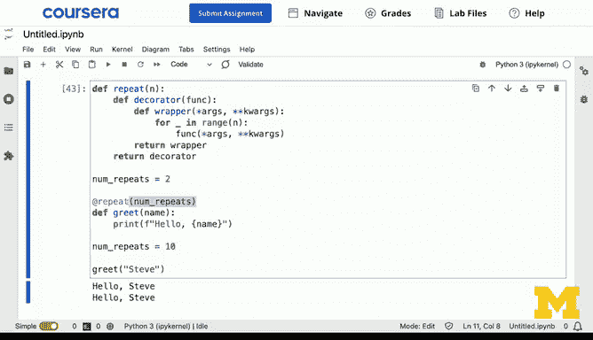

# 课程3、4、5：Python 3编程 - P96：39_04_05_带参数的装饰器 🎛️


在本节课中，我们将要学习如何创建和使用带参数的装饰器。装饰器是Python中一个强大的功能，它允许我们修改或增强函数的行为。之前我们已经介绍了简单的装饰器，本节中我们来看看如何让装饰器接受额外的参数，从而使其功能更加灵活和通用。

## 概述

装饰器本质上是一个函数，它接受一个函数作为参数，并返回一个新的函数。到目前为止，我们编写的装饰器都是简单的，只接受一个参数——即要被包装或装饰的函数。然而，我们也可以编写接受额外参数的装饰器，这大大扩展了装饰器的应用场景。

## 一个简单的装饰器示例

首先，让我们回顾一个简单的装饰器。这个装饰器包装一个函数，并在实际调用该函数之前打印“calling wrapper”。

```python
def my_decorator(func):
    def wrapper():
        print("calling wrapper")
        func()
    return wrapper

@my_decorator
def greet():
    print("Hello")
```

当我们调用 `greet()` 时，它会先打印“calling wrapper”，然后打印“Hello”。

## 让装饰器重复调用函数

现在，假设我们想修改这个包装器，让它多次调用被装饰的函数。我们可以修改 `wrapper` 函数来实现这一点。

以下是修改后的代码，它会让函数被调用两次：

```python
def my_decorator(func):
    def wrapper():
        print("calling wrapper")
        func()
        func()  # 第二次调用
    return wrapper
```

如果我们把这个装饰器应用到一个打印“hello”和传入名字的函数上，那么每次调用 `greet` 时，它都会打印两次问候语。

## 引入循环以重复任意次数

为了让重复次数更通用，我们可以使用 `for` 循环。例如，我们可以让函数重复执行五次。

```python
def my_decorator(func):
    def wrapper():
        for _ in range(5):
            func()
    return wrapper
```

现在，当我们用 `@my_decorator` 装饰一个函数并调用它一次时，该函数实际上会被执行五次。

## 创建带参数的装饰器

但是，如果我们不想硬编码重复次数（比如固定的5次），而是希望能够在应用装饰器时指定任意重复次数，该怎么办呢？这时，我们就需要创建带参数的装饰器。

我们可以通过将之前的装饰器嵌套在另一个函数中来实现。外层函数接受一个参数（例如 `n`，代表重复次数），并返回内层的装饰器函数。

以下是实现带参数装饰器的步骤：

1.  定义一个外层函数（例如 `repeat`），它接受参数 `n`。
2.  在这个外层函数内部，定义我们之前的内层装饰器函数。
3.  在内层包装器函数中，使用 `for _ in range(n):` 来循环调用原函数。
4.  外层函数返回这个内层装饰器函数。

```python
def repeat(n):
    """这是一个带参数的装饰器工厂函数。"""
    def decorator(func):
        """这是实际的装饰器。"""
        def wrapper(*args, **kwargs):
            for _ in range(n):
                func(*args, **kwargs)
        return wrapper
    return decorator
```

## 如何使用带参数的装饰器

现在，我们可以像这样使用这个带参数的装饰器：

```python
@repeat(3)  # 指定重复3次
def greet(name):
    print(f"Hello {name}")

# 调用函数
greet("Steve")
```

执行以上代码，将会输出：
```
Hello Steve
Hello Steve
Hello Steve
```

我们也可以使用变量来指定重复次数：

```python
num_repeats = 5

@repeat(num_repeats)
def greet(name):
    print(f"Hello {name}")

greet("Alice")  # 会打印5次 "Hello Alice"
```

**需要注意的一点是**：装饰器在函数定义时就被应用了。这意味着，用于装饰器参数的变量值是在函数定义的那一刻被捕获的。即使之后这个变量的值发生了变化，也不会影响已经装饰好的函数的行为。

例如：
```python
num_repeats = 2

@repeat(num_repeats)
def greet(name):
    print(f"Hello {name}")

num_repeats = 10  # 重新赋值，但不会影响 greet 函数

greet("Bob")  # 仍然只会打印2次 "Hello Bob"
```

## 总结



本节课中我们一起学习了如何创建和使用带参数的装饰器。我们从一个简单的装饰器开始，逐步将其改进为可以接受参数、从而控制函数重复执行次数的更强大的装饰器。关键点在于，我们通过一个外层函数（装饰器工厂）来接收参数，并在这个工厂函数内部定义和返回实际的装饰器。这展示了Python装饰器的灵活性，使我们能够编写出可配置、可重用的代码来增强函数功能。