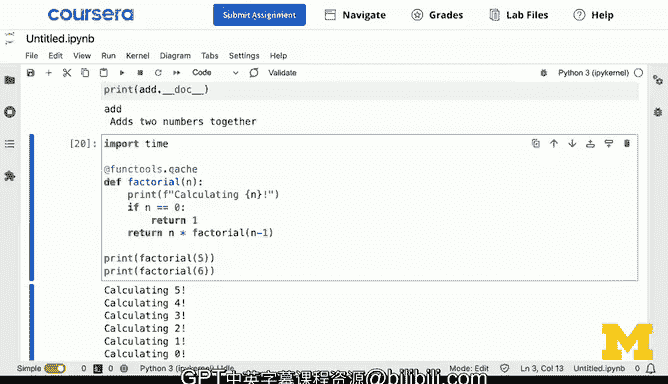

# 课程3：Python 3编程 - P97：40_04_06_functools模块内置装饰器 🧰


在本节课中，我们将学习Python标准库`functools`模块中两个非常实用的内置装饰器：`wraps`和`cache`。我们将了解它们如何帮助我们编写更健壮、更高效的代码。

## 概述 📋

Python包含许多内置装饰器，可用于我们的代码。虽然数量众多，无法全面覆盖，但我们将重点介绍`functools`模块中的一些示例。请注意，Runestone教科书目前尚未支持`functools`模块，因此我们将使用Jupyter Notebook来演示代码。

## 使用`@functools.wraps`保留元数据

上一节我们介绍了装饰器的基本概念，本节中我们来看看如何在使用装饰器时保留原始函数的元数据。

首先，我们从一个有助于编写自定义装饰器的示例开始。假设我们有一个名为`debug`的装饰器，它的功能是在每次调用函数时，打印出该函数被调用的信息及其参数。

```python
def debug(func):
    def wrapper(*args, **kwargs):
        print(f"调用函数 {func.__name__}，参数: {args}, 关键字参数: {kwargs}")
        return func(*args, **kwargs)
    return wrapper

@debug
def add(a, b):
    return a + b

print(add(1, 2))
# 输出: 调用函数 add，参数: (1, 2), 关键字参数: {}
# 输出: 3
```

现在，如果我们尝试打印函数本身的信息，可能会发现一个问题。

```python
# 不使用装饰器时
def add(a, b):
    """将两个数字相加。"""
    return a + b
print(add)          # 输出: <function add at 0x...>
print(add.__doc__)  # 输出: 将两个数字相加。
print(add.__name__) # 输出: add

# 使用装饰器后
@debug
def add(a, b):
    """将两个数字相加。"""
    return a + b
print(add)          # 输出: <function debug.<locals>.wrapper at 0x...>
print(add.__doc__)  # 输出: None
print(add.__name__) # 输出: wrapper
```

可以看到，默认使用装饰器会“丢失”原始函数的名称、文档字符串等元数据。这可能会给调试和使用帮助文档带来不便。

为了解决这个问题，我们可以使用`functools`模块中的`wraps`装饰器。以下是它的使用方法：

```python
import functools

def debug(func):
    @functools.wraps(func)  # 使用 wraps 装饰器
    def wrapper(*args, **kwargs):
        print(f"调用函数 {func.__name__}，参数: {args}, 关键字参数: {kwargs}")
        return func(*args, **kwargs)
    return wrapper

@debug
def add(a, b):
    """将两个数字相加。"""
    return a + b

print(add.__name__) # 输出: add
print(add.__doc__)  # 输出: 将两个数字相加。
```

`@functools.wraps(func)`装饰器的作用是，将原始函数`func`的元数据（如名称、文档字符串等）复制到包装函数`wrapper`上。因此，在定义自己的包装函数时，使用`functools.wraps`是一个好的实践，它能确保用户使用你的装饰器时，原始函数的元信息得以保留。

## 使用`@functools.cache`进行函数结果缓存

了解了如何保留函数元数据后，我们来看看另一个能提升程序性能的装饰器：`cache`。

假设我们有一个执行计算密集型任务的函数，例如模拟需要3秒才能完成的计算。

```python
import time

def expensive_computation(n):
    """模拟一个耗时的计算。"""
    time.sleep(3)  # 模拟耗时3秒的计算
    return n ** 2

# 多次用相同参数调用此函数
print(expensive_computation(3))  # 等待3秒后输出 9
print(expensive_computation(3))  # 再次等待3秒后输出 9
print(expensive_computation(3))  # 又一次等待3秒后输出 9
```

每次调用`expensive_computation(3)`都需要等待3秒。如果我们能记住（或缓存）第一次调用参数`3`时的结果`9`，那么后续相同的调用就可以直接返回结果，而无需重新计算。

`functools.cache`装饰器正是为此而生。以下是它的应用：

```python
import functools
import time

@functools.cache  # 使用 cache 装饰器
def expensive_computation(n):
    time.sleep(3)
    return n ** 2

print(expensive_computation(3))  # 第一次调用，等待3秒后输出 9
print(expensive_computation(3))  # 第二次调用，立即输出 9 (使用了缓存)
print(expensive_computation(3))  # 第三次调用，立即输出 9 (使用了缓存)
```

`@functools.cache`装饰器会缓存（记住）函数在特定参数下的返回值。当使用相同参数再次调用时，它会直接返回缓存的结果，而无需重新执行函数体。

另一个经典的例子是计算阶乘的函数。以下是阶乘的递归定义：

**公式：**
- `0! = 1`
- `n! = n * (n-1)!` (当 n > 0 时)

```python
def factorial(n):
    """计算 n 的阶乘。"""
    print(f"正在计算 {n} 的阶乘")
    if n == 0:
        return 1
    return n * factorial(n - 1)

print(factorial(6))
print(factorial(5))
```

运行上述代码会发现，计算`factorial(6)`时，会依次计算`6!, 5!, 4!, 3!, 2!, 1!, 0!`。随后计算`factorial(5)`时，又会重新计算`5!, 4!, 3!, 2!, 1!, 0!`，存在大量重复计算。

使用`@functools.cache`可以避免这种重复：

```python
import functools

@functools.cache
def factorial(n):
    print(f"正在计算 {n} 的阶乘")
    if n == 0:
        return 1
    return n * factorial(n - 1)

print(factorial(6))  # 首次计算6的阶乘，会打印出计算6,5,4,3,2,1,0的过程
print(factorial(5))  # 再次计算5的阶乘，由于5!的结果已在缓存中，直接返回，不会打印过程
```

当计算`factorial(6)`后，`factorial(5)`、`factorial(4)`等中间结果都被缓存。因此，后续调用`factorial(5)`时，函数会直接返回缓存的结果，而无需再次进行递归计算，极大地提升了效率。

## 总结 🎯

本节课中我们一起学习了`functools`模块中两个重要的内置装饰器：
1.  **`@functools.wraps`**：在编写自定义装饰器时使用，用于保留被装饰函数的元数据（如`__name__`和`__doc__`），这是良好的编程实践。
2.  **`@functools.cache`**：用于缓存函数的调用结果。当使用相同参数多次调用一个计算成本较高的函数时，它可以避免重复计算，显著提高程序性能，尤其适用于递归函数或计算密集型函数。



Python中还有许多其他内置装饰器，分布在`functools`及其他模块中。你可以通过查阅Python官方文档来探索更多功能。