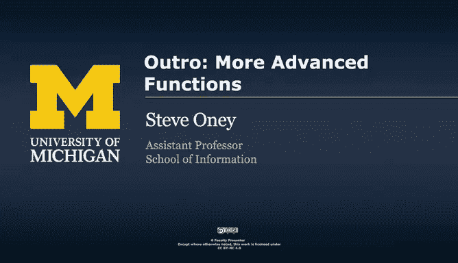

# 密歇根大学《Python3编程》课程3、4、5｜P98：41_04_07_结语：高级函数进阶 🎓

## 概述

在本节课中，我们将要学习Python中与函数和类相关的更高级主题。我们将重点讨论如何通过编写清晰的代码以及使用文档字符串和类型提示来提升代码的可读性与可维护性。

## 课程内容

上一节我们介绍了函数和类的基础知识，本节中我们来看看如何通过一些高级实践来优化我们的代码。

### 文档字符串与代码清晰度

我们讨论了文档字符串（doc strings）。然而，编写清晰、易于理解的代码本身就是最好的文档。尽管如此，添加诸如文档字符串甚至类型提示（type hints）等元素，可以额外提升代码的可读性和可维护性。

以下是关于代码文档化的核心观点：
*   最根本的文档是编写清晰的代码。
*   文档字符串可以为函数、模块或类提供说明。
*   类型提示可以明确指定函数参数和返回值的预期类型。

### 关于文档与类型提示的讨论

我个人非常推崇良好的文档和类型提示。现在，有些人并不同意我的观点，他们认为为此付出的努力并不值得。我通常会避免参与这类争论，因为我个人非常看重能够明确指定函数参数类型所带来的好处。

## 总结

本节课中我们一起学习了Python高级函数的相关概念。我们认识到，虽然清晰的代码是基础，但合理地使用文档字符串和类型提示能显著提升代码质量。不同的开发者对此可能有不同看法，但选择适合自己项目的文档化策略非常重要。

下次再见。