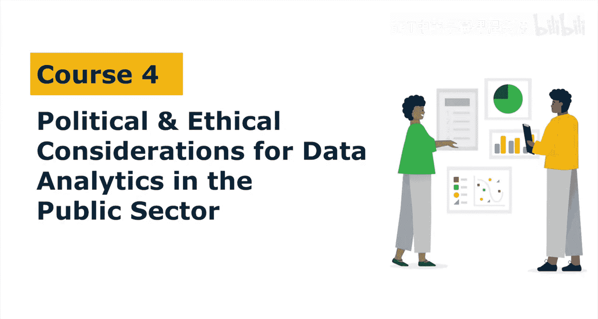
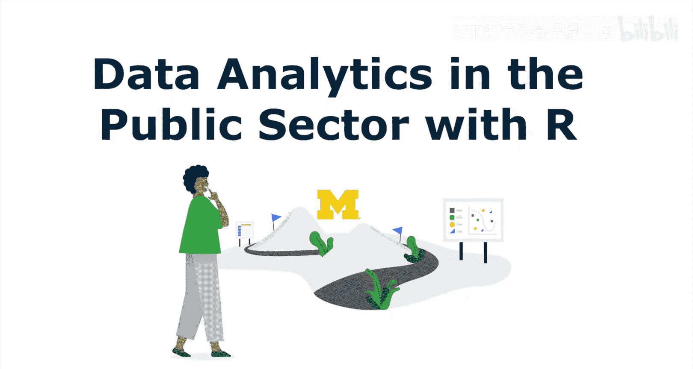
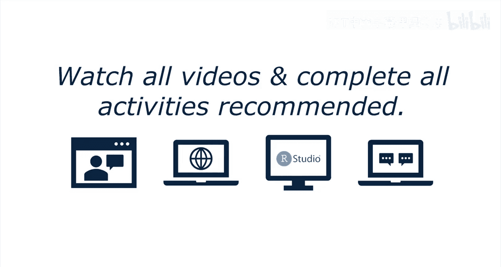
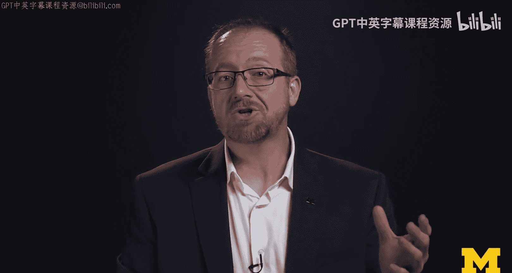
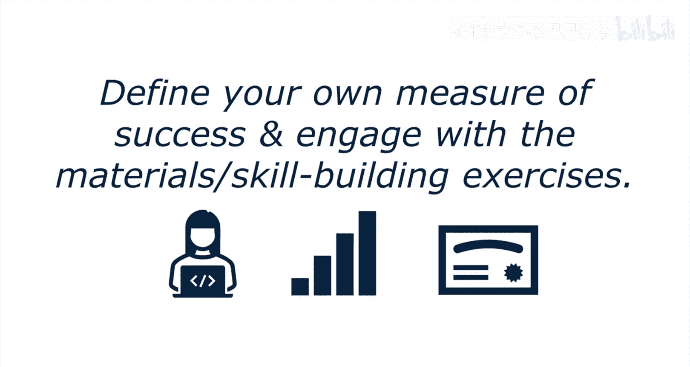
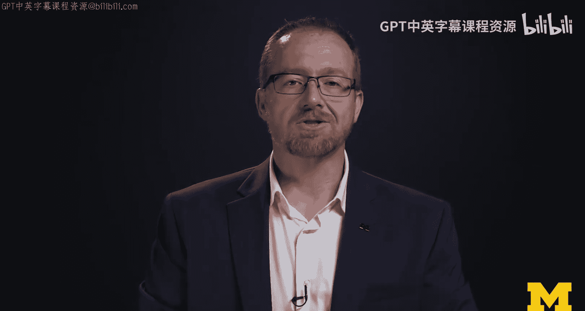

# 公共部门的R数据分析：P01：欢迎辞与课程概述 🎉

在本节课中，我们将学习密歇根大学《公共部门的R数据分析》证书课程的欢迎辞与整体介绍。课程将阐述数据分析在公共部门中的核心作用，并概述整个系列课程的结构与学习目标。

世界上有近200个国家，数千个州、省和地区政府，以及数十万个地方政府。每一个政府单位都需要数据和信息来完成其行政和立法工作，以分配资源和做出决策。数据的作用，以及能够收集、分析和沟通数据的专业人才的需求，对公共部门的工作至关重要。

本证书课程专为当前和未来的公共部门专业人士设计，他们的任务是收集、解释和共享数据，以用于公共行政和公共政策制定。

## 课程结构

该证书包含四门课程，每门课程都旨在帮助学习者掌握分析和技术技能，并了解如何在公共部门工作中应用这些技能。

以下是四门课程的具体内容：

1.  **使用R进行公共部门数据分析基础**
2.  **使用GGplot进行公共管理的探索性数据分析**
3.  **利用数据与政策分析辅助公共部门决策者**
4.  **公共部门数据分析的政治与伦理考量**

每门课程都将帮助你使用R构建数据分析技能，同时加深你对公共部门如何运作的理解，认识到高质量的数据分析对于政府功能和目标实现至关重要。

## 讲师介绍

我是克里斯·布鲁克斯，我是保拉·兰斯。我们在此向你介绍《公共部门的R数据分析》证书课程，并担任你的讲师。我们很高兴共同设计了这四门课程，并非常荣幸能在此次学习体验中担任你的导师。

让我们进一步介绍一下自己。

我是密歇根大学信息学院的教员。我很荣幸在Coursera平台上为数以万计的学生教授数据科学课程。在那些课程中，我主要关注Python生态系统中的数据科学，但在这门课程中，我很高兴向你介绍精彩的R语言世界。

我是密歇根大学公共政策与健康管理与政策专业的教授。我教授的课程包括公共政策基础、项目与政策评估的研究方法，以及公共卫生与社会政策。我的学术背景是社会人口学、流行病学和健康政策。在成为我热爱的“书呆子”教授之前，我曾在一个县级少年法庭系统担任政策分析师，并在一个州卫生部门担任流行病学家和政策分析师。在我的研究中，我专注于理解和解决健康方面的社会不平等问题，经常与美国联邦政府以及州和地方政府合作，主要是与他们的健康和社会福利服务部门合作。我非常高兴能成为这个系列课程的一部分，并为你提供数据分析在公共部门中重要作用的基础背景知识。

你将主要与我和布鲁克斯教授一起学习，但在学习过程中，我们还将邀请许多其他专家加入，他们渴望与你分享他们的知识和经验。

## 成功学习指南

我们真心希望你拥有愉快、有价值且成功的学习体验。那么，你该如何做到呢？

首先，本证书课程建立在你已有的一些知识和技能之上。我们假设你已经具备一些处理数据的基本技能（可能通过电子表格），并且至少接触过编程（尽管可能还不是R语言）。我们还假设你接触过一些入门级的统计学知识。

除此之外，如果你能采取动手实践和探索性的方法来学习课程内容，你将能在这门课程中取得最大的成功。我们努力使这一点变得容易：你不仅可以看到展示R代码的视频和笔记，我们还直接将RStudio平台嵌入到课程中供你使用，因此你无需在自己的计算机上安装任何软件。

我们不假设你之前有任何在公共部门工作的经验，或任何公共行政或公共政策方面的知识。

为了在这一系列课程中取得成功，你真正需要做的主要事情包括：

*   **保持参与**：尝试建立一个适合你生活节奏的学习进度。
*   **完成所有内容**：观看所有视频，并完成所有推荐以及要求的学习活动。这主要涉及使用RStudio实际进行数据分析，但也包括其他类型的应用技能构建活动。
*   **保持好奇与热情**：要知道，你正在以一种可能为你带来新工作机会的方式投资自己，并且是在全球经济中一个非常庞大的领域。
*   **定义个人成功标准**：最重要的是，确保定义你自己的个人成功衡量标准，并投入到我们提供的材料和技能构建练习中。

## 课程目标与总结

我们希望你能坚持完成所有四门课程。到课程结束时，你将掌握入门级R课程所涵盖的技能，以及公共行政和公共政策入门课程所涵盖的基础知识。这包括贯穿整个系列的一个重要主题：虽然高质量的数据和客观的数据分析对公共部门的工作至关重要，但数据本身永远不会告诉决策者该做什么，因为这不可避免地涉及相互竞争的价值观、伦理考量和政治因素。

让我们开始吧。我们期待与你共度时光，并在学习过程中保持你的兴趣和参与度。我们希望你会发现我们的共同工作有趣、富有挑战性、有价值，并且最重要的是充满乐趣。

我们很快将在第一门课程《公共部门数据分析基础》中与你见面。该课程将涵盖公共行政的核心职能、调查与人口数据的基础知识，以及如何使用R编程语言清理数据和回答问题。