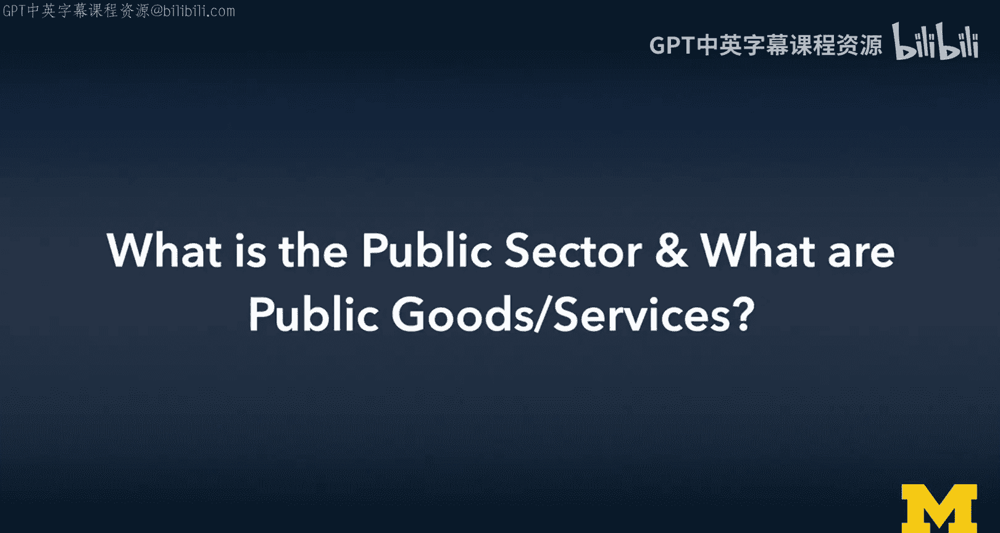
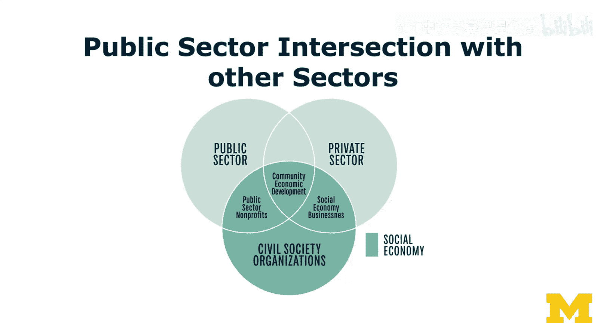
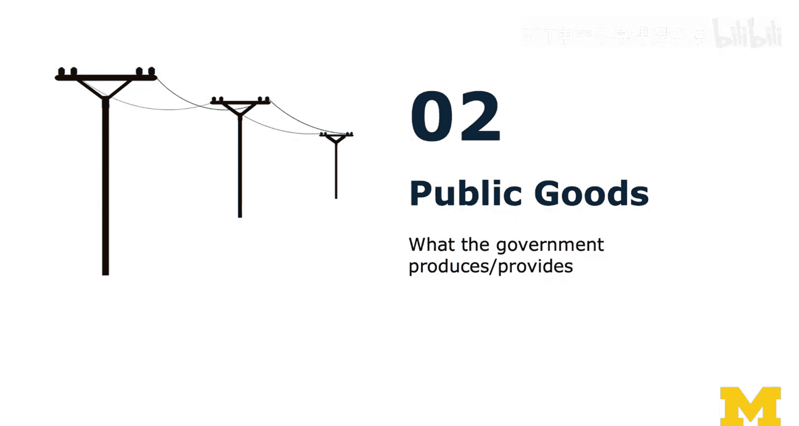
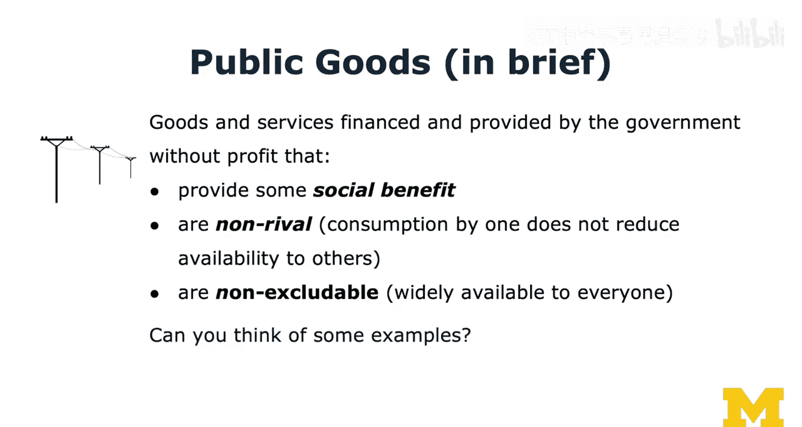
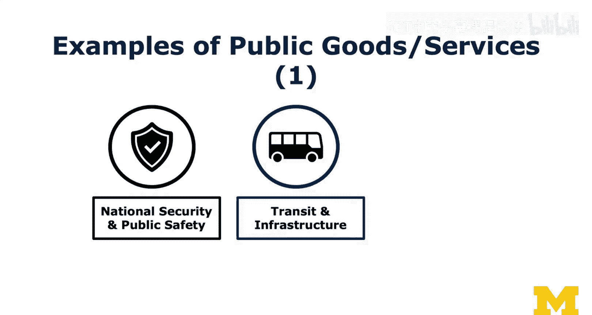
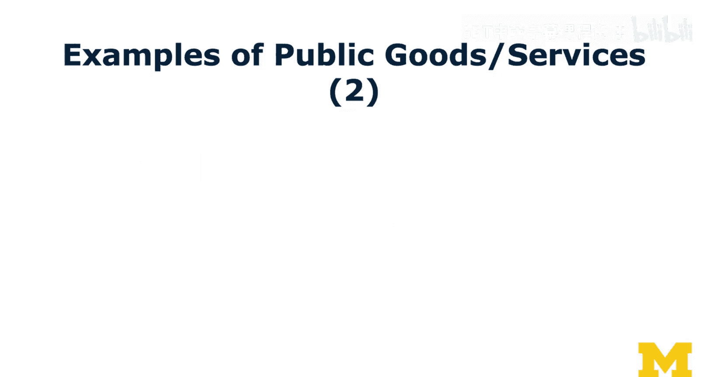
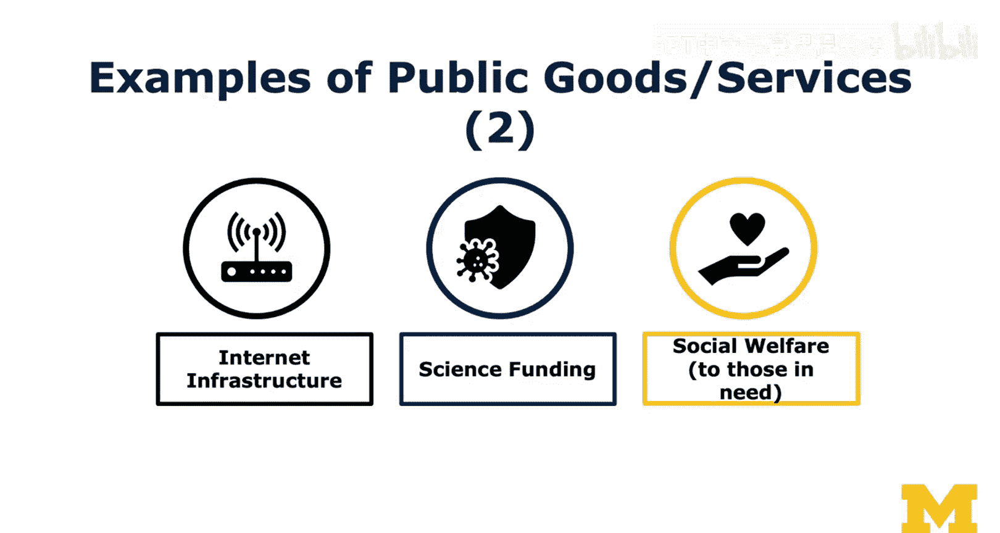

# 公共部门R数据分析：1：公共部门定义与公共产品-服务解析 📚

在本节课中，我们将要学习公共部门数据分析的基础背景知识。在深入探讨具体的数据分析技术和应用之前，我们需要首先明确一些核心术语和概念。本节将重点定义四个关键术语：公共部门、公共产品与服务、公共行政以及公共政策。

## 公共部门的定义 🏛️

首先，什么是公共部门？公共部门是指政府行动和活动的主要活动及其后果，这些活动主要与政府提供公共产品和服务相关。

我们通常认为单个国家乃至全球的经济体包含三个主要部门：
1.  **私营部门**：以营利为目的的商业活动。
2.  **非营利部门**：不以营利为目的的商业和组织，例如慈善机构、教会、非政府组织、倡导团体、非营利大学等。
3.  **公共部门**：即政府。公共部门是政府在经济中的行动及其后果，包括提供公共产品（如道路、电网、桥梁、公园）和公共服务（如邮件递送、垃圾收集、教育、各类许可证）。

在服务方面，政府还为其他部门（包括私营部门的经济市场）的活动提供法规或规则。

实际上，这三个部门存在重叠，并非完全独立运作。经济中存在一些重要的公私合作伙伴关系，以及私营、公共和非营利部门共同协作生产产品和服务的领域。然而，就我们的主要目的而言，经济中确实存在三个主要部门，而公共部门特指由政府生产的部分。

## 公共产品与服务 🛡️

接下来，什么是公共产品？广义上，我们讨论的是“公共利益”或政府提供服务的使命。政府提供产品和服务，也提供保护，这些是其他两个部门（私营部门和非营利部门）不愿意、无法提供，或者若由市场提供会导致严重社会公平问题的。

此外，经济学中有一个非常具体的术语叫做“公共产品”。其定义是：由政府非营利性地资助和提供的、能带来社会效益的产品和服务。它们具有两个核心特性：
*   **非竞争性**：一个人消费该产品或服务不会减少另一个人对其的可用性。
*   **非排他性**：它们广泛地对所有人可用。

以下是公共产品的一些例子：
*   **国家安全**：政府保护人民免受外部威胁。
*   **公共安全**：保护人民免受本地或国内威胁。
*   **公共交通、运输和基础设施**：如能源基础设施、道路、桥梁、隧道、水坝等。
*   **空气、水和其他环境保护**。
*   **公共卫生保护**。
*   **互联网基础设施**：需要说明的是，作为公共产品，重点在于基础设施本身，而非实际服务。例如，政府提供的是让人们能够接入互联网的基础设施，而大多数人为实际的互联网服务付费。
*   **政府对科学研究的资助**。
*   **面向需要者的社会福利产品和服务**：如收入支持、食品、住房和医疗保健。

## 公共行政与公共政策 ⚙️

上一节我们介绍了公共产品，本节中我们来看看公共行政。从根本上说，公共行政是运营政府的业务。

总结来说，本节课我们一起学习了公共部门数据分析的基本概念框架。我们明确了公共部门是指政府提供产品和服务（包括公共产品）的活动领域；公共产品具有非竞争性和非排他性；而公共行政则是政府运作的核心。理解这些基础概念，是后续运用R语言进行公共部门数据分析的重要前提。