# 公共部门的R数据分析：P03：数据科学与数据分析导论 📊

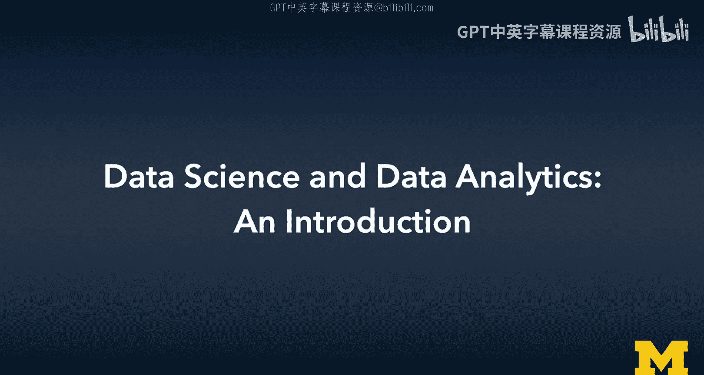

在本节课中，我们将要学习数据科学与数据分析如何应用于公共行政与政策领域。课程将避免复杂的数学形式化概念，重点在于如何通过R编程语言实际执行调查和分析公共数据。

## 概述：从探索性数据分析说起

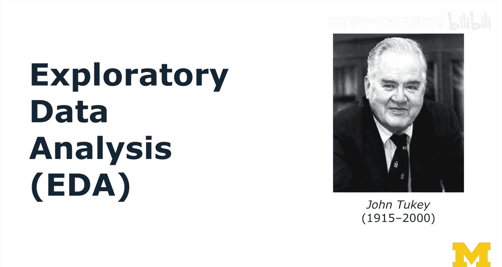

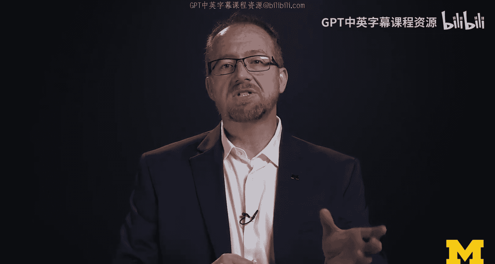

我们将要进行的许多工作被称为**探索性数据分析**，简称**EDA**。这个术语源自约翰·图基1977年关于此主题的著作。图基是一位在统计建模和检验方面有影响力的统计学家，但他认为统计学界过于强调假设检验。因此，他创造了“探索性数据分析”这个短语，来概括数据分析师用于更好地理解和洞察数据的一系列技术。

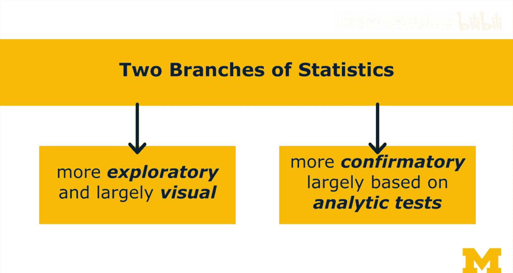

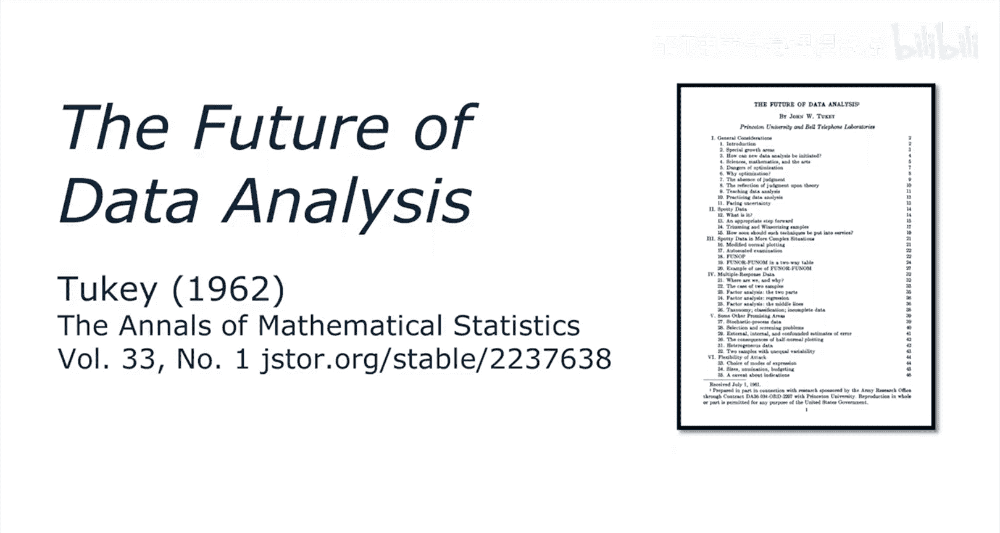

通过这项工作，图基表明他认为统计学实际上有两个分支：一个是更具探索性、主要以可视化为主的分支；另一个则是更具验证性、主要基于假设检验的分支。

## 图基的贡献与数据思维的转变

图基的工作对本课程至关重要，我们将花大量时间探讨在R中应用EDA的不同方法。实际上，图基代表了一种数据思维的转变。早在1961年，他发表了一篇关于数据分析未来的论文，在开篇第一句就质疑自己是否真的是一名统计学家，并将我们引向“数据分析”的实践。

他将数据分析定义为：分析数据的流程、解释这些流程结果的技术、规划数据收集以使其分析更简单、更精确或更准确的方法，以及所有适用于分析数据的数理统计机制与结果。

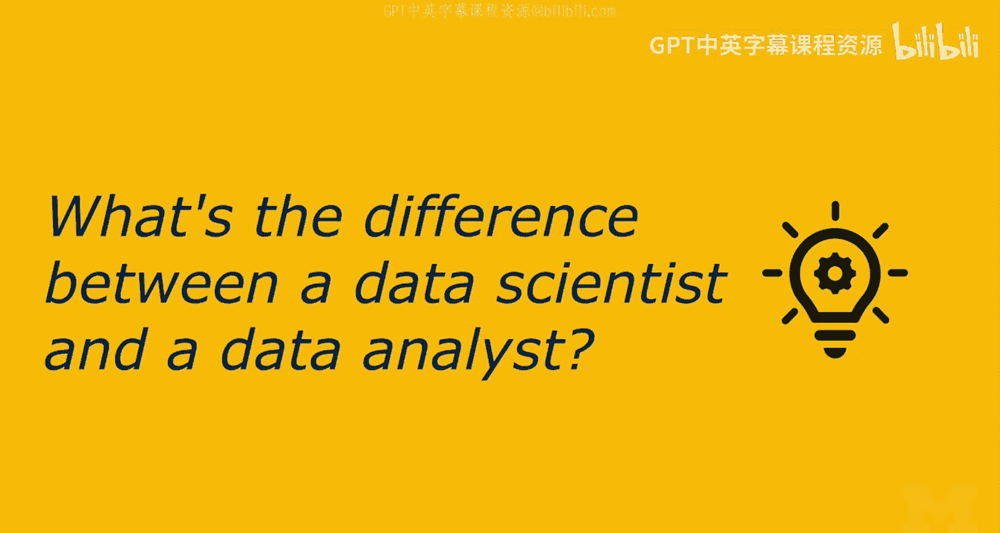

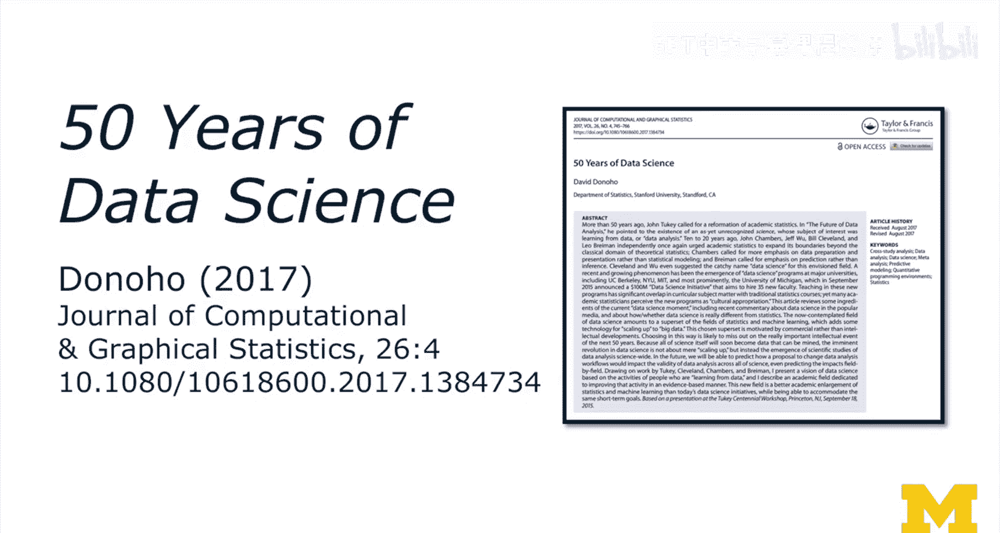

正是这一点，将本课程与其他教授R语言的课程区分开来。虽然有许多课程介绍如何使用R进行统计学学习，但我们将**在公共政策的背景下**进行学习，其真正目标是帮助你成为一名**由R驱动的数据分析师**。

## 数据科学家与数据分析师的区别

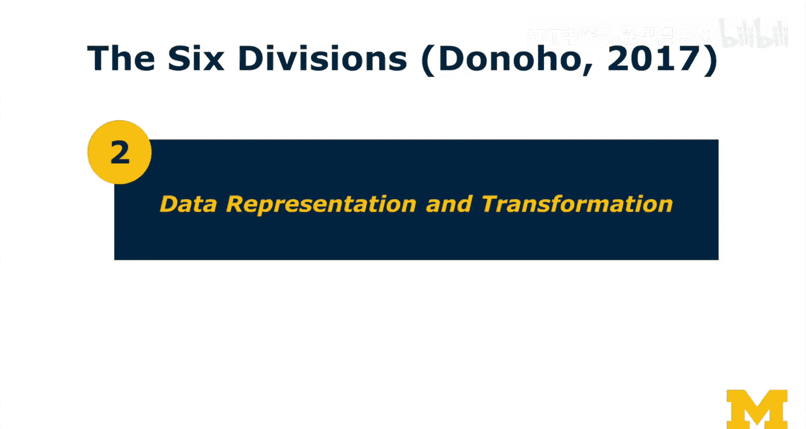

我经常被问到：数据科学家和数据分析师有什么区别？这其实并不那么清晰。如果我们快进到2015年，可以看到大卫·多诺霍在图基百年诞辰研讨会上发表的演讲，他后来将其发表为《数据科学的50年》。在演讲中，多诺霍认为该领域正沿着图基指出的方向持续发展，并列举了包括约翰·钱伯斯和比尔·克利夫兰在内的其他有影响力的应用统计学家，他们帮助引入了各种其他探索性数据分析方法。

基于此，多诺霍提出，数据科学实际上由六种不同的活动组成。

以下是这六种核心活动：

1.  **数据收集、准备与探索**：无论是清洗数据、将数据与代码簿对齐，还是进行可视化探索，这一类别可能占据了数据科学家80%的时间和活动。在本系列课程中，我们将花大量时间学习能让你快速有效理解数据的工具和技术。

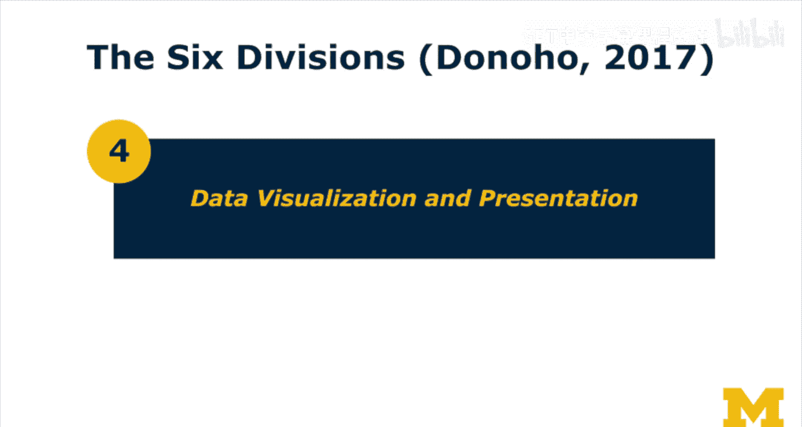

2.  **数据表示与转换**：这包括数据库等计算格式，以及数学表示形式。在本课程中，我们将主要使用一种非常具体且如今几乎无处不在的数据表示格式，称为**数据框**，并且这一切都将在R中完成。数据科学家还使用许多其他类型的数据表示，例如用于建模社会关系的图、树和网络，以及用于建模文本数据的嵌入和向量空间。不过，大多数公共行政和政策数据都位于关系型或表格数据中，例如CSV文件，因此本系列将重点讨论这些。

3.  **数据计算**：在这一类别中，多诺霍首先提出，我们作为数据科学家应努力成为“多语言者”，学习多种计算机语言来处理数据。本课程将特别只关注一种语言，但我强烈建议，如果你有时间，可以考虑学习其他语言和工具，因为每种语言都有其自身的优势和机会。

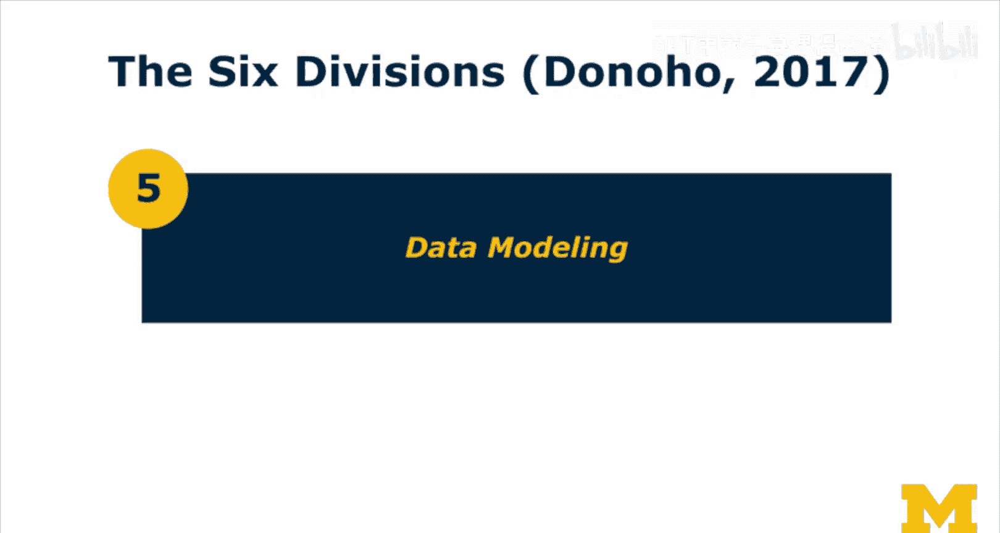

4.  **数据可视化与呈现**：这一类别与探索类别有所重叠，但更侧重于可视化的机制以及向读者传达信息。我们将在此探讨许多关于如何制作引人注目且有意义的可视化图表的话题。虽然我们无法全面讨论这个主题，但会简要介绍如何使用R创建仪表板，这是一个非常棒的功能，可以让你相对快速地从数据过渡到交互式可视化。

5.  **数据建模**：这将是本课程仅会涉及的一个领域。数据建模是一个庞大的主题，涵盖了从基本线性回归到深度神经网络、大数据方法以及整个机器学习领域的广度。深入研究这一领域需要投入传统的推断统计学内容或机器学习算法与方法。然而，通过应用机器学习来专注于数据建模应用的机会越来越多。

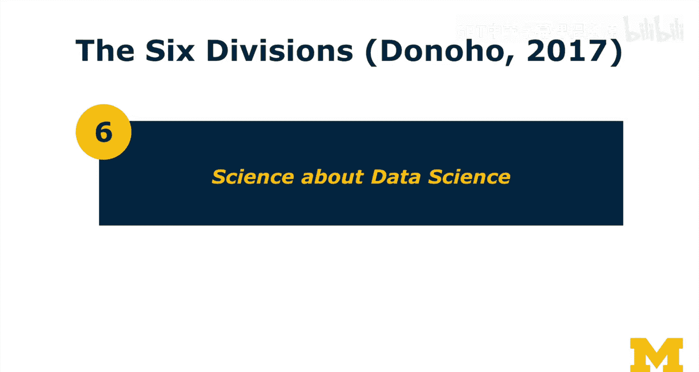

6.  **关于数据科学的科学**：多诺霍呼吁像我这样使用和教授数据科学的学者，去理解实际应用中的实践，研究如何让人们更好地进行数据科学，并将我们的学术研究转向我们所教授的这些实践。这本身不是本课程要讨论的内容，但我希望你能感受到我在这方面工作的影响。我在密歇根大学的研究专注于学习分析，即使用数据科学方法来理解和优化学习。教授多样化的数据科学课程，无论是在大学里还是像这样的慕课中，都是我理解和开展学术研究的绝佳平台。

## 总结

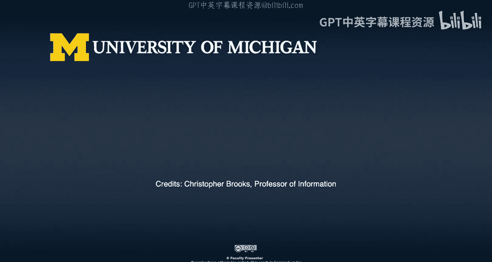

本节课中我们一起学习了数据科学与数据分析的导论。我们快速概述了数据分析与数据科学的领域，了解了探索性数据分析的起源及其重要性，并区分了数据科学家所从事的六类核心活动。我们将以非常应用化的方式，使用真实世界的数据集、示例和问题，在R语言环境中来应对这些挑战。让我们开始深入学习吧。