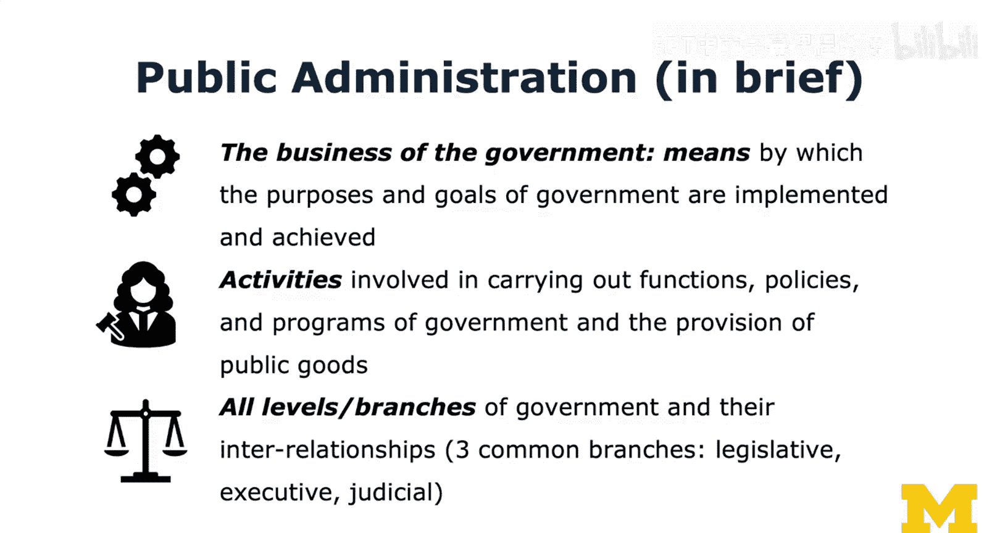
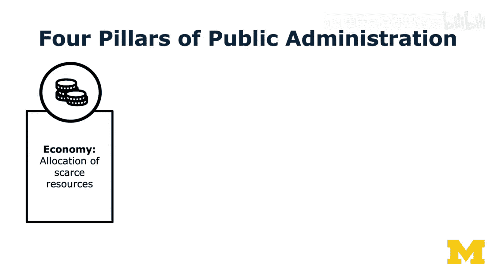
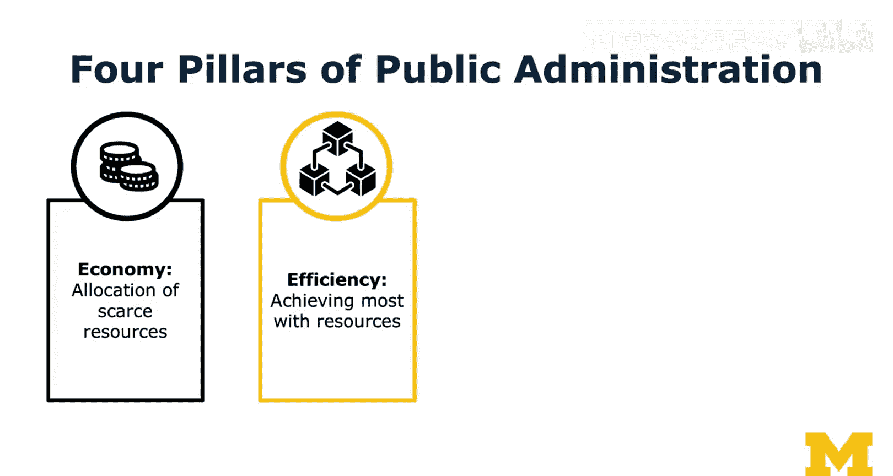
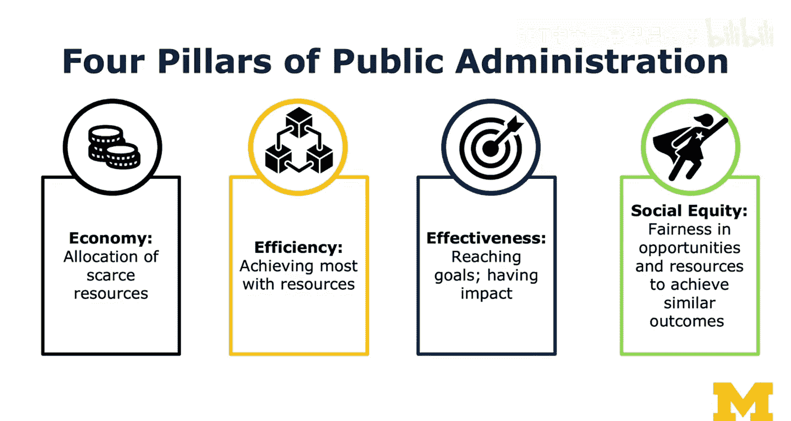
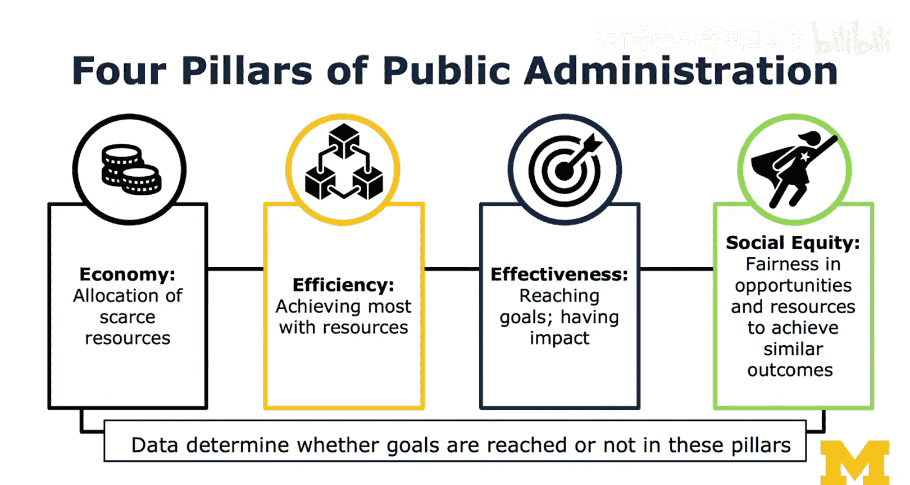
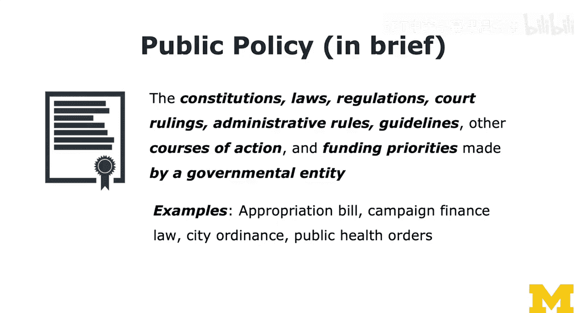
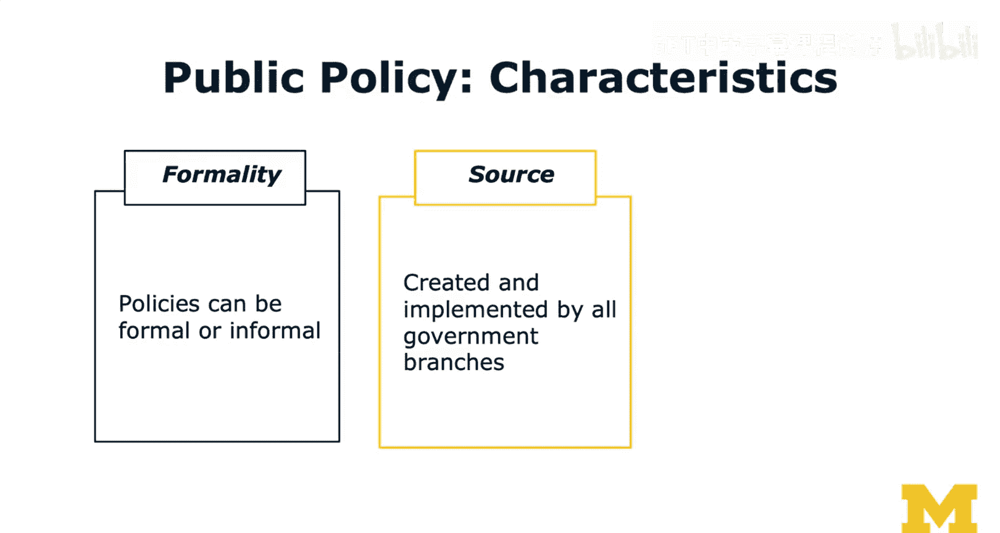
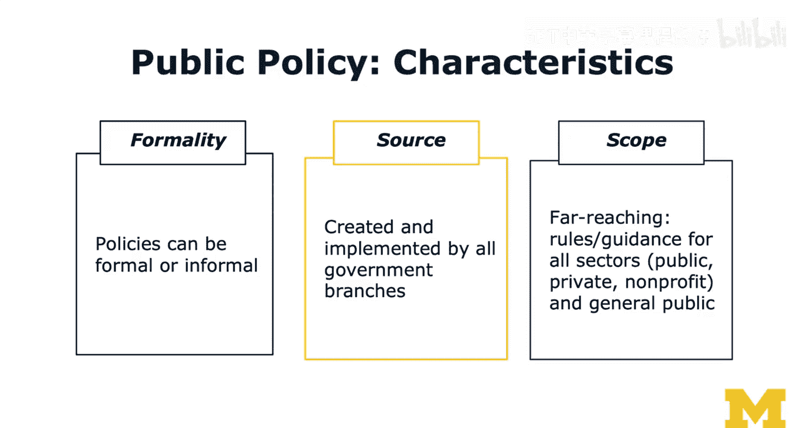
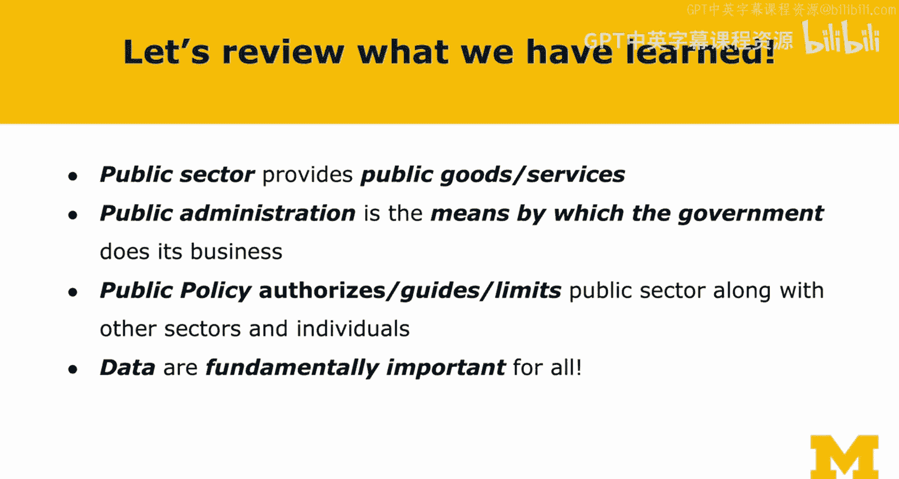

# 4：公共行政与公共政策内涵解析 📚

在本节课中，我们将要学习公共行政与公共政策这两个核心概念的定义、框架及其相互关系。理解这些概念是运用数据分析支持公共部门决策的基础。

## 公共行政的定义 🏛️

接下来我们要定义的是公共行政。从根本上说，公共行政是管理政府的业务。它是一个类似于工商管理的专业领域，但这里应用于公共部门所有活动的管理。这是一个领域内的宏大概念，但我们可以将其总结为：

> **公共行政**是**实现和达成政府目的与目标的工作和手段**，以及**执行政府职能、政策和项目，并提供公共产品所涉及的活动**。

我们倾向于认为公共行政主要是政府的行政部门。一般而言，世界上大多数民主国家的政府（这是目前最常见的政府形式）都分为三个分支：**立法分支**（制定法律和优先事项）、**行政或管理分支**（实施和执行法律与优先事项），以及**司法分支或法院系统**（执行和解释法律）。公共行政确实是政府行政或管理分支的核心。其他两个分支（立法和司法）的工作也需要行政管理，因此公共行政涉及政府所有层级和分支的工作及其相互关系。

## 公共行政的框架 📊

现在，我想介绍两个与公共行政相关的框架，我们将在整个学习过程中使用它们。随着课程的深入，我们将更详细地讨论它们。但现在，我只想向你们介绍一下。

第一个框架被称为**公共行政的四大支柱**，你可以将其视为公共行政的使命或主要目标。

以下是四大支柱的简要介绍：

1.  **经济性**：即如何最佳地利用和分配稀缺资源。虽然几乎所有人都认为税收太高，政府从人民和企业那里收取了太多钱，但同样的事实是，大多数政府没有足够的资金或其他资源来做所有他们需要和想做的事情。因此，公共行政的一部分就是弄清楚可以获取哪些资源，然后如何最佳地分配它们。
2.  **效率**：这与经济性支柱相关，意味着公共管理者必须弄清楚哪些行动能针对特定的资源投入实现最大的效益。目标是尽可能高效地利用资源，或以最少的投入实现最多的产出。
3.  **有效性**：资源的分配和投资也必须是有效的。它必须产生影响，必须有助于达成目标、减轻或缓解问题，或提供某种可衡量的效益。
4.  **公平性**：大多数政府在其宪法或法律设计中都高度重视社会公平。这意味着在向不同人群或社区提供机会、资源和福利时必须公平。

请注意，公平并不意味着资源、机会和结果的**平等或相同**。公平意味着在机会和资源方面提供**公平性**。这通常涉及根据社会中可能存在的特定需求、能力、偏见和歧视，提供不同程度的额外援助和支持。

公共行政的这四大支柱都依赖于数据。数据收集和分析对于实现这四大支柱至关重要。

## 公共行政的核心职能 ⚙️

今天我想介绍的第二个公共行政概念模型，侧重于公共行政做什么，或称为**公共行政的核心职能**。

随着课程的推进，我们将更详细地讨论所有这些职能。但今天，这里只是快速浏览一下公共行政七大核心职能的模型：

以下是七大核心职能：
*   **规划**
*   **组织**
*   **人事**
*   **指挥**
*   **预算**
*   **报告**
*   **协调**

所有这些职能都很重要，并且都严重依赖于信息、指标和复杂的数据分析。

## 公共政策的定义 📜

好的，我们的定义部分即将完成。我们要定义的第四个关键概念是**公共政策**。与公共行政一样，公共政策是其自身的研究和专业实践领域。

我们将在后续课程中更深入地探讨公共政策。今天，我将为你们提供一个非常简单的解释：公共政策是**宪法、法律、法规、法院裁决、行政规则、行政命令、指南、建议以及政府可能采取的其他行动方针**。并且，它的定义还可以包括**政府实体制定的资金优先事项**。

总而言之，它是各级政府（地方市或市政府、城市、区、教区等层级政府、州/省/地区级以及国家级）制定的规则和计划或确定的行动方针。此外，实际上还存在一些国际政策和国际法。

每个国家都有成千上万的公共政策例子。同样，我们稍后会更详细地讨论这一点。但现在，关于公共政策，我希望你们记住几件事，我们可以做出一些概括。

## 公共政策的特征 🔍

以下是关于公共政策的几个重要概括：

1.  **形式多样**：首先，公共政策在许多情况下可以是并且确实是非常正式的。它之所以正式，是因为它包括法律、法规、高等法院裁决等事物，如果人们不遵守，就会产生后果。但公共政策也可以是非正式的。它可以是政府制定的一系列指南，例如疫情期间推荐的口罩佩戴行为、教育或大众媒体宣传活动、专注于如何戒烟的社会营销活动、促进婴儿母乳喂养、就发短信和驾驶向公众发出警告等。即使你不遵守也不会产生后果的事情，仍然被认为是公共政策，它们是政府正在采取的特定行动方针和信息提供。
2.  **涉及所有政府分支**：第二个概括是，公共政策发生在政府的所有分支中。我们倾向于认为公共政策主要是立法者或法律制定者做的事情，这绝对是正确的。然而，政府的其他分支也制定公共政策。司法或法院系统通过解释法律和设定新的判例法先例的裁决来制定政策。虽然行政部门不制定法律，但它确实制定行政规则、法规、行政命令、新计划以及许多非正式政策，如指南、建议和信息宣传活动。因此，政府的所有分支、部门和层级都制定公共政策。
3.  **影响深远**：公共政策的第三个特征是它的影响非常广泛。公共政策影响经济的**所有三个部门**：它影响政府本身（公共部门），也影响非营利部门，当然还有私营部门。公共政策也对普通公众产生巨大影响。因此，公共政策非常强大，对世界上的每个人、家庭、组织、机构和企业都有影响。

## 总结与回顾 ✅

好了，让我们回顾一下刚刚定义的四个复杂且相互重叠的术语。

*   **公共部门**是经济中政府提供公共产品和服务的部分。
*   **公共行政**是政府开展其业务的手段，它有一套总体的支柱或原则，以及一套七个关键或核心职能。
*   **公共政策**授权、指导并限制公共部门以及其他部门和个人。
*   最后，也是最重要的部分，**数据**对于公共部门提供公共产品的工作、对于公共行政的职能、以及对于公共政策的设计、实施和评估都至关重要。

数据分析对于公共行政的支柱和职能、对于公共政策的设计和评估、以及对于公共产品都至关重要。

本节课中，我们一起学习了公共行政与公共政策的定义、核心框架（四大支柱与七大职能）及其基本特征。理解这些概念是后续运用R语言进行数据分析，以支持公共部门实现经济、效率、有效和公平目标的基础。