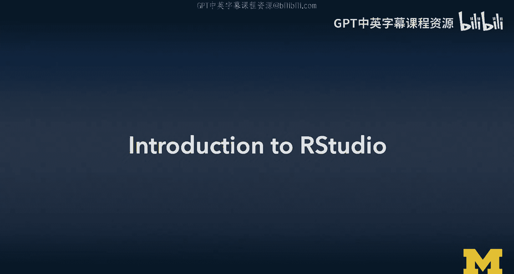
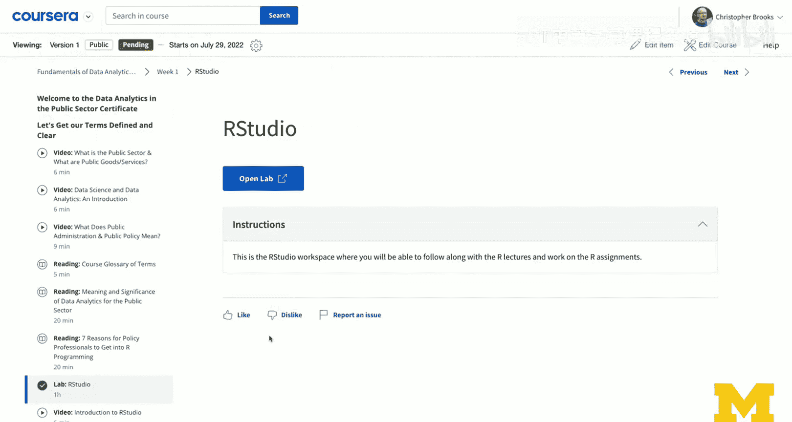
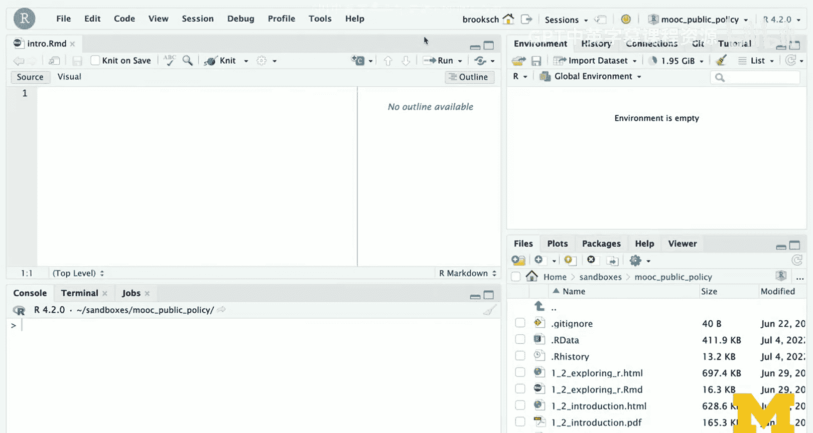
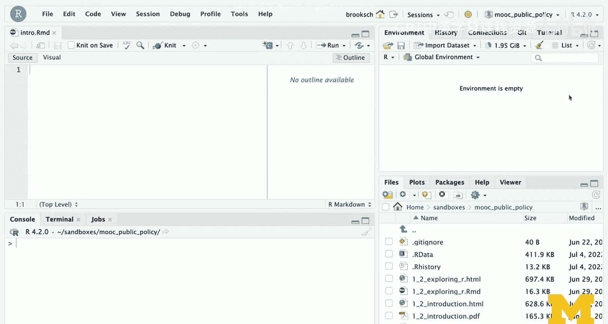
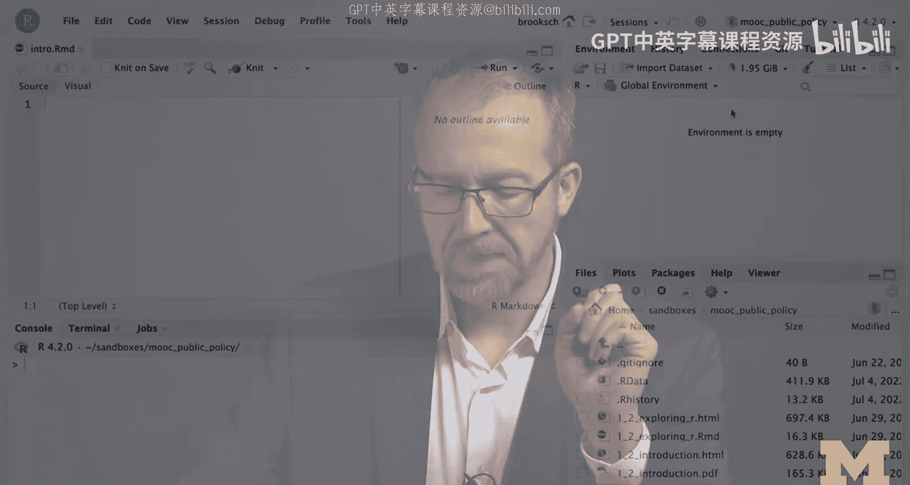
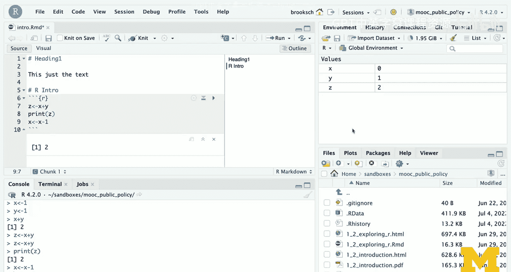
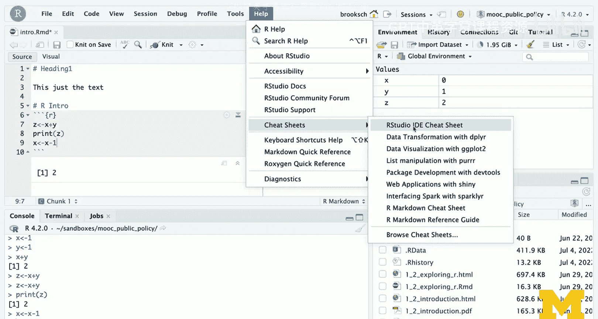
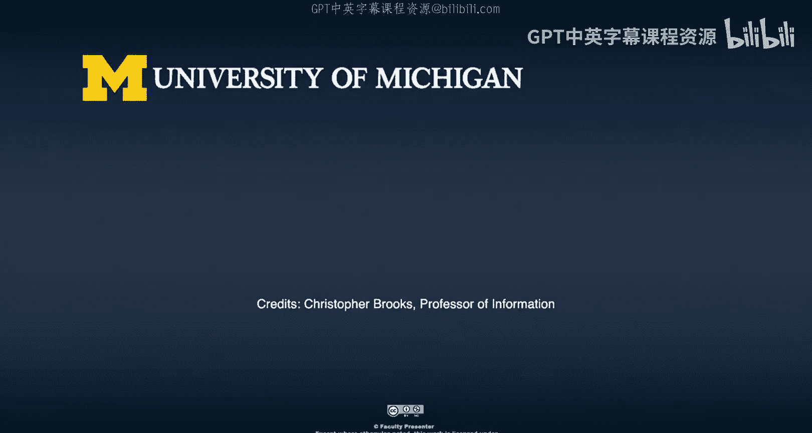

# 5：RStudio开发环境入门 🚀



在本节课中，我们将学习如何在Coursera平台上启动和使用RStudio。RStudio是我们进行大部分技术工作的主要环境，你可以在Coursera平台内免费使用它。我们将了解其界面布局、核心功能以及如何跟随课程进行学习和实验。

## 启动Coursera平台上的RStudio

你的系统界面左侧应显示课程周次，右侧是我们为你准备的各种内容，包括视频。向下滚动，你会看到一个名为“RStudio”并标记为“实验”的部分。点击此处，将弹出一个新的启动器屏幕，然后你可以打开该实验环境。




你可以在此环境中完成本课程的所有工作，包括跟随我的讲座、完成作业以及在基于Coursera的在线RStudio中探索R。我们已在课程中为你安装了必要的软件包，因此你可以直接启动并跟随学习。当然，你也可以选择在自己的电脑上下载RStudio和讲座材料进行学习。


## RStudio界面概览

RStudio界面主要分为四个窗格，我们将逐一介绍其功能。




### 源代码窗格

左上角是**源代码窗格**。这是你当前正在处理的文件所在区域。在本课程中，我的大部分工作以及讲座材料都将在此处显示。

### 控制台窗格






底部是**控制台窗格**。这是一个非常有用的工具，虽然我在讲座中不会频繁使用它，但我会稍作演示，并且你将有机会大量使用它。这是一个R解释器，你可以在此直接输入R命令进行交互式实验。

例如，你可以输入 `1 + 1` 并按回车，R会返回结果 `2`。你也可以进行变量赋值：
```r
x <- 1
y <- 1
x + y
```
每次输入命令并按回车后，R都会立即执行并给出结果。

### 环境窗格

右上角是**环境窗格**。这个窗格主要用于探索数据环境。例如，当你像上面那样创建了变量`x`和`y`后，它们就会显示在这个窗格中。我们将在后续讲座中详细介绍其用途。

### 文件/绘图/包窗格

右下角是**文件、绘图和包窗格**。默认情况下，它显示文件列表，你可以看到包含本课程所有讲座材料的Coursera文件系统。当我们开始绘图时，图形将在此处显示。此外，你还可以在此查看已安装的包列表、获取特定函数的帮助信息等。这是一个非常方便的区域，有时我可能会将其最小化，但在需要时它非常有用。

## 操作与导航

在文件窗格中，你可以点击任何以 `.Rmd` 结尾的R Markdown文件，它将被加载到源代码窗格中。例如，我加载了一个名为 `Intro.Rmd` 的文件，这是我今天准备的讲座内容之一。通过这种方式，你可以跟随讲座学习，并直接执行其中的代码。

在控制台中，你可以自由地试验R语言。这是一种交互式的学习方式。

在Coursera系统中，你还可以访问操作系统终端。这是一个控制台访问界面。不过，在本课程中我们完全不会使用它。如果你对探索其他包或了解系统工作原理感兴趣，可以在这里执行诸如列出系统文件等操作。如果不理解也不必担心。

## 使用R Markdown

在源代码窗格中，我们主要在 **R Markdown** 文件中编写内容。大部分内容是普通文本，但我们可以使用一些标记来添加结构。

例如，使用 `#` 可以创建标题。随着你添加标题，右侧会开始生成一个大纲，你可以通过点击这些标题进行导航。

你还可以通过点击“Visual”按钮，将文档渲染成HTML进行可视化查看，这有时会更方便。

### 代码块

当我们需要在R Markdown中插入可执行的R代码时，需要使用**代码块**。代码块以三个反引号开始，后跟 `{r}`，再以三个反引号结束。



在代码块内部，我们可以编写常规的R语句。例如：
```r
z <- x + y
print(z)
x <- x - 1
```
要运行代码块，你有几个选择：
*   要运行单行代码，可以将光标置于该行，然后按 `Ctrl + Enter`。
*   要运行整个代码块，可以点击代码块右上角的绿色播放按钮。

运行后，你可以在控制台看到输出结果，并且环境窗格中的变量也会相应更新。

## 实用资源：速查表

我想向你介绍RStudio中一个非常实用的功能。在顶部菜单栏中，点击“Help”，然后找到“Cheat Sheets”区域。


这些速查表是由我们将要使用的R包的创建者们制作的（RStudio本身也是由同一团队开发的）。点击任何一张速查表，它会在你的浏览器中打开一个PDF文件。

例如，这里有一份关于RStudio IDE本身的速查表，它会详细解释各个按钮的功能以及你输入时会看到的内容。你并不必须使用这些速查表，但它们制作得非常精良，我鼓励你去查阅。我也会在课程中提供一些供你下载，因为它们是非常棒的学习资源。

## 总结






本节课我们一起学习了RStudio开发环境的基础知识。我们了解了如何在Coursera平台上启动RStudio，熟悉了其四个主要窗格（源代码、控制台、环境、文件/绘图/包）的功能，并实践了在控制台进行交互式编程、在R Markdown中编写和运行代码块。最后，我们还介绍了获取官方速查表这一实用学习资源的途径。记住，你无需在本课程中安装任何软件，所有学习都可以在Coursera提供的RStudio环境中完成。你可以打开视频在另一个窗口，然后在此环境中跟随实验。在接下来的互动讲座中，我将逐步引导你更深入地使用这个环境。