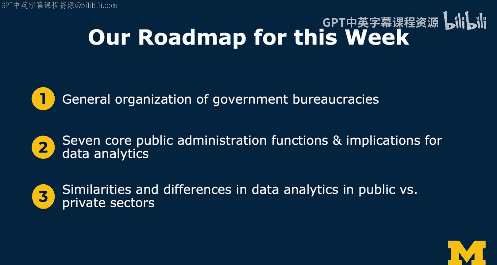
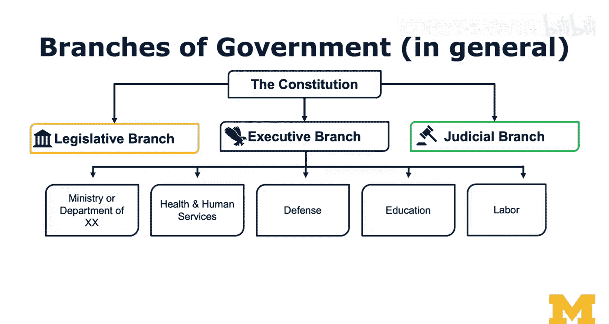

# 6：政府官僚机构组织架构 🏛️

在本节课中，我们将继续为理解数据分析在公共部门的重要作用奠定基础。我们将简要探讨政府通常是如何构建和组织的，即所谓的政府官僚机构。

## 概述

上一节我们讨论了数据分析在公共政策周期中的角色。本节中，我们来看看政府自身的组织结构。理解这一点，对于把握公共部门数据产生和使用的具体情境至关重要。

## 全球政府概览

首先，请思考一个问题：你认为世界上有多少个政府？这个问题实际上很难精确统计。

以下是关于政府数量的估算：
*   首先，世界上有 **195** 个主权国家或民族国家。
*   此外，还有一定数量的领土、联邦或其他与这些国家（通常通过殖民历史）相关联的地缘政治单位。
*   每一个国家内部又划分为次国家级单位，例如地区、省份、州等。全球一级次国家级政府单位的数量估计在 **3,600 到 5,200** 个之间。
*   最后是地方政府，其数量更加难以统计。仅在美国，估计就有近 **36,000** 个不同的地方政府（县、教区、市、镇等）。在巴西，估计有约 **5,000** 个自治市。在西班牙，该国划分为 **17** 个自治区和超过 **8,000** 个市镇。

因此，地球上确实存在着数以万计的地方政府。好消息是，它们都拥有需要被收集、组织、管理、分析和沟通的数据。

关于政府如何运作、如何组织、权力所在、公民角色以及其他许多政治议题，既有趣又重要，但也非常复杂，遗憾的是超出了本课程的范围。尽管如此，我们可以确信地说，每个政府，无论其类型如何，其不同分支及其组成部分都有一个组织结构。这个结构以官僚机构的形式运作。

官僚机构的定义是一个拥有多个下属单位和许多层级系统与流程的复杂组织。要理解数据分析在公共部门，特别是与公共行政和公共政策相关的角色，首先理解你自己政府的结构和组织方式非常重要。

这里的重点不是要求你能说出政府的每一个部委、机构、部门、办公室及其下属单位和所有联系，那会让人抓狂。重点在于获得对组织结构的一般性理解，以便你能理解所有不同但重要的、数据被收集、管理、分析和（希望）使用的地方。

## 国家政府结构

让我们从国家政府开始。国家政府通常以拥有不同分支的方式构建，而这些分支又包含多个下属单位。

例如，正如我们之前讨论过的，在大多数民主国家，政府有三个分支：
*   **立法分支**：分为不同部分，这些部分又进一步细分。
*   **司法分支**：分为不同层级的法院。
*   **行政分支**：这往往是最复杂的。

通常，政府的行政或执行分支分为部委、机构、部门或其他部门。这些机构在不同国家有不同的名称。但不同的部门通常专注于某个重要的公共事务领域。

以下是常见的政府部门示例：
*   卫生与公众服务
*   国防或国家安全
*   教育
*   劳工
*   商业
*   能源
*   环境
*   交通
*   财政
*   司法

这些下属单位也可以专注于跨越不同政策和公共议题的交叉性问题。这包括预算与财政、人力资源管理等方面。

## 总结

本节课中，我们一起学习了政府官僚机构的基本组织架构。我们了解到全球政府数量庞大且层级复杂，国家政府通常分为立法、司法和行政三大分支，其中行政分支又按职能划分为众多部委和机构。理解这个结构是理解公共部门数据来源和应用场景的基础。下一节，我们将深入探讨公共行政的七大核心职能，以及数据分析在每一项职能中扮演的角色。