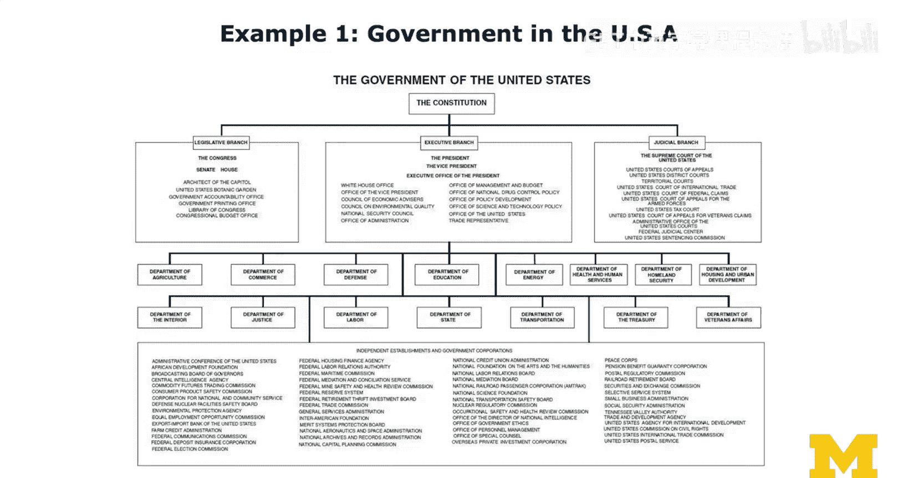
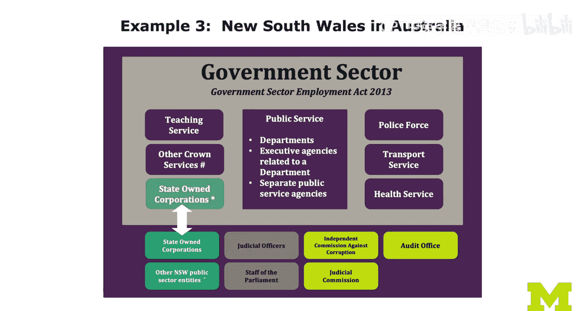
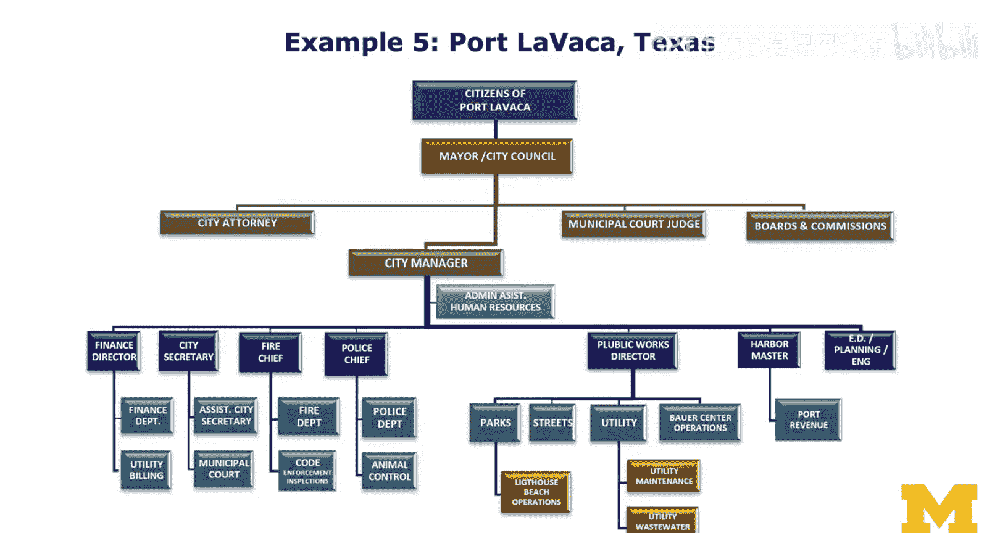
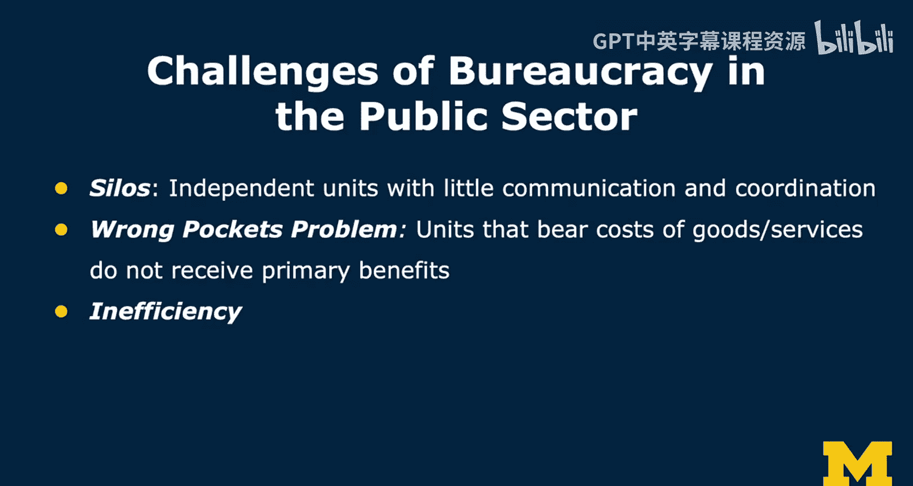
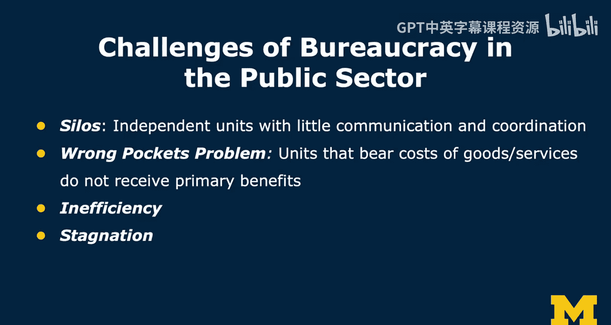

# 7：典型政府机构实例分析 🏛️

在本节课中，我们将通过分析几个典型的政府组织结构图，来理解公共部门官僚体系的复杂性及其对数据分析工作的影响。了解这些背景知识，对于在公共部门进行有效的数据分析至关重要。

## 政府组织结构的复杂性

上一节我们探讨了公共部门的基本概念，本节中我们来看看政府机构在实际中是如何组织的。首先，我将展示几个政府组织结构图的例子。

这里的目的是并非深入探讨这些政府官僚机构的细节及其组织方式，而是为了展示一个事实：在几乎所有情况下，组织的结构都如此复杂且层级众多，以至于几乎不可能完整阅读和理解这些结构图。

## 实例分析：从联邦到地方

以下是几个不同层级政府机构的组织结构图实例，它们共同揭示了公共部门组织的普遍特征。

**实例一：美国联邦政府**
以美国联邦政府系统的组织结构图为例。它非常复杂，尤其是行政分支。没有放大镜几乎无法阅读。但关键在于，如果你花时间去审视它，你会对事物的主要结构框架有一个概览。这是理解政府设计、组织方式以及数据在不同子部门中分布情况的良好起点。

**实例二：国家部委**
现在，国家政府的每个部委或主要机构也都有自己的组织结构图，用以可视化其官僚结构。

例如，这是印度卫生与福利部的组织结构图。它仍然复杂且难以阅读。但如果你是该部门的数据分析师，你需要理解其组织结构，才能把握不同类型数据在整个体系中的角色。

**实例三：州政府**
作为第三个例子，这是澳大利亚新南威尔士州政府的组织结构图。它读起来稍微容易一些，但请注意，它之所以更容易阅读，是因为它并未列出所有不同的部门和机构。

**理解结构的另一种途径**
有时，通过观察政府网站的结构，你可以对官僚机构的组织设计方式有很多了解。例如，加拿大不列颠哥伦比亚省在其网站上列出了所有不同的厅局，你可以点击每一个来进一步了解各厅局自身的组织架构。

**实例五：小城市政府**
最后，在今天提供的第五个例子中，我们看到了美国德克萨斯州拉瓦卡港市的组织结构图。即使你从未听说过这个城市也没关系，它的人口只有大约12，000人。这里的重点是，即使是小城市和自治市，也有以不同且复杂方式组织的官僚机构，正如这张结构图所示。更重要的观点是，无论你在公共部门的哪个层级进行数据分析工作，从国家政府的最高层到最小的城镇，你都需要了解政府是如何组织和构建的，你处于官僚机构的哪个部分，以及它如何与其他部分连接。

## 公共部门官僚体系面临的重大挑战

理解了政府的基本结构后，我们来看看在其中工作所面临的一些重大挑战。

除了显而易见的复杂性之外，还有一些深层次的挑战。

以下是公共部门大型官僚机构工作中的一些主要挑战：

1.  **复杂性与变动性**：政府官僚机构不仅复杂且难以整体把握，而且它们还在不断经历重组、结构调整和人员洗牌，这通常发生在领导层变更时。例如，在我为威斯康星州卫生部门工作的不到三年时间里，它就经历了两次重大重组，不仅改变了组织结构图，还改变了汇报关系、人员办公位置以及一些项目和职能。

2.  **孤岛问题**：政府被划分为许多独立的单元，它们之间缺乏沟通和协调。

3.  **错位口袋问题**：这是公共行政中的一个术语，指一个政府单位承担了提供商品和服务的成本，却不一定获得这样做的主要收益。

让我举个例子。政府的住房部门通常负责为无家可归者或有高风险无家可归者提供住房和一些社会福利服务。但为无家可归者提供庇护的许多收益，却流向了应急服务、监狱、学校和医疗保健提供部门。其他单位或“孤岛”获得了主要收益，而住房单位却承担了大部分成本。

4.  **效率低下**：由于孤岛、缺乏协调和错位口袋问题，大型官僚机构效率低下。

它们确实如此。我认为无需多言，我们都知道并认识到这一点：它们并不总是以最小努力获得最大成果的方式运作。

5.  **抗拒变革**：尽管组织结构不断有小幅调整或变化，但官僚机构对**有意义的改革和变革**有着真正的抵抗力，这导致了停滞。在完成重要工作和实现公共行政四大支柱目标方面，缺乏创造力和创新。

## 总结与启示

本节课中，我们一起学习了政府组织结构的实际案例及其内在挑战。

总而言之，重要的是要理解，公共部门的数据分析工作始终是**处于一个官僚体系之内**的。

数据分析师需要理解这种官僚结构。

同时也需要了解在其中工作所面临的一些挑战。

这种理解是有效定位数据、促进跨部门协作以及推动数据驱动决策的基础。认识到孤岛、成本收益错位和变革阻力等问题，能帮助数据分析师更策略性地开展工作，在复杂的公共部门环境中找到发挥影响力的途径。