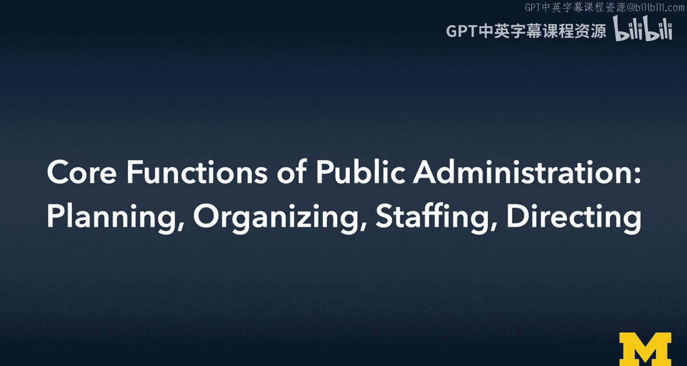
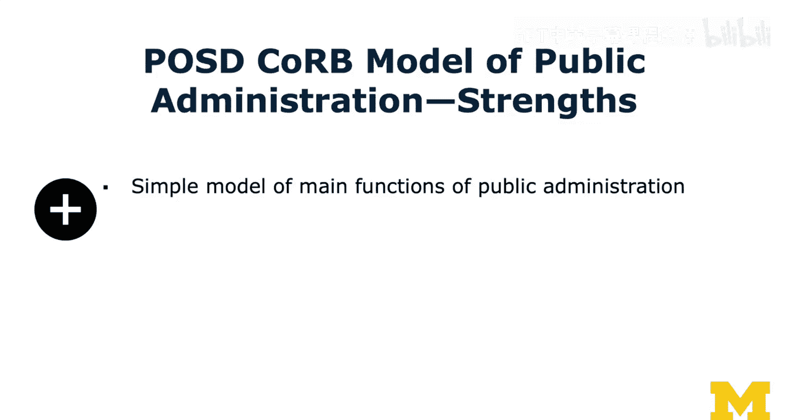
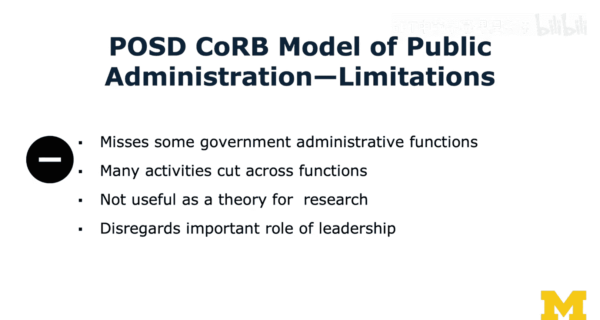
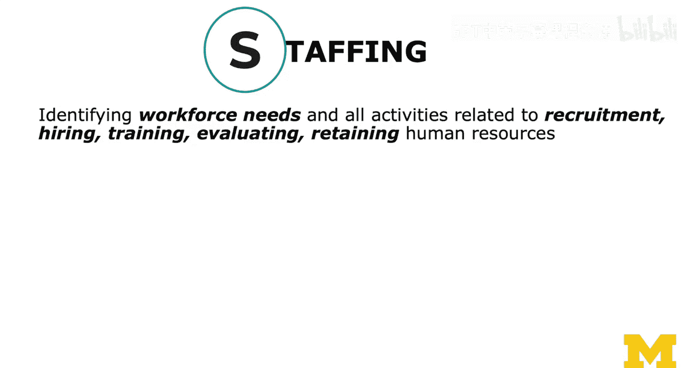
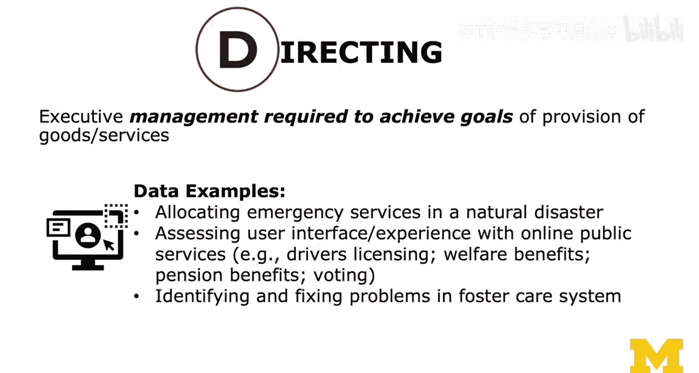

# 8：公共行政核心职能：规划、组织、人事、指挥

欢迎回来。在本节课中，我们将继续讨论公共行政的核心职能及其对数据分析的影响，这些内容在之前的课程中已有介绍。

我们使用一个经典模型来理解公共行政，该模型聚焦于七个核心职能。

## 概述

在本节课中，我们将学习公共行政的四个核心职能：规划、组织、人事和指挥。我们将了解每个职能的定义，并探讨数据分析如何在这些职能中发挥关键作用。理解这些基础职能，将帮助我们看清公共部门运作中所需的各种数据和分析类型。

## 模型简介与评价

我们使用的模型聚焦于七个核心活动：**规划**、**组织**、**人事**、**指挥**、**预算**、**报告**和**协调**。有些人用其首字母缩写“POSDCORB”来指代这个模型。我们并不要求你记忆这个模型名称。

了解这个模型及其公认的优点很重要：
*   首先，它是一个简单的模型，聚焦于运行政府和公共部门所需的最核心、最重要的活动。这些活动都是数据分析极其重要的领域。
*   其次，该模型适用于不同国家、不同政府形式以及不同层级的政府（地方、区域、国家）。
*   第三，这个模型实际上也适用于企业管理和公共部门。运行政府所需的主要职能，与管理企业或任何其他类型组织所需的行政职能是相同的。

现在，我们可以承认这个模型也有一些局限性：
*   首先，它遗漏了公共行政的一些活动和职能。实际需要完成的工作不止这七项。
*   其次，它将职能分开考虑，而现实中许多职能是同时运作的。例如，预算和规划常常齐头并进；报告是指挥和协调的重要组成部分；组织和人事也经常同时发生。因此，单独关注各项职能，低估了公共行政实际工作的复杂性。
*   该模型的其他一些局限性包括：它对公共行政领域的学术研究没有太大用处，并且没有强调不同类型领导力对每项职能的重要作用。

尽管如此，这个模型对我们的目的来说非常有用，即为了解数据和数据分析在公共部门的重要作用提供一个框架。理解公共行政的核心基本职能，将让你开始看到执行这些基本职能（无论是单独还是组合）所需的众多数据类型和分析。

## 核心职能详解

接下来，让我们逐一了解模型中的各项职能。

### 1. 规划 📝

上一节我们介绍了模型的基本情况，本节中我们来看看第一项职能：规划。

规划被定义为决定政府实体未来方向和目标以及所需行动与资源的有组织、战略性的方式。

以下是数据分析对规划职能至关重要的几个例子：
*   **预测养老金系统的未来收入和支出**。
*   **评估或分析预测的人口变化**（如人口老龄化）对公共服务需求的影响，例如医疗、公共交通、家庭服务甚至驾照更新。

### 2. 组织 🏢

了解了规划职能后，我们转向第二项职能：组织。

这是指识别提供公共产品和服务所需的必要财政资源（资金），以及人力资源、原材料、组织和物理基础设施。

以下是组织职能及数据作用的例子：
*   **弄清楚将纸质信息收集和存储系统转移到在线系统需要什么**。这是目前全球许多政府正在努力推进的工作。
*   **识别所需资源并制定细节，以在紧急情况（如新冠疫情）期间实施新的失业保险计划**。

### 3. 人事 👥

组织职能关注资源调配，而人事职能则聚焦于人力资源。

人事职能侧重于人力资源，涉及识别公共部门劳动力需求，以及与招募、聘用、培训、评估、留用和解雇政府工作人员相关的所有活动。全球三分之一的劳动力在公共部门。再次强调，地球上每三个有工作的人中就有一个为政府工作，因此人事职能至关重要。

以下是人事职能中数据分析的例子：
*   **评估当前劳动力的 demographic diversity（人口多样性）、技能水平和留任问题**。
*   **调查公务员对专业和技能发展的兴趣和需求**。在职成长和学习对每个人都很重要，无论你在哪个部门。
*   **比较公共部门职位与私营部门类似职位的工资**。

### 4. 指挥 🧭

最后，我们来看指挥职能。

这关乎实现政府提供产品和服务的目标所需的监督、管理和领导。

以下是指挥职能的例子：
*   **在自然灾害中获取并分配应急服务和资源**。
*   **评估在线公共服务系统的用户界面和体验**，例如驾照更新、福利申领、养老金福利、选民登记等系统。
*   **识别并解决 foster care system（寄养照顾系统）中的问题**。

## 总结

在本节课中，我们一起学习了公共行政的四个核心职能：**规划**、**组织**、**人事**和**指挥**。我们了解了每个职能的定义，并通过具体例子看到了数据分析如何成为执行这些职能不可或缺的工具。理解这些基础框架，是认识数据在公共部门治理中广泛而关键作用的第一步。在接下来的课程中，我们将继续探讨预算、报告和协调等其他核心职能。