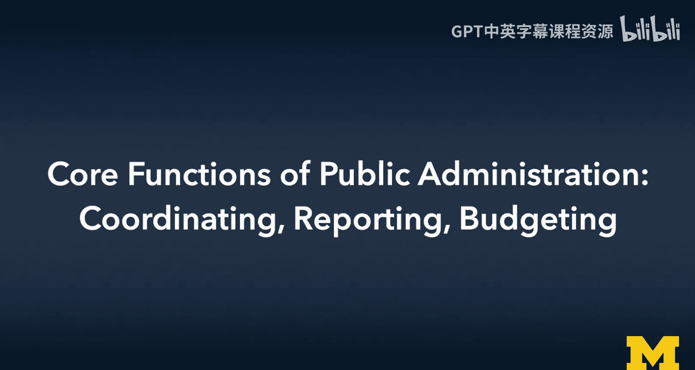
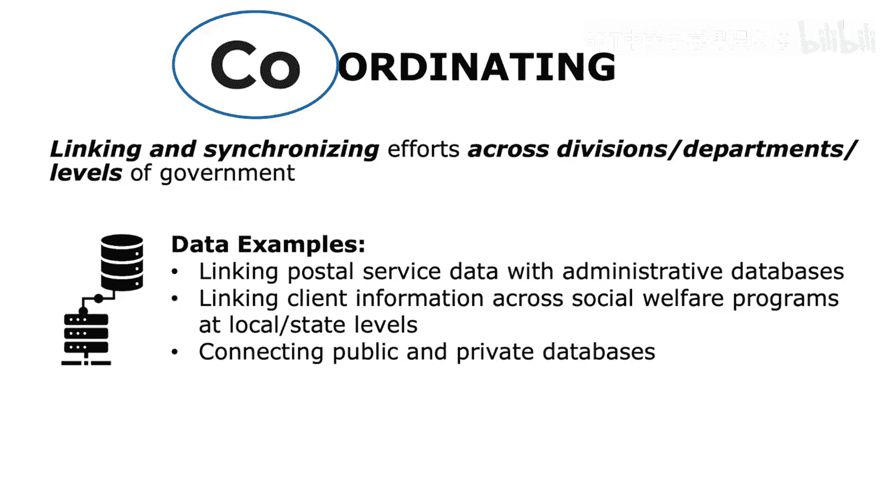
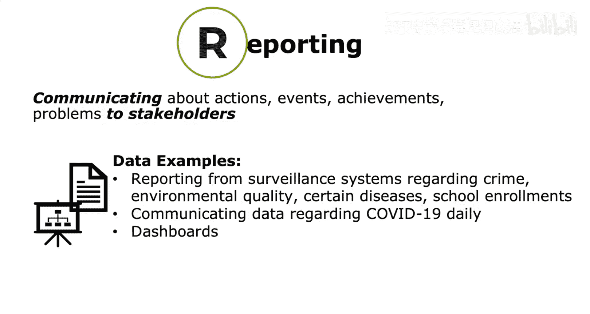
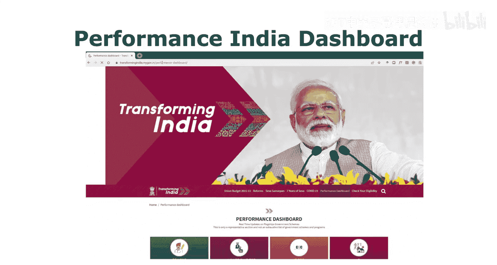
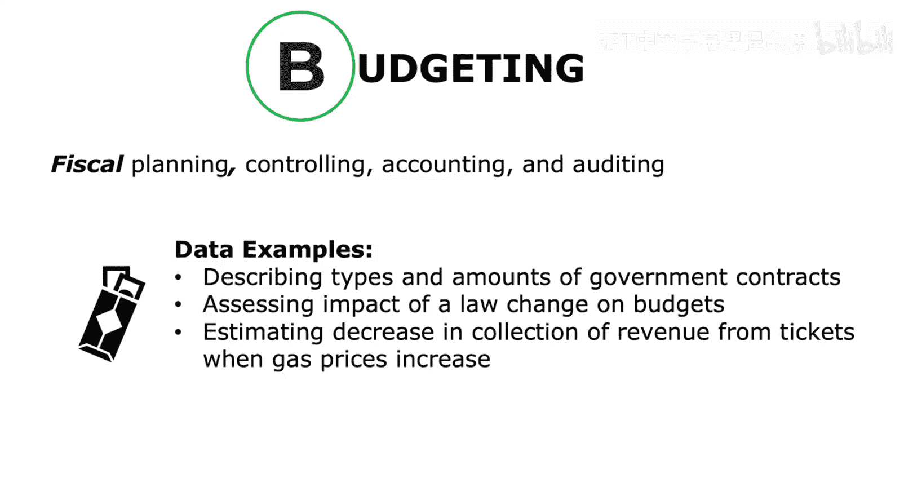
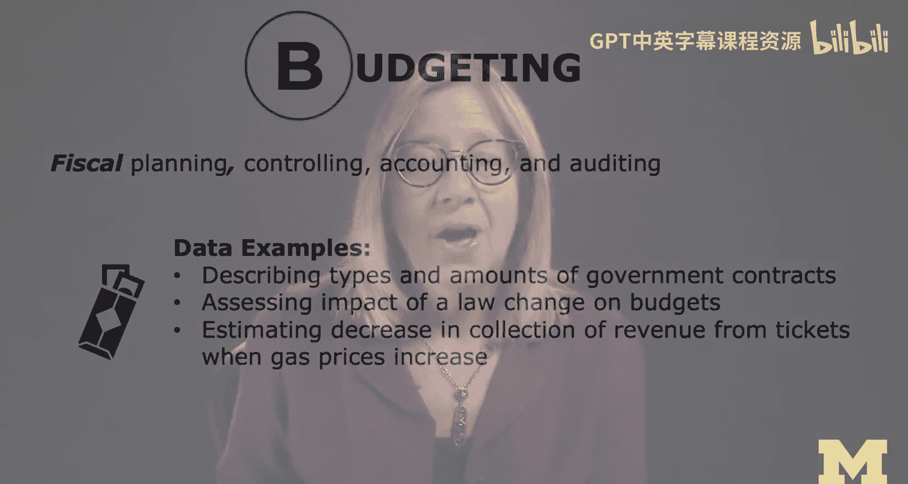

# 公共部门的R数据分析：P09：公共行政核心职能：协调、报告、预算编制 📊

在本节课中，我们将继续探讨公共行政的核心职能，并深入了解数据分析在每一项职能中所扮演的重要角色。我们将聚焦于协调、报告和预算编制这三个关键领域。

上一节我们讨论了公共行政的规划、组织、人事和指导职能。本节中，我们来看看剩下的三项核心职能：协调、报告和预算编制。

## 协调职能 🔗

协调职能主要涉及连接和同步我们之前讨论过的各个“孤岛”——即跨部门、跨单位、跨政府层级之间的工作。

以下是涉及数据的协调工作示例：

*   **连接邮政服务数据与其他政府数据库**：例如，将包含地址变更信息的邮政数据与财产税系统、社会福利项目系统、公共医疗保险系统等其他政府数据库进行关联。
*   **跨项目链接客户信息及其社会福利服务使用情况**：这些信息通常也分散在不同的“孤岛”中，并由不同层级的政府提供。

此外，还有许多需要合并私营部门和公共部门数据的例子。随着课程的深入，我们肯定会更多地讨论这个话题。

## 报告职能 📈

报告职能是公共行政中至关重要的一个方面。政府需要向立法机构和公众报告数据，主要有两个原因：第一，法律或法规通常有此要求；第二，以清晰简洁的方式向公众报告信息或数据，其重要性远超法律要求。在重视政府透明度、诚实和公开对话的文化中，透明度已被证明对建立政府信任至关重要。

以下是报告职能的一些示例：

*   **公共监测或追踪系统的持续性报告**：例如，犯罪统计报告、公立学校入学报告。此外，法律要求大量疾病必须向政府报告，然后再向公众公布。
*   **COVID-19疫情报告**：自疫情初期以来，大多数国家级和次国家级政府每天都向公众报告疫情统计数据，包括新增病例数、死亡人数以及疫苗接种率。
*   **政府仪表盘**：这是政府向公众报告情况的一种方式。许多政府已开始使用仪表盘来汇总在多个既定目标方面的进展，以此向公众报告，并对进展和挑战保持透明。

一个用于报告的政府仪表盘示例是令人印象深刻的“印度绩效仪表盘”。该仪表盘实时跟踪国家在36个目标上的进展，这些目标实际上是印度庞大的国家转型战略计划相关目标的一个子集。建议您查看这个网站以及其他政府仪表盘，以了解其多样化的设计和用途，并思考有多少不同类型的数据和数据分析构成了这些报告仪表盘的支柱。

## 预算编制职能 💰

我们需要讨论的第七项也是最后一项核心职能是预算编制。这涉及财政规划、预算审批，以及与公共财政收入和支出相关的控制、会计、审计等其他财务活动。

这同样是一个由数据驱动的重要职能。

以下是预算编制职能的一些示例：

*   使用数据来描述政府与私营部门签订的合同类型和金额。
*   评估新法律变更对某项服务项目预算的影响。
*   估算油价上涨时，罚单收入可能出现的减少（这对政府来说是个问题）。

## 总结

本节课中，我们一起学习了公共行政的协调、报告和预算编制这三项核心职能。我们看到了数据分析在连接信息孤岛、确保政府透明度以及支持财政决策中的关键作用。随着课程的继续，当您开始实际处理和分析数据时，我们将在实践中不断重温这些核心职能。