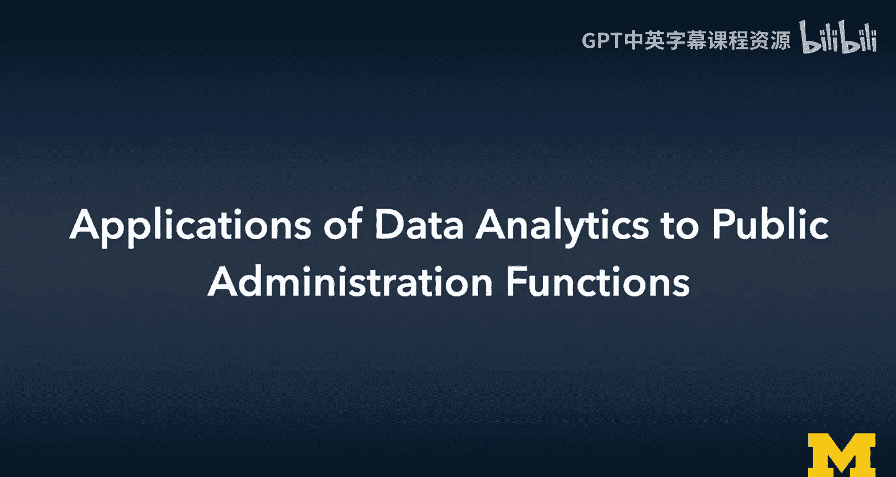
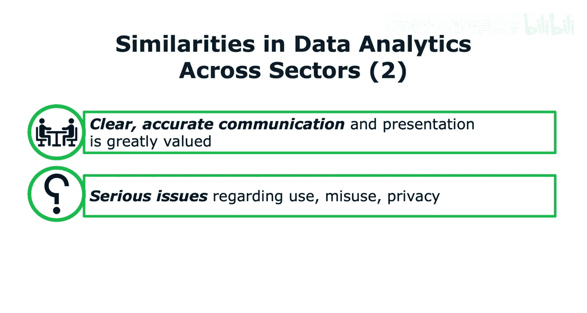
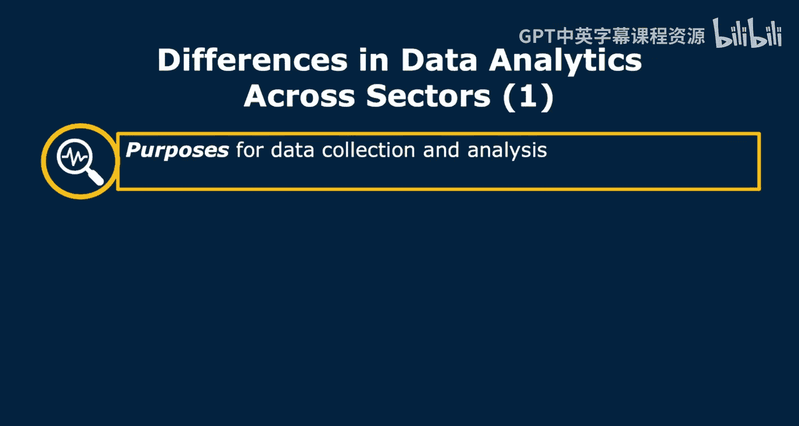
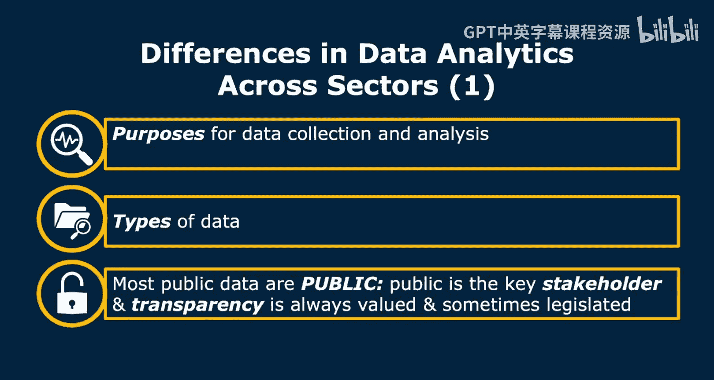
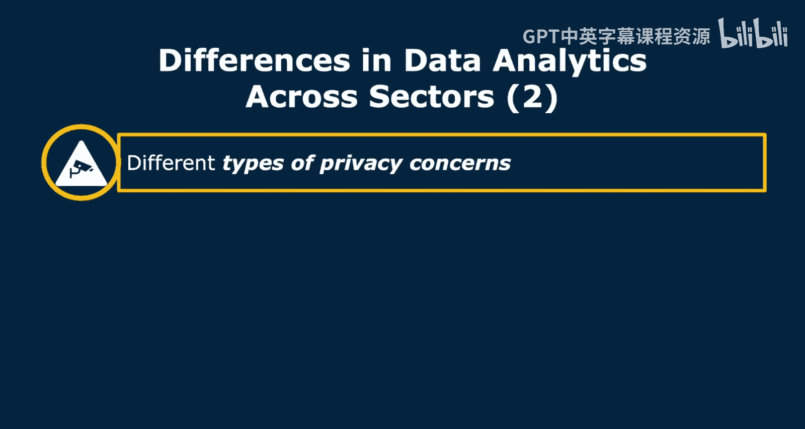
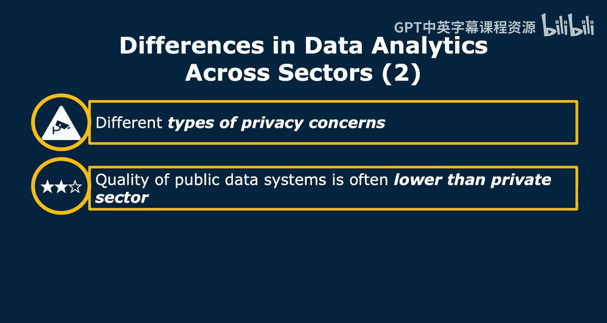
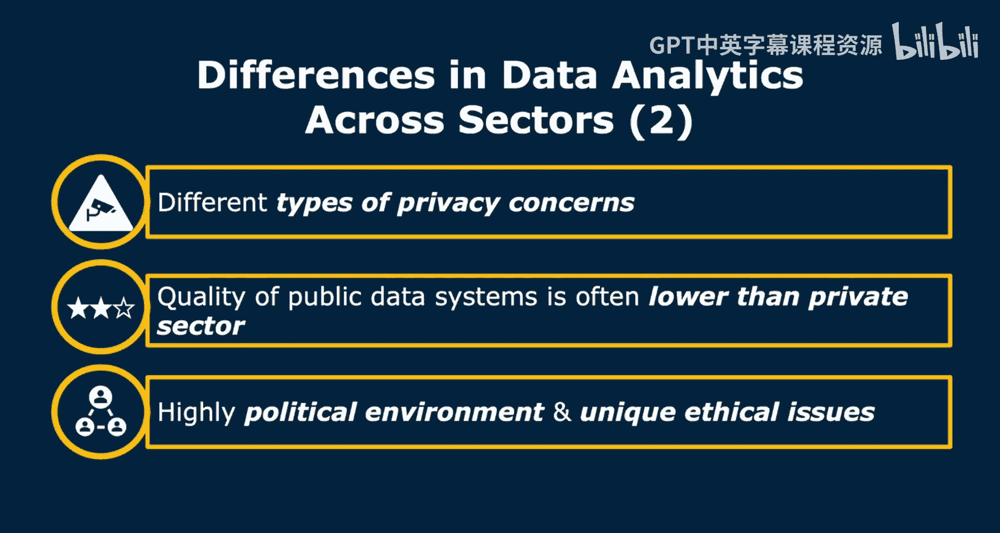
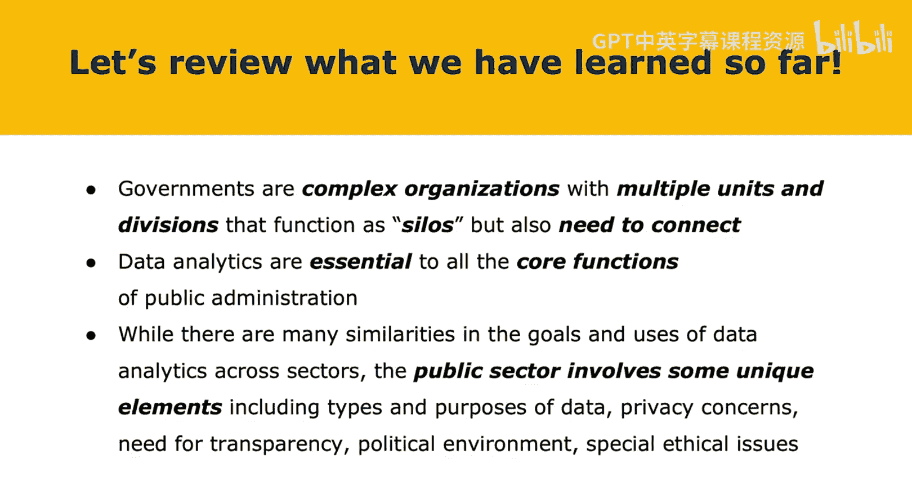

# 10：数据分析在公共行政职能中的应用 📊

在本节课中，我们将探讨数据分析在公共部门、非营利部门和私营部门之间的异同。理解这些背景差异对于在公共部门有效开展数据分析工作至关重要。

## 数据分析的跨部门相似性 🔄

尽管应用场景不同，但数据分析在不同部门间存在许多根本性的相似之处。

以下是数据分析在各领域共有的核心特征：

1.  **数据无处不在**：我们不断与各类组织（企业、服务提供商、政府、社交媒体等）分享关于自身的信息和数据。所有部门的组织都在工作中收集、分析和使用海量数据来提出并解答重要问题。
2.  **决策依赖数据**：基于证据或循证的组织政策和实践，在所有部门中都依赖于数据驱动的资源分配和决策。
3.  **数据质量至关重要**：在所有部门中，拥有高质量、可用于指导资源分配和决策的数据都至关重要。
4.  **重视数据沟通**：清晰、准确的数据共享、沟通和呈现方式在各个部门都受到重视。
5.  **面临伦理挑战**：关于数据的使用、滥用和隐私问题，在各个部门都存在非常复杂且严肃的伦理议题。

## 公共部门数据分析的独特性 🏛️

上一节我们介绍了跨部门的共性，本节中我们来看看公共部门数据分析的关键差异。尽管使用的分析方法和技巧基本相同，但公共部门（主要指政府）与其他部门，尤其是私营部门之间，存在非常重要的区别。这些区别之多，以至于我们专门开设了这个面向公共部门的数据分析专业课程。

以下是公共部门数据分析的主要独特之处：

1.  **目的与数据类型不同**：公共部门数据分析侧重于我们讨论过的公共行政的各项职能，例如政策分析（将在第三门课程中讨论）。此外，公共部门提供的广泛商品和服务非常注重结果，这些结果包括我们一直在讨论的四大支柱：**经济性**（明智地使用公共收入而不以营利为目的）、**效率**、**有效性**和**公平性**。因此，我们分析的数据类型和目的非常不同。
2.  **数据的公共属性**：在民主国家，大多数公共数据是公开的（并非全部），因为公众提供了公共收入的主要部分，并且是政府行为的主要利益相关者。虽然数据本身并不总是公开，但公共数据分析的结果几乎总是以某种方式公开。在美国等许多国家，未例行公开的数据和结果，公民也可以通过《信息自由法》或其他法律获取。政府数据和分析的公共性基于透明度和信任的既定价值观。当然，对政府的信任远不止数据透明度，但从我们关注数据的角度来看，必须理解数据隐私和保密性与透明度的问题在公共和私营部门之间截然不同。
3.  **数据质量与资源挑战**：数据分析在私营部门与公共部门之间的另一个巨大差异是数据质量和可用数据分析工具的复杂程度。众所周知，高质量的数据收集、管理和分析需要资源和资金。一般而言，私营部门的企业通常比政府拥有更多资金，或决定将更多资源投入到信息系统、数据管理和分析中。尽管过去20年左右，公共数据管理和分析的质量与复杂性确实有所提高，但这在每个政府中仍然是一个大问题。政府层级越低，问题就越大。对于世界上成千上万个市、县、省、州和其他地方级政府单位而言，以高质量和复杂的方式收集、组织、管理、检索、分析、沟通和保护数据的能力，在大多数政府中都是一个非常严峻的挑战。
4.  **固有的政治属性**：最后但非常重要的一点是，公共部门的数据分析本质上是一项政治活动。政治最基本的定义就是人类聚在一起做出决策。而公共部门正是大量人类聚集在一起，做出对所有部门和人民都有巨大影响、并涉及稀缺资源分配的决策。众所周知，这涉及很多分歧，因为价值观、政治意识形态和文化的作用也是其中重要的一部分。当数据显示政府在效率、有效性或实现公平方面未能履行职责时，风险非常高。当数据显示可能存在资源滥用、错配甚至腐败时，风险也很高。当数据揭示民选或任命的政府官员的项目未能奏效或未达到目标时，风险同样很高。公共部门数据分析的结果常常会让人感到愤怒和担忧，这有时会导致要求改变结果、隐藏或压制结果的压力。

## 总结 📝

本节课中我们一起学习了公共部门数据分析的背景。我们讨论了政府是拥有多个单位和部门的复杂组织，这些部门常常各自为政，但也需要相互连接。我们探讨了公共部门行政所必需的一系列核心职能，以及数据分析对每一项核心职能的重要性。同时，尽管数据和分析的目标与使用在各部门间有许多相似之处，但公共部门涉及一些独特的要素，包括数据的类型和目的、隐私问题、对透明度的需求、政治环境以及在公共部门进行数据分析时出现的特殊伦理问题。

现在，您已经准备好与布鲁克斯教授一起投入实际的数据分析了。请享受进入数据真实乐趣的过程，同时牢记我们迄今为止讨论的公共部门广阔而独特的背景。