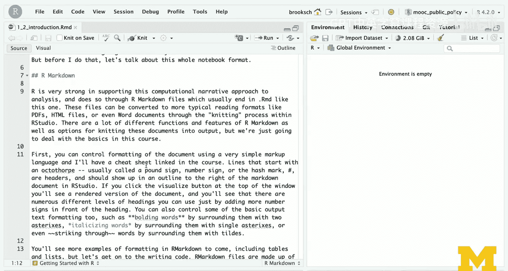
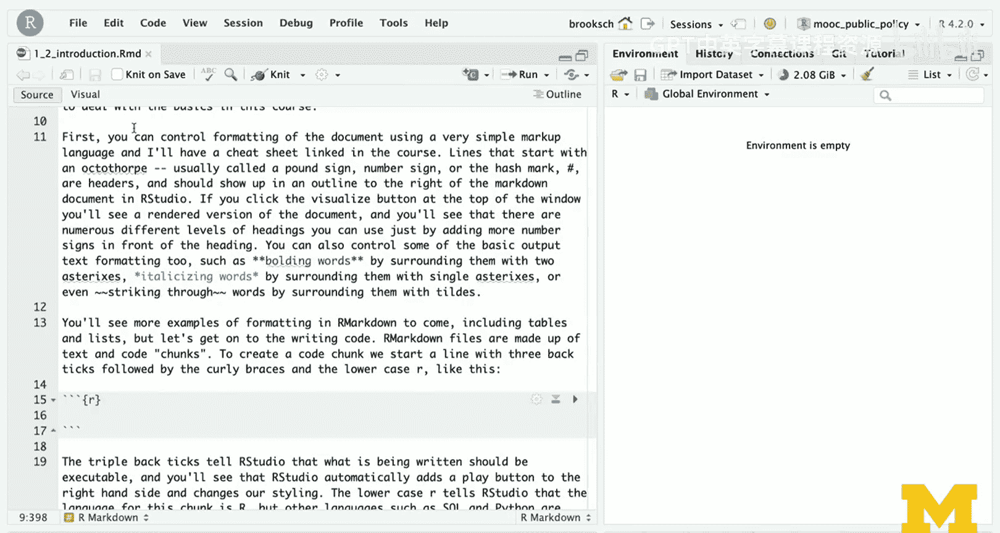
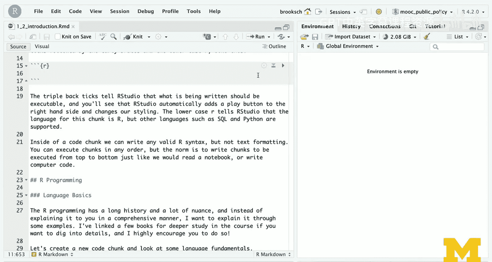
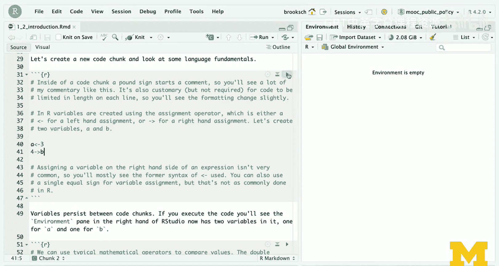
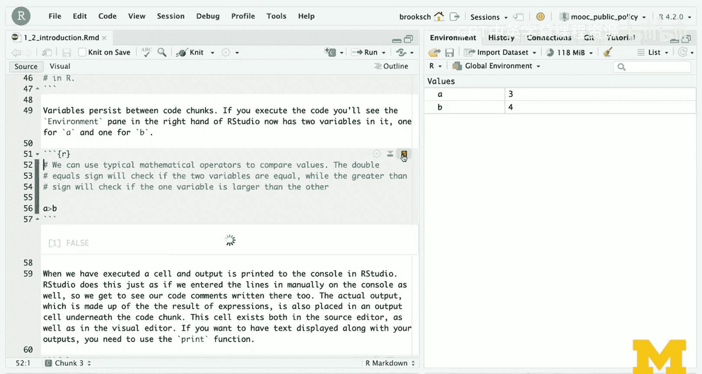
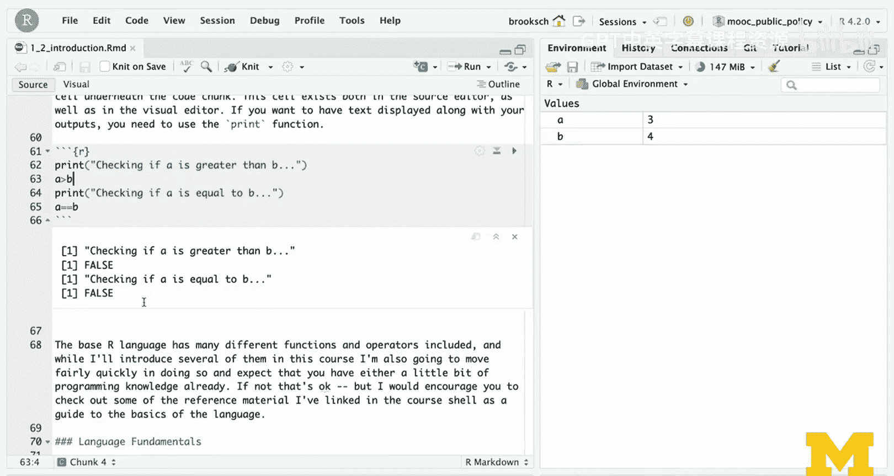

# 11：R语言编程基础入门 🚀


在本课程中，我们将学习如何使用R语言进行数据分析。本节课将介绍R语言编程的基础知识，包括R Markdown文档的格式、代码块的创建与执行，以及R语言的基本语法和操作。

---

## 概述 📋

在本节课中，我们将学习R语言编程的基础入门知识。我们将了解如何编写和格式化R Markdown文档，创建和执行代码块，以及掌握R语言中的变量赋值、数学运算和逻辑比较等基本操作。

---

## 计算叙事与R Markdown 📝

我们将以纯文本、计算机代码和图像相结合的形式编写分析报告。这种形式被称为**计算叙事**，它允许我们将分析讨论、执行分析的编程代码以及支持与传达结果的视觉元素编织在一起。


我尝试以这种格式完整记录我的讲座，以便您可以下载这些文件供日后参考，而无需重新观看视频。这意味着您可以快速浏览讲座，其中包含我所说的文字记录以及我编写的代码，类似于教科书和视频讲座的混合体。

在本笔记中，我将向您介绍R的一些基本功能。但在开始之前，让我们先谈谈整个笔记格式。



---

## R Markdown文档格式 🧩

R在支持这种计算叙事分析方法方面非常强大，它通过**Markdown文件**来实现，这些文件通常以 `.Rmd` 结尾。


这些文件可以通过RStudio中的**编织**过程，转换为更典型的阅读格式，如PDF、HTML文件，甚至Word文档。

R Markdown有许多不同的功能和特性，以及将这些文档编织成某种输出的选项，但在本课程中，我们只处理一些基础知识。

---

## 基础文本格式化 ✏️

首先，您可以使用一种非常简单的标记语言来控制文档的格式。所有以 `#` 号（通常称为井号、数字符号或哈希标记）开头的行都是标题，它们会显示在RStudio中Markdown文档右侧的大纲中。

如果您点击窗口顶部的“可视化”按钮，您将看到此文档的渲染版本，并且您会看到可以通过在标题前添加更多 `#` 号来使用不同级别的标题。

您还可以控制一些基本的输出文本格式，例如：
*   用两个星号包围单词来**加粗**。
*   用一个星号包围单词来*斜体*。
*   用波浪号包围单词来~~删除线~~。

在接下来的课程中，您将看到更多R Markdown格式化的例子，包括表格和列表。现在，让我们开始编写代码。



---

## 代码块与文本块 📦

R Markdown文件由文本块和代码块组成。要创建一个代码块，我们以一行三个反引号开始，后跟花括号和小写的 `r`，就像这样：


```r
# 这是一个R代码块
```

这三个反引号告诉RStudio，所写的内容应该是可执行的。您会看到RStudio自动在右侧添加了一个小播放按钮，并改变了代码的样式。

小写的 `r` 告诉RStudio这个代码块的语言是R，但也支持其他语言，如SQL和Python。

在代码块内部，我们可以编写任何有效的R语法，但不能进行文本格式化。您可以按任意顺序执行代码块，但通常的做法是按照从上到下的顺序编写和执行代码块，就像我们阅读笔记或编写计算机代码一样。

---



## R语言基础：变量与赋值 🔢

R编程语言历史悠久，细节丰富。与其全面地向您解释，我更希望通过一些示例来介绍。如果您想深入研究细节，我在课程中链接了几本书供深入学习，我强烈鼓励您这样做。

现在，让我们创建一个新的代码块，并看看一些语言基础。

在代码块中，以 `#` 号开头的行是注释。您会看到很多像这样的注释。通常（但不是必须）每行代码的长度有限制，所以您会看到格式略有变化。


在R中，变量是使用**赋值运算符**创建的，它可以是向左的箭头 `<-` 或向右的箭头 `->`。

让我们创建两个变量。这里我创建了 `a` 并将其赋值为 `3`，然后我创建了 `b` 并将其赋值为 `4`。

```r
a <- 3
4 -> b
```

在表达式的右侧赋值实际上并不常见，因此您主要会看到前面那种使用向左箭头的语法。您也可以使用单个等号 `=` 进行变量赋值，但这也不常见。

现在，如果我们执行这个代码块，我们会看到在右上角这里创建了变量。

---

## 变量作用域与环境 🌐

变量在代码块之间是**持久存在**的。如果您执行此代码，您会看到RStudio右侧的环境窗格中现在有两个变量，一个是 `a`，一个是 `b`。



---

## 数学运算与逻辑比较 ⚖️


我们可以使用典型的数学运算符来比较值。双等号 `==` 将检查两个变量是否相等，而大于号 `>` 将检查一个变量是否大于另一个。

```r
a > b
```

所以，我在这里输入 `a > b`，然后执行这个代码块。我们看到结果是 `FALSE`。



---

## 代码执行与输出 📤

当我们执行一个单元格时，输出会打印在RStudio的控制台中。RStudio这样做就像我们手动在控制台中输入这些行一样。因此，我们也可以在那里看到我们的代码注释。

实际的输出（由表达式的结果组成）也会被放置在一个输出单元格中，位于代码块下方。这个单元格既存在于源代码编辑器中，也存在于可视化编辑器中。

如果您希望文本与输出一起显示，您需要使用 `print` 函数。


```r
print("检查a是否大于b")
a > b
print("检查a是否等于b")
a == b
```

所以这里我给出一个例子，我们将创建一个新的代码块，打印“检查a是否大于b”，然后我只做我们的比较。您会注意到，对于比较，我不必在那里写 `print` 函数，该表达式将被直接求值然后打印。接着打印“检查a是否等于b”，然后我们输入那个比较并执行这个单元格。

我们看到该输出的所有部分都被添加到了单元格输出中。

---



## 扩展学习与资源 📚

基础的R语言包含许多不同的函数和运算符。虽然我将在本课程中介绍其中的几个，但我的进度也会相当快，并期望您已经具备一点编程知识，甚至是一些R知识。

如果没有，那也没关系，但我鼓励您查看我在课程大纲中链接的一些参考资料，作为学习该语言一些基础知识的指南。

---

## 总结 🎯


在本节课中，我们一起学习了R语言编程的基础入门知识。我们了解了R Markdown文档的用途和基本格式化方法，学会了如何创建和执行包含R代码的代码块。我们掌握了使用 `<-` 运算符进行变量赋值，以及使用 `==`、`>` 等运算符进行逻辑比较。我们还看到了代码块的输出如何显示，以及如何使用 `print` 函数输出文本。这些是开始使用R进行数据分析的重要第一步。