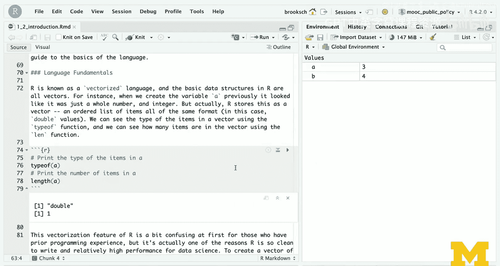
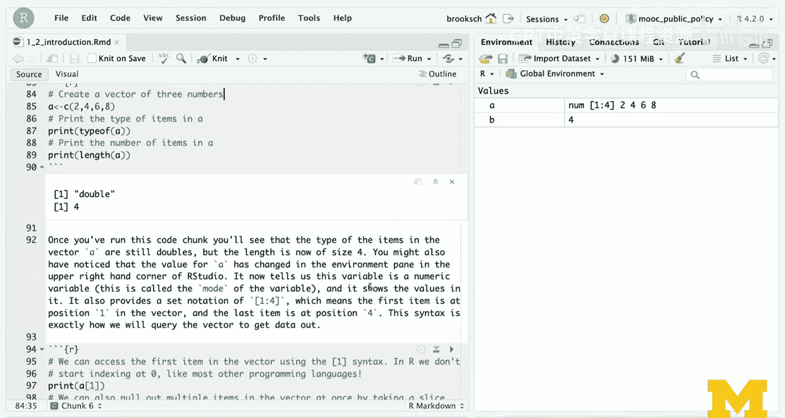
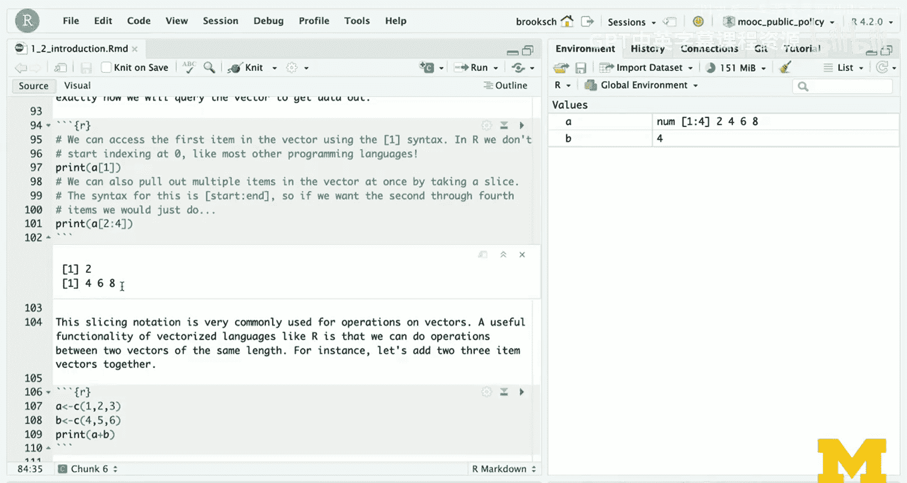
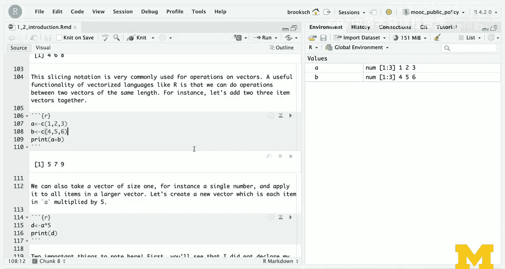
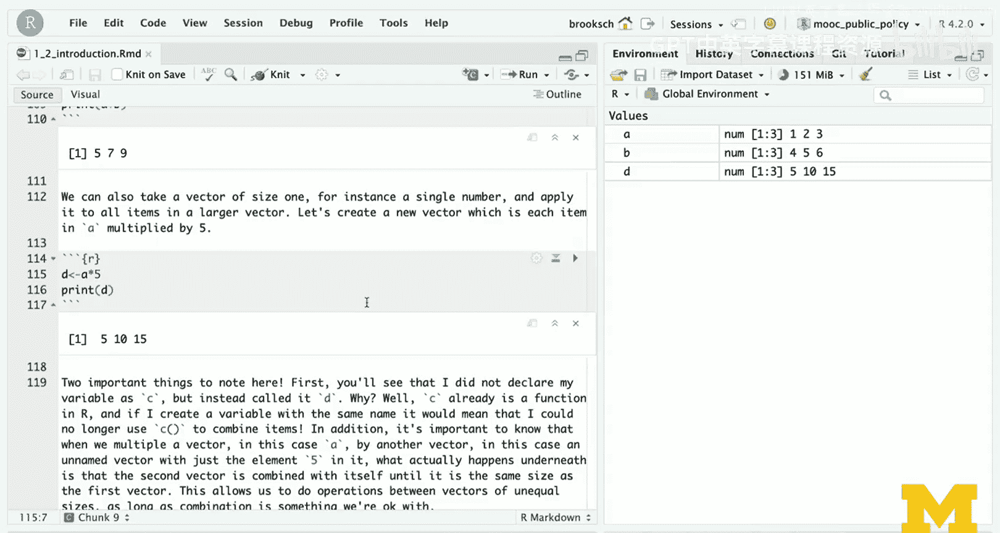
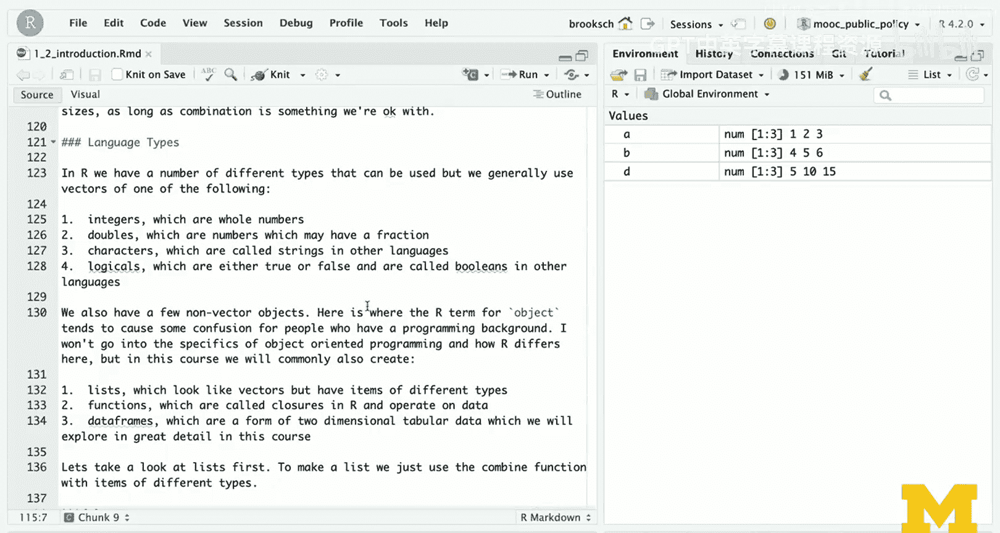
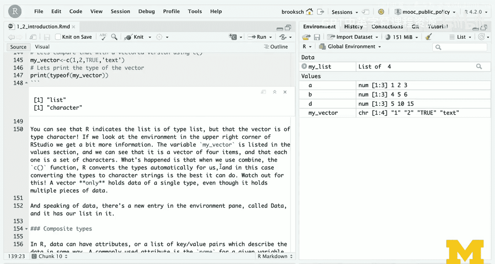

# 12：向量化运算原理 🧮


在本节课中，我们将要学习R语言的核心特性之一：向量化运算。我们将了解什么是向量，如何创建和操作向量，以及向量化如何使R语言在数据科学中既简洁又高效。

## 概述


R语言被称为向量化语言，其基本数据结构都是向量。理解向量是掌握R语言数据处理的关键。本节将介绍向量的概念、创建方法、索引操作以及向量间的运算规则。



## 向量的本质


上一节我们介绍了R的基本操作，本节中我们来看看R的核心数据结构——向量。

在R中，即使我们创建一个看似单一的变量，它实际上也被存储为一个向量。向量是一个有序的列表，其中的所有元素都具有相同的数据格式。

例如，当我们创建一个变量 `a` 并赋值为一个整数时，R实际上将其存储为一个长度为1的向量。我们可以使用 `typeof()` 函数查看向量中元素的类型，使用 `length()` 函数查看向量中包含多少个元素。

```r
# 创建一个变量，它实际上是一个长度为1的向量
a <- 5
# 查看元素类型
print(typeof(a))
# 查看向量长度
print(length(a))
```

执行上述代码后，我们会发现 `a` 的类型是 `"double"`，长度是 `1`。R的这种向量化特性对于有其他编程经验的人来说起初可能有些困惑，但这正是R语言代码简洁且在数据科学领域性能较高的原因之一。

## 创建多元素向量

要创建包含多个不同值的向量，我们使用组合函数 `c()`。



以下是创建向量的步骤：
1.  使用 `c()` 函数将多个值组合起来。
2.  将结果赋值给一个变量。


```r
# 创建一个包含四个元素的向量
a <- c(2, 4, 6, 8)
# 查看元素类型
print(typeof(a))
# 查看向量长度
print(length(a))
```

运行代码后，向量 `a` 的元素类型仍是 `"double"`，但长度变为 `4`。在RStudio环境面板中，变量 `a` 被标记为“数值型”，并显示其值。面板还使用 `[1:4]` 的集合符号表示，意为向量中第一个元素在位置1，最后一个元素在位置4。这种方括号语法正是我们查询向量数据的方式。

## 访问向量元素

我们可以使用方括号 `[]` 加索引号来访问向量中的特定元素。

需要注意的是，R语言的索引从 **1** 开始，而不是像大多数其他编程语言那样从0开始。




```r
# 访问向量中的第一个元素
print(a[1])
```

我们也可以一次性提取向量中的多个元素，这称为“切片”。切片语法是在方括号中使用起始索引和结束索引，中间用冒号 `:` 分隔。



```r
# 提取向量中第二到第四个元素（包含两端）
print(a[2:4])
```

切片操作在向量运算中非常常用。


## 向量间的运算



像R这样的向量化语言有一个实用功能：可以对两个长度相同的向量进行逐元素运算。

例如，将两个包含三个元素的向量相加：

```r
# 创建两个向量
a <- c(1, 2, 3)
b <- c(4, 5, 6)
# 向量相加（逐元素相加）
print(a + b)
```

结果是一个新向量，其第一个元素是 `a[1] + b[1]`，第二个元素是 `a[2] + b[2]`，依此类推。

我们还可以将一个长度为1的向量（即单个数值）与一个较长的向量进行运算。该操作会将这个单值应用于长向量中的每一个元素。


```r
# 创建向量a
a <- c(1, 2, 3)
# 将向量a中的每个元素乘以5
d <- a * 5
print(d)
```

这里有两个重要注意事项：
1.  **避免使用 `c` 作为变量名**：因为 `c()` 是R中基础的组合函数，如果用它作为变量名，将无法再使用该函数。
2.  **向量循环利用**：当两个长度不同的向量进行运算时（如上面的乘法），R会自动将较短的向量循环扩展，直到其长度与较长的向量相同。这允许我们在可接受的情况下对不等长向量进行操作。



## R中的主要数据类型

在R中，我们主要使用以下几种数据类型的向量：
*   **整数**：`integer`，表示整数。
*   **双精度浮点数**：`double`，表示可能带有小数的数字。
*   **字符**：`character`，在其他语言中常称为字符串。
*   **逻辑值**：`logical`，取值为 `TRUE` 或 `FALSE`，在其他语言中常称为布尔值。

## 列表与向量的区别


除了向量，R中还有非向量对象。这里“对象”一词可能让有编程背景的人感到困惑。本课程不深入探讨面向对象编程，但我们会常用到以下结构：
*   **列表**：`list`，看起来像向量，但可以包含不同类型的元素。
*   **函数**：`function`，在R中称为闭包，用于操作数据。
*   **数据框**：`data.frame`，一种二维表格数据，本课程将详细探讨。

让我们先看看列表。要创建列表，我们使用 `list()` 函数，它可以容纳不同类型的项。

```r
# 创建一个列表，包含数字、逻辑值和字符
my_list <- list(1, 2, TRUE, "text")
print(typeof(my_list))
```

为了对比，我们尝试用 `c()` 函数组合不同类型的数据来创建“向量”：

```r
# 尝试用c()组合不同类型数据
my_vector <- c(1, 2, TRUE, "text")
print(typeof(my_vector))
```

你会发现，`my_list` 的类型是 `"list"`，而 `my_vector` 的类型是 `"character"`。查看环境面板会发现，`my_vector` 显示为一个包含四个元素的字符向量。

这是因为当使用 `c()` 函数时，R会自动将输入转换为单一的数据类型。在这种情况下，将所有项转换为字符字符串是R能做到的最佳方案。**必须注意这一点：一个向量只能容纳单一数据类型的数据，尽管它可以容纳多个数据项。**

## 总结




本节课中我们一起学习了R语言向量化运算的核心原理。我们了解到R中的基本数据单位是向量，学会了如何使用 `c()` 创建向量，如何使用索引和切片访问元素，以及如何进行向量间的运算。我们还区分了向量与列表的不同：向量要求元素类型一致，而列表可以容纳异构数据。理解这些概念是后续进行高效数据处理和分析的基础。