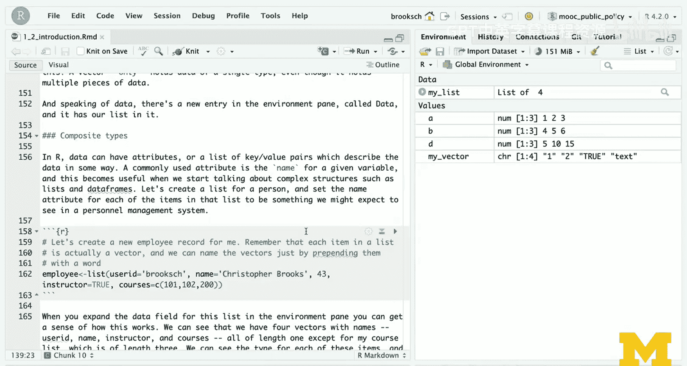
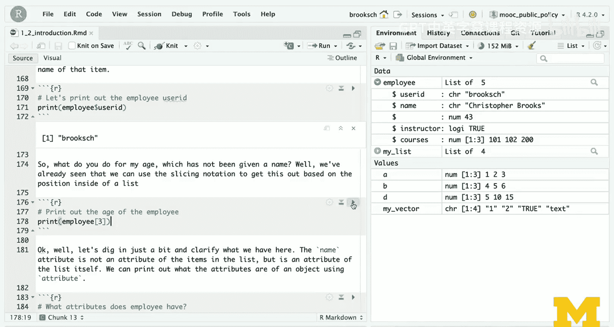
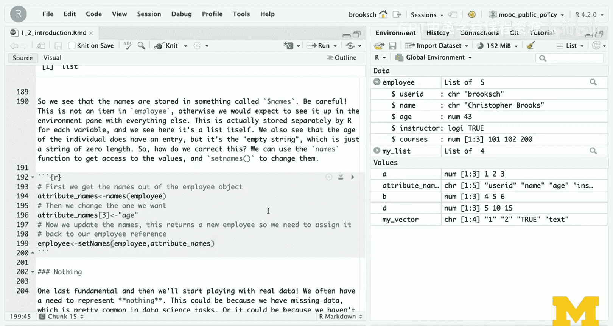
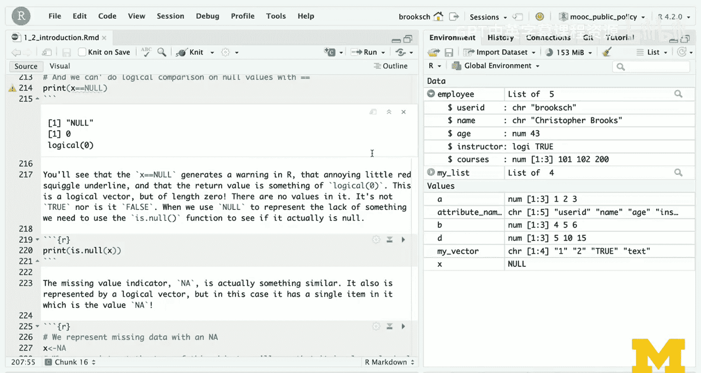
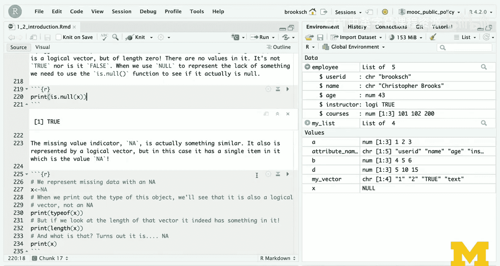

# 13：R语言数据属性解析 🧩




在本节课中，我们将学习R语言中数据的属性（Attributes）概念，以及如何处理列表（List）结构和两种特殊的“空值”：`NULL`与`NA`。理解这些概念是后续处理复杂数据结构的基础。

## 数据属性与列表

上一节我们介绍了R的基本数据结构。本节中我们来看看数据属性。在R中，数据可以拥有属性，即一系列描述数据的键值对。一个常用的属性是变量的名称，这在处理列表和数据框等复杂数据结构时非常有用。

现在，让我们创建一个模拟人事管理系统中的人员信息列表，并为列表中的每一项设置名称属性。


以下是创建并查看列表的步骤：
```r
# 创建一个员工信息列表
employee <- list(
  userID = "BrooksCH",
  name = "Christopher Brooks",
  43,
  instructor = TRUE,
  courses = c(101, 102, 200)
)
```
执行上述代码后，在环境面板中展开`employee`列表，可以看到四个已命名的向量（`userID`, `name`, `instructor`, `courses`）和一个未命名的元素（数字`43`）。列表项的类型和长度也一并显示。



## 访问列表元素


我们看到列表项名称前有一个美元符号`$`，这是一个重要的提示。可以使用`$`运算符根据名称从列表中选取项目。

以下是访问列表元素的示例：
```r
# 使用 $ 运算符访问已命名的元素
print(employee$userID)  # 输出: "BrooksCH"
```
对于未命名的元素（如年龄`43`），我们可以使用切片符号`[[]]`根据其在列表中的位置来访问。
```r
# 使用索引访问未命名的元素
print(employee[[3]])  # 输出: 43
```



## 理解与修改属性

名称属性实际上是列表本身的属性，而不是列表内部各个项目的属性。我们可以使用`attributes()`函数来查看对象的属性。

以下是查看和修改属性的过程：
```r
# 查看列表的属性
print(attributes(employee))
# 查看属性结果的类型
print(typeof(attributes(employee)))
```
输出显示名称存储在`$names`中，它是一个列表。未命名的元素（年龄）对应的名称是一个空字符串`""`。


要修改名称，可以使用`names()`函数获取名称列表，然后使用`setNames()`函数进行修改。`setNames()`函数会返回一个修改后的副本，需要重新赋值给原变量。
```r
# 获取当前的名称列表
attribute_names <- names(employee)
# 将第三个元素的名称改为 "age"
attribute_names[3] <- "age"
# 使用新的名称列表更新 employee 对象
employee <- setNames(employee, attribute_names)
```
执行后，环境面板中`employee`列表的第三个元素现在被正确标识为`age`。

## 特殊值：NULL 与 NA






在数据处理中，我们经常需要表示“无”。这可能是由于数据缺失（在数据科学中很常见），也可能是由于对象中的某个字段尚未定义（在计算机科学中很常见）。R用两种不同的方式处理这两种情况。

**NULL** 用于表示对某个对象的引用缺失。
```r
# 将 x 赋值为 NULL
x <- NULL
print(typeof(x))  # 输出: "NULL"
print(length(x))  # 输出: 0
```
**注意**：不能使用`==`对`NULL`值进行逻辑比较，这会产生警告并返回一个长度为0的逻辑向量。应使用`is.null()`函数进行判断。
```r
# 错误的比较方式（会产生警告）
x == NULL
# 正确的判断方式
print(is.null(x))  # 输出: TRUE
```


**NA** 用于表示数据缺失。
```r
# 将 x 赋值为 NA
x <- NA
print(typeof(x))  # 输出: "logical"
print(length(x))  # 输出: 1 (包含一个NA值)
```
判断数据是否缺失应使用`is.na()`函数。
```r
print(is.na(x))  # 输出: TRUE
```


## 总结


本节课中我们一起学习了R语言中数据属性的概念，包括如何创建和操作带有名称属性的列表。我们还深入探讨了两种表示“无”的特殊值：`NULL`（引用缺失）和`NA`（数据缺失），并掌握了使用`is.null()`和`is.na()`函数进行正确判断的方法。这些基础知识是后续处理真实、复杂数据集的关键。在接下来的课程中，我们将通过实际案例来巩固这些概念。