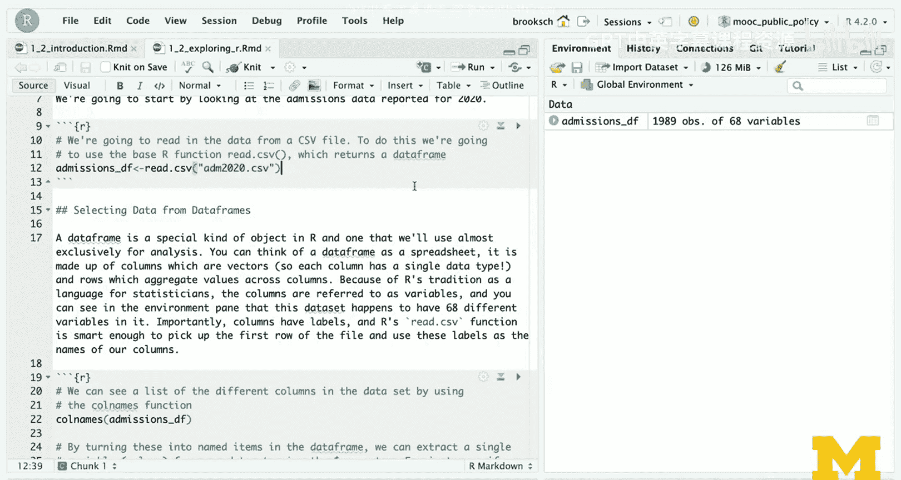
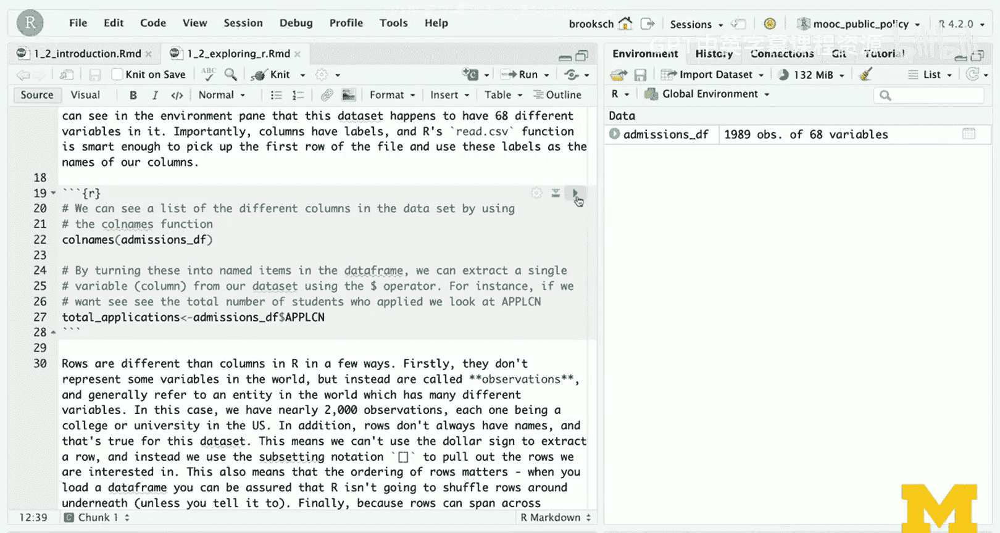
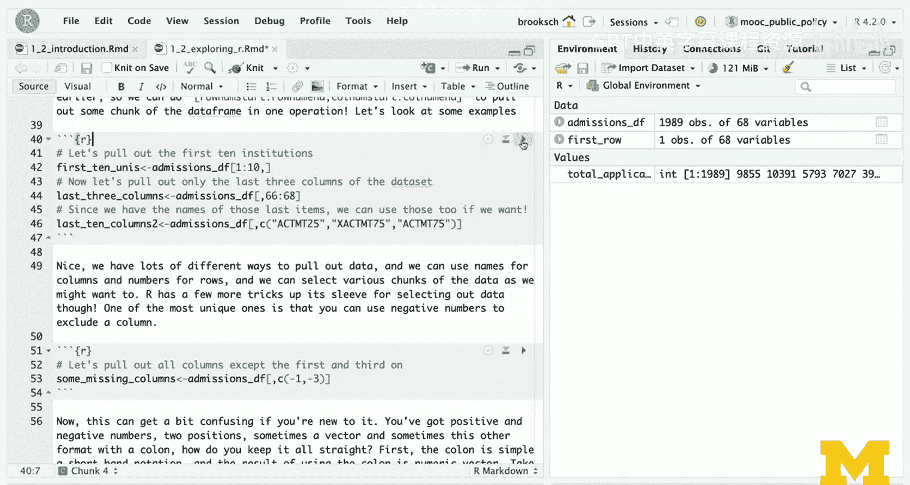

# R数据分析：1：R数据框变量列操作技术


在本节课中，我们将学习R语言中数据框（Data Frame）的核心概念与基本操作，特别是如何查看、选择和提取数据框中的变量（列）。我们将使用一个真实的美国高等教育数据集作为示例。

## 概述：数据框与变量


上一节我们介绍了R的基本环境，本节中我们来看看R中最重要的数据结构之一：数据框。数据框是R进行数据分析的核心，你可以将其理解为一个电子表格。它由行和列组成，其中每一列是一个向量，代表一个变量；每一行是一个观测，代表一个实体（例如一所大学）。

## 读取数据与查看结构



我们首先从CSV文件中读取数据。为此，我们使用R的基础函数 `read.csv()`。

```r
admissions_df <- read.csv("your_file_path.csv")
```

执行上述代码后，`admissions_df` 这个数据框对象会出现在环境面板中。这个数据集包含了近2000所美国大学在2020年的招生数据，共有68个不同的变量。


数据框的列有标签（即变量名）。`read.csv()` 函数会自动将CSV文件的第一行作为列名。

以下是查看数据框列名的方法：

```r
colnames(admissions_df)
```



## 提取单个变量（列）

在R中，数据框的列被称为变量。我们可以使用美元符号 `$` 运算符来提取单个变量。

例如，如果我们想查看所有大学的申请总人数，可以提取名为 `APPLCN` 的变量。

```r
total_applications <- admissions_df$APPLCN
```

执行后，`total_applications` 就成为了一个包含所有大学申请人数数据的向量。


## 理解行与列的不同

行（观测）与列（变量）在R中有几个关键区别：
1.  **行代表实体**：在本数据集中，每一行代表一所美国大学。
2.  **行通常没有名字**：这意味着我们不能用 `$` 来提取行。
3.  **行的顺序是固定的**：R不会随意打乱行的顺序，除非你明确要求。
4.  **行包含多种数据类型**：因为一行跨越多个列（变量），所以提取单行时得到的是一个列表或一个新的小数据框，而不是一个单一数据类型的向量。

## 使用方括号进行子集选择

为了选择行、列或两者，我们需要使用方括号 `[ ]` 子集操作符。其通用语法非常重要。

以下是选择子集的几种方式：

1.  **选择特定行（所有列）**：`数据框[行索引, ]`
    ```r
    first_row <- admissions_df[1, ]
    ```

2.  **选择连续的多行**：使用冒号 `:` 进行切片。
    ```r
    first_10_unis <- admissions_df[1:10, ]
    ```

3.  **选择特定列（所有行）**：`数据框[, 列索引]` 或 `数据框[, 列名]`
    ```r
    # 通过列索引选择最后三列
    last_three_cols_by_index <- admissions_df[, 66:68]

    # 通过列名选择最后三列
    last_three_cols_by_name <- admissions_df[, c("COL66", "COL67", "COL68")]
    ```

4.  **同时选择特定的行和列**：`数据框[行索引, 列索引]`
    ```r
    # 选择前5所大学的前3个变量
    subset_data <- admissions_df[1:5, 1:3]
    ```



请注意语法中的逗号：逗号前用于指定行，逗号后用于指定列。留空则表示选择所有行或所有列。

## 总结


本节课中我们一起学习了R数据框的基本操作。我们了解了数据框是类似电子表格的结构，由变量（列）和观测（行）组成。我们掌握了如何使用 `colnames()` 查看变量名，使用 `$` 运算符提取单个变量，以及使用方括号 `[ ]` 子集操作符来灵活地选择数据的特定行、列或区域。这些是进行数据探索和清洗的基础技能，在后续的分析中会频繁使用。