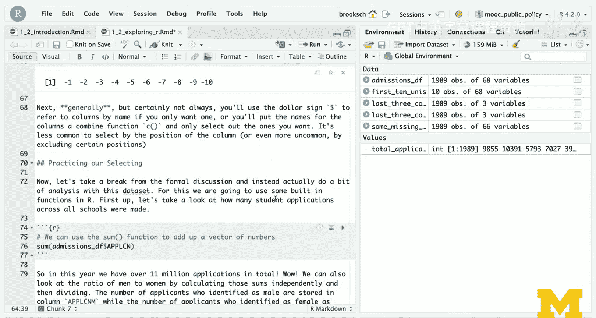
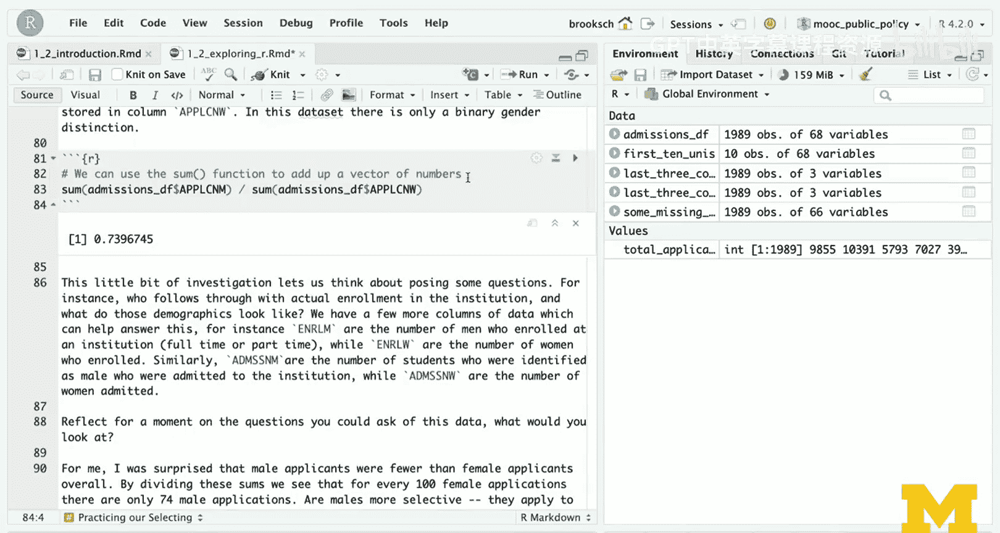

# 公共部门的R数据分析：14：向量选择与数据分析方法


在本节课中，我们将学习在R中从数据框中选择数据的多种方法，包括使用正负索引、冒号运算符以及列名。随后，我们将应用这些选择技巧，对一个高等教育招生数据集进行初步分析，计算申请、录取和入学的性别比例，并探讨如何处理数据中的缺失值。

## 数据选择方法


上一节我们介绍了使用列名和行号选择数据的基本方法。本节中，我们来看看R中一些更独特的数据选择技巧。

### 使用负号排除列

R允许使用负整数来排除特定的列。例如，如果我们想选择除第一列和第三列之外的所有列，可以这样做。

```r
admissions_df[, c(-1, -3)]
```

### 理解冒号运算符



冒号运算符 `:` 是创建连续整数向量的简写方式。它本身并不复杂，只是将两个数字之间的所有整数生成一个向量。

```r
# 创建一个从1到10的向量
1:10

# 同样可以创建负数的连续向量
-1:-10
```

### 选择方法总结

以下是选择数据时的一般原则：

*   通常，如果只想选择一列，使用美元符号 `$` 按列名引用是最直接的方式。
*   如果想选择多列，可以将列名组合成一个向量，然后进行选择。
*   按列的位置（索引）进行选择的情况相对较少。

## 初步数据分析


现在，让我们暂时放下形式化的讨论，利用这些选择方法对数据进行一些实际分析。我们将使用R的一些内置函数。

### 计算总申请量

首先，我们来看看所有学校的申请总量。这里我们使用 `sum` 函数对一个数值向量求和。



```r
# 计算“application”列的总和
sum(admissions_df$application)
```
执行结果显示，该年度总申请量超过1100万份。

### 计算申请性别比例

接下来，我们可以通过分别计算男性和女性申请者的总和，然后相除，来查看性别比例。在该数据集中，男性申请者数量存储在列 `applicationM` 中，女性申请者数量存储在列 `applicationW` 中（数据集仅包含二元性别区分）。

```r
# 计算男性与女性申请者数量的比例
sum(admissions_df$applicationM) / sum(admissions_df$applicationW)
```
计算结果显示比例约为0.74，这意味着女性申请者数量明显多于男性申请者。

## 提出数据问题

这个初步调查让我们开始思考可以向数据集提出的问题。例如，哪些申请者最终入学？其人口统计学特征如何？数据集中还有更多列可以帮助我们回答这些问题，比如 `enrollM`（男性入学人数）、`enrollW`（女性入学人数）、`admitM`（男性录取人数）和 `admitW`（女性录取人数）。

请思考一下：关于美国或其他地方的高等教育招生，你想了解什么？例如，男性申请者总体少于女性申请者，是因为男性申请学校更挑剔，还是女性在美国更可能上大学？如果后者成立，这是否也意味着女性获得录取的机会更多？

## 计算多变量性别比例

为了继续探索这些问题，我们接下来计算申请、录取和入学三个变量的性别比例。最直接的方法是复制并修改之前的代码。

```r
# 计算三个比例
application_ratio <- sum(admissions_df$applicationM) / sum(admissions_df$applicationW)
admissions_ratio <- sum(admissions_df$admitM) / sum(admissions_df$admitW)
enrollment_ratio <- sum(admissions_df$enrollM) / sum(admissions_df$enrollW)
```

现在，我们希望将结果打印在一行文本中。这里我们将使用 `paste0` 函数，它能将所有参数转换为字符向量并连接起来，非常适合用于打印数字或其他内容。

```r
# 使用paste0函数打印结果
paste0("申请比例是：", application_ratio,
       "， 录取比例是：", admissions_ratio,
       "， 入学比例是：", enrollment_ratio)
```
`paste0` 的一个优点是，你可以将每个参数放在单独的一行，这有助于提高代码的可读性。

执行这段代码后，我们可能会得到类似这样的输出：“申请比例是：0.739，录取比例是：NA，入学比例是：NA”。

## 处理缺失值（NA）

为什么录取和入学比例会显示为 `NA`？当数据存在缺失值时，`NA`（Not Available）值在进行算术运算时具有“传染性”。大多数处理数据的函数（如我们使用的 `sum` 函数）在遇到任何 `NA` 值时，通常会返回 `NA`。

在本例中，这意味着一个或多个机构在男性或女性的录取或入学数据上存在缺失。我们知道申请数据是完整的（因为申请比例计算成功），但录取或入学数据有缺失。

处理缺失数据不仅是一个技术挑战，也涉及数据政策和知识层面的挑战。数据缺失是因为某个群体确实无人被录取/入学，还是机构简单地报告了 `NA`？我们无从得知，这需要我们进行更深入的调查。

## 总结


本节课中我们一起学习了R中多种向量和数据框的选择方法，包括使用正负索引和冒号运算符。我们应用这些方法对一个招生数据集进行了分析，计算了性别比例，并遇到了数据缺失值 `NA` 带来的挑战。理解数据选择是数据分析的基础，而识别和处理缺失值是确保分析结果可靠的关键步骤。