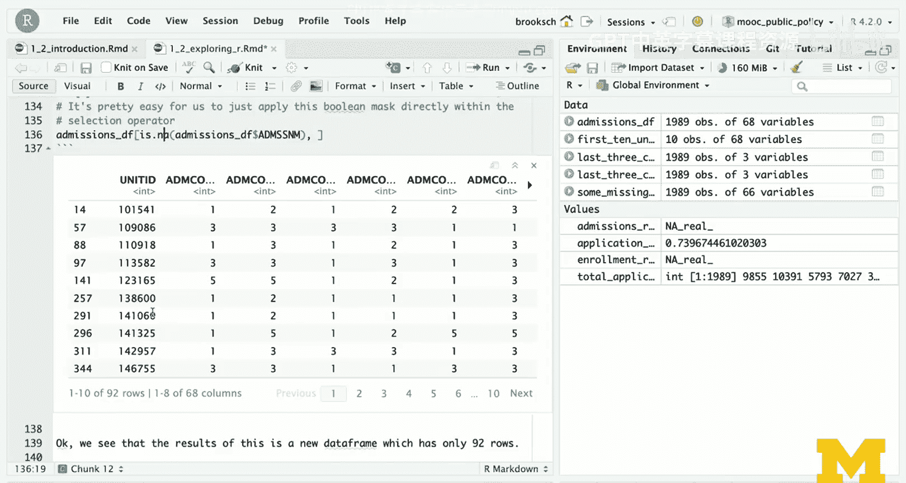
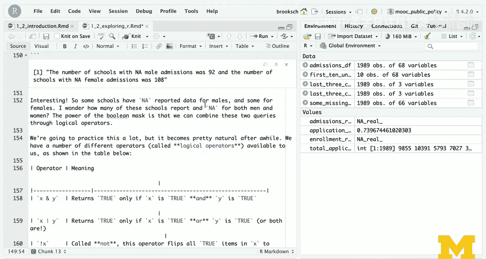
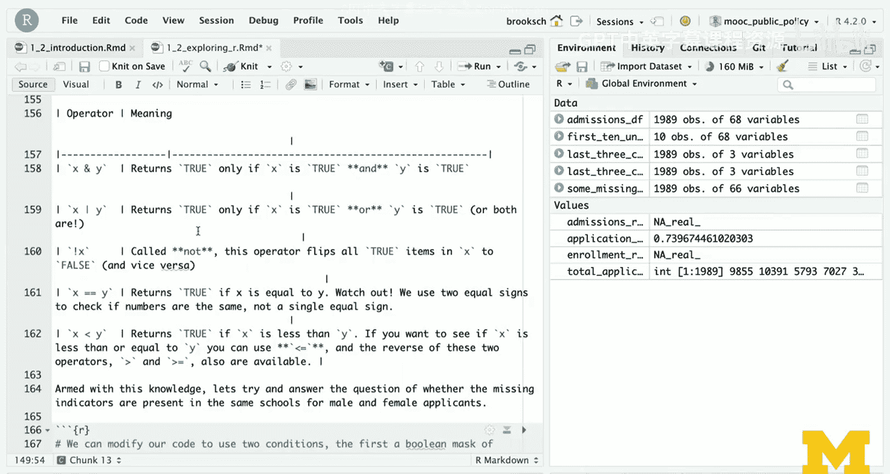

# 公共部门的R数据分析：16：数据框缺失值处理：布尔掩码技术 🎯


在本节课中，我们将要学习如何处理数据框中的缺失值。我们将重点介绍一种强大的技术——布尔掩码，它可以帮助我们识别、筛选和清理数据中的缺失值。

## 概述

数据清洗是数据分析的关键步骤，而缺失值处理是其中的核心环节。上一节我们介绍了数据框的基本操作，本节中我们来看看如何使用布尔掩码技术来识别和处理缺失值。

## 识别缺失值

我们的第一步是考虑数据中可能存在缺失值的地方。我们可以使用 `is.na()` 函数来检查数据列中哪些值被报告为 `NA`。

让我们首先查看“applications”列中是否有任何男性申请数据的缺失报告。运行以下代码：

```r
is.na(admissions_df$applications_men)
```

这会返回一个巨大的布尔值向量，其中包含 `TRUE` 或 `FALSE`，取决于该列在特定观测值（即一所学院或大学）中是否为 `NA`。在这个例子中，我们可以瞥见男性数据中明显有一些缺失值。

## 布尔掩码技术


如果我们想要量化缺失值，或者无法通过肉眼观察前一千条记录来判断是否存在缺失值，该怎么办呢？这里看似麻烦的地方，实际上R提供了一种非常好的处理方式，我们称之为**布尔掩码**。



布尔掩码是一个由 `TRUE` 和 `FALSE` 组成的向量，我们通过选择操作将其覆盖在数据之上。结果是，选择操作只返回那些对应 `TRUE` 值的观测值，而不返回对应 `FALSE` 的观测值。

让我们看一个例子。直接应用这个布尔掩码非常简单。我将使用方括号 `[]` 来限制行，并且只选择那些男性录取数据确实是 `NA` 的行。

```r
admissions_df[is.na(admissions_df$admissions_men), ]
```

这里实际发生的情况是：`is.na(admissions_df$admissions_men)` 创建了那个巨大的布尔向量，然后它被覆盖在我们2000行数据上，只有 `TRUE` 对应的行会作为结果被输出。


执行后，我们得到一个更易管理的数据框，只有92行。我们可以看到所有列，但只有92行数据。

## 统计缺失值数量

布尔掩码技术非常强大，在本课程结束时你会觉得它就像第二天性一样自然。但现在让我们再多做一些练习。

例如，让我们计算没有报告男性或女性录取数据的学校数量。以下是具体步骤：

```r
# 统计男性录取数据为NA的学校数量
paste("The number of schools with NA in male admissions was", nrow(admissions_df[is.na(admissions_df$admissions_men), ]))

# 统计女性录取数据为NA的学校数量
paste("The number of schools with NA in female admissions was", nrow(admissions_df[is.na(admissions_df$admissions_women), ]))
```

执行后，结果显示男性录取数据缺失的学校有92所，女性录取数据缺失的学校有108所。




## 逻辑运算符

有些学校报告了男性数据的缺失，有些报告了女性数据的缺失。我想知道有多少学校同时报告了男性和女性数据的缺失。

布尔掩码的强大之处在于，我们可以通过逻辑运算符将这两个查询条件组合起来。我们将大量练习这个操作，一段时间后就会变得很自然。



以下是我们可以使用的几种不同的逻辑运算符：

*   **`x & y`**：逻辑“与”。仅当 `x` 和 `y` 都为 `TRUE` 时返回 `TRUE`。
*   **`x | y`**：逻辑“或”。如果 `x` 或 `y` 为 `TRUE`，则返回 `TRUE`。如果两者都为 `TRUE`，同样返回 `TRUE`。
*   **`!x`**：逻辑“非”。它只有一个操作数，作用是取反。它将 `x` 中所有 `TRUE` 项翻转为 `FALSE`，反之亦然。
*   **`x == y`**：等于。仅当 `x` 等于 `y` 时返回 `TRUE`。注意这里使用两个等号来检查是否相等，而不是一个。
*   **`<`, `>`, `<=`, `>=`**：小于、大于、小于等于、大于等于。使用这些尖括号进行比较。

## 组合条件查询

掌握了这些知识后，让我们尝试回答这个问题：缺失指标是否在同一所学校中同时出现在男性和女性申请者数据中？

我们可以修改代码，使用两个条件：第一个是男性数据缺失的布尔掩码，第二个是女性数据缺失的布尔掩码。然后我们可以用一个“与”掩码将它们组合起来，这个掩码只对同时满足两个条件的学校为 `TRUE`。

```r
missing_schools <- admissions_df[is.na(admissions_df$admissions_men) & is.na(admissions_df$admissions_women), ]
paste("The number of rows is", nrow(missing_schools))
```

执行后，我们得到24所学校同时报告了男性和女性数据的缺失。这意味着有68所学校只报告了男性数据的缺失，84所学校只报告了女性数据的缺失。

## 数据清理决策

现在，数据科学家需要做出一些选择。由于我们试图回答的关于录取率和入学率的问题无法用缺失数据来解答，我们需要处理这些缺失值。

在未来的课程中，我们将更多地讨论缺失值处理技术，因为这个问题会影响你在实践中进行的大多数分析。就本讲座的目的而言，我将排除那些在我们感兴趣的六个变量中任何一个存在缺失数据的观测值（即学校）。

我们需要进行相当多的输入。我们知道如何为缺失数据创建布尔掩码，现在只需要取反，以便只获取没有缺失的数据。记住，我们使用感叹号 `!` 来取反，并且我们将用“与”条件 `&` 将所有掩码组合在一起。

为了清晰起见，我喜欢在多行中完成这个操作：

```r
clean_df <- admissions_df[
  !is.na(admissions_df$applications_men) &
  !is.na(admissions_df$applications_women) &
  !is.na(admissions_df$admissions_men) &
  !is.na(admissions_df$admissions_women) &
  !is.na(admissions_df$enrolled_men) &
  !is.na(admissions_df$enrolled_women),
]
```

这只是打印最终清理后数据框的总行数：

```r
paste("The total number of rows in the final clean DF is", nrow(clean_df))
```

执行后，我们的干净数据集中有1790所学校。虽然输入很多，但这就是R的工作方式。在清理数据时，了解正在发生什么非常重要。

值得庆幸的是，有一些人做了出色的工作，用其他函数扩展了R，这将使事情变得更容易。但在我们转向那些方法之前，让我们回到最初的问题：计算男性和女性在申请、录取和入学这三个变量上的比率。

## 总结


本节课中我们一起学习了如何使用布尔掩码技术来处理数据框中的缺失值。我们介绍了如何用 `is.na()` 识别缺失值，如何应用布尔掩码进行筛选，以及如何使用逻辑运算符组合多个条件。我们还通过一个实际的数据清理例子，展示了如何排除在关键变量上存在缺失值的观测记录，为后续的分析做好准备。掌握这些基础技术对于确保数据分析的准确性和可靠性至关重要。