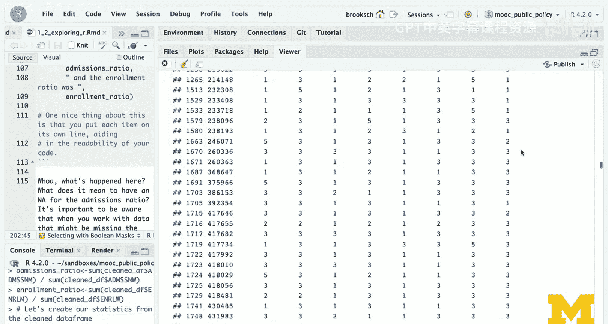

# 公共部门的R数据分析：P17：数据清洗后统计量生成方法 📊


在本节课中，我们将学习如何从清洗干净的数据框中生成关键的统计量，并利用R Markdown的强大功能，将这些计算结果无缝地嵌入到一份可复现的分析报告中。

上一节我们完成了数据的清洗工作，得到了一个干净的数据框。本节中，我们来看看如何基于这个干净的数据框计算我们关心的统计指标，并生成一份动态报告。

## 计算核心统计量

现在我们已经有了清洗后的数据框，计算统计量变得非常简单快捷。我们将计算申请、录取和入学三个环节的男女性别比例。

以下是计算这三个比例的核心代码：

```r
# 计算申请、录取、入学三个环节的男女性别比例
ratio_applications <- sum(clean_df$applications_male) / sum(clean_df$applications_female)
ratio_admissions <- sum(clean_df$admissions_male) / sum(clean_df$admissions_female)
ratio_enrollment <- sum(clean_df$enrollment_male) / sum(clean_df$enrollment_female)
```

执行这段代码后，我们可以在RStudio的环境面板中看到生成的三个比例值。

## 在R Markdown中嵌入结果

我没有直接打印这些结果，因为我想展示R Markdown的一个巧妙功能：我们可以在非代码块中直接嵌入变量。只需以反引号加字母R开头，后面跟上变量名即可。

这种方法允许你将计算的所有元素直接整合到叙述性文本中。你不需要执行这些文本块，而是通过“编织”过程来渲染它们。在RStudio中点击“视觉”标签页，你就能看到渲染后的结果。


为了查看这份报告的渲染效果，我们只需点击上方的“Knit”按钮。默认情况下，它会生成一个HTML文件。你可以看到这里已经生成了预览。这份报告非常实用，你可以将其展示给他人，或作为一份报告提供给利益相关者，也可以将其输出为PDF或Word文档。

报告中包含了我们所有的分析代码、实际执行的计算，以及我们创建的表格等。

## 优化报告输出

然而，报告也面临一个挑战：它会包含所有的输出内容。例如，这里包含了那个庞大的、包含上千个元素的布尔掩码，这并不十分有趣。有时还会输出整个数据框，而我们通常对此并不感兴趣。

我快速滚动到报告的底部，因为那里才是我真正想展示的、非常简洁的部分。在这里，我们可以看到报告中直接嵌入了计算出的数字。

这种方式的优势在于，如果我们的数据发生变化，或者我们需要回头修改脚本、改变某些假设、对数据有了新的认识，我们只需重新运行这个“编织”过程，所有数字都会自动更新，而我们之前写好的叙述性文本保持不变。这非常酷，也是R语言一个相当独特的功能。

## 结果解读与思考



现在，让我们看看这些数字，我们可以从中思考很多事情。

我们得到的申请男女性别比是 **0.74**，这意味着在所有大学中，女性的申请人数远多于男性。

录取的性别比更加悬殊，为 **0.69**，表明被录取的女性比例更高。

然而，入学的性别比略有回升，为 **0.77**。这可能是合理的，因为女性可能被更多不同的学校录取，但最终只能选择其中一所学校入学。

这只是对一个优秀的公共数据集的初步探索。关于这些数据，你希望回答哪些类型的问题呢？

---


本节课中我们一起学习了如何从清洗后的数据生成统计摘要，并利用R Markdown创建了包含动态结果的、可复现的分析报告。我们计算了申请、录取和入学环节的性别比例，并探讨了如何将计算结果优雅地嵌入叙述文本中，实现数据与洞察的一体化呈现。