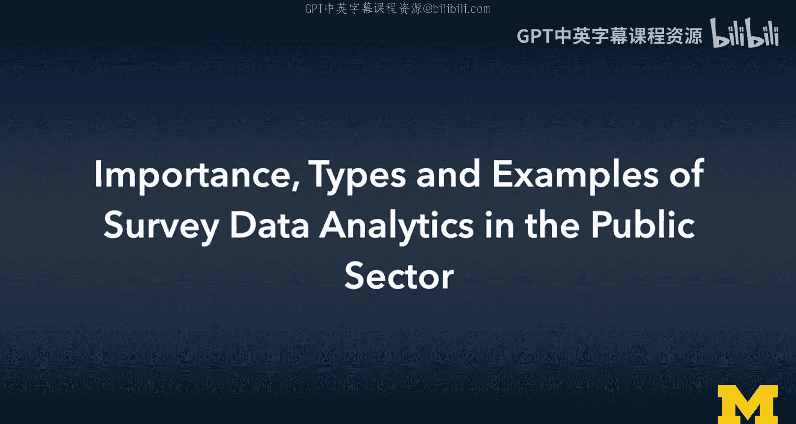
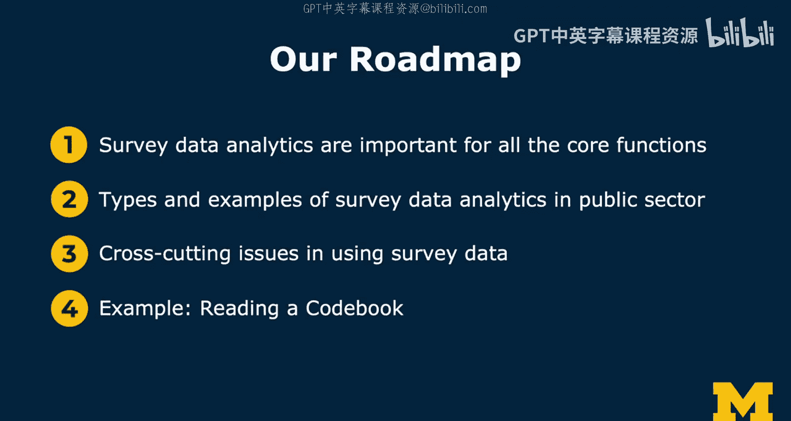
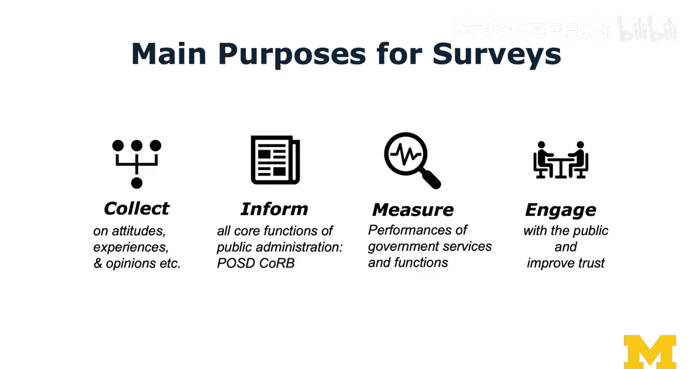
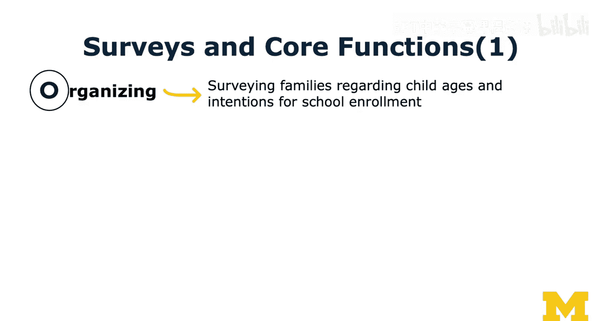
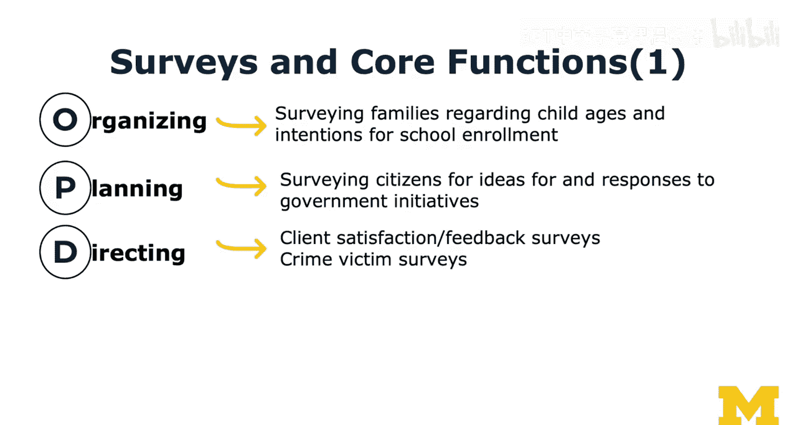
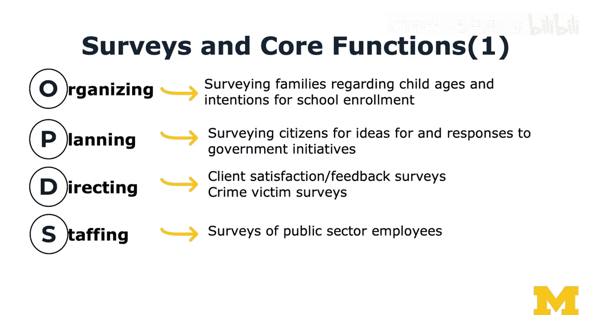
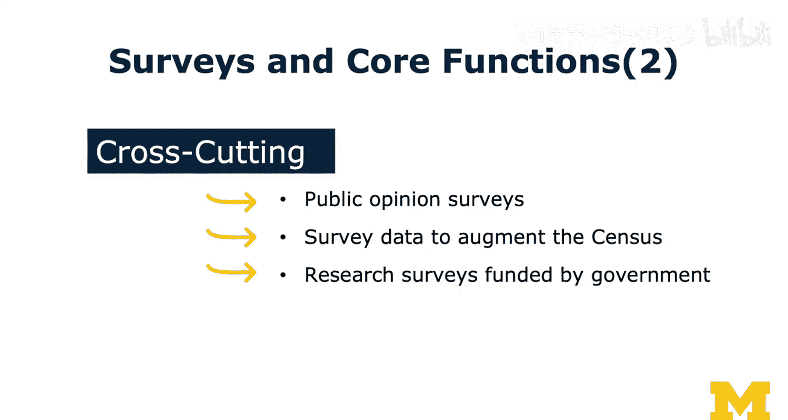
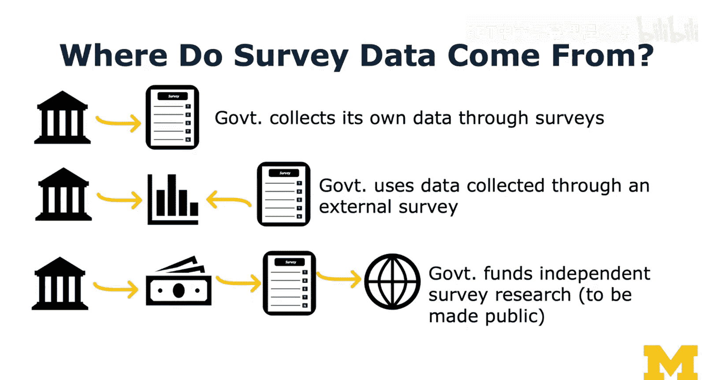
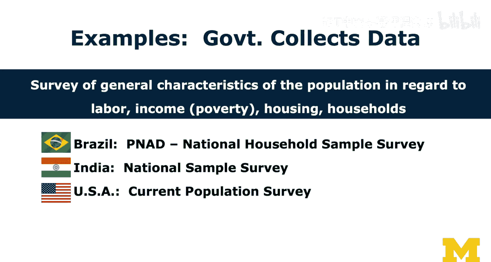
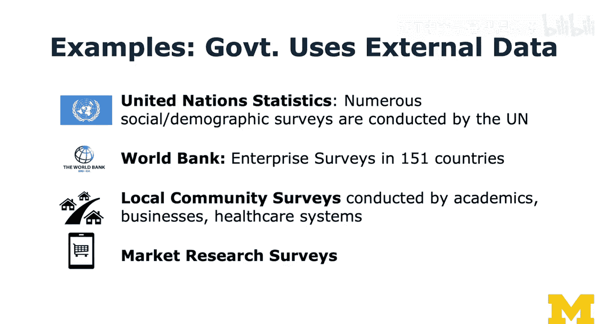

# 公共部门的R数据分析：19：调查数据分析：重要性、类型及公共领域应用案例 📊

在本节课中，我们将学习调查数据分析在公共管理中的核心作用。我们将了解调查的主要目的、不同类型，并探讨其在公共部门各项核心职能中的具体应用案例。

---

公共管理各项核心职能都需要依赖多种不同类型的数据，这其中包括调查数据。调查的设计、实施和数据分析所涉及的方法本身就是一个完整的社会科学领域，甚至可以攻读调查研究的硕士或博士学位。我们接下来几节课的路线图，是为大家介绍调查数据分析在公共管理中的基本作用。这包括不同调查类型的定义和示例，以及使用调查时面临的共性问题介绍。

上一节我们介绍了课程的整体安排，本节中我们来看看调查在政府，特别是公共管理中的主要目的是什么。

调查的主要目的包括：
*   直接从政府产品、服务和项目的用户、客户、公民、员工及其他利益相关者那里，收集关于态度、经历和意见的信息。
*   为公共管理的所有核心职能提供信息支持。
*   客观和主观地衡量政府绩效，收集利益相关者的意见。
*   与公众互动以征求反馈、收集想法、帮助确定优先事项，并提升对政府的信任。

以下是调查如何在公共管理核心职能中发挥作用的几个例子。

在组织职能方面，一个例子是：可以对学校或学区的家庭进行调查，以获取关于该学区儿童数量以及家庭让孩子入读公立学校意向的更准确信息。

来自家庭的调查数据也可用于了解儿童是否需要课前或课后托育服务、儿童是否需要特殊教育服务、家庭在家使用何种语言等信息，这些信息将帮助学校组织其服务和项目。

对于计划职能，调查通常用于就政府新举措的想法、他们认为近期和长期的优先事项等，向公民征求系统性反馈。

对于指挥职能，客户反馈和满意度调查经常被持续使用。例如，一些司法管辖区会在犯罪受害者报案数月后对其进行调查，从受害者的角度获取关于案件是否以及如何得到解决、受害者是否对处理过程满意，以及改进反馈等信息。

对于人事职能，公共部门员工经常被调查，以获取关于他们的工作满意度、薪酬满意度，以及他们当前是否或计划在政府内部或外部寻找不同职位的反馈。

此外，还有许多调查示例横跨多项公共管理职能。

这包括可用于为信息、计划、指挥、组织等所有职能提供信息的民意调查。此外，许多政府使用调查数据来补充人口普查收集的信息，获取关于个人和家庭的更详细信息，这些信息随后被用于多种核心职能和目的。

现在让我强调一个重要观点。许多国家及其地方单位的政府会资助或支付由政府外部研究人员进行的调查研究，这些研究人员来自学术界、私营部门和非营利部门。

在这种情况下，政府资助那些它认为将为公共部门带来某种公共利益的调查研究。同样重要的是，在大多数政府调查完成且数据被分析后，通常需要将数据匿名化，即移除所有识别信息，然后公开，以便其他人可以访问和分析这些数据。

那么，公共部门使用的调查数据通常来自哪里？这在我刚才提供的例子中已有暗示，但让我们更明确一点。

首先，政府通过自己设计和实施的调查来收集数据。其次，政府使用由其他政府、非政府组织、学术研究人员、智库以及私营部门收集的外部调查数据。第三，政府使用其资助的研究所产生的调查数据，但这些数据反过来可供公众使用，包括政府本身。

让我就最后一点举一个简单的例子。我曾获得美国政府资助，进行一项全国性调查，研究人们如何理解政府发布的关于临床预防服务的指南，例如谁应该接受不同的癌症筛查测试、不同年龄的人应该接种什么疫苗等。我从联邦政府获得这笔资助的一个条件是，在我完成数据的初步分析后，不含任何受访者识别信息的调查数据将提供给其他研究人员和分析师使用。

为了继续讨论公共部门使用的调查数据来源，大多数国家和地方政府在开展自己的调查方面投入了大量资源。其中一些调查只实施一次，另一些则是持续进行的。例如，美国联邦政府每年进行大约100项调查。

这是另一个例子。许多国家进行旨在代表全国人口的持续性调查。他们从家庭收集关于劳动力参与、收入状况的重要信息，贫困统计数据就来源于此。还有其他关于他们居住的房屋类型以及与许多其他经济和社会福利问题相关的信息。这项调查在巴西被称为PNAD，英文是National Household Sample Survey；在印度被称为National Sample Survey；在美国被称为Current Population Survey。

此外，政府也使用在公共部门之外或外部收集的调查数据。简单的例子包括联合国统计数据，联合国有很多很好的统计数据，因为它定期进行大量的社会、经济和人口调查。

世界银行也进行了大量调查，包括所谓的“企业调查”，这些调查侧重于一组核心的经济和劳动力指标，并在150多个国家进行。此外，地方或社区调查通常由学术研究人员、非营利机构、当地企业、卫生系统进行，这些调查反过来为地方政府提供了有用的信息。同时，政府也可以从私营部门进行的市场研究和其他类型的调查中学到很多东西。

我毫不羞愧地向你们承认，我是一个调查数据爱好者。我数不清自己为学术研究和公共部门工作设计和实施了多少次调查。

我希望你们能和我一样，欣赏调查研究、调查数据分析以及公共管理重要工作和职能的力量与重要性。

---

本节课中我们一起学习了调查数据分析在公共管理中的基础作用。我们明确了调查在收集公众意见、支持政府核心职能、衡量绩效和促进公众参与等方面的主要目的，并通过具体案例看到了调查在组织、计划、指挥、人事等职能中的实际应用。我们还了解了公共部门调查数据的多种来源，包括政府自行收集、使用外部数据以及共享资助研究成果。理解这些是有效利用调查数据支持公共决策的第一步。