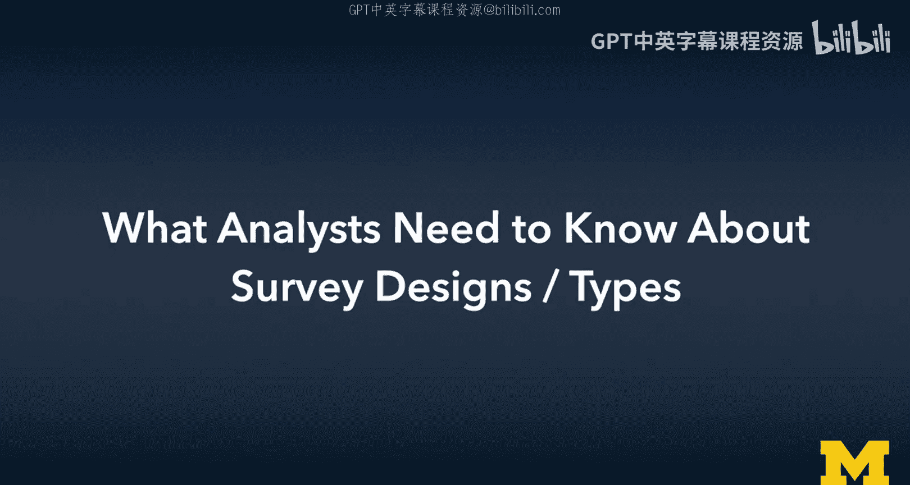
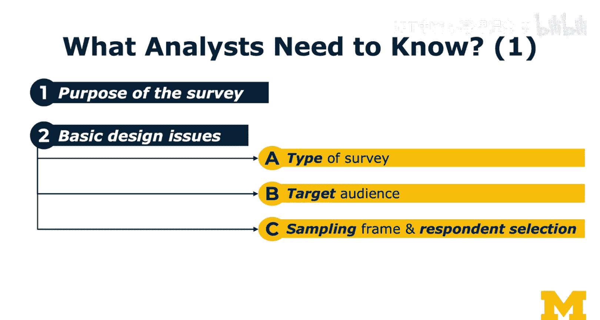
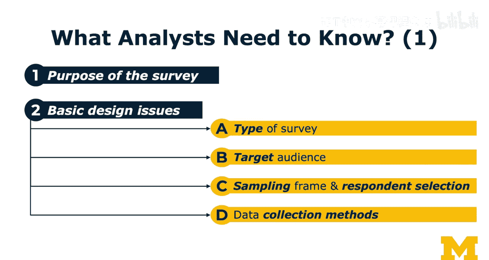
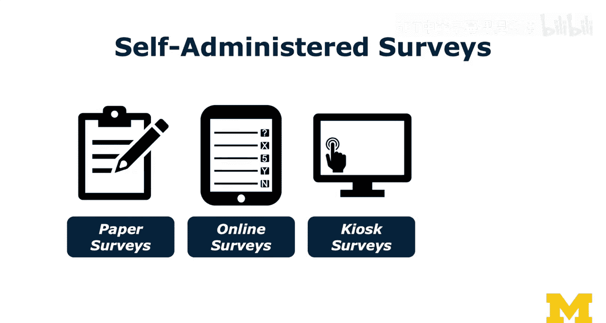
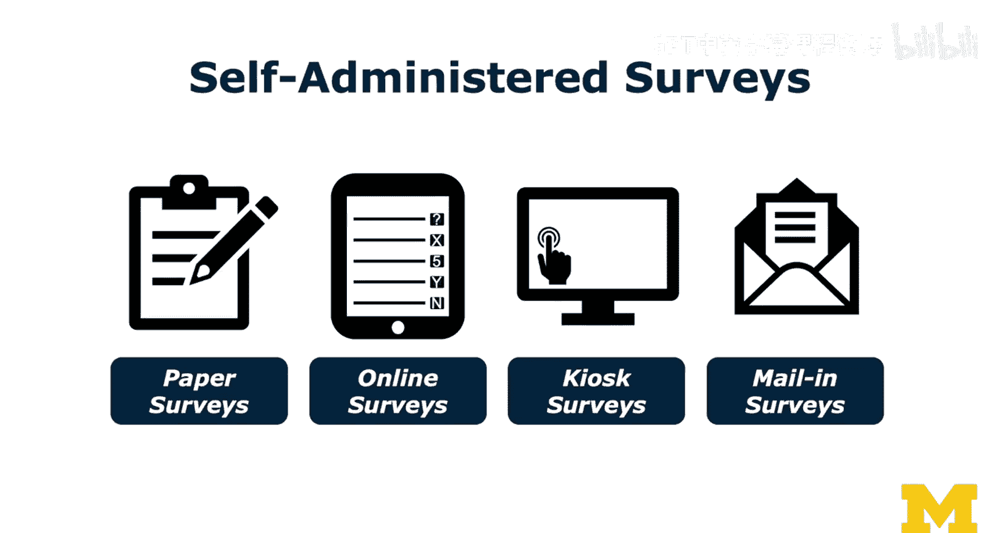
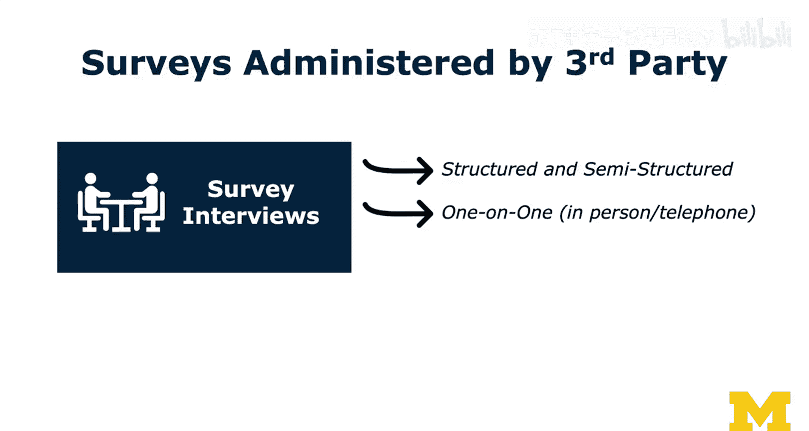
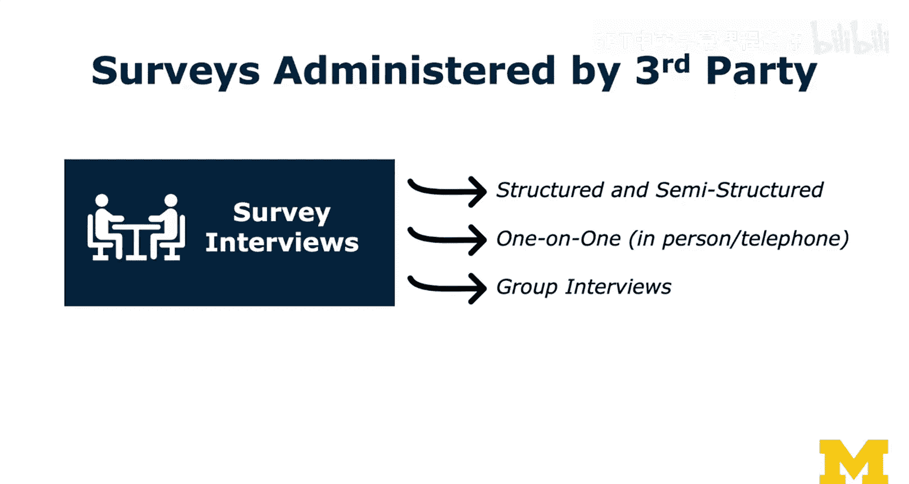
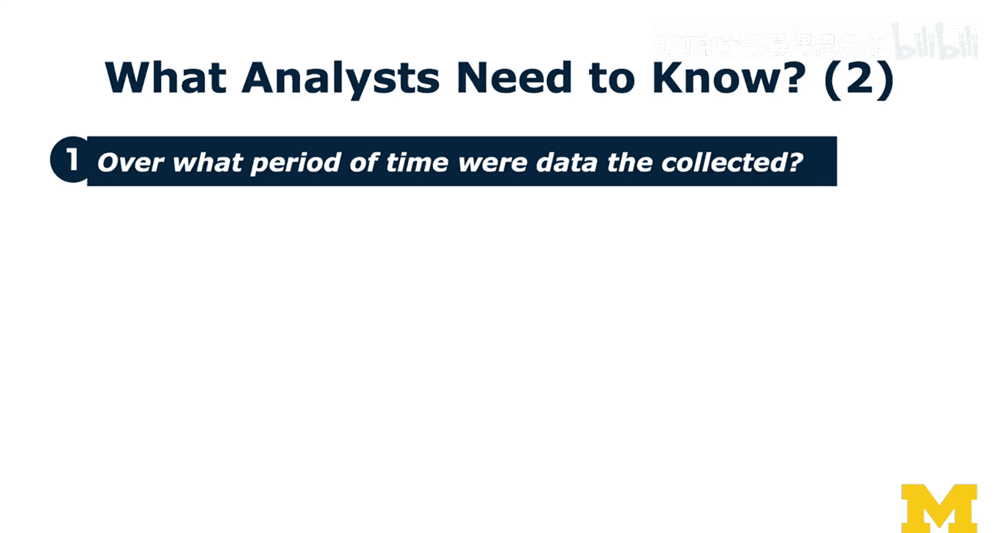
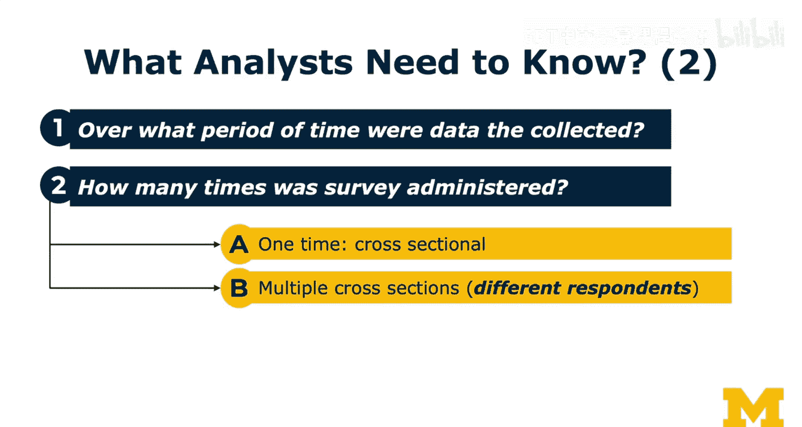
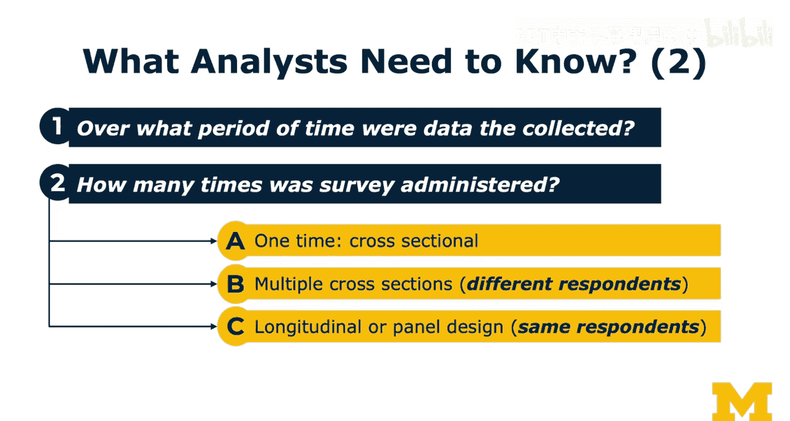

# 20：分析师必备：调查设计类型解析 📊

在本节课中，我们将学习调查数据分析的基础知识。作为一名数据分析师，在开始分析调查数据之前，必须理解调查的基本设计要素。这包括调查的目的、设计类型、数据收集方式以及时间维度。掌握这些信息是确保分析结果准确、可靠的前提。

## 理解调查目的与设计

上一节我们介绍了课程概述，本节中我们来看看调查数据分析的起点。在分析任何调查数据之前，分析师首先需要理解两个核心问题。

第一，需要理解**调查的目的**。这包括了解谁创建了这项调查，以及其目标或意图是什么。

第二，需要理解**调查的设计**。这意味着需要了解以下类型的信息。

以下是调查设计需要了解的关键信息：
*   调查的类型。
*   调查的目标受众或目标应答者群体。
*   抽样框和应答者选择方法。

## 抽样框与数据收集方法

理解了调查的基本目的后，我们需要深入了解数据是如何获取的。抽样框定义了调查的总体范围，而数据收集方法则决定了信息的获取方式。

例如，一个地方政府可能希望调查其辖区内的所有企业。它可以从税务部门获取去年纳税的企业名单，然后从该名单中随机抽取企业样本进行调查。政府可以对所有企业进行调查，但这需要更多资源且耗时。因此，通常可以从这个更大的企业总体中抽取一个随机样本。如果操作正确，从随机样本中获取的数据可以用来代表总体。这样就不必调查所有企业，抽样成本更低、效率更高，但能代表所有企业。

调查设计的另一个重要基本要素是数据实际收集的方式。这让我们回到对所用调查类型的理解。

## 调查类型：自填式与他人协助式

了解了数据来源后，我们来看看数据是如何被收集的。总的来说，调查可以分为自填式或他人协助式。

自填式调查由应答者自己完成。他人协助式调查则由访问员向应答者提问并记录答案。

以下是自填式调查的几种形式：
*   **纸笔调查**：应答者自己填写印有调查问题的纸张。
*   **在线调查**：应答者通过互联网（通常在家中）回答问卷问题。
*   **服务亭调查**：政府经常使用，通常在政府大楼等公共场所设置站点，邀请人们上前在屏幕上回答一些调查问题。服务亭显然连接到互联网，答案被收集并存储在数据集中。
*   **邮寄调查**：这是纸笔调查的另一种形式，但使用邮政服务将调查问卷邮寄给人们。邮寄调查的回复率通常很低。如果随信附上已付邮资的回邮信封，回复率会高得多。

对于由他人协助进行的调查，这通常昂贵得多，但出于多种原因而被采用。一个原因是当调查篇幅较长，或涉及一些复杂问题、需要比调查表上的简单复选框更详细的叙述性或定性回答时，这是一种更好的方法。当试图通过电话调查接触大量人群样本时，由访问员进行的调查也是一个好方法。此外，当政府调查的目标受众中有些人无法阅读时，采用访问员的调查方式几乎是唯一的选择。

## 访谈类型：结构化与半结构化

在他人协助的调查中，也存在多种形式。这包括结构化和半结构化的调查访谈。

**结构化**意味着所有问题都是预先确定的，访问员只需读出问题并记录应答者的答案。

**半结构化**意味着许多问题是预先定义和确定的，但访问员也可以追问和提出额外问题，真正与应答者进行对话，以获取更详细、清晰和有用的信息。

一个简单的例子：我曾为美国疾病控制与预防中心进行过一系列超过200次的半结构化访谈，对象是地方部落政府官员，旨在更多地了解他们实施一项最初为州而非部落设计的政府项目的经验。这些是一对一的结构化访谈，每次访谈超过一小时。这显然是一种劳动密集型的方法，但获得的信息与仅仅让人们自己填写简单的纸质表格截然不同。

其他类型的调查访谈包括小组访谈。这是一种方法，一组人同时在同一地点，由访问员同时向他们提问，但每个人私下在调查表上写下自己的答案。小组内部不讨论或分享答案。

这与所谓的焦点小组访谈不同。焦点小组访谈中，一小群人同时在一个房间或Zoom通话中，由访问员提问，但在这种情况下，小组会大声回答问题，他们不仅回答问题，还会彼此讨论自己的观点和看法。焦点小组访谈的目的实际上是引发小组讨论，以便了解在一对一提问时通常无法了解到的事情。

## 调查的时间维度

在深入分析数据之前，调查数据分析师还需要了解数据收集的时间跨度。

你需要知道和理解的一点是，这些调查数据是在多长时间内收集的。数据是在许多周、许多月、一年还是超过一年的时间内收集的？你需要了解所有这些，以理解你将得出的结果所代表的时间段。

此外，如果一项调查在某个事件（例如自然灾害、某种政府危机或其他我们所说的冲击或事件）发生前后都在收集数据，你需要知道这一点，以便查看该事件前后的结果是否不同。

分析师还需要知道一项调查是否是横截面调查。这意味着它是在一个时间点实施的。因此，应答只代表那一个时间点。或者，一项调查可能是横截面设计，但属于我们所说的多重横截面设计。这意味着调查会持续重复进行，但针对不同的人，或者说在每个时间点调查的是人口的不同横截面。年度调查通常就是这种情况，它们属于多重横截面调查。

然而，一项调查也可能是持续进行的，并长期跟踪同一群人，这种情况下被称为纵向调查或面板调查。

## 总结

本节课中我们一起学习了调查数据分析前必须掌握的基础知识。我们探讨了理解调查目的和设计的重要性，包括明确调查类型、目标受众和抽样方法。我们详细区分了自填式调查（如纸笔、在线、服务亭、邮寄）和他人协助式调查（如结构化与半结构化访谈、小组访谈、焦点小组）。最后，我们分析了调查的时间维度，包括横截面设计、多重横截面设计以及纵向（面板）设计。理解这些核心概念是确保后续数据分析工作有效、准确的关键第一步。