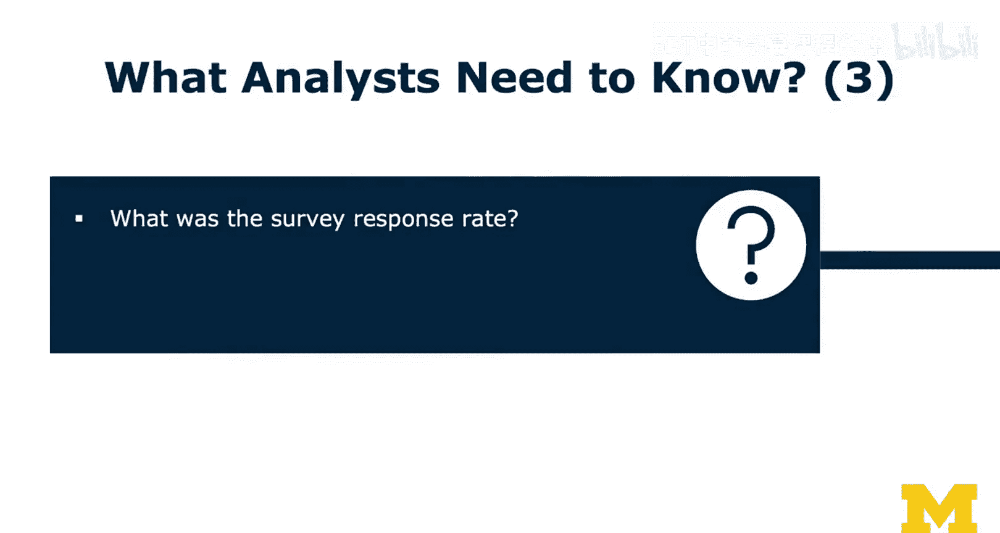
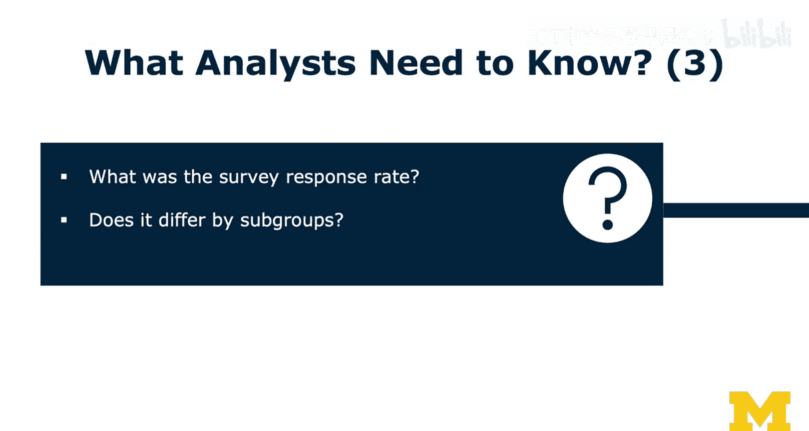
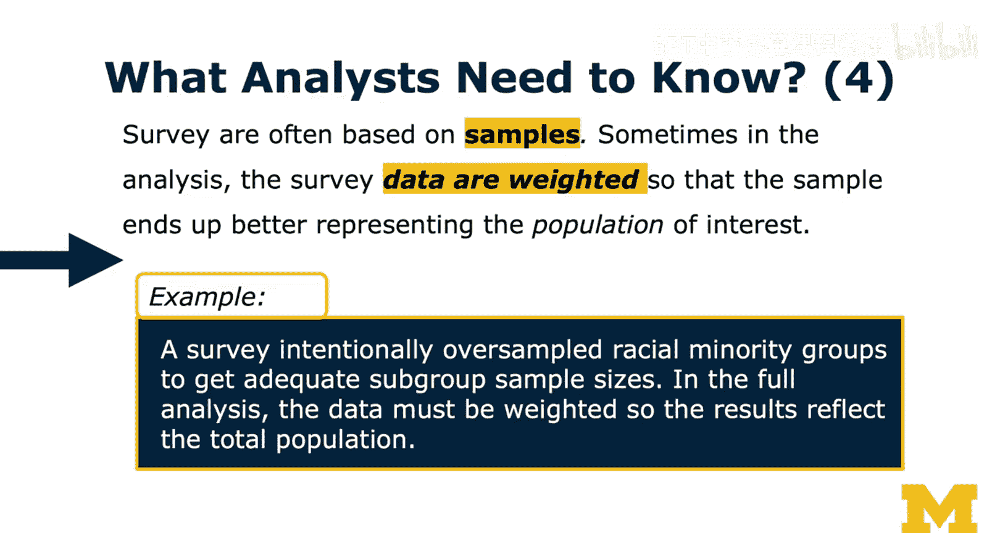

# 公共部门的R数据分析：20：调查分析师必备：调查实施要点 📊

在本节课中，我们将深入探讨调查数据分析师必须掌握的几个核心实施要点。我们将了解如何评估调查数据的质量，以及为何需要理解调查设计和权重。

---

## 概述

作为数据分析师，理解调查数据的来源和收集方式至关重要。本节将介绍两个关键概念：**调查回复率**和**调查权重**。理解这些概念有助于我们评估数据的代表性，并确保分析结果的准确性。

---

## 调查回复率

上一部分我们讨论了数据的基本属性，本节中我们来看看调查数据特有的一个关键指标：回复率。

调查分析师需要知道调查的回复率是多少。回复率是指，在所有被邀请参与调查的单位（可以是个人、学校、企业、教堂或其他宗教组织等）中，实际完成或开始了调查访谈的比例。

回复率的计算公式如下：

**回复率 = (已开始的访谈数 / 被联系、符合条件且被邀请参与调查的总人数) × 100%**

需要注意的是，计算回复率实际上比我刚才提到的更复杂，大多数调查会有多个回复率。但就我们的目的而言，作为数据分析师，你应该了解总体的回复率，以及回复率是否因不同亚组（例如性别、年龄、地理区域、教育状况）而异。

回复率帮助我们理解数据是否真正代表了更广泛的人群，或者结果中是否存在某些偏差。

---

## 调查权重

了解了数据的回复情况后，我们还需要关注一个更技术性的细节：调查权重。

分析师需要知道数据集中是否存在需要使用**调查权重**的情况。调查权重是由调查方法学家创建的，作为分析师，你需要知道你使用的数据集是否包含调查权重、权重的不同类型，以及在分析数据时是否应该使用这些权重。

让我们更深入地探讨一下。调查几乎总是基于**样本**，即从更大总体中选择的一部分案例。在数据分析中，调查数据通常需要进行加权。这是一个由你所用的统计软件包执行的数学过程。

加权会对样本受访者施加不同的“计数”或“权重”，目的是使你的分析结果能更好地代表所关注的全部总体。

以下是一个例子：
一项调查可能有意**过度抽样**了少数种族或文化群体，以便为不同亚组的统计分析获得足够的样本量。在完整的分析中，数据必须进行加权，这样这个被过度抽样的亚组就不会在整体结果中被过度代表。这样做是为了确保完整的样本结果不会因该群体的过度代表而产生偏差，从而使其能反映总人口的情况。

我知道我向你抛出了很多术语和技术细节，但对于分析师来说，理解基本的调查设计、用于收集所分析数据的方法、回复率是多少以及分析中是否需要应用调查权重，确实非常重要。

来自调查的数字和数据都有其来源，它们并非神奇地出现在你面前的数据集中。因此，你真的需要了解数据为何以及如何被收集，以及这些其他基本细节，以便将你的分析工作置于正确的背景之中。

---

## 总结

本节课中，我们一起学习了调查数据分析师必须掌握的两个核心实施要点。我们明确了**调查回复率**的定义和重要性，它帮助我们评估数据的代表性。我们还深入探讨了**调查权重**的概念及其作用，即通过数学调整确保样本结果能无偏地推断总体。理解这些调查实施的基础，是进行严谨、可信的数据分析的前提。