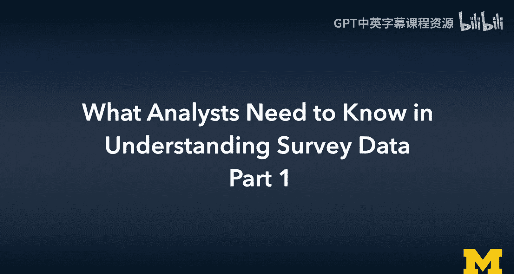
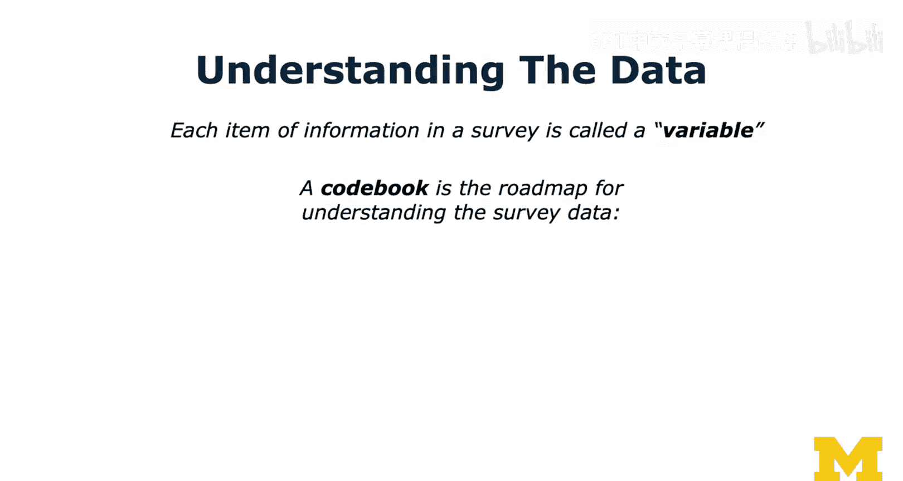
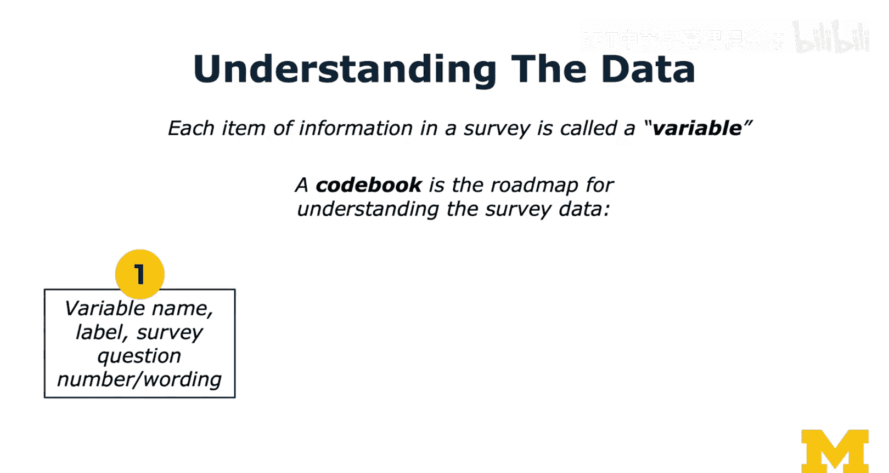
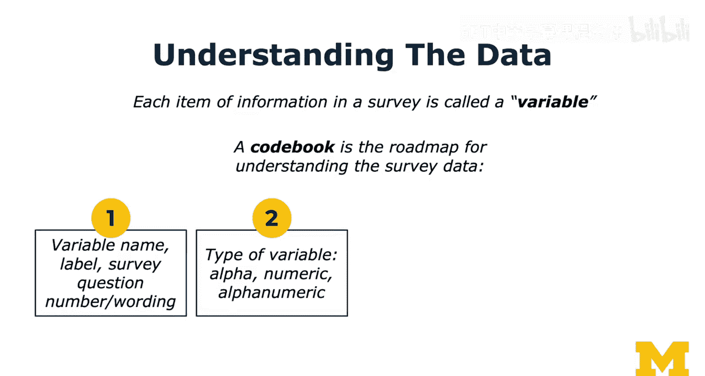
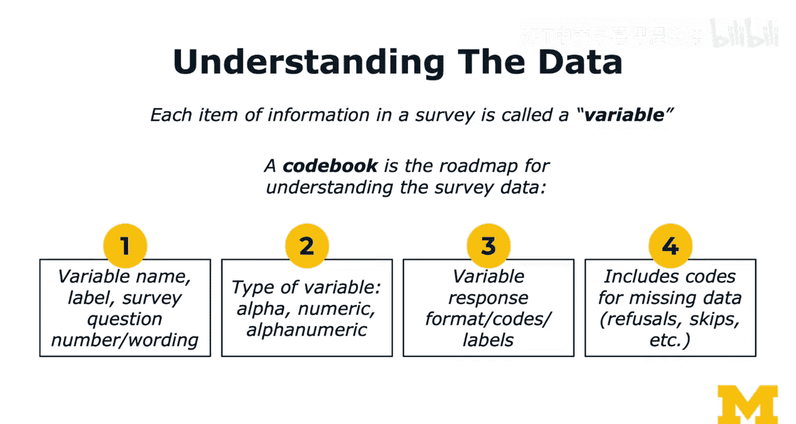
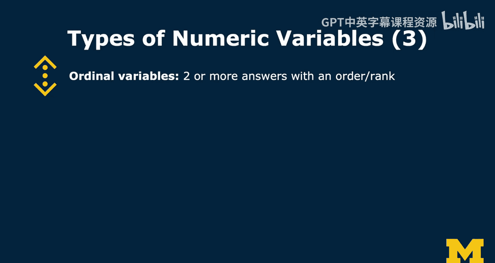
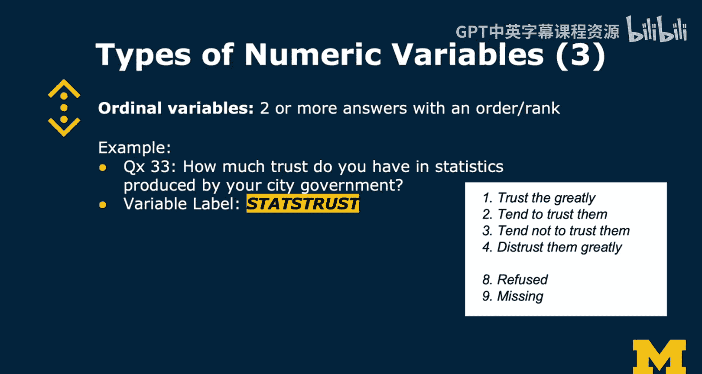

# 公共部门的R数据分析：22：调查数据理解方法论（第一部分）🔍

在本节课中，我们将学习如何理解调查数据集。我们将介绍数据集中变量的基本概念、类型以及解读数据的关键工具——编码手册。

---

上一节我们探讨了调查的目的、设计、类型和抽样方法。现在，我们将进入分析调查数据的环节。

相应地，我们需要花些时间来理解数据集的内容，了解实际收集了哪些数据以及它们的格式。

---

调查数据集中的每一项信息都称为一个**变量**。

每个数据集都附带一份**编码手册**，这对于理解调查数据中的所有变量至关重要。你可以将编码手册视为理解和分析调查数据的路线图，它通常包含以下内容。

以下是编码手册包含的核心信息：

*   **变量名**：数据中的每个变量名，通常是一个简短的名称，用于分析。
*   **变量标签**：对变量实际含义的较长描述。
*   **调查问题编号**：来自调查问卷的问题编号，确保你能将编码手册和数据中的变量与调查中提出的问题联系起来。
*   **问题原文**：调查中该问题的实际措辞。

编码手册还包含每个变量的类型信息。我们将主要考虑三种变量类型，当然它们各自还有子类型。

以下是三种主要的变量类型：

1.  **字母变量**：该变量的回答仅包含字母。例如，某人的姓名，或开放式问题中的简短文本。
2.  **数值变量**：该变量的回答仅包含数字。
3.  **字母数字变量**：该变量的数据同时包含数字和字母。

统计分析只能在数值变量上进行。因此，当调查数据收集时，如果包含字母或字母数字的回答，通常需要在进行分析前将其重新编码为数字。

例如，一项调查可能要求人们列出他们最喜欢自己社区的哪些方面。这会生成大量文本或字母回答。这些回答随后会进行定性分析，并归类分组，每组会获得一个对应的数字，以便进行统计分析。

---

最后，编码手册包含每个变量的格式和潜在回答代码信息，以及每个数字的清晰标签。

需要指出的一点是，编码手册还会明确指出当数据缺失时，每个变量被赋予的代码。这意味着受访者没有回答问题，可能是因为跳过了、提前退出调查、漏答了问题，或者是明确拒绝回答。

---

现在，让我们回到调查中最常见的变量类型——数值变量，这也是唯一可用于统计分析的变量类型。

---

数值变量本身也有几种不同的类型。

首先，我们有**名义变量**。名义变量是指调查问题有两个或更多可能的答案，但这些答案没有内在的顺序或排名。例如，询问某人“是或否”、“对或错”。另一个例子是询问某人的婚姻状况。

在这个例子中，我们看到这是调查中的第12个问题，问题是“你目前的婚姻状况是什么？”。编码手册中这个变量名为 `Mar_status`。分析师在进行任何分析时，会在命令或代码中输入这个名称。这里有九个可能的值（都是数字）：1=未婚，2=同居，3=已婚，等等。你还可以看到，代码8表示受访者拒绝回答问题，代码9表示数据缺失。

---

接下来，我们讨论**连续变量**。连续变量是指受访者输入一个代表实际数量的数字。例如，孩子的数量、上个月去公园的次数、月收入、拥有多少只宠物。年龄也是一个连续变量的例子。

在这个例子中，我们看到调查问题15询问“你的年龄是多少？”，并且这个变量的格式是连续的，意味着调查设计允许受访者直接填写自己的年龄。

然而，年龄在调查中也可以格式化为**顺序变量**。顺序变量是一种数值变量，其回答具有某种隐含的顺序或排名。

在这种情况下，变量“年龄”的顺序格式可以为受访者提供五个年龄组供选择，以表明他们的年龄落在哪个范围内：1=小于18岁，2=19至39岁，等等。调查设计者可以使用少量分组（如本例所示），但如果想获得更精确的年龄，也可能使用5岁或10岁的年龄范围。

思考一下：你认为哪种方法能从受访者那里收集到最准确的年龄数据？是让人们直接填写年龄的连续格式，还是提供不同年龄组的选择格式？

调查研究表明，提供小的年龄分组能获得最准确的信息。事实证明，很多人不喜欢报告自己的确切年龄，他们担心这会成为识别信息，从而担心结果无法匿名（而匿名性通常是调查研究中承诺的）。此外，有些人因为不想显得那么老或不想让人知道自己的年龄，会倾向于将年龄向下取整，并且通常取整到以5或0结尾的数字。因此，如果想在调查中获得非常准确（而非近似）的年龄信息，使用小的年龄分组是最佳方式。

---

好的，继续前进。这是调查中另一个顺序变量的例子，其定义是具有两个或更多可能回答、且回答具有某种隐含顺序或排名的变量。

这里我们有一个态度变量的例子：“你对市政府发布的统计数据有多少信任？”。我们的编码手册显示这是调查中的第33个问题，可能的答案是：1=非常信任，2=倾向于信任，3=倾向于不信任，4=非常不信任。代码8用于表示拒绝回答的受访者，代码9表示数据缺失。你可以看到，这些回答在衡量“信任”这个概念上具有隐含的顺序。

---

本节课中，我们一起学习了理解调查数据的基础。我们认识了变量和编码手册的重要性，区分了字母变量、数值变量和字母数字变量，并重点探讨了用于统计分析的数值变量的子类型：名义变量、连续变量和顺序变量。理解这些概念是准确分析和解读调查数据的第一步。