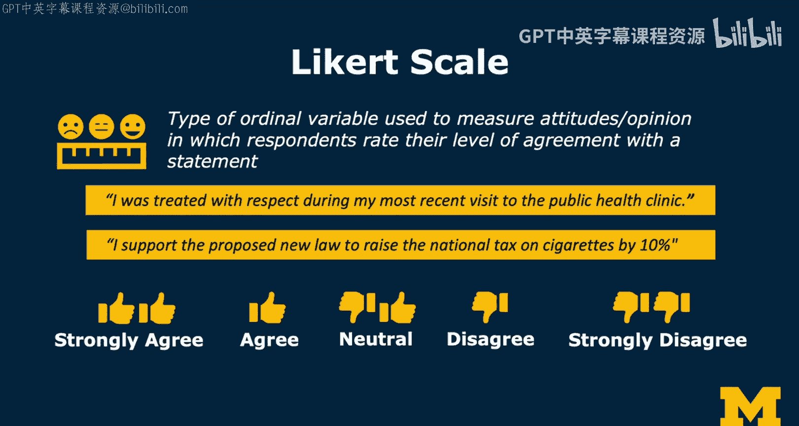

# 23：调查数据理解方法论（第二部分）📊

在本节课中，我们将继续学习调查数据的方法论，重点介绍一种特定的序数响应量表——李克特量表。我们将了解它的定义、用途和常见示例。

---

## 李克特量表：定义与起源

上一节我们介绍了变量类型和格式。本节中，我们来看看一种在态度和意见测量中极为常见的序数量表。

一种特定类型的、使用序数响应量表的调查问题被称为“李克特量表”。这个量表实际上是以密歇根大学的一位调查研究教授的名字命名的，这位教授就是**李克特教授**。

---

## 李克特量表的用途与结构

李克特量表用于测量态度和意见。其操作方式是向受访者提供一个陈述，然后让他们选择在多大程度上同意或不同意该陈述。相信大家都填写过包含此类问题的调查问卷。

这类问题通常有五个响应类别。以下是一个例子：

*   **陈述**：在我最近一次去公共卫生诊所就诊时，我受到了尊重。
*   **调查问题**：您在多大程度上同意或不同意这一说法？

另一个使用李克特量表的调查问题示例是向受访者提出如下陈述：

*   **陈述**：我支持将国家香烟税提高10%的新提案法律。

然后，受访者需要在以下选项中选择答案：
*   非常同意
*   同意
*   中立（或既不同意也不反对）
*   不同意
*   非常不同意

---

## 深入探索与展望

关于不同类型的变量格式、变量的构建与使用方法，以及在调查中如何分析数据，还有更多内容需要理解。

随着我们深入研读一些数据字典，您很快就会更详细地看到这些内容。

---

## 总结

本节课中，我们一起学习了**李克特量表**。我们了解到它是一种以学者命名的、用于测量态度和意见的序数量表，其核心是让受访者对给定的陈述表达同意或不同意的程度，通常包含五个标准选项。掌握这种常见的问题格式，是理解和分析调查数据的重要基础。