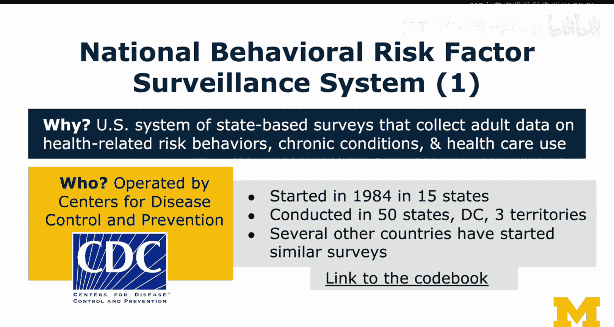
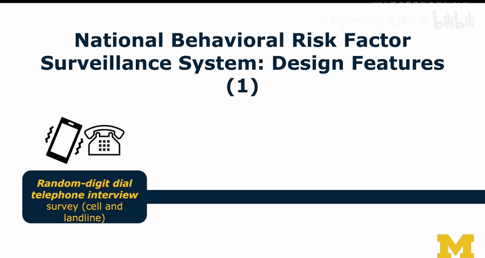
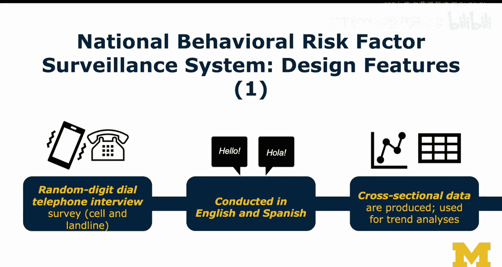
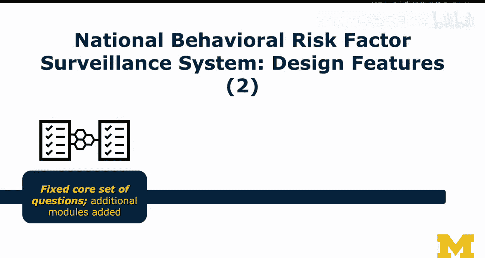
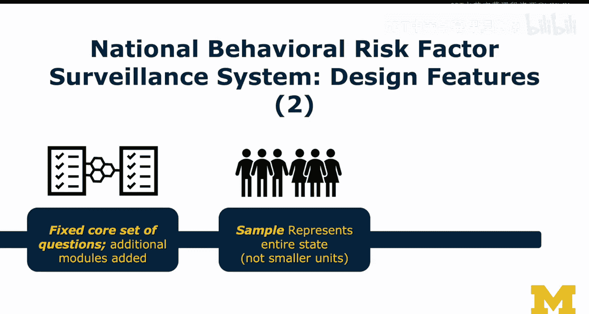
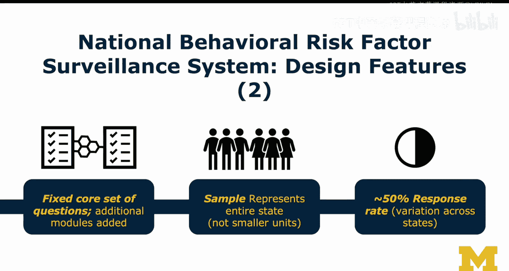
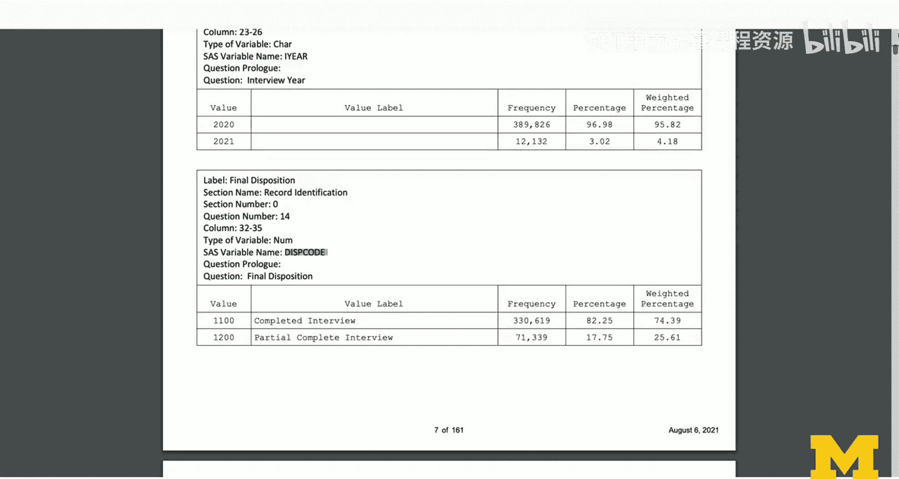
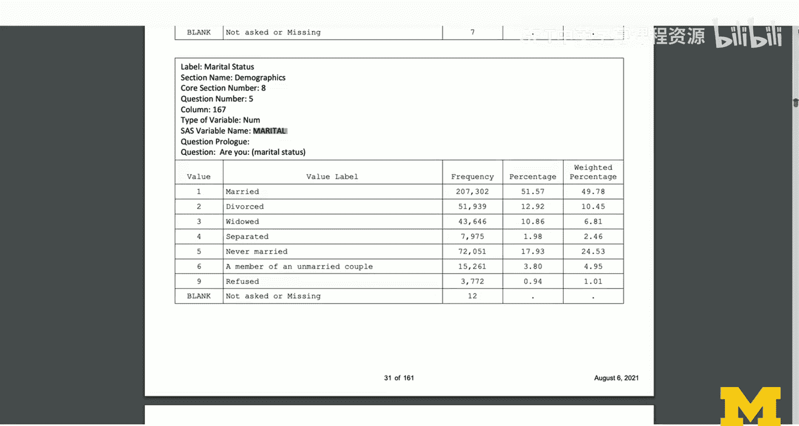
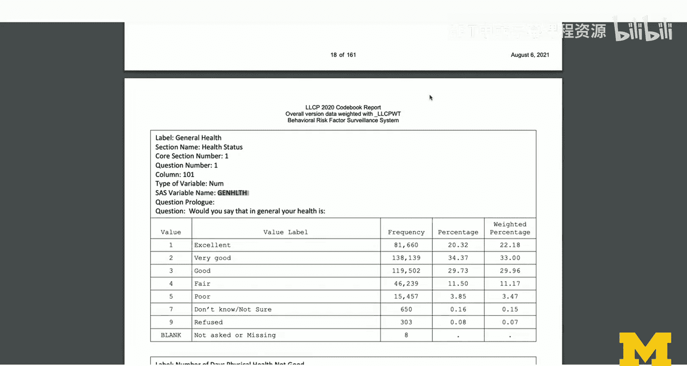

# 24：代码本解读实例 📖

在本节课中，我们将继续探讨调查数据分析，重点学习如何解读和使用调查代码本。代码本是分析师理解调查问卷结构、数据存储方式以及进行分析所需全部信息的“路线图”。

上一节我们讨论了调查数据的基本概念，本节中我们来看看如何通过一个具体实例来理解代码本。

---

## 概述：什么是调查代码本？

调查代码本为分析师提供了理解数据所需的完整蓝图。它说明了用于收集数据的调查问卷是什么样子，收集到的数据如何存储，以及分析所需的所有信息。理解这一切的最佳方式就是直接深入一个实例。

我们将以美国“行为风险因素监测系统”的代码本报告为例进行解读。这是一个基于州的电话调查，收集与健康相关的风险行为、慢性病和医疗使用等成人数据。该调查始于1984年，现已覆盖美国所有50个州、哥伦比亚特区及三个属地，并且其方法已被全球超过20个国家采用。

以下是关于该调查的一些关键信息：
*   **调查类型**：这是一项随机数字拨号的电话调查，旨在获取各州成年人口的随机代表性样本。最初仅使用固定电话，现已扩展到包括手机。
*   **语言**：调查使用英语和西班牙语进行。
*   **数据类型**：数据每年收集，每年使用全新的样本，因此属于**横截面数据**，而非追踪同一批人的纵向数据。
*   **问卷结构**：调查包含一套每年使用的固定核心问题集，同时每年会增加一两个附加模块，以收集关于新兴健康问题（如COVID-19）的信息。
*   **地理层级**：样本代表整个州，而非县或市等更小的地理单位。数据分析师需注意，不能将基于高级别地理单元抽样的数据随意向下钻取分析。
*   **响应率**：该调查的响应率约为50%，这对于当今的电话调查来说是相当标准的水平。

您可以在幻灯片或其他资料中找到2020年行为风险因素调查代码本报告的链接。该报告长达161页，我们不会逐一讲解，但会通过几个关键例子，展示代码本中通常包含的信息类型。

---

## 代码本信息解读示例

代码本中包含的信息，有些并不直接出现在给受访者的问卷中，但对分析师至关重要。

### 示例一：调查完成状态变量 (`_DISPCODE`)

我们来看一个名为 `_DISPCODE` 的变量。变量标签告诉我们，它代表“最终处置状态”，即访谈是否完成。

以下是关于此变量的关键信息：
*   **变量类型**：这是一个**数值型变量**，意味着在数据集中该变量的值只能是数字。
*   **取值与含义**：从代码本报告的频率表中可以看到，主要取值有两个：1代表“完成访谈”，2代表“部分完成访谈”（即未完成全部问题）。
*   **数据分布**：报告显示，82.25%的受访者完成了全部访谈，17.75%的受访者在结束前退出。了解这些信息对分析师很重要，不仅能知道总响应率，还能了解有多少人完整完成了整个调查。

### 示例二：人口统计变量 (`_MARITAL`)

代码本中当然包含所有关于受访者的人口统计信息，如性别、年龄、收入、教育背景等。我们以婚姻状况变量 `_MARITAL` 为例。

以下是关于此变量的详细信息：
*   **变量含义**：代表婚姻状况，属于人口统计部分。
*   **定位信息**：代码本会告诉你它在调查数据中的位置，例如：属于核心部分第8节，是第5个问题，位于数据文件的第167列。这些是分析师在数据集中定位该变量所必需的信息。
*   **变量类型**：同样是一个**数值型变量**。
*   **问题与编码**：代码本展示了受访者被问到的问题原文：“您是已婚、离异、丧偶、分居、从未结婚，还是未婚伴侣关系的一员？” 可能的回答被编码为数字：1=已婚，2=离异，3=丧偶，4=分居，5=从未结婚，6=未婚伴侣。
*   **应答分布**：代码本报告会展示回答的分布情况，例如：2020年，51.57%的受访者回答“已婚”，12.92%回答“离异”等。
*   **特殊编码**：代码本中还会显示特殊值，例如值 `9` 代表“拒绝回答”。约有3,800人（略低于1%）拒绝回答此问题，他们被编码为9。此外，还有极少数人（12人）因故未被问及此题，属于“未询问/缺失”。区分“拒绝回答”和“缺失数据”非常重要，它们不是一回事。

### 示例三：健康状态变量 (`GENHLTH`)

几乎所有政府健康调查都会包含一个关于总体健康状况的问题。变量名为 `GENHLTH`。

以下是关于此变量的详细信息：
*   **变量含义**：指“总体健康状况”问题。
*   **定位信息**：它位于“健康状况”部分，是第一个问题，在数据文件的第101列。它是一个数值型变量。
*   **问题与编码**：访谈员问受访者：“总的来说，您认为您的健康状况是？” 选项为：极好、很好、好、一般、差。这些回答分别对应数值1到5。
*   **应答分布与特殊编码**：查看频率分布时，你会发现有些人回答“不知道/不确定”（尽管这不是预设选项），约有650人（不到0.5%）如此回答。此外，有303人拒绝回答此问题（编码为7）。还有极少数人因故未被问及此题。这些情况都在频率分布中有所体现。

---

## 总结与建议

我知道，深入代码本的细节可能不那么令人兴奋，但因为你将使用这个数据集进行分析，我们强烈建议你花些时间浏览整个代码本。

在开始分析数据之前，请尝试：
*   查看所有不同的变量。
*   了解不同类型问题的提问方式。
*   查看回答的分布情况。
*   注意调查中的跳转模式（在代码本中也能看到）。

本节课中，我们一起学习了如何解读调查代码本。我们通过国家行为风险因素监测系统的实例，了解了代码本如何作为数据分析的路线图，提供了变量定义、编码方式、问题原文以及数据分布等关键信息。熟悉代码本是进行准确、有效数据分析的重要第一步。