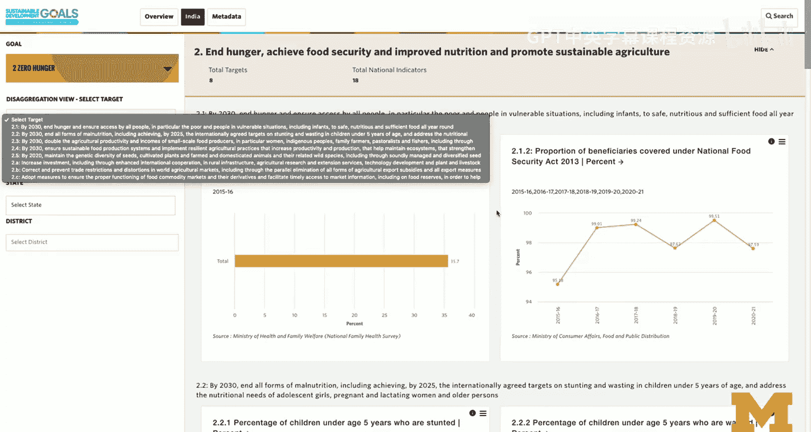
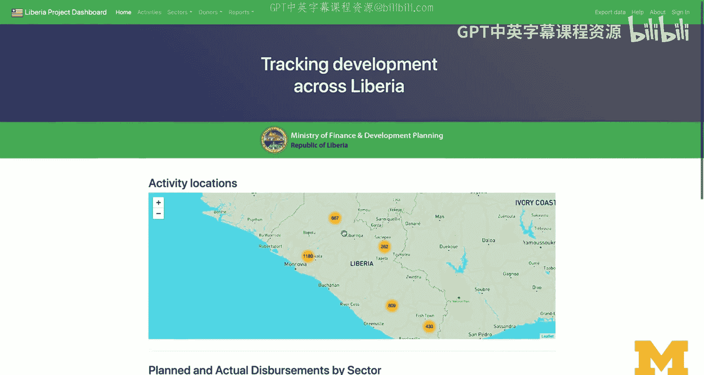
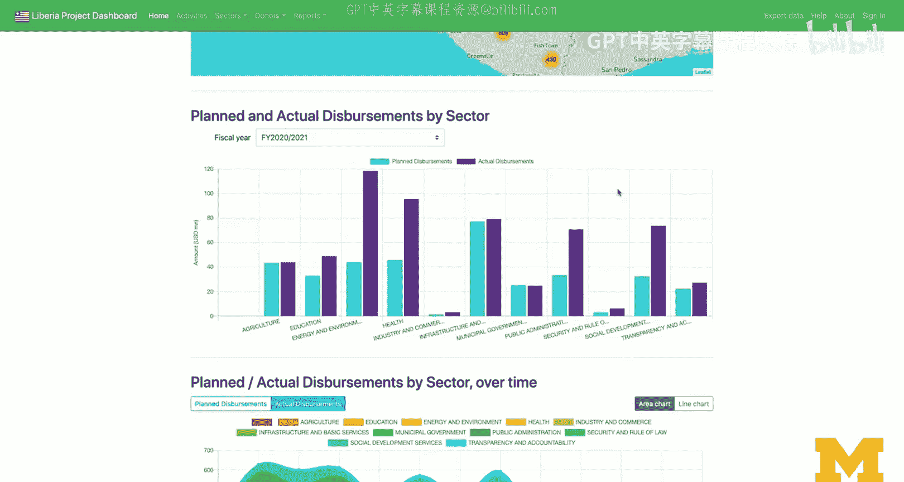
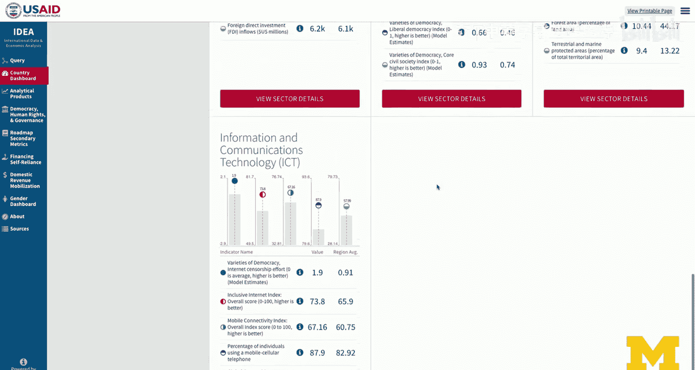
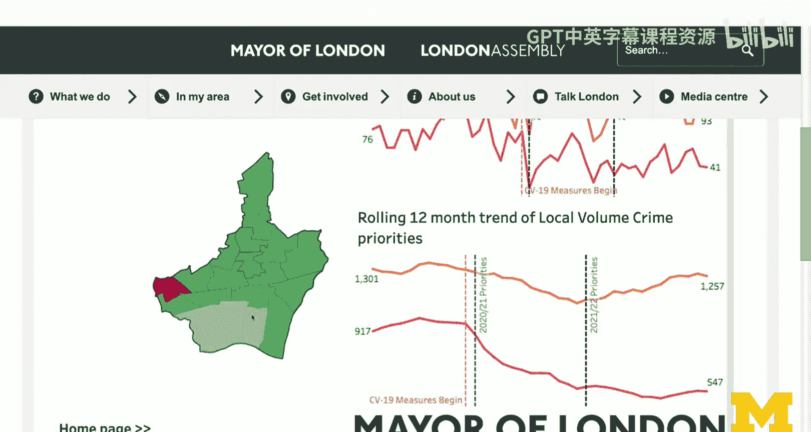
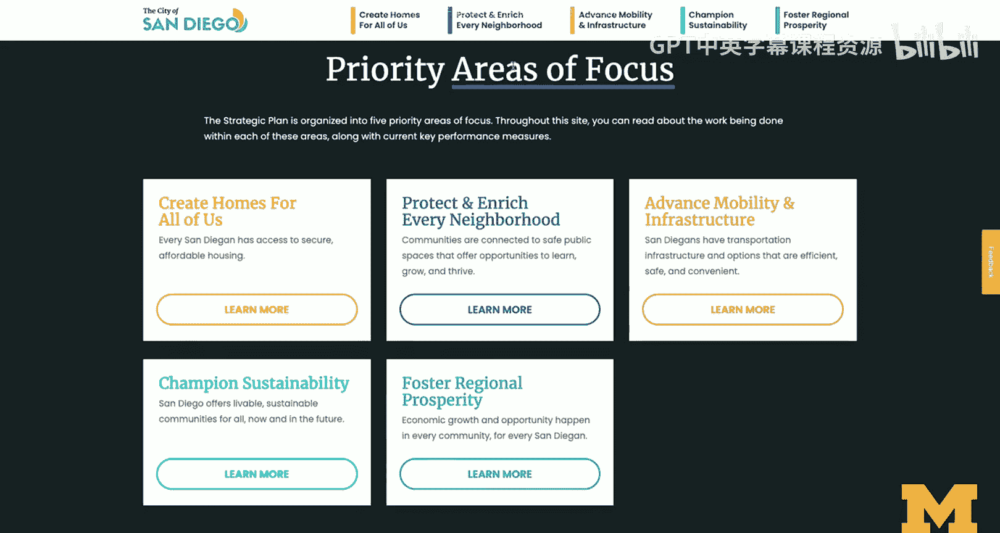

# 公共部门的R数据分析：25：数据看板典型案例 📊

在本节课中，我们将学习数据看板在公共部门中的应用。数据看板已成为政府向公众沟通和报告数据的重要方式。我们将通过几个典型案例，了解不同层级政府如何使用看板来分享信息、报告目标进展，并探讨优秀看板的设计特点。

---

上一节我们介绍了数据看板的基本概念，本节中我们来看看具体的应用实例。

首先，我们以印度政府为例。印度国家政府拥有众多数据看板，其中一个由统计和计划执行部创建，用于展示印度可持续发展目标的进展。

该看板内容非常丰富。用户可以点击17个可持续发展目标中的任何一个。例如，点击目标3“确保健康的生活方式，促进各年龄段人群的福祉”后，可以进一步查看该目标下的13个具体指标。针对每个指标，看板都提供了展示进展的数据可视化图表。

可持续发展目标2是“零饥饿”。在看板上点击该目标，可以看到其具体描述：“消除饥饿，实现粮食安全，改善营养状况和促进可持续农业”。深入看板细节，会发现该目标下共有8个具体指标。例如，指标1是“到2030年，消除饥饿，确保所有人，特别是穷人和弱势群体，全年都能获得安全、营养和充足的食物”。看板通过数据可视化展示了这8个指标各自的进展。

这是一个高度交互式的看板，用户可以花时间探索，它以非常高效的方式提供了大量信息。

---

接下来，我们看另一个例子。利比里亚政府财政和发展规划部最近发布了一个看板。

该看板主要展示政府在不同部门的资金支出情况，即计划拨款与实际拨款的对比。以下是看板中展示的主要部门类别：

*   农业
*   教育
*   能源与环境
*   公共管理
*   社会发展

这个例子展示了政府如何通过看板，向公众透明地呈现其税收收入的计划支出与实际支出的对比情况。

---

此外，美国国际开发署（USAID）为世界上几乎每个国家都创建了数据看板。在课程提供的链接文档中，可以找到印度尼西亚和阿根廷的看板链接。实际上，你对任何感兴趣的国家，都可以在USAID网站上找到类似的看板。

让我们快速浏览一下阿根廷的看板。

每个看板的设计都各不相同。有些非常复杂且难以操作，有些则更简洁明了。USAID的网站包含大量信息。以阿根廷看板为例，你会看到与饥饿和粮食安全相关的统计数据。

这些统计数据非常详细，包括：

*   谷物产量
*   全球粮食安全指数
*   总生产指数
*   农业就业人数等

你不需要完全理解所有统计指标的含义，未来你会在自己专攻的公共管理领域成为专家。这里的重点是，这些看板能让你快速获取国家层面的一些重要统计数据快照。

在USAID网站上，你还能看到与经济、国内财政收入、教育、性别平等、健康、贸易与投资、民主人权与治理、环境与全球气候变化以及信息通信技术相关的统计数据。

---

许多看板具有交互性，这意味着你可以控制信息的详细程度，并与看板互动以获取不同地理单元或不同子群体的深入数据。

伦敦市的犯罪数据看板就是一个很好的例子。

这个看板非常互动，提供大量信息。你可以获取行政区（Borough）和选区（Ward）级别的犯罪总量与趋势数据。看板提供基本统计数据和简单但重要的数据可视化图表。同时，它包含一张伦敦地图，你可以点击特定的行政区或选区，然后它会显示该伦敦市较小地理区域更详细的统计数据。

因此，这个看板既展示了整个城市的犯罪统计数据，也允许用户深入了解城市不同区域（这些区域的统计数据可能差异很大）的信息。

---

今天分享的最后一个例子来自美国加利福尼亚州的圣地亚哥市。

这个看板明确旨在与市民沟通该市的战略规划。这是一个相当大的城市。看板说明城市制定了战略规划，包含多个重点领域。进入看板后，你可以找到更多信息，例如“关注我们的进程”，在那里可以了解该市战略规划的具体过程、市民如何参与以及如何确定优先事项。

对于实际的战略规划及其重点领域，你可以查看具体内容，了解目标是什么、衡量目标进展的指标，以及当前进展状况。

该市的战略重点领域包括：

*   **为我们所有人创建家园**：包含住房安全目标。
*   **保护和丰富每个社区**：包含社区层面的目标。
*   **推进交通与基础设施**：包含许多与交通相关的目标。
*   **倡导可持续发展目标**：包含许多与环境保护和气候变化相关的目标。
*   **促进区域繁荣**：包含经济目标。

---

我建议你花些时间浏览这些看板，或者自己在网上寻找其他例子。观察它们，并思考以下问题：

首先，创建这些看板需要哪些数据？
其次，你认为看板中哪些是数据可视化和数据呈现的优秀范例？
同时，也找出那些你认为未达标准、难以操作或沟通效果不佳的看板例子。

---

本节课中，我们一起学习了数据看板在公共部门的多种应用案例。我们看到了从印度国家政府的可持续发展目标追踪，到利比里亚的财政支出透明化，再到USAID的国家数据概览，以及伦敦和圣地亚哥市的地方性交互看板。这些案例展示了看板如何以高效、透明和互动的方式，帮助政府与公众沟通复杂数据、报告政策进展并提升治理的透明度。理解这些典型案例，是设计和评估有效公共部门数据看板的第一步。