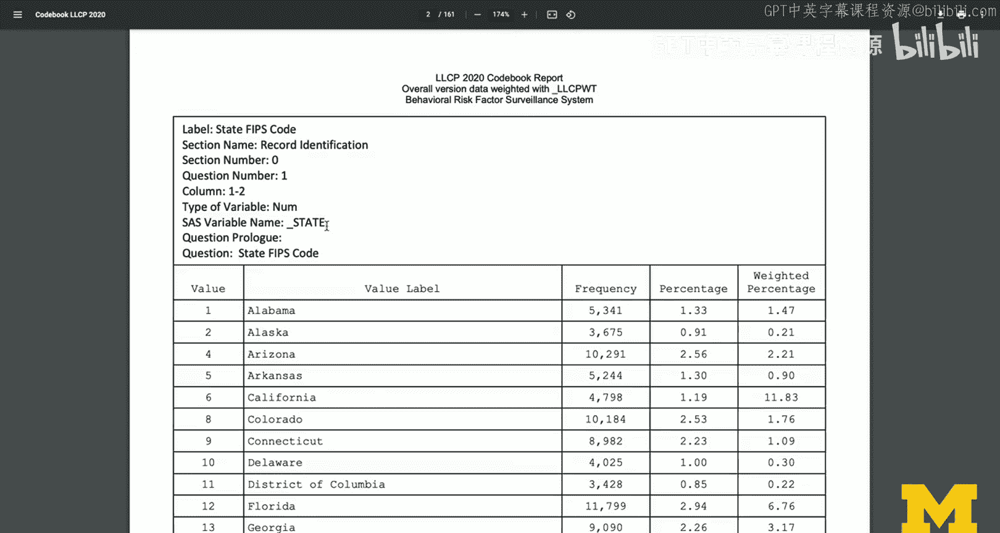
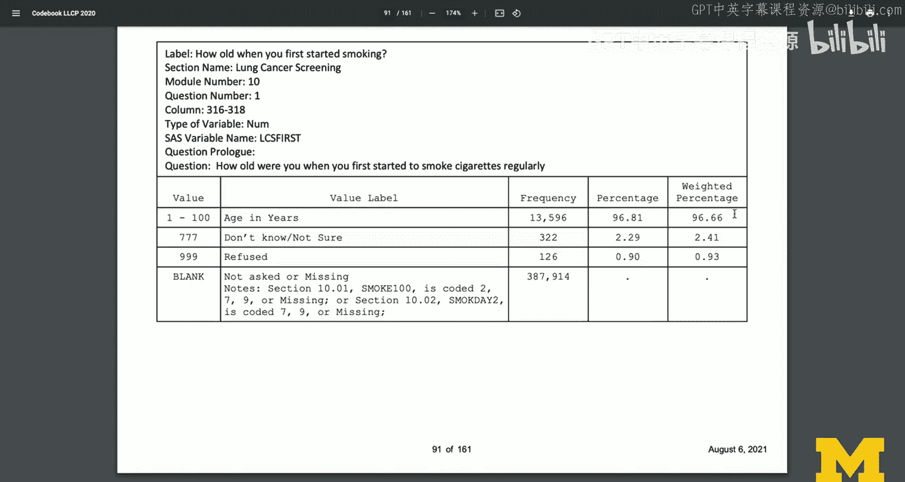

# 公共部门的R数据分析：1.2：行为风险因素监测系统代码本解析 📖

在本节课中，我们将学习如何解析和使用“行为风险因素监测系统”的数据代码本。代码本是理解任何数据集的钥匙，它详细说明了每个变量的含义、编码方式以及数据收集的背景信息。

在深入研究数据的代码本之前，值得先阅读美国疾病控制与预防中心和行为风险因素监测系统提供的概述文档。该文档讨论了数据收集的参数。例如，在此次BRFS调查中，他们混合使用了固定电话和手机抽样来联系潜在受访者。此外，各州可以添加自己感兴趣的特定问题，或选择加入CDC提出的某些问题。

调查设计中有一个重要主题是**如何对回答进行加权**，本课程不会深入探讨。在这项调查中，由于调查的运行方式，家庭电话数量越多的人被联系到的几率就越大。这里开始显现出代表性的挑战。电话访问不便的人群，例如无家可归者、或因工作无法经常接听电话的人，在此数据集中的代表性远低于每个成员都有手机的家庭。

这种人口偏差部分是调查设计所固有的，在基于此数据得出结论时需要予以承认。然而，可以使用其他分析方法来处理部分这类回答，例如根据某人被联系到的倾向性对其进行重新加权。这对于公共部门工作是一个重要且引人入胜的考量，概述文档也提到了CDC如何处理这一问题。

现在，让我们来看看代码本的实际样子，本周我们将一直使用它。所以让我们先熟悉它。

代码本由这些不同的变量组成。这是第一个变量，它被称为**州FIPS代码**。这在联邦数据中非常常见，它用于标识州并将州名映射为一个数值。例如，阿拉巴马州对应数值1。

这里有很多对你有用的信息。它告诉你这是记录标识的一部分，这是确定的第一个问题。它实际上告诉你它在数据列中的起始位置是第1到2列，并给出了一些关于该变量大小的信息以及变量类型。变量类型是数值型，然后是SAS变量名。这对我们很重要，因为这就是R导入这些变量时看到的名字。

让我们看看本周会频繁使用的一个变量。实际上，这个变量是关于肺癌筛查的，我们将仔细研究它。它的SAS变量名是**LCCS_FIRST**。我们可以看到它是一个数值，实际存储在数据集的第316到318列。

我们使用的R包不会直接用到这个位置信息，但有时你需要知道特定列在数据中的确切位置。在顶部我们看到它有一个标签。但在下方，有一个问题。这将是直接向电话受访者提出的问题：“您几岁时开始定期吸烟？”

在代码本内部，他们定义了四个不同的类别：
*   如果值在1到100之间，代表开始吸烟的年龄。
*   如果值是777，代表“不知道或不确定”。
*   如果值是999，代表“拒绝回答”。
*   如果是空白，代表“未询问或数据缺失”。

代码本没有说明该列中超出这些范围的值。我们还看到了每个类别的频率。这实际上告诉我们数据集中每个值有多少个，以及所占的百分比。然后，正如我之前提到的，基于受访者的人口统计和联系特征，例如他们是否在拥有多部电话的家庭中，这里还有一个加权百分比。

以上就是代码本的基本结构。现在你已可以访问这个长达161页的代码本。你不需要全部阅读，但我认为其中有一些不同的代码值得你查看，并跟随课程讲座学习。这是一个非常好的代码本示例，很多代码本远没有这么完善。有些我接触过的代码本甚至是数据收集者留下的便签。

既然我们已经了解了这个代码本，我认为应该开始探索和操作这些数据了。所以，让我们获取数据集，进入R环境，开始工作吧。

本节课中，我们一起学习了如何解读BRFS数据集的代码本。我们了解了代码本的结构，包括变量名、位置、类型、标签、问题原文以及数值编码的含义。我们还讨论了调查数据中加权的重要性及其对代表性的影响。掌握代码本是进行任何数据分析的第一步，它为后续的数据导入、清理和探索性分析奠定了坚实的基础。