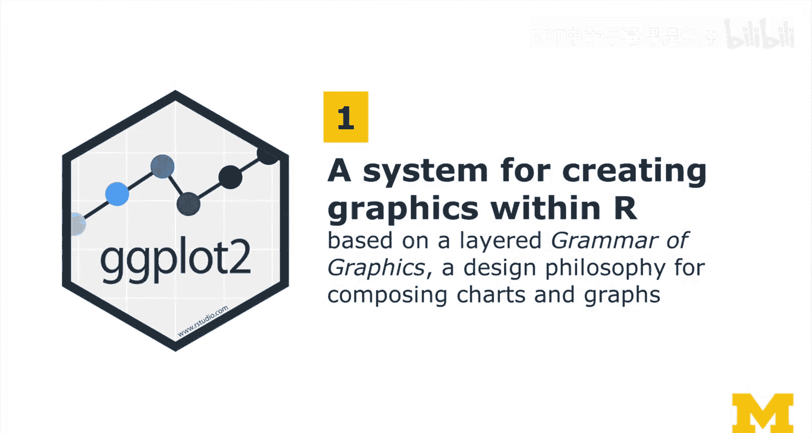
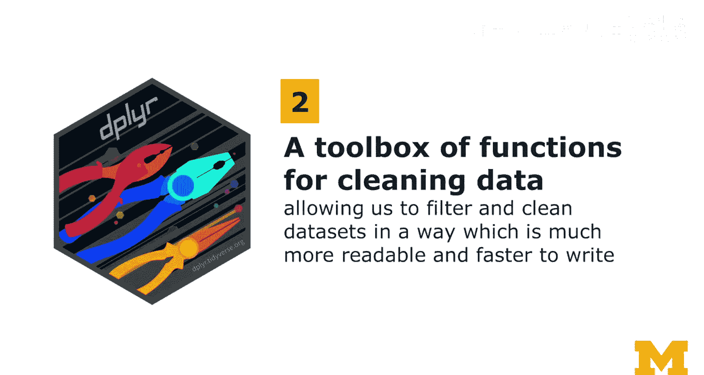
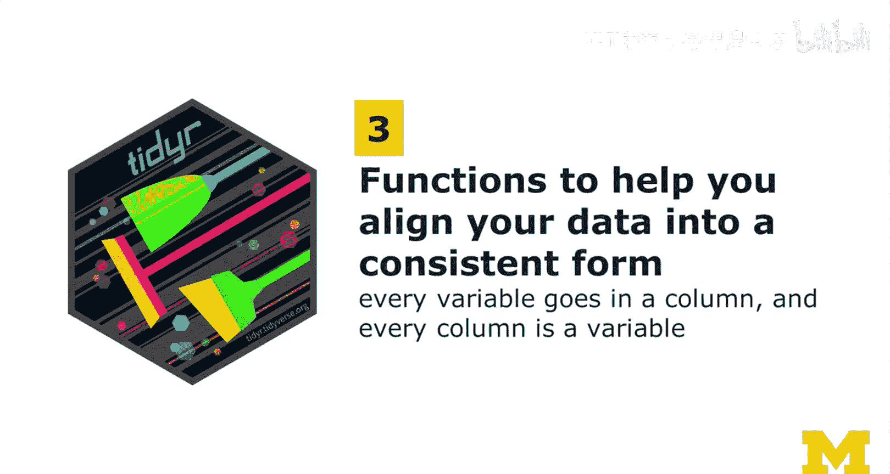
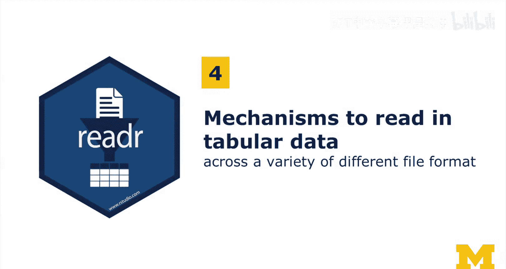
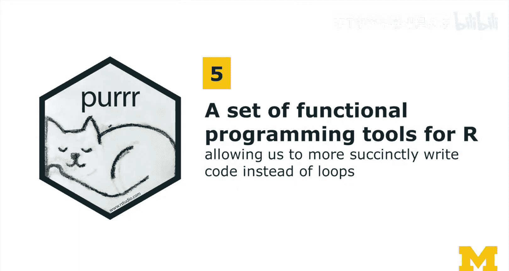
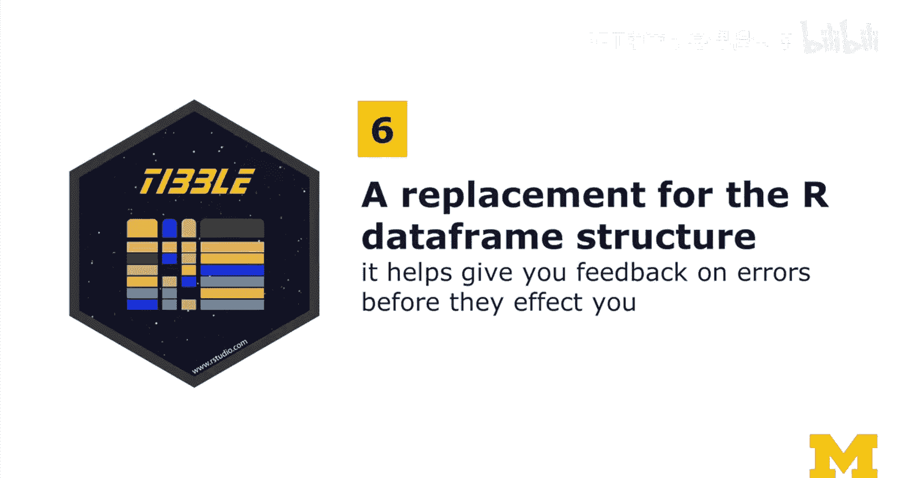
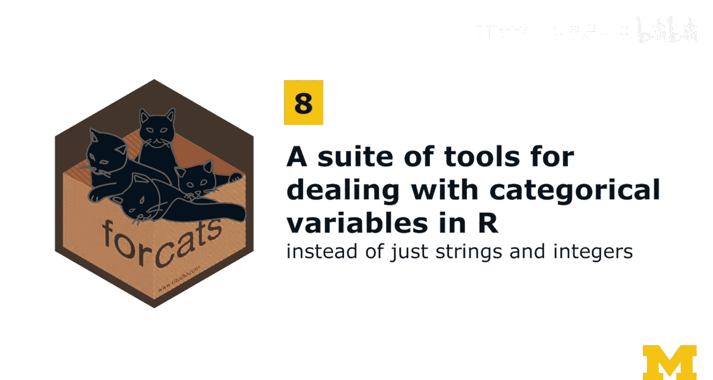
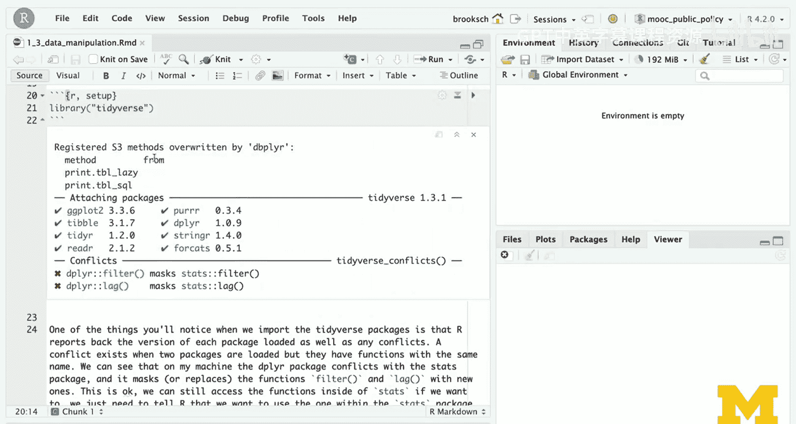

# 公共部门的R数据分析：27：dplyr数据操作：数据探索（tidyverse应用）📊


在本节课中，我们将学习如何使用Tidyverse系列包，特别是dplyr，对2020年行为风险因素监测系统数据进行操作和探索分析。


## 概述：Tidyverse简介



上一节我们介绍了基础R的数据操作。本节中，我们将认识Tidyverse，这是一系列为R编写的、高度集成的扩展包，旨在使数据科学工作流程更快速、更流畅、更一致。


Tidyverse包含八个“有主见”的R包，它们扩展了基础R的功能。之所以称为“有主见”，是因为它们要求用户遵循其提供的编程接口和数据分析风格。以下是Tidyverse的核心包：






*   **ggplot2**：一个基于图形语法分层的绘图系统，用于在R中创建图形。它是R中最受欢迎的库之一，其语法（通常简称为ggplot）非常独特。从下一门课程开始，我们将大量使用ggplot2。
*   **dplyr**：一个用于数据清洗的工具箱，提供了一系列函数，使我们能够以更易读、更快捷的方式筛选和整理数据集。这是我们今天课程剩余部分将要探索的主要工具包。
*   **tidyr**：提供帮助你将数据整理成一致形式的函数。在整个专项课程中，我们会用到其中的许多函数。
*   **readr**：提供读取多种不同文件格式表格数据的机制。处理公共数据的一个挑战是，许多数据集仅以基础R无法处理的格式提供，而readr为处理其他类型的数据集提供了一些功能。
*   **purrr**：一套R的函数式编程工具。作为向量化语言，R可以非常快速且易读，而purrr通过允许我们编写更简洁、循环更少的代码来进一步提升这一点。虽然purrr很有趣，但我们在本专项课程中实际不会过多使用它。
*   **tibble**：R数据结构`data.frame`的替代品。请放心，tibble构建在`data.frame`之上，因此你不会丢失已学知识。相反，它有助于在实际错误影响你之前提供反馈。我们将在本课程及后续课程中使用tibble，但为便于理解，我通常仍将其称为数据框。
*   **stringr**：用于操作字符串的函数。在公共数据中，我们经常获得清理得相当好的数据文件，不需要进行字符串解析。然而，当我们处理来自网络的数据或通过光学字符识别（OCR，有时称为扫描）产生的数据时，这个库就非常宝贵。
*   **forcats**：一套用于处理R中分类变量的工具。我们将不再仅仅使用字符串和整数，而是会在整个专项课程中稍微使用这个包，以便更好地分类和可视化我们的数据。




对于这些库，作者都提供了速查表以及在线文档来支持你的使用。我在课程平台中链接了其中一些资源。




## 加载Tidyverse与数据

让我们在第一个代码块中加载tidyverse包。你会注意到我为这个代码块提供了一个标签或名称。通常，我们会为设置和绘图相关的代码块添加标签，这能让RStudio更智能地处理库的重载和文件输出的命名。你可以通过在代码块第一行末尾添加一个逗号和一个单词来为其添加标签。




```r
library(tidyverse)
```


加载后，我们会看到一些不错的输出信息，包括每个加载包的版本以及任何冲突。当两个包被加载且它们具有相同名称的函数时，就会存在冲突。例如，在我的机器上，dplyr包与stats包冲突，它用新的函数“屏蔽”或替换了`filter`和`lag`函数。这没关系，如果我们想使用stats包中的函数，只需通过`stats::filter`这样的命名空间方式来指定。


## 读取外部数据




BRFSS数据以SAS数据文件格式提供。这种格式不是R的原生格式，而是一种专有的二进制数据格式。SAS数据在公共管理领域相当常见，我们可以使用`foreign`包将其加载到数据框中。

因此，我们先加载`foreign`包，它会创建一个名为`read.xport`的新函数来读取SAS数据。然后，我们将数据加载到一个数据框中。

```r
library(foreign)
data <- read.xport("path/to/your/file.xpt", fill = NA)
```


`fill = NA`参数表示数据应被读入，任何空白项应被列为`NA`。这个过程可能需要一些时间，因为数据集不小。

我想解释一下我是如何做到这一点的，因为老实说，我在自己的工作中不常使用SAS数据。当我在网站上注意到它是SAS格式时，我不得不做一些调查来弄清楚如何在R中处理。但你甚至不需要离开RStudio就能做到这一点。我只需点击文件窗格中的“Packages”选项卡，然后搜索“SAS”。我看到了一些包，点击进入`foreign`包，查看了函数并阅读了在线文档。这一切都得益于CRAN（综合R档案网络）这个中央R代码库。一旦我决定尝试，我只需点击安装按钮即可。虽然我们已经为你安装了这些包，但你应该了解这个过程是如何工作的。如果你已经使用其他数据格式，现在可以花点时间探索RStudio的包界面，看看有哪些可用的包。



## 初步数据检查与变量处理

从环境选项卡中，我们可以看到这个数据非常庞大：近50万条观测记录，涉及近300个不同的变量。始终建议查阅代码簿，了解不同数据的含义。例如，在这个数据集中，有一个名为`_PSU`的变量，它似乎是给定年份内数据集中唯一的序列号。

但是，如果我们尝试查看该变量的前10个值，会遇到一个问题。我们可以使用美元符号`$`提取单个列，并使用切片符号`[1:10]`查看前10项。我们立即会发现这里有问题，R给出了一点提示。

```r
data$_PSU[1:10]
```

问题在于，我们代码簿和数据文件中的变量并非都适合R的命名规则。R的变量名需要以字母开头，而不是下划线。因此，`read.xport`函数已自动将这些变量重命名，在它们前面加上了大写字母“X”。所以，让我们再次查看数据，这次在变量`_PSU`前加上“x”。

```r
data$x_PSU[1:10]
```

现在我们看到了一些值，它们只是科学计数法表示的数字，对我们来说不是特别有用。代码簿告诉我们这些是序列号。在这个数据集中，有两列实际上代表序列号，而我们都不需要它们。

之前我们看到，可以通过在方括号中指定行号并在前面加上减号来删除行。dplyr包使删除列变得更加容易。它提供了一个名为`select`的函数，允许你按名称引用列，包括允许我们使用负号来删除列。

让我们删除这两个变量。为此，我们传入要处理的数据框，然后是列选择列表。这里我将使用负号来指定要删除的列。

```r
data <- select(data, -x_PSU, -x_另一序列号变量名)
```

对于有编程背景的人来说，这可能看起来像一个奇怪的函数。请记住，R中的对象模式通常与其他语言大不相同。因此，几乎所有东西都是一个函数，它接受一个数据结构作为其第一个参数，然后返回该数据结构的修改版本。在R中也很常见的是，看到一个任意的参数列表（在本例中，是两个排除条件），而不是一个包含值列表的单个参数。

## 管道操作符 `%>%`

在本课程的大部分工作中，我们将持续调用函数，其中第一个参数是我们的数据，并且我们希望将其赋值回某个变量。这种“数据作为函数第一个参数”的模式写起来真的很累，因此在2021年，R语言中添加了一个名为管道操作符`%>%`的新运算符，它实际上非常酷。

管道操作符`%>%`允许你将一个表达式的结果“传递”给下一个表达式，作为其第一个参数。这使得代码更易读，更像一个从左到右的数据处理流程。例如，上面的`select`操作可以重写为：

```r
data <- data %>%
  select(-x_PSU, -x_另一序列号变量名)
```

这读作：“取`data`，然后(`%>%`)从中选择(`select`)删除`x_PSU`和另一个变量。”这避免了嵌套函数调用，使代码逻辑更加清晰。在后续的数据操作中，我们将广泛使用管道操作符来串联多个数据处理步骤。

## 总结


本节课中，我们一起学习了Tidyverse生态系统，这是一个强大的R包集合，旨在简化数据科学工作流程。我们重点介绍了其八个核心包的用途，并实际演示了如何使用`foreign`包读取SAS格式的公共数据集，以及如何使用dplyr包的`select`函数删除不需要的列。最后，我们认识了能极大提高代码可读性的管道操作符`%>%`。在接下来的课程中，我们将深入利用dplyr和ggplot2等工具，对数据进行更复杂的整理、探索和可视化。