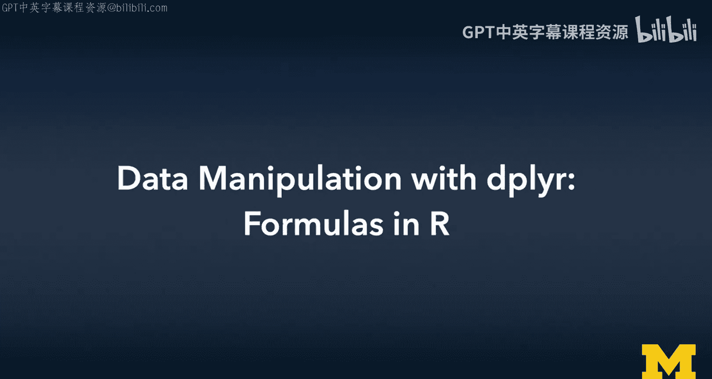

# 29：dplyr公式在R中的应用 🧮



在本节课中，我们将要学习R语言中一个特殊的运算符——波浪号（`~`），它用于定义公式。我们将重点探讨它在`dplyr`包（特别是`case_when`函数）中的具体应用，并学习如何查阅R的帮助文档来理解其用法。

## 公式运算符 `~`

上一节我们介绍了`dplyr`的基本操作，本节中我们来看看一个在数据操作中扮演重要角色的特殊符号。

波浪号（`~`）是R语言中的一个运算符，就像加号（`+`）、减号（`-`）或美元符号（`$`）一样。这个运算符通常用来表示一个**公式**。

一般来说，波浪号会将一个公式的左侧（LHS）和右侧（RHS）分开，就像大多数其他运算符一样。然而，公式的左侧是**可选**的，有时你根本看不到它。

这个运算符的含义完全取决于其使用的**上下文**，R中的所有运算符都是如此。在不同的函数中，它的用法可能会有很大差异。因此，我们需要查看具体函数（例如`case_when`）的文档，来了解它期望如何处理这个公式。

## 查阅帮助文档

在R中，我们可以轻松地获取几乎所有函数或对象的帮助信息。

只需在函数或对象名称前加上一个问号（`?`），然后执行，RStudio就会在帮助面板中显示相关信息。

例如，输入 `?case_when`。我们可以看到`case_when`来自`dplyr`包，被描述为一个“通用的向量化if语句”。文档会列出它接受的参数，对于`case_when`，它接受一系列**两侧公式**作为动态参数。

以下是关于`case_when`中公式用法的核心说明：
*   **左侧**决定哪些值匹配这个情况，它必须能计算为一个逻辑向量（TRUE/FALSE）。
*   **右侧**提供匹配后的**替换值**。

帮助文档通常包含许多示例，你可以直接查看并尝试运行这些例子，这对于学习非常有帮助。

## `case_when` 函数中的公式应用

让我们具体看看公式在`case_when`中是如何工作的。`case_when`允许我们根据多个条件进行向量化的条件判断。

它的基本结构由一系列公式组成：
```r
case_when(
  条件1 ~ 结果1,
  条件2 ~ 结果2,
  ...
  TRUE ~ 默认结果
)
```

文档中的一个示例如下：
```r
case_when(
  x %% 3 == 0 ~ “除以3余数为0”,
  x %% 3 == 1 ~ “除以3余数为1”,
  TRUE ~ “其他情况”
)
```

在这个例子中：
*   每个`条件 ~ 结果`都是一个公式。
*   最后一个公式 `TRUE ~ “其他情况”` 是一个**兜底语句**。因为`TRUE`永远为真，所以任何不满足前面条件的情况都会返回“其他情况”。
*   **兜底语句必须放在最后**。如果放在前面，后面的条件将永远不会被评估。
*   如果没有提供兜底语句，并且存在未匹配的情况，结果将是`NA`。

## 总结与过渡

本节课中我们一起学习了R语言中的公式运算符（`~`）及其在`dplyr`的`case_when`函数中的具体应用。

我们了解到，R中的运算符高度依赖于上下文，公式运算符也不例外。虽然在数据分析中你会大量使用传统的数学公式，但公式运算符在这里允许你描述一种关系——在本例中，是**布尔掩码（条件）**和**输出值**之间的关系。接收这个公式的函数（如`case_when`）会决定如何处理它。

我们还掌握了使用`?`快速查阅内置帮助文档的技能，这对于理解任何函数的行为都至关重要。

---

在我们对BRFSS数据的初步探索中，我们涵盖了很多内容。我们了解到`tidyverse`是一个包含许多不同包的大集合，并花了相当多的时间学习了其中`dplyr`包的基础知识。

具体来说，我们学会了：
*   使用 `filter()` 函数从数据框中筛选出特定的观测行。
*   使用 `select()` 函数从数据框中选取特定的变量列。
*   使用 `mutate()` 函数在数据框中创建新的列。

所有这些方法都大量使用了**布尔掩码**来实现其功能。

我们还探索了两个新的语言基础概念：
1.  **管道（`|>`）**：允许我们轻松地将多个操作链接在一起。本课程中使用的是R基础语言新增的管道符号。在浏览书籍和在线文档时，你可能会看到另一个管道符号（`%>%`），它来自`magrittr`包。在本课程的讨论中，两者基本等效，但底层实现不同。预计几年后，这种新的内置管道运算符语法将会更加普及。
2.  **公式运算符（`~`）**：我们学到这个运算符高度依赖于上下文，它由三部分组成：一个可选的**左侧**、运算符本身以及**右侧**。

我们的朋友（指示例中的操作）通过在RStudio中使用`?`查看文档，这让我们能够探索正在尝试使用的包，并实际看到我们调用的函数将如何使用公式。


`tidyverse`的内容远不止这些，我们将会继续探索。不过，我们首先需要对`dplyr`进行更多学习，接下来我们将深入其中。