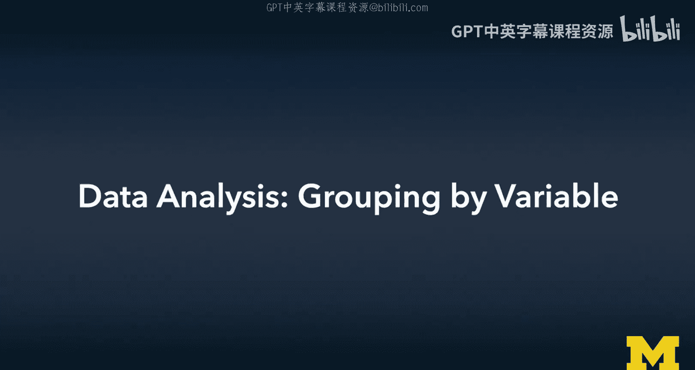
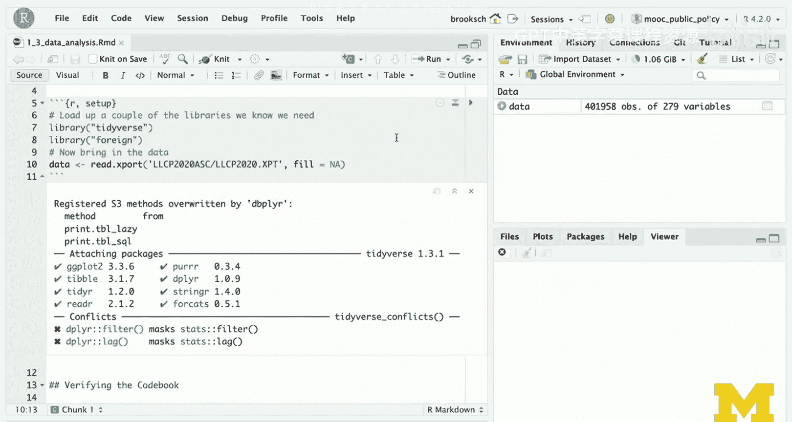
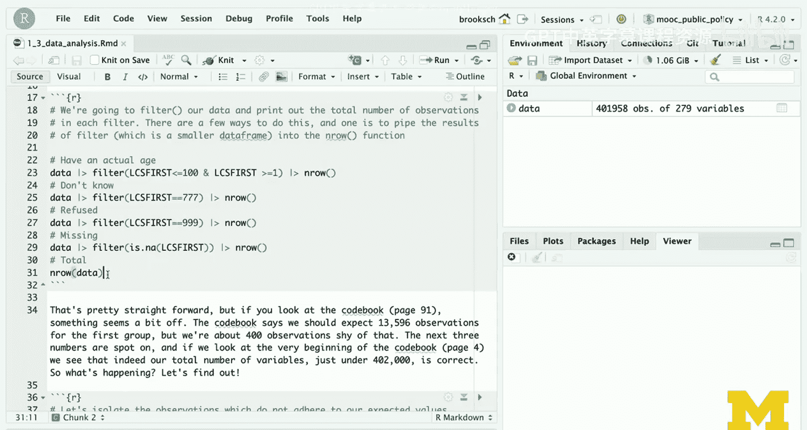
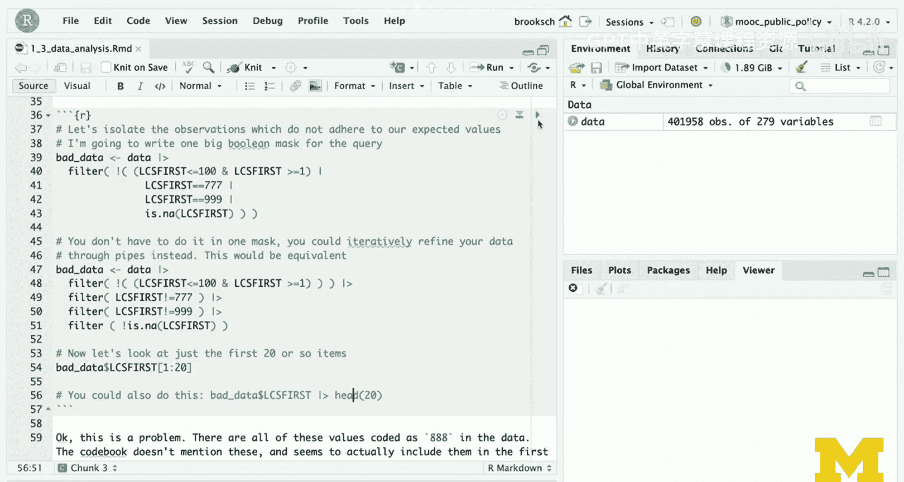
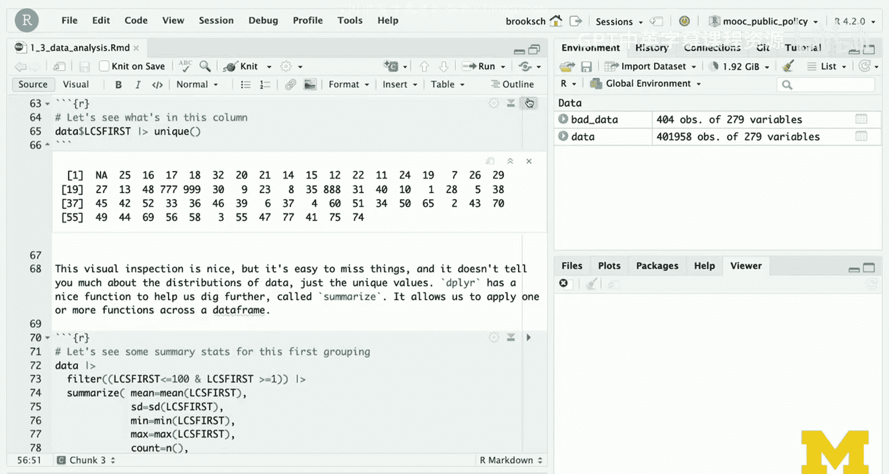
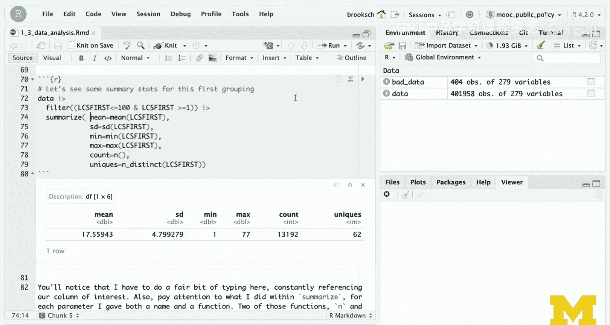
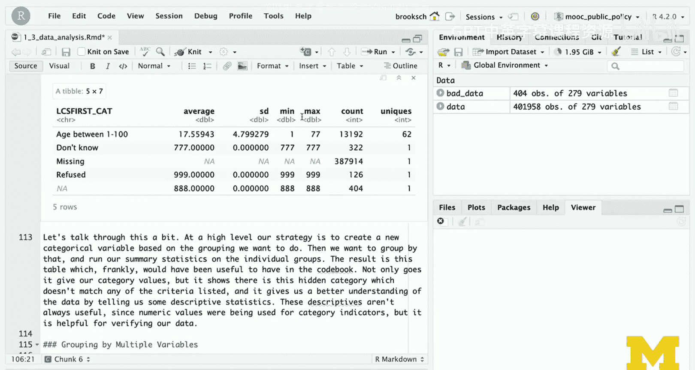

# 30：基于变量的分组分析



在本节课中，我们将继续使用2020年行为风险因素监测系统的数据，并学习如何基于变量对数据进行分组分析。我们将重点关注数据验证、创建分类变量以及使用`group_by`和`summarize`函数进行分组统计。




上一节我们介绍了数据处理的基础知识，本节中我们来看看如何对数据进行分组分析。

## 加载数据与包

首先，我们需要加载必要的R包和数据。我们使用`tidyverse`和`foreign`包来处理数据。

```r
library(tidyverse)
library(foreign)
re.export <- read.spss("path/to/your/data.sav", to.data.frame = TRUE)
```


数据加载需要一些时间，因为数据集比较大。



## 数据验证与问题发现

我们根据已发布的代码手册，关注一个关于肺癌筛查的变量`LC_FIRST`，它记录了患者开始吸烟的年龄。代码手册第91页说明，该变量有四种可能的响应值：
*   一个1到100之间的数字，代表患者年龄。
*   数字777，代表“不知道”或“不确定”。
*   数字999，代表“拒绝回答”。
*   空白，代表问题未被询问或数据缺失。


让我们查看这些不同数值的频率。以下是检查不同类别观测数量的方法：

```r
# 检查年龄在1到100之间的观测数
data %>% filter(LC_FIRST >= 1 & LC_FIRST <= 100) %>% nrow()

# 检查“不知道”（777）的观测数
data %>% filter(LC_FIRST == 777) %>% nrow()

# 检查“拒绝回答”（999）的观测数
data %>% filter(LC_FIRST == 999) %>% nrow()

# 检查缺失值（NA）的观测数
data %>% filter(is.na(LC_FIRST)) %>% nrow()



# 检查数据集总行数
nrow(data)
```

然而，将结果与代码手册对比时，我们发现了一个问题。代码手册显示第一类（年龄）应有13596个观测值，但我们的计数少了约400个。其他类别的计数则完全吻合。这表明数据中可能存在代码手册未提及的值。

为了找出这些不符合预期的观测值，我们编写以下代码进行筛选：


```r
# 方法一：使用一个大的布尔掩码进行筛选
bad_data <- data %>%
  filter(!(LC_FIRST >= 1 & LC_FIRST <= 100) &
         !(LC_FIRST == 777) &
         !(LC_FIRST == 999) &
         !is.na(LC_FIRST))




# 方法二：使用管道进行迭代筛选（更易读）
bad_data <- data %>%
  filter(!(LC_FIRST >= 1 & LC_FIRST <= 100)) %>%
  filter(LC_FIRST != 777) %>%
  filter(LC_FIRST != 999) %>%
  filter(!is.na(LC_FIRST))

# 查看前20个有问题的值
bad_data$LC_FIRST %>% head(20)
```

运行代码后，我们发现数据中存在大量编码为`888`的值，而代码手册并未提及。这在实际数据分析中是一个常见问题，我们必须验证数据是否已正确清理，并与分析代码手册保持一致。

## 数据探索技术

为了更好地理解数据，我们可以使用一些探索技术。首先是查看列中的所有唯一值：



```r
unique(data$LC_FIRST)
```

这提供了直观检查，但容易遗漏信息，且不显示数据分布。`dplyr`包中的`summarize`函数可以帮助我们进行更深入的探索，它允许我们在数据框上应用一个或多个函数。

让我们为第一组数据（年龄在1到100之间）计算一些汇总统计量：

```r
data %>%
  filter(LC_FIRST >= 1 & LC_FIRST <= 100) %>%
  summarize(mean_age = mean(LC_FIRST),
            sd_age = sd(LC_FIRST),
            min_age = min(LC_FIRST),
            max_age = max(LC_FIRST),
            count = n(),
            unique_vals = n_distinct(LC_FIRST))
```


`summarize`函数返回一个`tibble`（一种更美观的数据框）。我们可以看到，人们开始吸烟的平均年龄约为17.5岁，标准差接近5。`n()`和`n_distinct()`是`dplyr`函数，分别用于计算总行数和唯一值数量。

## 使用`group_by`进行分组分析

现在我们需要为每个筛选条件重复上述分析。为了避免大量重复输入，`dplyr`提供了`group_by`函数。它接收一个数据框和一组变量，返回一个分组数据框。`summarize`函数能感知分组，并将函数分别应用到每个组上，为每个组返回一行结果。

`group_by`的文档建议，在分组之前，最好先通过`mutate`在数据中创建一个分类变量。这是一个常见的操作模式。

让我们根据不同的类别对数据进行分组。首先，创建一个新的分类变量：

```r
grouped_summary <- data %>%
  mutate(LC_FIRST_cat = case_when(
    LC_FIRST >= 1 & LC_FIRST <= 100 ~ "Age (1-100)",
    LC_FIRST == 777 ~ "Don't Know/Not Sure",
    LC_FIRST == 999 ~ "Refused",
    is.na(LC_FIRST) ~ "Missing/Not Asked",
    TRUE ~ "Other" # 捕获所有其他情况，包括代码888
  )) %>%
  group_by(LC_FIRST_cat) %>%
  summarize(mean_val = mean(LC_FIRST, na.rm = TRUE),
            sd_val = sd(LC_FIRST, na.rm = TRUE),
            min_val = min(LC_FIRST, na.rm = TRUE),
            max_val = max(LC_FIRST, na.rm = TRUE),
            count = n(),
            unique_vals = n_distinct(LC_FIRST))
```

执行这段代码后，我们得到一个包含五行的`tibble`，每一行对应一个分类。我们可以看到清晰的字符串类别，以及之前未发现的“Other”类别（包含888等值）。同时，我们也获得了每个组内的描述性统计量。



## 总结与策略回顾

本节课中我们一起学习了基于变量的分组分析。我们的核心策略是：
1.  **创建分类变量**：使用`mutate`和`case_when`根据分析需求定义分组类别。
2.  **分组**：使用`group_by`函数，指定要依据哪个（些）列进行分组。
3.  **汇总统计**：对分组后的数据使用`summarize`函数，计算各组的统计量。

这种分组汇总的结果生成了一张表格，它不仅列出了类别值，还揭示了数据中隐藏的、不符合文档记录的类别（如888），并通过描述性统计量让我们对数据有了更深入的理解。虽然对于像888这样的代码，其数值均值没有实际意义，但对于“年龄”这类连续变量，平均值（如17.5岁）则提供了有价值的信息。


通过本节课的学习，你掌握了在R中使用`dplyr`进行数据验证、探索和分组分析的基本流程，这是理解复杂数据集结构的关键步骤。