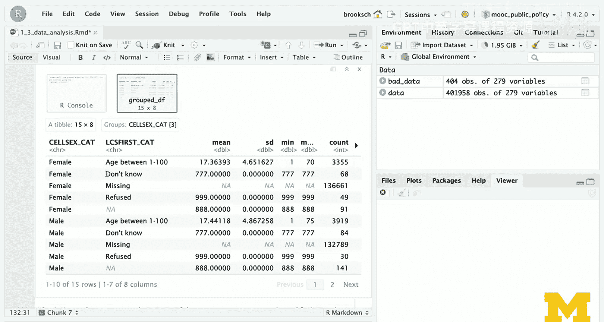
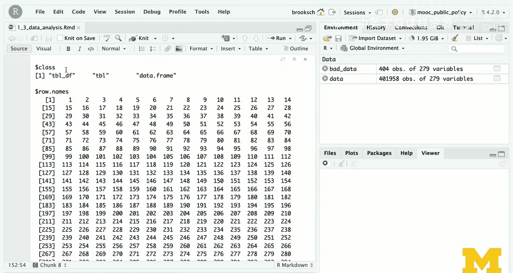

# 31：多变量分组分析方法


在本节课中，我们将学习如何使用R对数据进行多变量分组分析。我们将探讨如何基于多个分类变量对数据进行分组，并计算各组的汇总统计量。同时，我们也会了解分组操作背后的机制以及需要注意的事项。

## 概述

上一节我们介绍了基于单一变量的分组分析。本节中我们来看看如何基于多个变量的组合进行分组。例如，我们可以在之前查询的基础上，进一步按性别拆分数据。

## 多变量分组操作

以下是实现多变量分组分析的核心步骤。首先，我们需要创建或指定用于分组的分类变量。

```r
# 创建两个分类变量并分组
data %>%
  mutate(
    age_cat = case_when(
      AGE >= 1 & AGE <= 10 ~ "1-10岁",
      AGE > 10 & AGE <= 20 ~ "11-20岁",
      is.na(AGE) ~ "缺失",
      TRUE ~ "其他"
    ),
    sex_cat = case_when(
      cellsex == 1 ~ "男性",
      cellsex == 2 ~ "女性",
      is.na(cellsex) ~ "缺失"
    )
  ) %>%
  group_by(sex_cat, age_cat) %>%
  summarise(
    mean_age = mean(AGE, na.rm = TRUE),
    sd_age = sd(AGE, na.rm = TRUE),
    count = n()
  )
```

在上述代码中，我们使用 `mutate` 函数创建了两个新的分类列：`age_cat`（年龄分组）和 `sex_cat`（性别分组）。随后，`group_by(sex_cat, age_cat)` 指定了按这两个变量进行分组。传递给 `group_by` 的变量顺序会影响结果表格的显示结构，您可以尝试调换顺序以观察差异。

## 理解分组结果



执行上述代码后，R会返回一个分组汇总表。理解这个表格的格式非常重要。

*   表格底部会显示总行数。
*   表格会分页显示数据（例如每页10行）。
*   每列标题旁会注明其数据类型（如字符向量、双精度向量、整数向量）。
*   数据首先按 `sex_cat`（如“女性”、“男性”）分组，然后在每个性别组内，再按 `age_cat`（如“1-10岁”、“未知”、“缺失”）进行细分。
*   通过观察各组的均值（`mean_age`）和标准差（`sd_age`），我们可以比较不同性别和年龄组合的吸烟起始年龄是否存在差异。

这是一种深入了解数据、开启数据分析的绝佳方式。

## 分组机制与注意事项

`group_by` 函数的工作原理是分析数据框，并通过添加分组元数据来丰富它。这意味着，在管道操作符 `%>%` 之后使用的函数（如 `summarise`）需要知晓这些元数据才能正确工作。


这种方法也带来了一些限制和影响：

1.  **与非Tidyverse包的兼容性**：`group_by` 可能不太适用于 `tidyverse` 生态系统之外的函数包。
2.  **分组状态的持久性**：分组操作会改变数据框的元数据。如果您计划对同一分组进行多次不同的分析，这很有用。但若想恢复未分组的状态，则需要手动取消分组。

以下是一个演示分组元数据及取消分组的例子：

```r
# 对数据进行分组并查看其属性
grouped_data <- data %>%
  mutate(sex_cat = ifelse(cellsex == 1, "男性", "女性")) %>%
  group_by(sex_cat)



# 查看分组后数据框的属性（包含分组信息）
attributes(grouped_data)

# 取消分组以恢复原始状态
ungrouped_data <- grouped_data %>%
  ungroup()
```

使用 `attributes()` 函数可以查看数据框的属性，其中包含了分组信息。当您不再需要分组，或者需要将数据传递给不识别分组的函数时，使用 `ungroup()` 函数清除元数据是关键步骤。

**请注意**：如果您不是通过管道连续进行分析，而是将分组结果赋值给新变量（如本例中的 `grouped_data`），则需要格外小心后续操作中的数据状态。

## 总结

本节课中我们一起学习了如何对数据进行多变量分组分析。其通用模板是：**决定分组依据 -> 在数据集中识别或创建一个或多个分组变量 -> 使用 `summarise` 等函数应用统计功能以生成报告**。

我们还见识了R的一些强大新特性，包括管道操作符 `%>%` 和 `tidyverse` 中的函数，它们协同工作，使得数据清洗和分析既快速又易于阅读。


最后，反思我们在使用代码簿进行数据探索时遇到的问题也很有价值。拥有清晰的代码簿实际上是一种奢侈，现实中很多数据远不如本数据集这样清晰。或许，将杂乱数据整理成整洁形式，并为他人生成这样的代码簿，正是您未来工作的一部分。