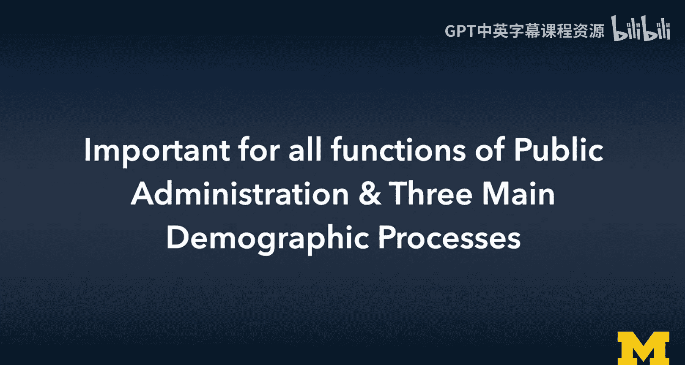
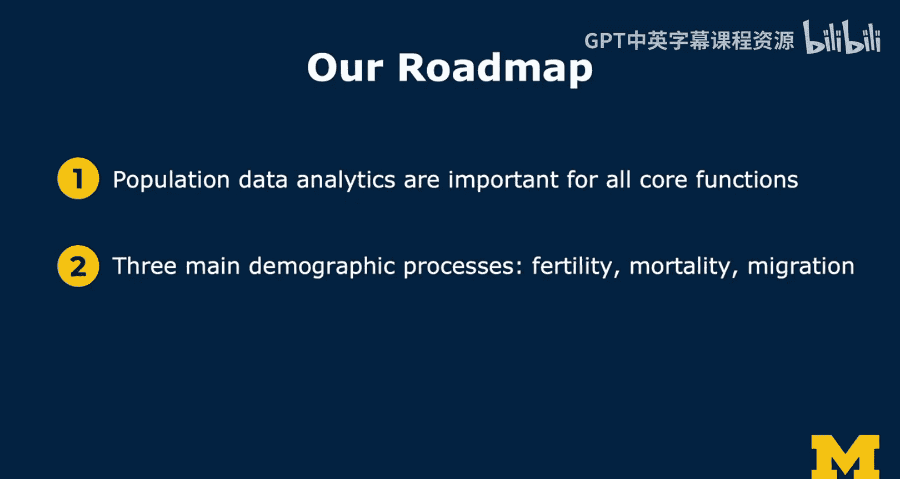
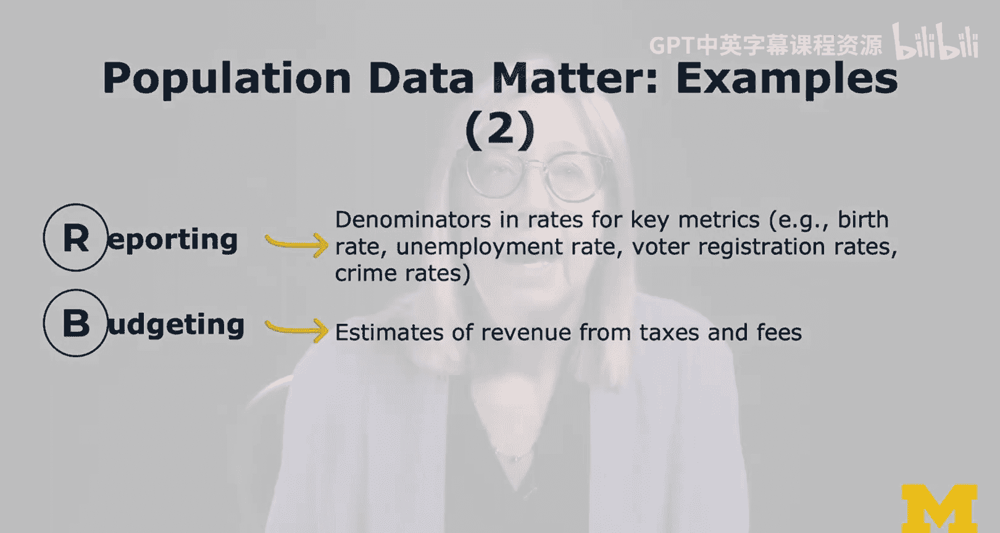
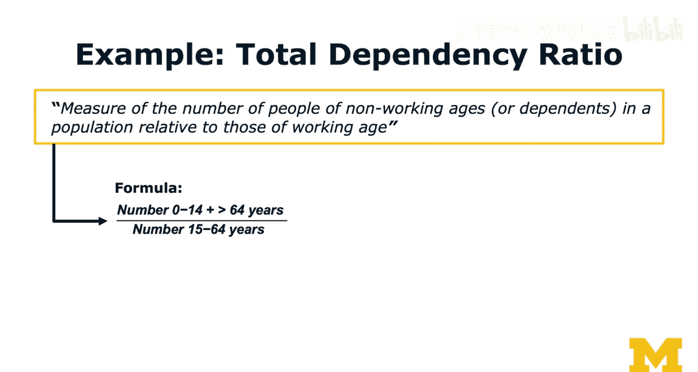
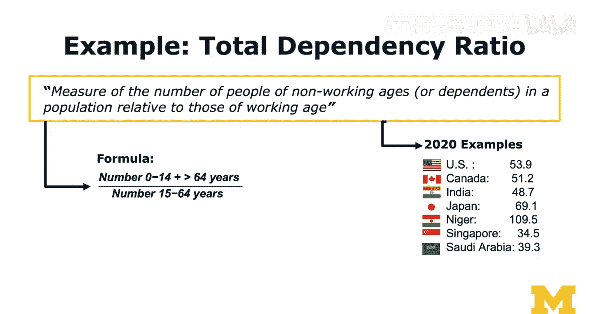
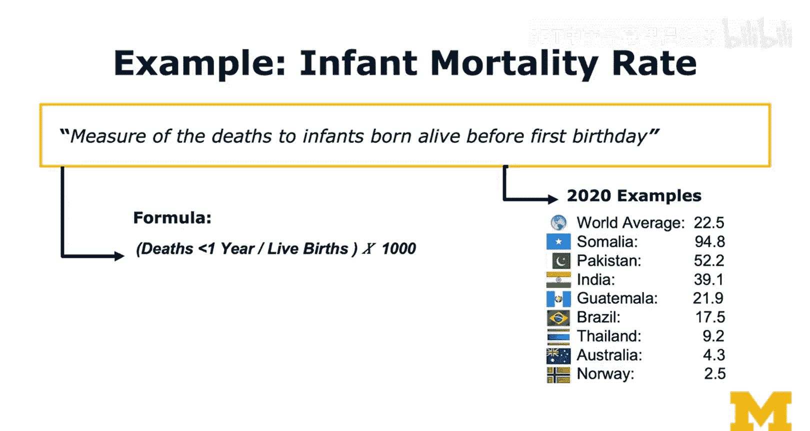
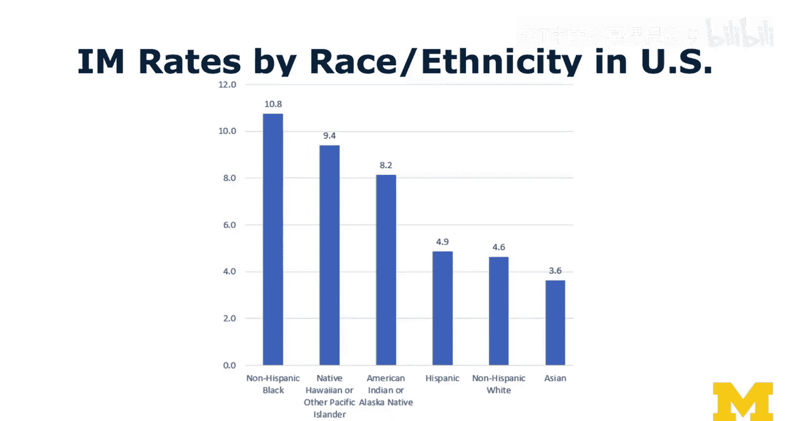
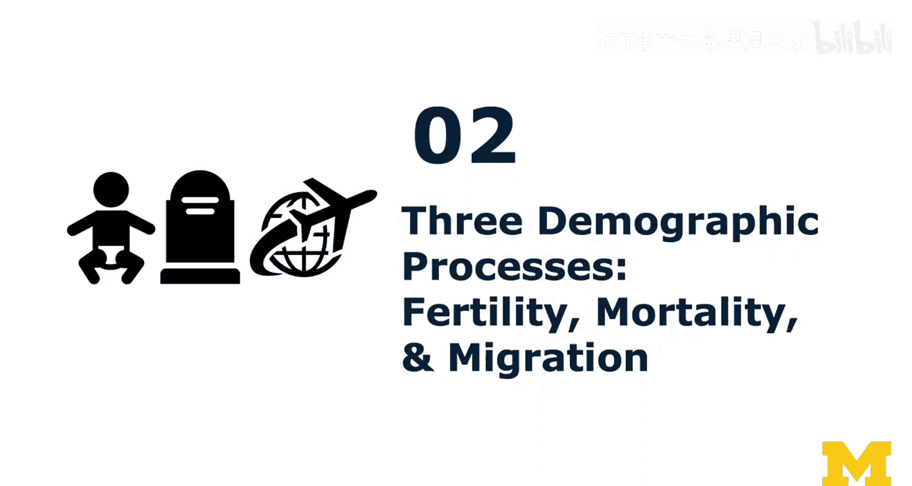
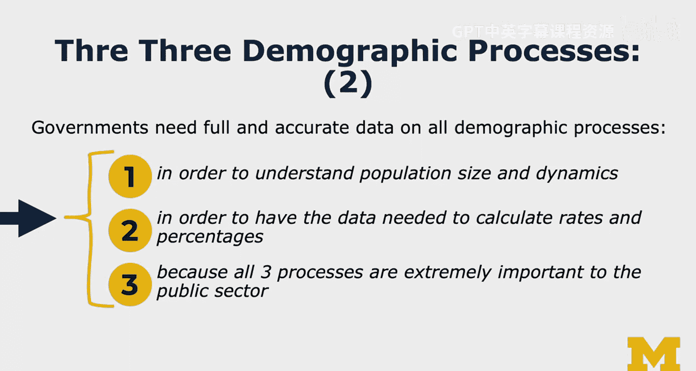

# 33：人口数据分析重要性：三大人口过程解析 📊

在本节课中，我们将探讨人口数据分析对于公共部门所有核心职能的重要性。我们将聚焦于决定人口动态的三大关键人口过程——生育、死亡与迁移，并介绍一些关键的人口数据来源。人口数据是公共行政决策的基石，理解这些过程对于有效的规划、资源配置和政策制定至关重要。

---

## 人口数据对公共行政核心职能的重要性

上一节我们介绍了公共行政的核心职能模型。本节中我们来看看人口数据如何为这些职能提供关键信息。

人口数据对于公共行政及其所有七项核心职能都极为重要。这些职能在我们的模型图中按顺时针方向依次是：规划、组织、人事、指挥、协调、报告和预算。对于所有这些职能，关于人口的关键问题包括：

*   当前辖区内有多少人？
*   短期和长期的未来人口数量是多少？未来的人口结构如何？
*   人口有哪些人口学特征？年龄分布是怎样的？
*   人们具体居住在哪里？
*   有多少人有资格享受不同类型的公共服务和项目？

以下是人口数据支持各项核心职能的具体示例：

*   **规划职能**：教育系统根据年龄分布和人口预测来规划未来的学校招生。
*   **人事职能**：人口统计数据有助于理解劳动力动态，包括因退休造成的人员更替。
*   **报告职能**：人口数据被用作许多社会和经济指标（以比率或百分比形式呈现）的分母。这包括出生率、死亡率、失业率、选民登记率、犯罪率等。任何重要的比率都包含分子和分母，而分母通常由人口数据和分析提供。
*   **政府预算职能**：人口数据对于预测政府来自税收和费用的收入至关重要。

---

## 关键人口统计指标示例

理解了人口数据的广泛用途后，我们来看两个在全球范围内被广泛使用的具体人口统计指标。

### 总抚养比

一个对所有政府职能都非常重要的人口统计指标是**总抚养比**。这是一个粗略但非常有用的估计值，用于衡量人口中不工作、因而依赖劳动人口收入、税收和养老金缴款的人数比例。

其公式非常简单：

**总抚养比 = (0-14岁人口数 + 65岁及以上人口数) / (15-64岁人口数)**

这个比率可以解释为：在人口中，每有一个工作年龄人口，需要抚养的依赖人口数量。

较高的比率会引起政府关注，因为这意味著更少的人需要为更多依赖人口提供收入支持，并向社会保险、养老金体系、医疗保险体系等做出必要贡献。

以下是部分国家的总抚养比数据。可以看到，日本和尼日利亚的抚养比都相对较高，但原因截然不同：

*   **日本**：抚养比高是因为人口老龄化，生育率低且持续下降，同时人均预期寿命长。
*   **尼日利亚**：抚养比高是因为生育率非常高，导致年轻人口比例大，同时死亡率较高，人均预期寿命相对较短。

仅看总抚养比无法完全了解一个国家的情况及其成因，但它仍然是一个有用的指标，常被用于跨国比较。

### 婴儿死亡率

另一个全球通用的、衡量人口健康的关键指标是**婴儿死亡率**。婴儿死亡率衡量的是活产婴儿在一周岁前的死亡情况。

其计算公式为：

**婴儿死亡率 = (一岁内死亡婴儿数 / 活产婴儿总数) × 1000**

可以将其解释为：每1000名活产婴儿中，在一岁前死亡的婴儿数量（这不是一个百分比）。

2020年，世界平均婴儿死亡率估计为22.5，这意味着全球每1000名活产婴儿中，约有22名在满周岁前不幸死亡。不同国家之间差异巨大，有些国家的婴儿死亡率远高于此，而有些国家则低于5。

然而，全国性的婴儿死亡率数据掩盖了人口内部不同亚群体之间显著且令人担忧的差异。因此，政府不仅关注总体婴儿死亡率，更关注按地理或社会人口学特征划分的不同群体和亚人口中的具体比率。

以美国为例，不同种族和族裔群体间的婴儿死亡率差异和不平等是一个长期存在的严重问题。如下图所示，亚裔母亲的婴儿死亡率为3.6，而非西班牙裔黑人母亲的婴儿死亡率几乎高出三倍，达到10.8。尽管过去几十年美国所有种族和族裔的婴儿死亡率都已显著下降，但这些群体之间的差距实际上却扩大了。

这类针对特定年份、亚群体和长期趋势的统计数据对政府极其重要，因为它是衡量妇女和婴儿整体健康状况的一个非常强有力的指标。

---

## 决定人口动态的三大关键过程

既然我们已经明确了人口层面的数据对公共行政的所有核心职能都非常重要，现在让我们转向解析决定人口动态的关键人口过程，即人口如何增长、减少和随时间变化。

像我这样的人口学家主要关注三个基本的人口过程：

1.  **生育（出生）**：人口如何进入一个群体。
2.  **死亡**：人口如何离开一个群体。
3.  **迁移**：人口如何进入、离开一个群体，并在群体内部移动。

政府需要关于所有这些人口过程的全面而准确的信息，以便：
*   理解人口规模和动态变化。
*   获得计算比率、百分比以及其他重要指标（如劳动参与率、失业率、出生率、死亡率、预期寿命等）所必需的数据。
*   因为这些过程本身对公共部门就具有重要意义。

---

## 总结

本节课中，我们一起学习了人口数据分析在公共部门中的核心地位。我们了解到人口数据是支撑规划、组织、人事、预算等所有公共行政职能的基础。通过分析**总抚养比**和**婴儿死亡率**等关键指标，政府能够洞察社会结构、健康水平和经济负担等重要信息。最后，我们解析了决定任何人口变化的三大根本过程：**生育、死亡与迁移**。掌握这些过程的数据和分析方法，是进行有效公共决策和制定前瞻性政策的关键。