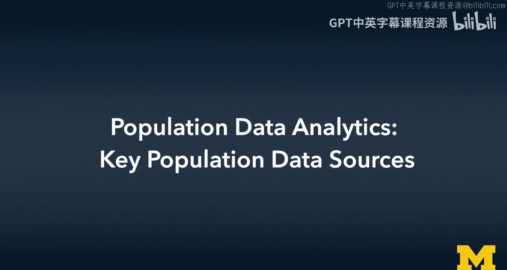
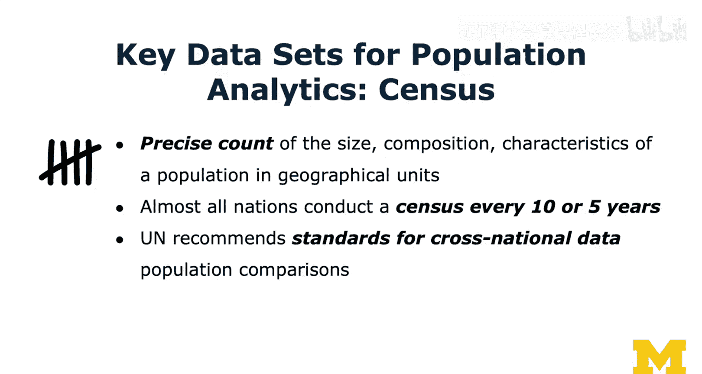
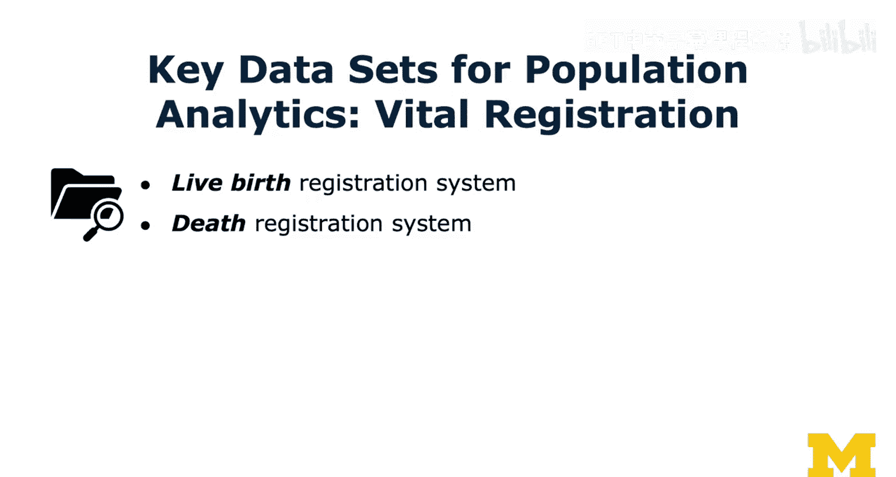
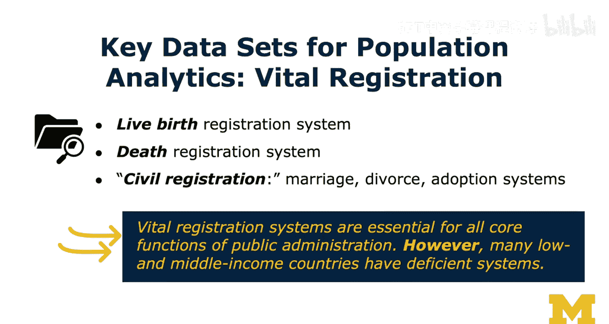
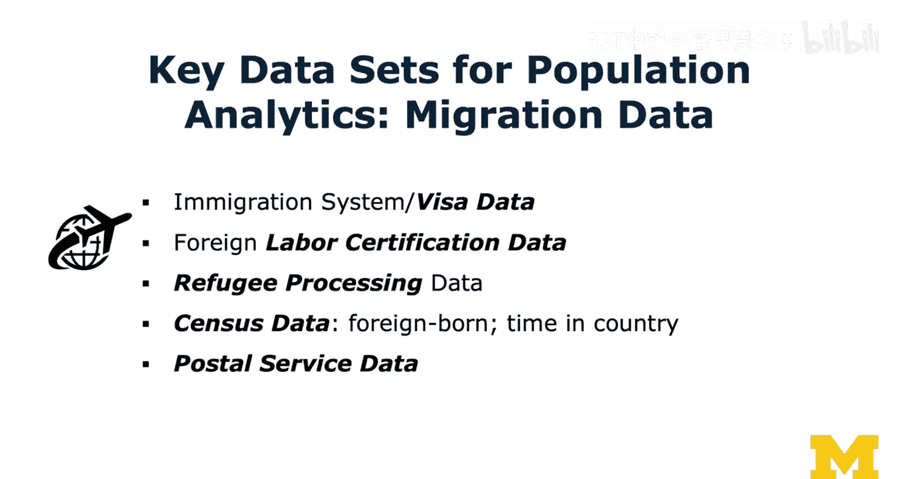

# 公共部门的R数据分析：第34课：核心人口数据来源解析 📊

在本节课中，我们将要学习公共部门获取关键人口数据的主要来源。了解这些数据如何产生、收集和管理，是进行有效人口数据分析的基础。

---

我们已经讨论了公共部门需要关于生育、死亡、迁移等关键人口过程以及人口数量和指标的稳健数据。那么，政府从何处获取所有这些重要的人口数据呢？

## 人口普查 📋

首先，人口数据的一个重要来源是**人口普查**。

人口普查是对一个地区（无论大小）的人口规模、构成和特征进行的精确而全面的统计。几乎所有国家都每10年进行一次人口普查。有些国家实际上每5年进行一次，例如加拿大、日本、爱尔兰、新西兰和澳大利亚。联合国为人口普查推荐了一系列标准程序，这有助于进行跨国比较。如果你想了解更多关于本国人口普查方法以及跨国比较的信息，可以从联合国获取大量优质资料。

## 生命登记数据 📝

人口数据分析的另一个关键信息来源是**生命登记数据**。

大多数国家都拥有所谓的生命登记系统。这意味着通过标准化表格登记出生和死亡，收集信息，这些表格通常被称为出生证明和死亡证明。这些证明在出生和死亡发生地填写，然后提交给政府进行记录保存，并输入大型数据系统。一些国家还有民事登记系统，用于跟踪婚姻、离婚和收养等信息。生命登记系统及其产生的数据对于公共行政的所有核心职能都至关重要。

然而，必须指出，这些系统的设计和启动成本极高，并且长期维护也非常昂贵。事实上，许多中低收入国家的系统在覆盖面和数据质量方面存在严重缺陷。

## 迁移数据 🧳

接下来我们看看迁移数据。政府如何获取关于人口流动和进出境的所有信息呢？

对于政府来说，追踪迁移情况确实非常困难。一些有助于公共部门完成这项重要任务的数据系统包括：

以下是几种关键的迁移数据来源：

*   **移民数据系统**：这包括所有签证申请、签发和停留时间数据的系统。
*   **外国劳工证书数据**：一些国家拥有此类数据。
*   **难民处理数据**。
*   **人口普查**：人口普查也能为我们提供迁移信息。大多数国家的普查问卷中都包含收集个人是否在国外出生、在所在国时间等信息的问题。这些信息有多种用途，包括掌握一个国家内部的迁移流动情况。
*   **邮政服务数据**：具体来说，**地址变更数据**确实有助于政府更好地了解一个国家内部的迁移情况。

---

在本节课中，我们一起学习了公共部门获取核心人口数据的三大主要来源：**人口普查**、**生命登记系统**和**迁移相关数据系统**。理解这些数据的来源、优势和局限性，是进行可靠公共部门数据分析的第一步。