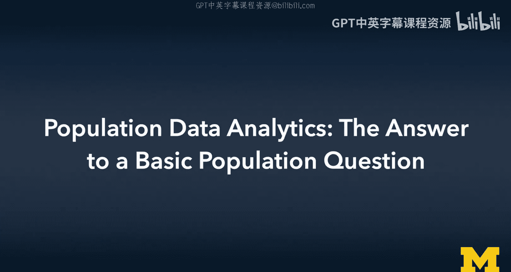
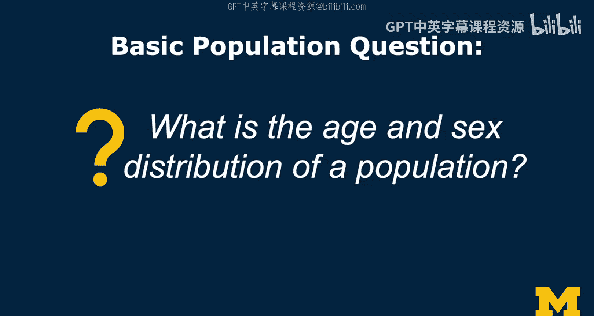
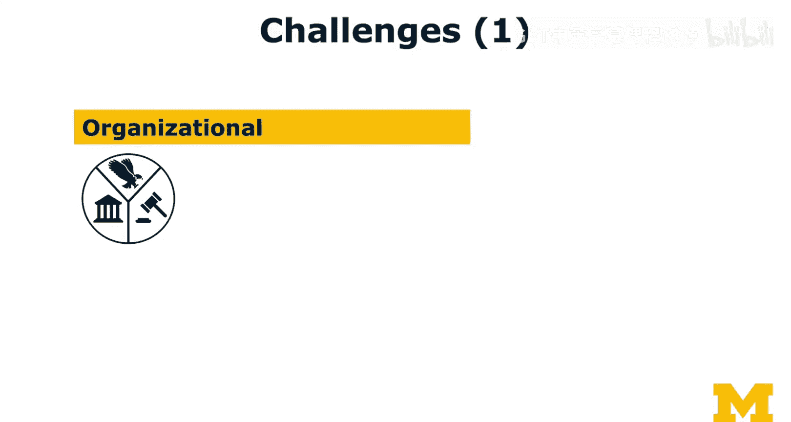
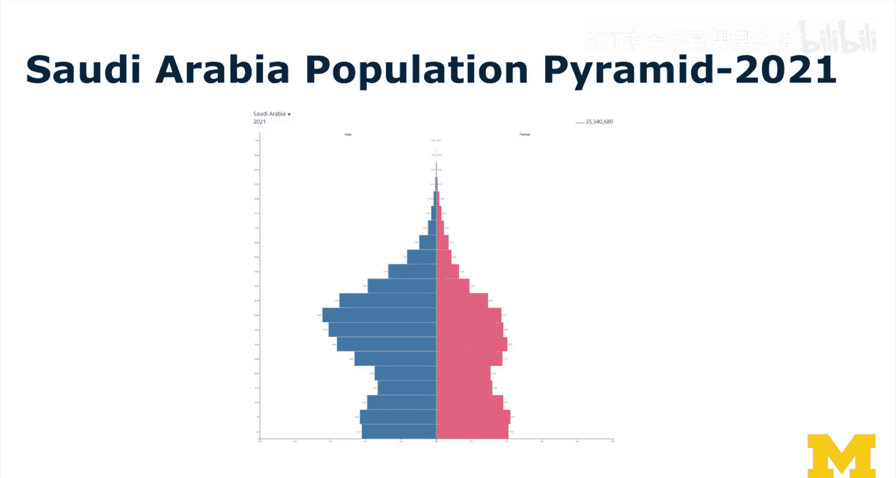
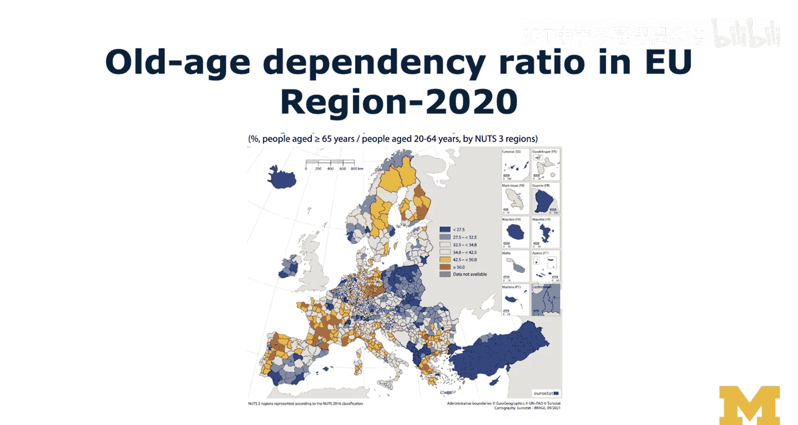
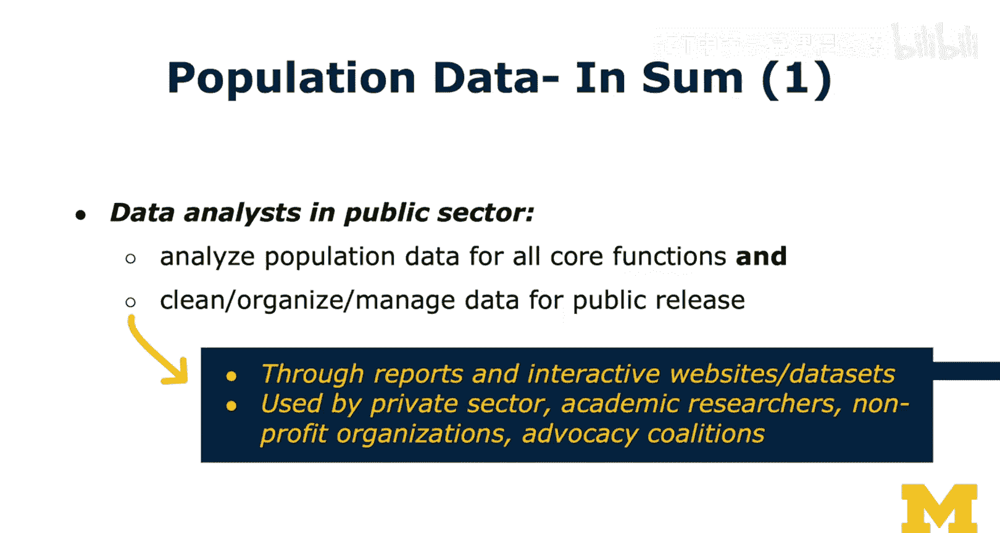
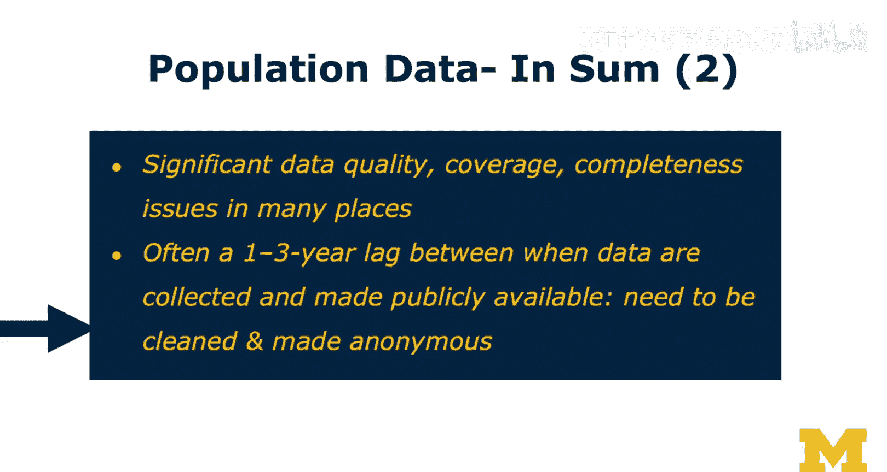
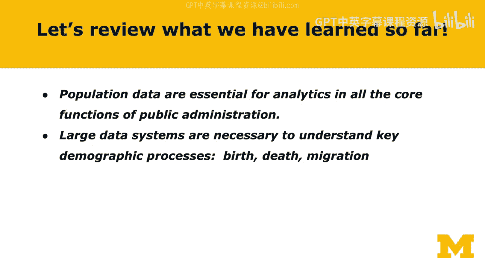

# 公共部门的R数据分析：35：基础人口问题分析方法 📊

在本节课中，我们将要学习如何分析人口数据，特别是如何理解人口的年龄与性别分布。我们将介绍人口金字塔这一核心可视化工具，并探讨其如何揭示出生、死亡和迁移等关键人口动态。

## 概述人口分析的重要性

一个基础且重要的问题是：如何了解人口的年龄和性别分布？这对所有政府而言都是一个至关重要的问题。

## 理解人口金字塔 📐

上一节我们介绍了人口分析的重要性，本节中我们来看看如何具体呈现人口结构。这个问题通常通过一种名为“人口金字塔”的图表来解答和可视化。

人口金字塔简单地展示了按性别（男性与女性）和细分的年龄组划分的人口数量。下图展示了2021年世界人口的金字塔。

该图表明，目前地球上儿童和年轻人的数量远多于老年人。世界人口总体上相对年轻。只要各年龄组的出生率和死亡率保持不变，这种底部宽大的金字塔形状就会持续。

然而，如果出生率下降，金字塔的底部就会变小。几乎所有国家的人口金字塔形状都会随时间而变化。

## 人口动态与形状演变

人口动态之所以称为“动态”，是因为情况并非一成不变。下图展示了日本自20世纪60年代以来人口金字塔发生的巨大变化。

它从典型的金字塔形状，演变为2010年截然不同的形状，显示出出生率下降、人口老龄化以及某些婴儿潮世代的存在。图中还展示了日本到2060年的人口预测，呈现出另一种不同的形状，即所谓的“倒金字塔”形状。

这种形状是出生率长期下降，同时死亡率保持低位或下降的结果。其特点是老年人口更多，而金字塔底部的年轻人口更少。

## 案例分析：沙特阿拉伯的人口金字塔

以下是另一个例子，2021年沙特阿拉伯的人口金字塔。

关于这个金字塔的形状，你注意到什么有趣之处了吗？希望你能看到两点。

第一点是男女性别之间的明显差异，在20至65岁年龄段，男性人口相对更多。原因是什么？如果你认为这可能是由于其他国家男性移民到沙特阿拉伯工作所致，那么你的判断是正确的。因此，我们再次看到，移民对人口内部的年龄和性别分布可以产生重要影响。

你可能会注意到的第二点是，沙特阿拉伯出现过几次婴儿潮，即金字塔中某些年龄组的人口数量比其前后的年龄组都要多。当条形图比前后组更突出时，那就是一次婴儿潮。

政府需要真正理解婴儿潮及其发生时间，因为随着人口老龄化，这对于规划政府社会服务项目、社会保险项目、退休福利支付等都至关重要。

## 结合地图进行人口分析

再来看一张图表，这是欧盟国家及其主要地区的老龄人口抚养比可视化地图。

这与之前讨论的总抚养比略有不同，因为它只考虑老年人口对劳动年龄人口的依赖。你可以看到，老龄人口抚养比较低的地区用蓝色表示，而抚养比较高的地区用橙色和红色表示。

不要求你消化和理解这张地图中的所有信息，但重要的是，**将人口数据与地图相结合**，也是理解人口动态的有力工具。

## 关于人口数据的重要注意事项

以下是关于人口数据的几点重要评论，需要你记住。

首先，公共部门的数据分析师分析人口数据是为了服务于所有核心职能，这既帮助政府自身，同时分析师们也需要为公众发布、报告以及通过交互式网站和数据库来清理、组织和管理这些数据。因为公众，以及各行各业，都对政府发布的人口数据感兴趣。这些报告被私营部门、学术研究人员、非营利组织、倡导联盟等广泛使用。

其次，数据从收集到公开可用之间通常存在一到三年的滞后。数据需要被清理，需要确保从出生记录、死亡记录和人口普查信息等中剥离任何识别信息，并且完成这些工作并以使其他利益相关者能够高效理解、清晰沟通和呈现的方式也需要时间。

最后，在我们讨论的各类人口数据中，确实存在许多数据质量、覆盖范围和完整性问题，这在每个国家都存在，但显然对于资源较少的国家来说，这个问题尤为突出。

## 总结

本节课中我们一起学习了人口数据分析的基础知识。让我们快速回顾一下本节关于人口数据分析所涵盖的内容。

人口数据对于分析和公共行政的所有核心职能都至关重要，这类数据几乎是计算重要公共措施和指标比率及百分比的最重要组成部分。

此外，复杂的**数据系统**对于公共部门理解关键的人口过程（出生、死亡和迁移）是必要的，这对于理解人口动态至关重要。数据系统必不可少，这包括生命登记数据、人口普查数据以及来自多个数据系统的迁移数据。

我们很快将深入探讨更多人口数据分析重要性的例子，以及如何进行一些数据分析。