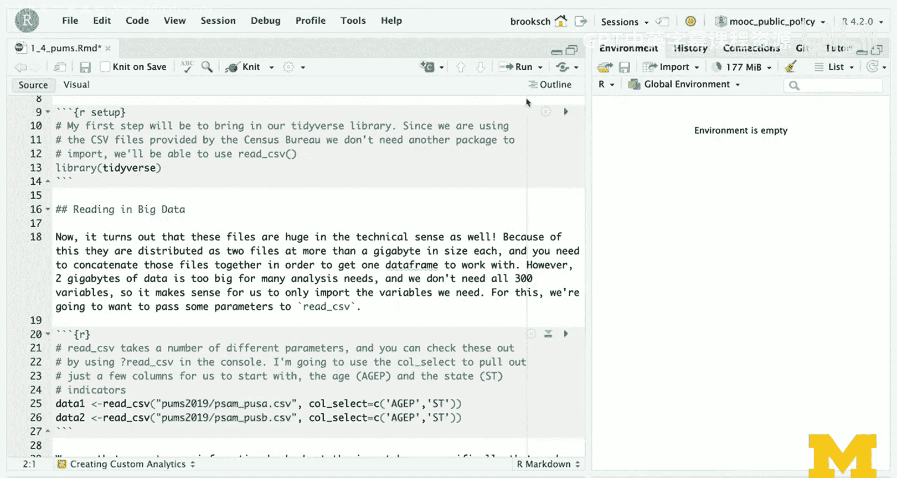
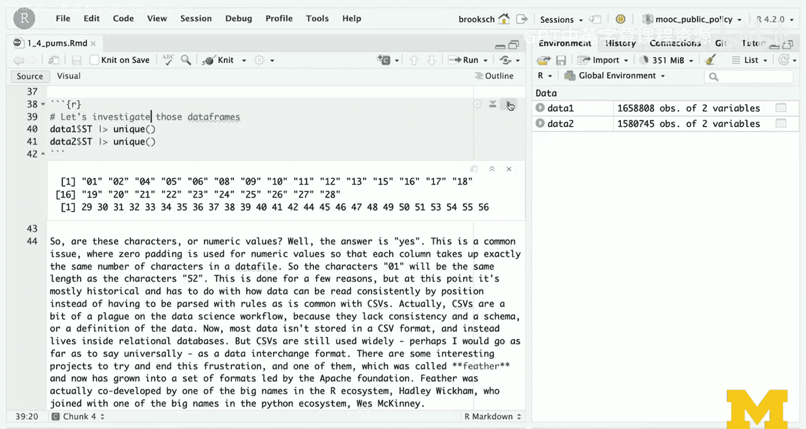
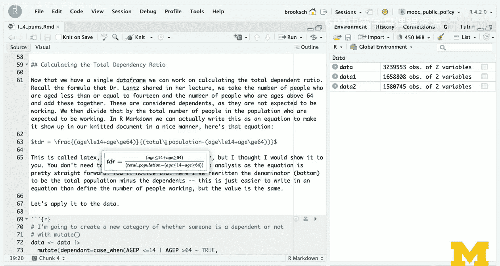
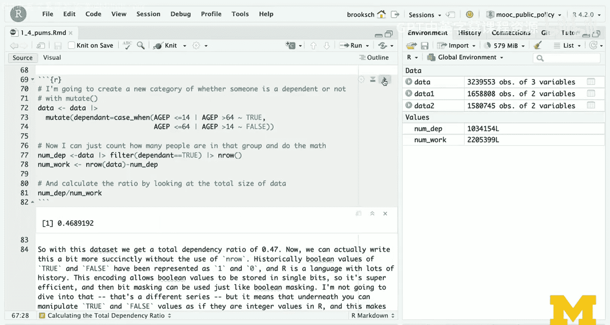
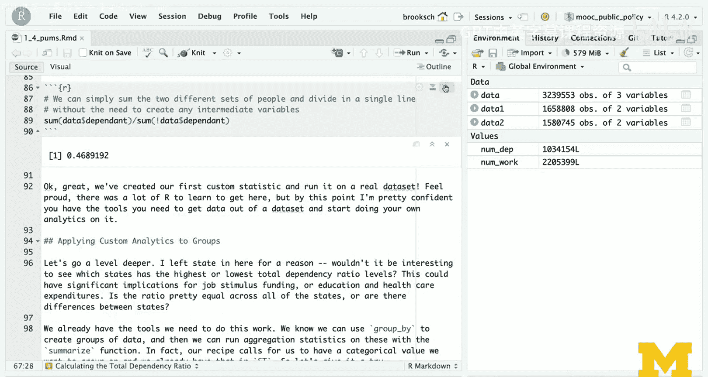

# 公共部门的R数据分析：第36讲：定制化分析模型构建 🛠️


在本节课中，我们将学习如何利用真实的人口普查数据，构建一个定制化的分析模型。具体来说，我们将计算**总抚养比**。我们将使用美国社区调查的原始数据，并在此过程中学习如何处理大型数据集、解决数据导入中的常见问题，以及运用R语言进行高效计算。

## 概述与数据介绍

在之前的课程中，我们学习了几种常见的人口统计指标，社会科学家和公共数据分析师使用这些指标来为公共政策提供信息。本节课程将在此基础上，探讨如何将这些指标应用于原始数据。

本节课将使用**2019年美国社区调查公共使用微观数据样本**。这是一项针对美国家庭和社区的横断面调查，以原始微观数据格式提供。它代表了超过300万个美国家庭的五年期样本，涵盖了人口、经济、社会、住房等多个维度，用于在十年一次的人口普查之间收集高质量的人口数据。

美国人口普查局将这些ACS家庭调查数据公开，供公众使用和分析。这几乎是公共数据集中最接近原始数据的形式，也是像Lance博士这样的研究者在政策研究工作中使用的数据类型。

PUMS数据规模庞大，不仅包含近300个变量，其数据采集、记录和加权的流程也非常复杂，测量的变量涵盖了广泛的社会背景。PUMS数据用于支持政府内部超过300个联邦指标，并为每年近7000亿美元的公共支出提供依据。

虽然无法在一节课中全面介绍PUMS，但美国人口普查局提供了一系列出色的开放资源，帮助联邦政府内外的数据分析师。这些资源包括示例、教程、录制的网络研讨会和演示文稿，强烈建议查阅，课程资料中已附上普查学院网站的链接。

本节课的目标是展示如何利用这类人口普查数据，创建像**总抚养比**这样的定制化分析。当然，在这个过程中，我们也会学习更多关于R和tidyverse的知识。

## 第一步：导入数据与Tidyverse


首先，我们需要加载Tidyverse库。由于我们使用的是人口普查局提供的CSV文件，无需额外安装包，可以直接使用Tidyverse中的`read_csv`函数进行导入。



```r
library(tidyverse)
```

## 处理大型数据文件

这些数据文件在技术层面上也非常庞大。因此，它们被分成了两个文件，每个都超过1GB大小。为了获得一个完整的数据框进行处理，我们需要将这两个文件拼接起来。


然而，2GB的数据对于大多数分析需求来说有些过大，而且我们并不需要全部300个变量。因此，明智的做法是只导入我们需要的变量。我们将向`read_csv`函数传递一些参数来实现这一点。

`read_csv`函数接受许多不同的参数，你可以在控制台使用`?read_csv`来查看。这里，我将使用`col_select`参数来仅提取我们需要的几列：年龄和州代码。

```r
# 假设文件路径为 file1.csv 和 file2.csv
# 仅导入 AGEP (年龄) 和 ST (州代码) 列
data_part1 <- read_csv("file1.csv", col_select = c(AGEP, ST))
data_part2 <- read_csv("file2.csv", col_select = c(AGEP, ST))
```

即使只提取这两列，这个过程也需要一些时间，因为`read_csv`需要读取整个文件来生成数据框。导入后，我们看到每个数据框大约有150万行和两列。

接下来，我们需要将这两个数据框拼接起来。可以使用`dplyr`包中的`bind_rows`函数。

```r
data <- bind_rows(data_part1, data_part2)
```

## 解决数据类型冲突

执行上述代码时，可能会遇到一个错误：州代码变量`ST`无法合并，因为它在第一个数据框中是字符类型，在第二个数据框中是数值类型。

这是一个常见问题，通常是由于数值使用了前导零填充，以确保数据文件中每列字符数一致。例如，字符“01”和“52”长度相同。这样做主要是历史原因，便于按固定位置读取数据，而不是像CSV那样依赖规则解析。



实际上，CSV在数据科学工作流中常带来困扰，因为它缺乏一致性和模式定义。如今，大多数数据存储在关系数据库中，但CSV仍被广泛用作数据交换格式。

有一些有趣的项目试图解决这个问题，例如由R语言的Hadley Wickham和Python的Wes McKinney共同开发的**Feather**格式，现由Apache基金会主导。不过，我们目前仍处于CSV的世界，因此需要处理这个问题。

我们需要决定将数据表示为数值还是字符串。根据代码簿，它们应该是字符串。那么，如何实现呢？最简单的方法是回到`read_csv`的文档。你会发现一个名为`col_types`的参数，我们可以设置它，让`read_csv`在读取字符时按照我们想要的类型进行设置。

```r
# 重新导入，指定两列均为字符类型
data_part1 <- read_csv("file1.csv",
                       col_select = c(AGEP, ST),
                       col_types = cols(AGEP = "c", ST = "c"))
data_part2 <- read_csv("file2.csv",
                       col_select = c(AGEP, ST),
                       col_types = cols(AGEP = "c", ST = "c"))

# 再次拼接
data <- bind_rows(data_part1, data_part2)
```

现在，在环境面板中可以看到，我们拥有了一个包含约300万行观测值和两个变量的巨型数据框。这说明了理解我们在课程最初几讲中讨论的数据类型基础是多么有用。虽然我们可以在不了解R语言内部机制的情况下走得很远，但有时理解这些机制对于调试遇到的问题至关重要。


## 计算总抚养比

现在我们有了一个统一的数据框，可以开始计算**总抚养比**。我们采用Lance博士在讲座中分享的公式。

我们将年龄小于等于14岁和大于等于65岁的人口数量相加，这部分人被视为**被抚养人口**，因为他们预计不参与工作。然后，将这个总和除以预计在工作年龄内的总人口数。

在Markdown中，我们可以将其写成一个公式，以便在编织文档时美观地显示。例如：

**总抚养比公式：**
$$
TDR = \frac{N_{dep}}{N_{work}} = \frac{N_{dep}}{N_{total} - N_{dep}}
$$
其中，$N_{dep}$ 是被抚养人口数，$N_{work}$ 是工作年龄人口数，$N_{total}$ 是总人口数。注意，分母被重写为总人口减去被抚养人口，这在公式中比直接定义工作人数更容易，但数值是相同的。

现在，让我们将这个公式应用到数据中。

首先，使用`mutate`函数创建一个新列，标识一个人是否属于被抚养人口。

```r
data <- data %>%
  mutate(dependent = case_when(
    AGEP <= 14 | AGEP >= 65 ~ TRUE,
    AGEP > 14 & AGEP < 65 ~ FALSE
  ))
```



接着，我们可以计算被抚养人口和工作年龄人口的数量，然后计算比率。

```r
# 方法一：分步计算
n_dep <- data %>%
  filter(dependent == TRUE) %>%
  nrow()


n_total <- nrow(data)
n_work <- n_total - n_dep

tdr <- n_dep / n_work
tdr
```

使用这个数据集，我们得到的**总抚养比**约为 **0.47**。

## 更高效的计算方法



实际上，我们可以写得更简洁，无需使用`nrow`。在R语言中，逻辑值TRUE和FALSE在底层被表示为1和0。这种编码方式历史悠久，允许布尔值以单个比特存储，效率极高。这意味着在R中，你可以像操作整数值一样操作TRUE和FALSE值，这使得计数变得非常容易。

我们可以在单行代码中完成计算，无需创建任何中间变量。

```r
# 方法二：利用逻辑值求和
tdr_succinct <- sum(data$dependent) / sum(!data$dependent)
tdr_succinct
```

这段代码直接提取`dependent`列，对TRUE值（被抚养人口）求和，对FALSE值（取反后为工作人口）求和，然后相除。所有TRUE计为1，FALSE计为0，非常简洁高效。

## 总结


在本节课中，我们一起学习了如何利用真实的美国社区调查数据构建定制化分析模型。我们完成了以下关键步骤：



1.  **导入与准备数据**：使用`read_csv`函数并指定`col_types`参数，解决了大型CSV文件导入时的数据类型冲突问题。
2.  **数据整合**：使用`bind_rows`函数合并了多个数据文件。
3.  **创建分析指标**：使用`mutate`和`case_when`函数，根据年龄条件创建了标识被抚养人口的新变量。
4.  **计算总抚养比**：运用两种方法（分步计算和利用逻辑值求和）计算了**总抚养比**，并理解了R中逻辑值可视为数值进行运算的特性。


虽然过程中涉及了不少R语言知识，但至此，相信你已经掌握了从数据中提取信息并开始进行自主分析所需的工具。恭喜你创建了第一个基于真实数据集的定制化统计量！