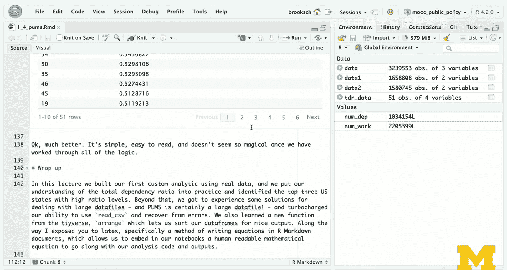

# 37：分组应用定制化分析 📊


在本节课中，我们将学习如何对数据进行分组，并应用定制化的分析。我们将以计算美国各州的“总抚养比”为例，深入探索数据中的模式。

## 概述

上一节我们介绍了数据聚合的基本概念。本节中，我们将进一步深化，学习如何按特定类别（如州）对数据进行分组，并计算每个组的汇总统计量。我们将使用 `group_by()` 和 `summarize()` 函数来实现这一目标。

## 按州分组计算总抚养比


我们有一个包含各州人口数据的数据集。一个有趣的问题是：哪些州的总抚养比最高或最低？这个比率可能对就业刺激资金或医疗教育支出有重要影响。各州的比率是相近的，还是存在显著差异？

我们已经掌握了完成这项工作的部分工具。我们知道可以使用 `group_by()` 创建数据组，并使用 `summarize()` 函数在这些组上运行聚合统计。我们的分析需要一个用于分组的类别值，而数据中恰好有州标识符 `ST`。

以下是实现步骤：

1.  首先，将数据按 `ST`（州）进行分组。
2.  然后，使用 `summarize()` 创建两个新变量：一个是公式的分子（依赖人口 `dependence`），另一个是分母（适龄工作人口 `working`）。
3.  接着，使用 `mutate()` 创建一个新列 `TDR`，其值为依赖人口除以适龄工作人口。

让我们尝试一下。代码如下：

```r
# 按州分组并计算总抚养比
state_tdr <- your_data %>%
  group_by(ST) %>%
  summarize(
    dependence = sum(dependence),
    working = sum(working)
  ) %>%
  mutate(TDR = dependence / working)
```

运行代码后，我们就计算出了每个州的总抚养比。

## 对结果进行排序

现在我们可以使用 `arrange()` 函数对数据进行排序，只需指定要排序的变量即可。在本例中，我们希望按 `TDR` 降序排列，以找出适龄工作人口比例最低的州。

以下是排序的代码：

```r
# 按总抚养比降序排列
state_tdr_sorted <- state_tdr %>%
  arrange(desc(TDR))
```

查看排序后的数据，根据代码本可知，排名第一的州是缅因州（州编号23）。其总抚养比为0.56，这意味着与依赖人口相比，其工作人口较少。排名第二和第三的分别是佛罗里达州和蒙大拿州。有趣的是，各州之间的比率存在差异，有些州甚至低至0.28，表明那里工作人口众多，而儿童和老年人相对较少。


## 优化分析流程

虽然上述方法可行，但创建中间数据框再进行操作并非最理想的方式。我们完全可以在一个语句中完成分组、计算和排序。


让我们优化一下代码。我们将数据直接传入 `group_by()`，然后在 `summarize()` 中直接计算 `TDR`，最后用 `arrange()` 排序。

优化后的代码如下：

```r
# 优化：一步完成分组、计算和排序
final_result <- your_data %>%
  group_by(ST) %>%
  summarize(TDR = sum(dependence) / sum(working)) %>%
  arrange(desc(TDR))
```



这样更好，代码简洁、易读，并且在我们理清所有逻辑后，操作过程一目了然。

## 总结

本节课中，我们一起学习了如何利用真实数据构建第一个定制化分析。我们将对总抚养比的理解付诸实践，并识别出了总抚养比水平最高的三个美国州。

此外，我们还获得了处理大型数据文件（如PUMS数据集）的解决方案经验，并提升了使用 `read.csv()` 及从错误中恢复的能力。

我们学习了 `tidyverse` 中的一个新函数 `arrange()`，它让我们能够对数据框进行排序，以便输出美观的结果。

在此过程中，我们还接触了 **LaTeX**，这是一种在 Markdown 文档中编写公式的方法。它允许我们在分析笔记本中嵌入人类可读的数学方程，与我们的分析代码和输出相辅相成。例如，总抚养比（TDR）的公式可以表示为：


**TDR = (依赖人口) / (适龄工作人口)**