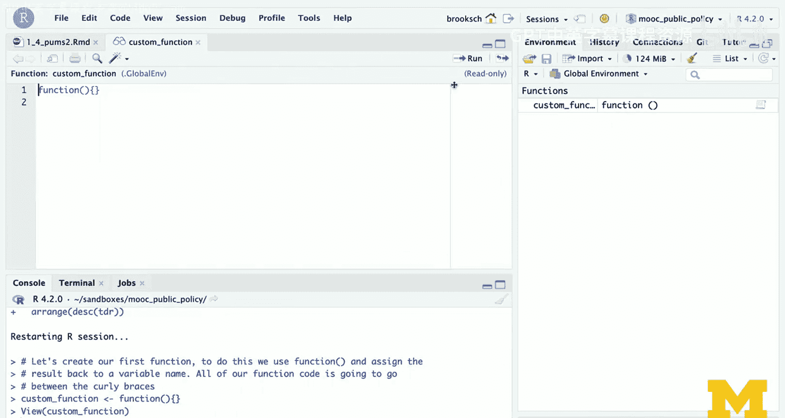
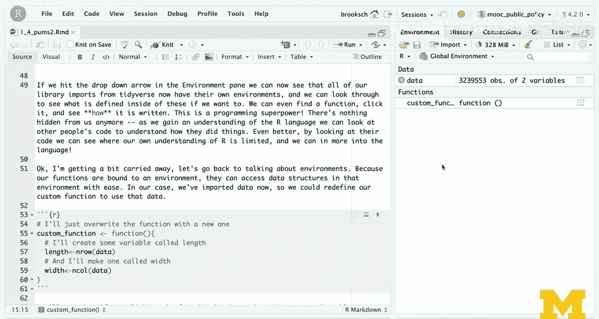
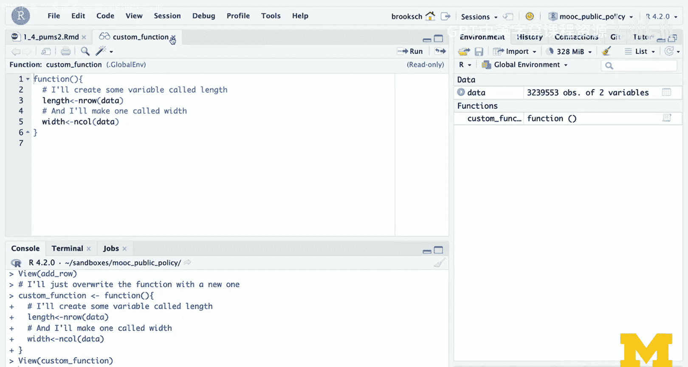
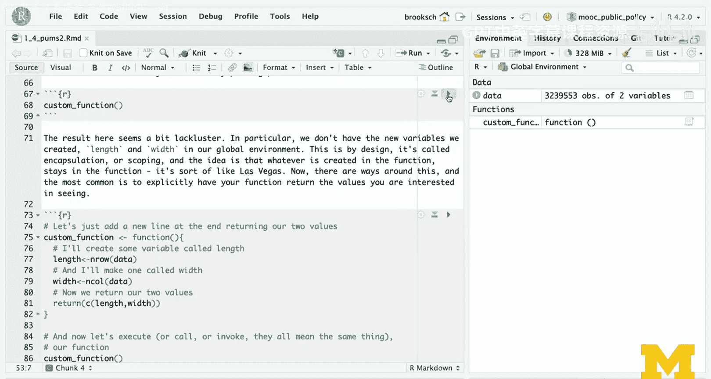
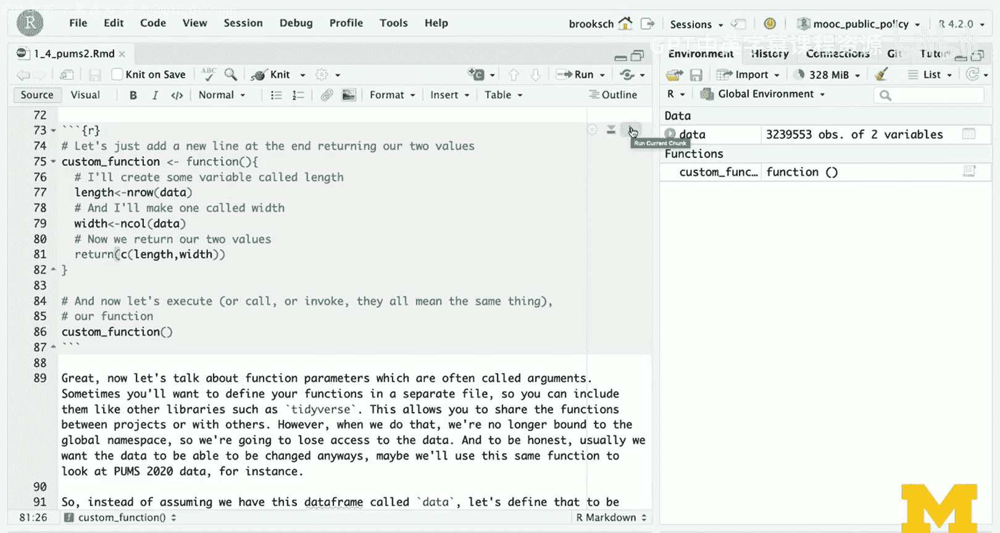
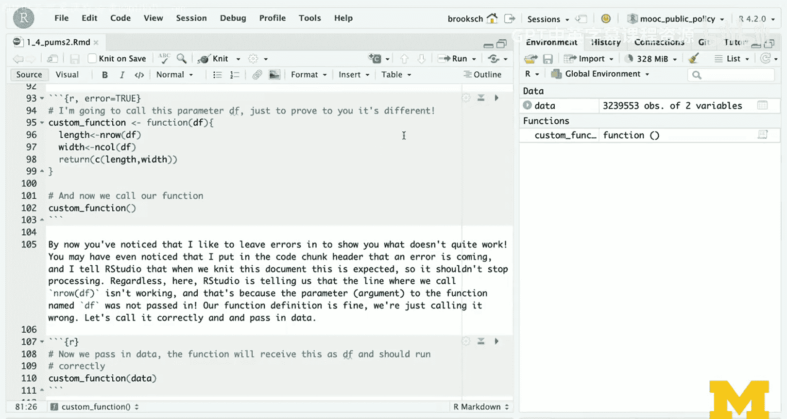
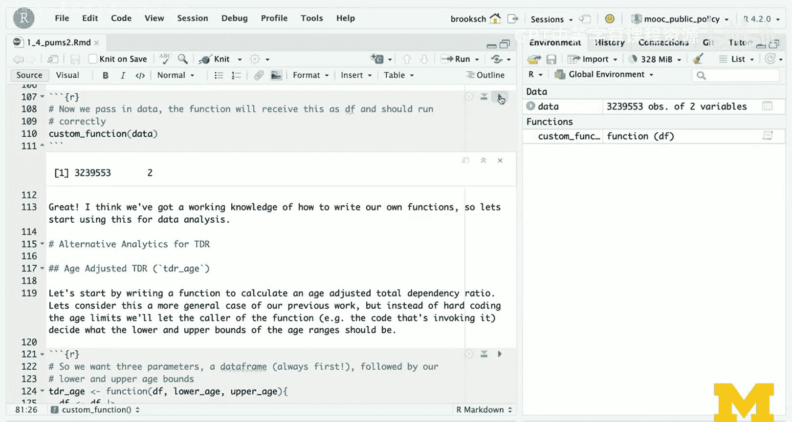
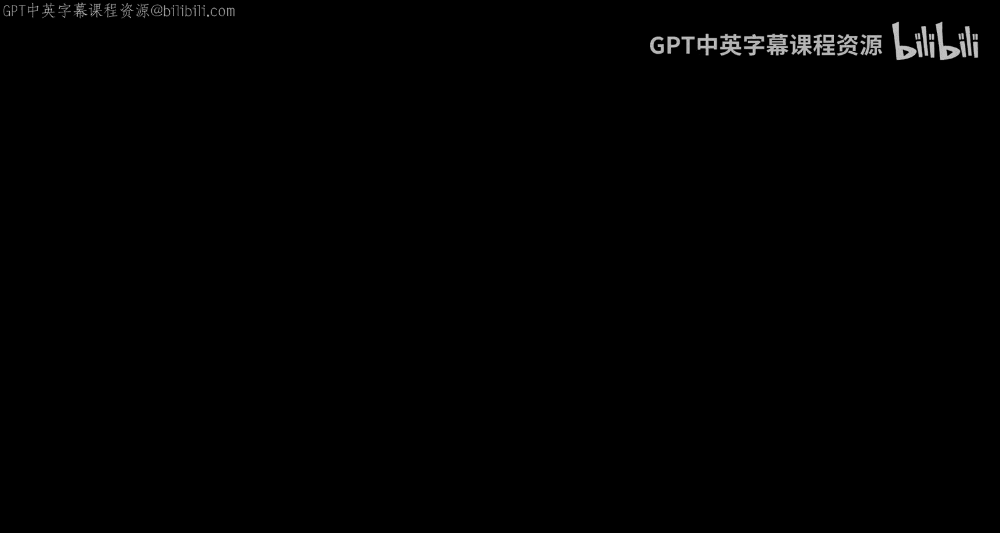

# 38：函数编写技术 🛠️


在本节课中，我们将学习如何在R中编写自定义函数。我们将以分析人口普查数据中的“抚养比”为例，探讨如何创建灵活、可复用的函数来支持数据分析工作。

---

## 概述 📋

过去几周我们已经使用了大量不同的函数。现在，随着我们开始编写自己的分析代码，是时候学习如何编写自定义函数了。我们将利用PUMS数据作为示例，因为“抚养比”存在多种定义，每种都对应特定的研究问题或主题。美国人口普查局的Fylen Kainsky提出了多种有趣的计算抚养比的方法，以反映现代社会中可能存在的潜在社会差异。例如，在美国，将15至17岁的人视为劳动者而非被抚养者是否合适？或者，在大学城（如我所在的安娜堡）中，将大学生计入就业适龄人口是否会夸大社区的劳动力容量？我们将通过解决这个问题来学习如何在R中编写自定义函数。

## 什么是R函数？ 🤔

在R中，函数使用 `function()` 调用来创建。与许多其他语言不同，我们在定义函数时并不直接命名它，而是将函数绑定到一个变量，该变量随后就成为函数的名称。


让我们创建第一个函数。我们将使用 `function()` 函数，并将结果赋值给一个变量。我们所有的函数代码都将放在花括号 `{}` 之间。

```r
custom_function <- function() {
  # 函数体目前是空的
}
```

运行上述代码后，虽然我们创建的函数目前不执行任何操作，但你会注意到在环境面板中出现了一个新的函数对象。点击它可以查看函数的详细信息。

## 函数的三个核心组成部分 🧩



在高层面上，R函数有三个需要考虑的部分：
1.  **参数和返回值**：我们称之为“形式参数”。
2.  **分析代码**：我们称之为“函数体”。
3.  **执行上下文**：我们称之为“环境”。

我们已经见过很多关于第一部分的例子。例如，`sum()` 函数接收一个列表或数据框并返回一个数字；`filter()` 函数接收一个数据框和任意数量的布尔掩码，并返回另一个数据框。我们也知道，函数的代码主体写在花括号 `{}` 之间。


然而，最后一项——函数运行的环境——则不那么清晰。到目前为止，我们的环境一直是RStudio右上角的面板，它列出了我们的数据、值和函数。那么，环境具体指什么？为什么它很重要？

## 理解函数环境 🌍

当你像我们刚才那样定义一个函数时，它会被绑定到你定义它时所在的环境。这意味着该函数可以访问该环境中的所有数据、值和其他函数。我们可以使用 `environment()` 函数来检查绑定到某个函数的环境名称。

```r
environment(custom_function)
```

运行后，我们可以看到这个函数绑定到了“R_GlobalEnv”，也就是过去几周我们创建数据框的环境。实际上，我们可以通过环境面板的下拉菜单浏览不同的环境。例如，“stats”、“graphics”、“utils”等都是基础R包引入的环境。进入这些环境，我们可以看到里面定义的值、函数和数据。这为我们提供了一个强大的学习工具。

## 函数与数据的交互 📊

由于我们的函数绑定到一个环境，它们可以轻松访问该环境中的数据结构。在我们的例子中，我们已经导入了数据，因此可以重新定义我们的自定义函数来使用这些数据。

首先，让我们导入tidyverse包和PUMS数据。



```r
library(tidyverse)
data <- bind_rows(read_csv("pums_data_2019.csv"), read_csv("pums_data_2020.csv"))
```

现在，让我们重写 `custom_function`，使其使用全局环境中的 `data` 数据框。

```r
custom_function <- function() {
  length <- nrow(data)
  width <- ncol(data)
}
```

定义函数后，它还没有运行。R实际上尚未执行该函数，因此也没有调用 `nrow()` 或 `ncol()` 或尝试访问 `data`。要执行函数，我们需要在变量名后加上括号来调用它。

```r
custom_function()
```

调用后，结果似乎并不起眼。特别是，我们在全局环境中并没有看到创建的新变量 `length` 和 `width`，这可能与你的预期不符。这是有意设计的，称为**封装**或**作用域**。其理念是：在函数内部创建的任何东西都保留在函数内部。最常见的解决方法是显式地让函数返回你感兴趣的值。


## 函数的返回值 🔄

让我们修改函数，使其返回我们计算的长度和宽度值。

```r
custom_function <- function() {
  length <- nrow(data)
  width <- ncol(data)
  return(c(length, width))
}



# 调用函数
custom_function()
```


现在，函数返回了一个包含行数和列数的向量。这个数字看起来是正确的：大约320万行和2列。

## 函数参数（又称实参） 🎯



有时，你可能希望将函数定义在单独的文件中，以便将其包含在其他库中（就像tidyverse所做的那样）。这允许你在项目之间或与他人共享函数。然而，当我们这样做时，就不再绑定到全局命名空间，我们将失去对 `data` 的访问权限。而且，坦率地说，我们通常希望数据本身是可以变化的。例如，我们可能希望使用同一个函数来分析2020年的PUMS数据。


因此，我们不应该假设存在一个名为 `data` 的数据框，而应该将其定义为一个需要传递的**参数**。

```r
custom_function <- function(df) {
  length <- nrow(df)
  width <- ncol(df)
  return(c(length, width))
}
```



在上面的代码中，我们定义了一个参数 `df`。在函数内部，我们将使用这个参数名来引用传入的数据框。现在，让我们尝试调用它。

```r
# 错误的调用方式：未传递参数
custom_function()
# 这会引发错误，因为参数 `df` 没有被传入。

# 正确的调用方式：传入数据框
custom_function(df = data)
```


现在，函数可以正确运行并返回结果了。当我们调用函数时，可以传入任何我们想要的数据框；在函数内部，它将被称为 `df` 并使用它。

## 应用函数进行数据分析 📈



我认为我们已经掌握了如何编写自定义函数的工作知识。现在，让我们开始将其应用于数据分析。我们可以创建更复杂的函数来计算不同定义的抚养比，处理数据筛选、分组和汇总等任务。通过将分析步骤封装在函数中，代码将变得更清晰、更易于维护和复用。

例如，我们可以开始设计一个函数，根据不同的年龄组定义来计算抚养比，并允许用户指定使用哪个数据框以及哪些年龄阈值作为参数。


---

## 总结 ✨






本节课中，我们一起学习了如何在R中编写自定义函数。我们从创建一个简单的空函数开始，逐步理解了函数的三个核心部分：参数、函数体和环境。我们探讨了函数如何访问其定义环境中的数据，以及**封装**原则如何确保函数内部变量不影响全局空间。接着，我们学习了如何让函数通过 `return()` 语句返回值，以及如何定义和使用**函数参数**来使函数更加灵活和通用。最后，我们认识到，掌握函数编写技能是进行复杂、可复用数据分析的关键一步。现在，你已经具备了使用自定义函数来封装和自动化分析流程的基础能力。