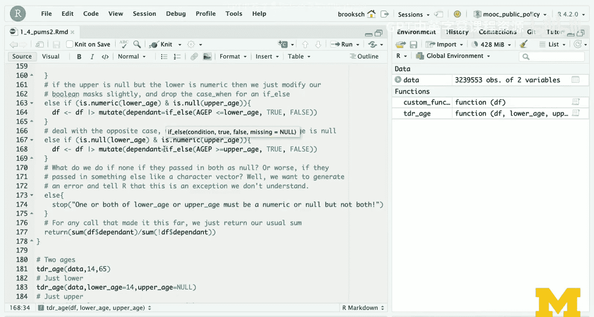
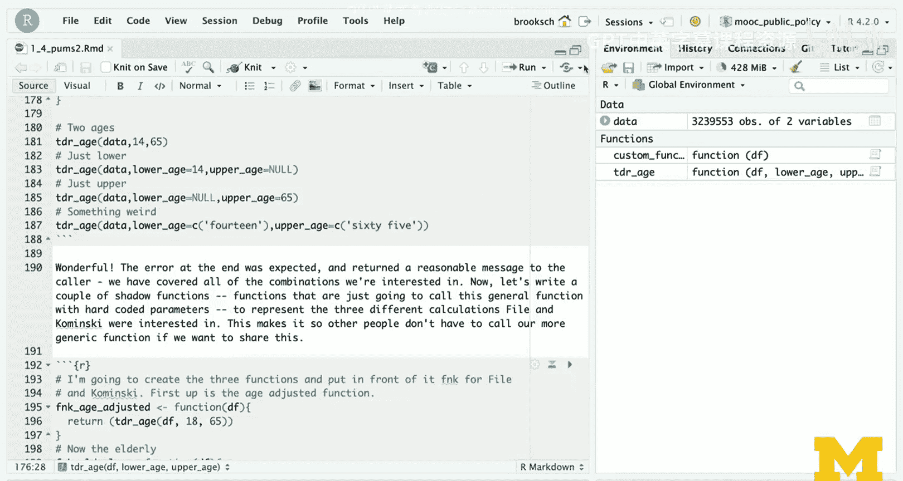
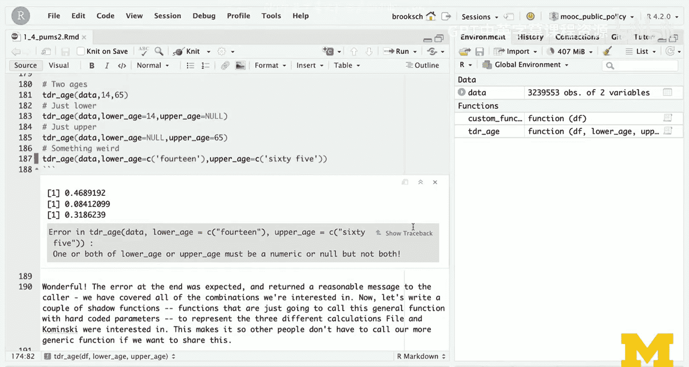
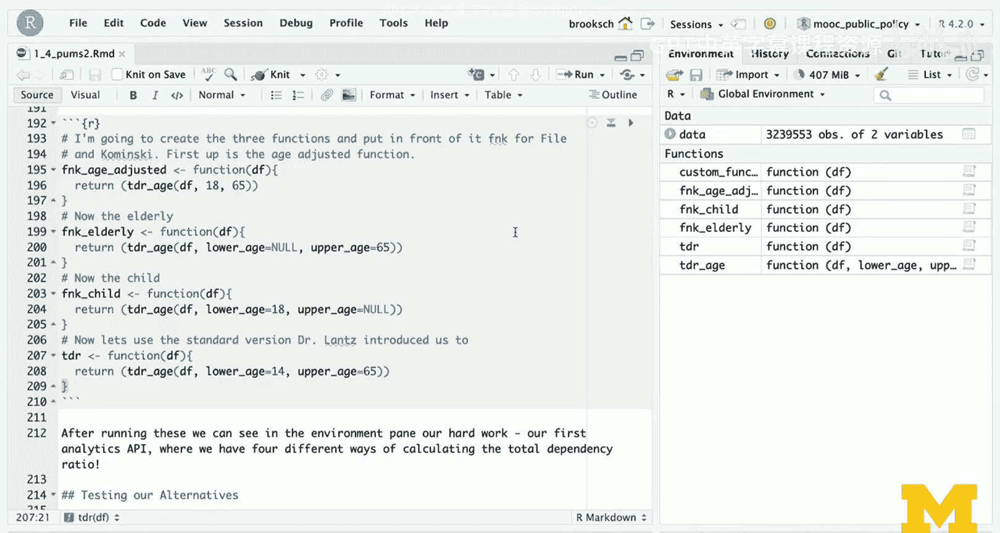
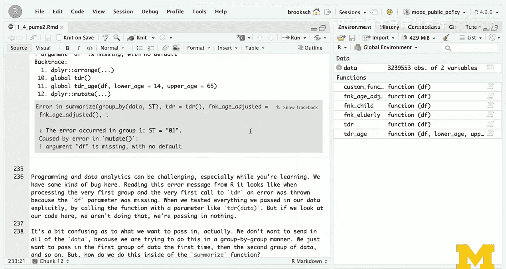
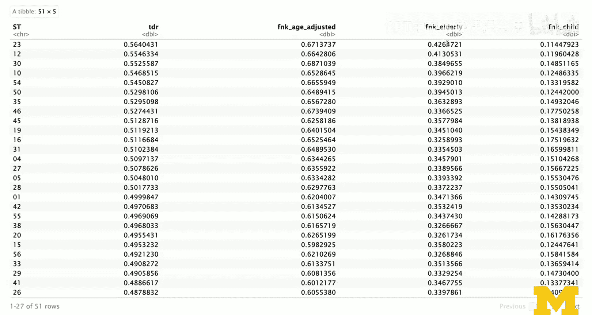
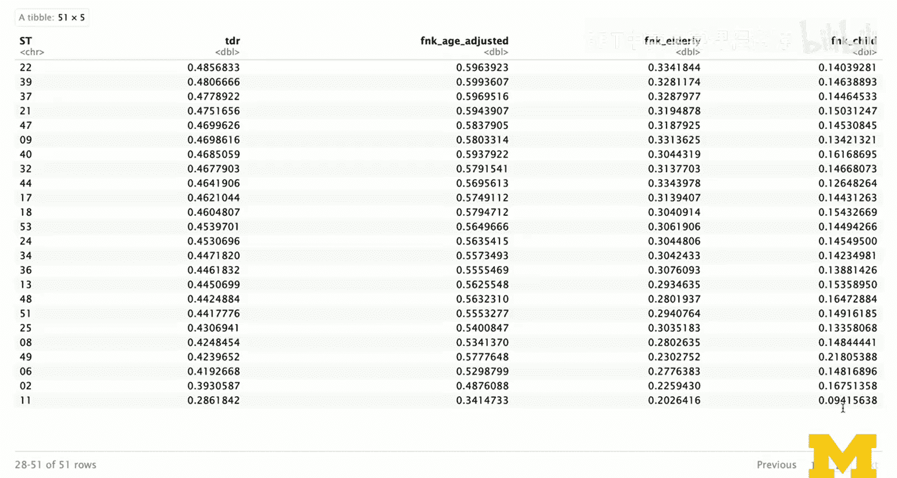

# 公共部门的R数据分析：第39讲：TDR替代分析方法 📊


在本节课中，我们将学习如何编写一个灵活的函数来计算年龄调整后的总抚养比。我们将从创建一个通用函数开始，然后扩展其功能，以计算不同类型的抚养比，例如老年抚养比和儿童抚养比。最后，我们将应用这些函数来分析美国各州的数据，并探讨不同计算方法如何影响我们对数据的理解。

---


## 编写通用函数


上一节我们学习了如何计算总抚养比。本节中，我们将创建一个更通用的函数，允许我们动态指定年龄范围的上限和下限，而不是在代码中写死。


以下是创建函数 `TDR_age` 的步骤：


1.  **定义函数参数**：函数需要三个参数：数据框 `df`、年龄下限 `lower_age` 和年龄上限 `upper_age`。
2.  **在函数内部处理数据**：使用 `mutate` 和 `case_when` 逻辑，根据传入的年龄界限创建新的“依赖人口”分类变量。
3.  **计算比率**：对分类后的数据进行汇总，并计算总抚养比。
4.  **返回结果**：函数最终返回计算出的比率值。

```r
TDR_age <- function(df, lower_age, upper_age) {
  df <- df %>%
    mutate(dependent = case_when(
      age <= lower_age ~ TRUE,
      age >= upper_age ~ TRUE,
      TRUE ~ FALSE
    ))
  
  summary_df <- df %>%
    summarise(
      total_pop = n(),
      dependent_pop = sum(dependent)
    )
  
  ratio <- summary_df$dependent_pop / (summary_df$total_pop - summary_df$dependent_pop)
  return(ratio)
}
```

我们使用之前课程中的参数（14岁和65岁）测试这个函数，结果与之前的手动计算一致，验证了函数的正确性。

---



## 扩展函数功能


Filin Kainsky 的研究建议，除了总抚养比，还应分别计算老年抚养比和儿童抚养比。这可以看作是我们通用函数的特例：老年抚养比只关注上限年龄（如65岁以上），儿童抚养比只关注下限年龄（如18岁以下）。



我们可以修改 `TDR_age` 函数，使其能够处理这些特例。核心思路是检查传入的 `lower_age` 和 `upper_age` 参数：
*   如果两者都是数字，则计算标准的总抚养比。
*   如果只有 `lower_age` 是数字而 `upper_age` 是 `NULL`，则计算儿童抚养比。
*   如果只有 `upper_age` 是数字而 `lower_age` 是 `NULL`，则计算老年抚养比。
*   如果两者都是 `NULL` 或传入非法值，则通过 `stop()` 函数抛出错误。


以下是更新后的函数逻辑代码块：




```r
TDR_age <- function(df, lower_age, upper_age) {
  if (is.numeric(lower_age) && is.numeric(upper_age)) {
    # 标准总抚养比计算
    df <- df %>% mutate(dependent = age <= lower_age | age >= upper_age)
  } else if (is.numeric(lower_age) && is.null(upper_age)) {
    # 儿童抚养比计算
    df <- df %>% mutate(dependent = ifelse(age <= lower_age, TRUE, FALSE))
  } else if (is.null(lower_age) && is.numeric(upper_age)) {
    # 老年抚养比计算
    df <- df %>% mutate(dependent = ifelse(age >= upper_age, TRUE, FALSE))
  } else {
    # 处理非法输入
    stop("参数 lower_age 和 upper_age 必须至少有一个为数字，另一个可为 NULL，但不能两者都为 NULL 或非数字。")
  }
  
  # 后续汇总和计算比率的代码保持不变
  # ...
}
```

我们通过多种参数组合测试了这个函数，包括标准双参数、单参数特例以及非法输入，函数均能按预期工作。



---

## 创建专用函数

为了让代码更清晰、更易于使用，我们可以基于通用函数 `TDR_age` 创建几个专用的“影子函数”。这些函数内部固定了年龄参数，直接对应特定的抚养比计算。

以下是四个专用函数的定义：

```r
# 1. 标准总抚养比 (TDR)
TDR <- function(df) {
  TDR_age(df, lower_age = 14, upper_age = 65)
}




# 2. Filin-Kainsky 年龄调整总抚养比
FNK_age_adjusted <- function(df) {
  TDR_age(df, lower_age = 18, upper_age = 65)
}

# 3. 老年抚养比
FNK_elderly <- function(df) {
  TDR_age(df, lower_age = NULL, upper_age = 65)
}


# 4. 儿童抚养比
FNK_child <- function(df) {
  TDR_age(df, lower_age = 18, upper_age = NULL)
}
```

现在，我们拥有了一个简单易用的分析工具集。


---

## 应用于州级数据分析


有了这些函数，我们可以轻松地分析各州数据。我们使用 `group_by` 和 `summarize` 函数，一次性为每个州计算所有四种抚养比。

这里有一个关键点：在 `summarize` 中使用自定义函数时，需要使用 `cur_data()` 来引用当前分组的数据。




```r
state_ratios <- data %>%
  group_by(state) %>%
  summarise(
    TDR = TDR(cur_data()),
    FNK_adj = FNK_age_adjusted(cur_data()),
    FNK_eld = FNK_elderly(cur_data()),
    FNK_child = FNK_child(cur_data())
  ) %>%
  arrange(desc(TDR))
```

查看结果表格，我们可以获得丰富的信息：
*   **总抚养比 (TDR)** 排名前三的州是缅因州、佛罗里达州和蒙大拿州。
*   **年龄调整抚养比 (FNK_adj)** 由于将15-17岁人群纳入被抚养人口，数值普遍高于标准TDR。
*   **深入分析**：例如，缅因州的高TDR主要源于其极高的**老年抚养比**，而非儿童抚养比。这对于公共政策制定（如税收、养老金、教育资源分配）具有重要启示。
*   **底部观察**：总抚养比最低的地区是华盛顿特区（DC）和阿拉斯加州，这反映了其人口结构以劳动年龄人口为主。




---

## 总结


本节课中我们一起学习了R语言中函数的核心应用。我们从编写一个简单的计算函数开始，逐步将其扩展为一个健壮、通用的工具，并最终创建了一套便于数据分析的专用函数。

通过将这些函数与 `dplyr` 的 `group_by` 和 `summarize` 操作结合，我们能够高效地对复杂数据集（如美国各州人口数据）进行多维度分析，从而提取出有意义的洞察，例如不同州老龄化或儿童比例的差异。


这标志着我们在掌握 `tidyverse` 数据操作方面迈出了坚实的一步。在接下来的课程中，我们将进入另一个强大的领域：信息可视化，使用 `ggplot2` 包将我们的数据发现转化为直观的图表。