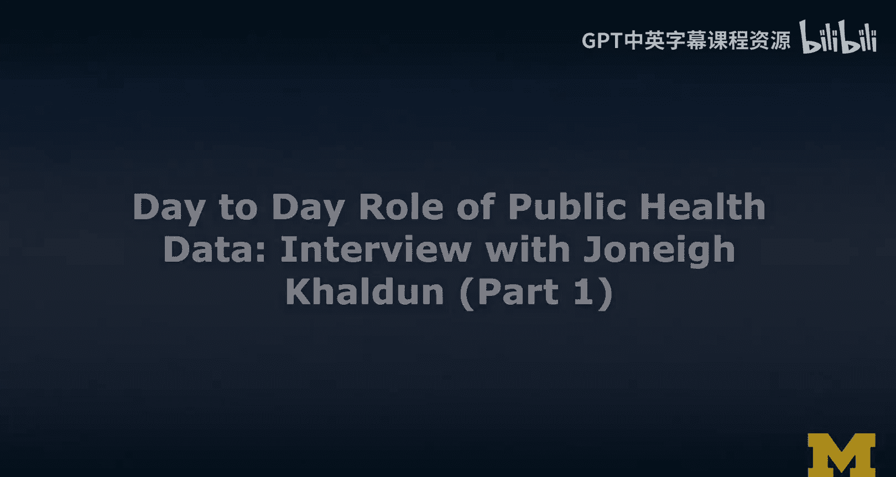

# 公共部门的R数据分析（基础、数据探索、决策支持）：40：公共卫生数据日常应用：Joneigh Khaldun访谈

在本节课中，我们将通过密歇根大学公共卫生学院Paula Lantz教授与Joneigh Khaldun博士的访谈，了解数据在公共卫生管理与决策中的实际应用。Khaldun博士将分享她在巴尔的摩市、底特律市和密歇根州担任公共卫生领导职务时的经验，重点阐述数据如何驱动政策制定、质量改进和健康公平。

## 引言与嘉宾介绍

欢迎，我是Paula Lantz教授。今天，我很高兴能与Joneigh Khaldun博士进行对话。她是我在公共卫生和公共服务领域的榜样之一。非常感谢您今天与我们在一起。

Khaldun博士是一名执业急诊科医生，目前也是CVS Health的副总裁兼首席健康公平官。她在公共卫生行政管理和领导方面担任过许多不同的重要职务。

为了让我们开始，Khaldun博士，再次感谢您今天与我们在一起，您能介绍一下您曾担任过的一些重要职位吗？

## Khaldun博士的公共卫生领导经历

能够来到这里是我的荣幸。我认识您很多年了，包括在我职业生涯早期，很高兴能再次与您交流。

是的，我很荣幸在行政管理领域，特别是在政府部门担任过多个职务。我曾是巴尔的摩市卫生局的首席医疗官，负责监督七个独立诊所和实验室的工作。我还曾担任底特律市卫生局的医疗主任和局长，负责在那里建立项目、进行大量重组并应对接踵而至的甲型肝炎危机。

最近，在我担任现职之前，我是密歇根州的首席医疗执行官，同时也是密歇根州卫生与公众服务部的卫生事务副主任。因此，公共卫生、医疗补助、行为健康以及我们的州立精神健康医院都在我的职责范围内。

## 公共卫生行政的核心职责

这些都是重大的职责。您能总结一下在巴尔的摩市、底特律市和密歇根州工作时的一些主要行政责任吗？

当然。在政府公共服务中，核心是关于人，是关于如何为人民服务，以及如何利用政府通常有限的预算。作为这些资金的管家，如何利用资金来推进巴尔的摩、底特律或密歇根州人民的健康。

我的大量工作涉及规划，很多是关于质量，查看数据。例如，在我们的巴尔的摩诊所，我们如何服务人群？我们的指标是什么？在巴尔的摩和底特律，我还特别致力于思考我们的计费方式、基础设施和人员配置。

因此，很多工作是规划、评估、查看数据和进行质量改进。

## 数据在公共卫生管理中的重要性

这很棒，这些都是我们在本专项课程中讨论的公共行政核心职能。此外，您知道本专项课程的学习者非常关注数据和数据分析在公共部门中的作用。您能谈谈信息和数据对于履行您非常庞大的行政职责的重要性吗？

当然。数据非常重要。除非你拥有数据，否则你无法了解自己服务得有多好，或者坦白说，你是否在服务人群。

数据对于理解你所服务的人群、不同的质量指标至关重要。例如，有多少人获得了医疗服务？他们是否得到了应得的治疗？他们获得治疗的时间点是什么？

特别是在政府公共卫生领域，我们经常关注死亡和死亡率。我举一个密歇根州的例子，实际上我负责监督我们的阿片类药物应对策略。我们发布了关于该州死亡人数和死亡趋势的数据。但我要求团队做的一件事是回过头来分析，我们发现（这是在2019年之前）死亡率的总体趋势在下降，但当我们按种族和民族细分数据时，我们发现某些人群的死亡率实际上在上升。

这些数据很重要，因为它帮助我们指导我们实施的计划，并思考我们服务的地理区域和人群。因此，不仅仅是拥有数据，真正重要的是知道如何按亚人群、地理和社会因素进行分析，理解数据要讲述什么故事，要回答什么问题，数据正在告诉你什么故事，这真的非常重要。

## 与数据团队的合作

那么，您能谈谈在这项重要工作中，您是如何与数据系统设计师和分析师合作的吗？您如何与他们合作以确保从一开始就拥有正确的数据，然后将其整合到用于沟通的报告中？

当然。我必须说，这很复杂。通常在政府公共卫生部门，你往往没有庞大的团队或充足的资金。坦率地说，我认为政府公共卫生部门往往资金不足。

然而，在我的三个政府公共卫生核心角色中，我的数据团队一直是我所做一切工作的支柱。我考虑数据的及时性，确保数据是干净的，没有重复项（例如，我们以正确的方式统计人数），数据是如何收集的，是否与我们需要向其他方报告的方式匹配。

从州的角度来看，我们必须向国家报告。因此，数据是否从一开始就以正确的方式收集？我们是否以可以发送给联邦政府的方式查看和打包数据？

同样非常重要的是如何向公众传达数据。对于普通公众来说，电子表格和Excel文件毫无意义。关键在于你如何以视觉方式分享数据，以及你如何谈论数据。数据实际上是一个故事，它讲述了一个特定的健康问题如何发展，同时也告诉我们为了促进社区健康需要做什么。

## 数据的背景与局限性

这很棒。我们在本课程中一直在讨论，这不仅关乎数据，更关乎故事。同时，分析师也需要知道领导者和行政人员将如何使用数据，背景绝对重要。您在这方面有什么故事可以分享吗？

我想说的是，在我所做的任何演讲之前（在我的角色中，特别是在底特律和密歇根州，我做过很多演讲），任何数据集都有其局限性。关于你能从数据中得出什么明确结论，总是存在局限。数据往往有遗漏，总是存在特定数据的局限性。

因此，在公开讲述那个故事甚至设计你的项目时，分享或理解这一点非常重要。以COVID-19应对为例，思考我们的数据说了什么，没说什么，以及我们如何始终努力获取更多数据，这真的非常重要。

关于COVID-19有太多可以讨论的内容。所以，我们现在稍作休息，然后回来与Khaldun博士进行另一场关于COVID-19数据以及在危机时刻建立新数据系统这一巨大议题的对话。非常感谢。

---

在本节课中，我们一起学习了数据在公共卫生实践中的核心作用。通过Khaldun博士的分享，我们了解到数据不仅是衡量服务质量和健康结果的工具，更是指导资源分配、揭示健康不平等和讲述社区健康故事的关键。有效的公共卫生管理依赖于准确、及时且按相关维度（如种族、地理）细分的数据，并需要与数据团队紧密合作，将原始数据转化为可操作的见解和公众能够理解的沟通材料。同时，认识到数据的局限性并在决策中加以考虑，是负责任的领导力的重要组成部分。