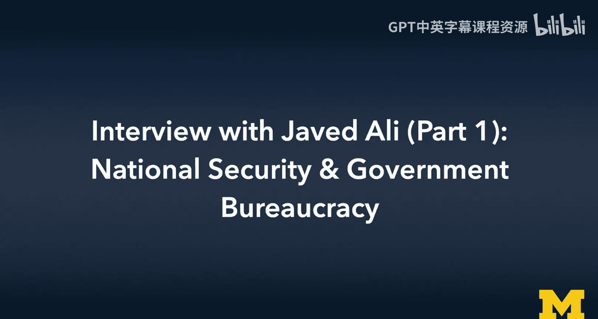
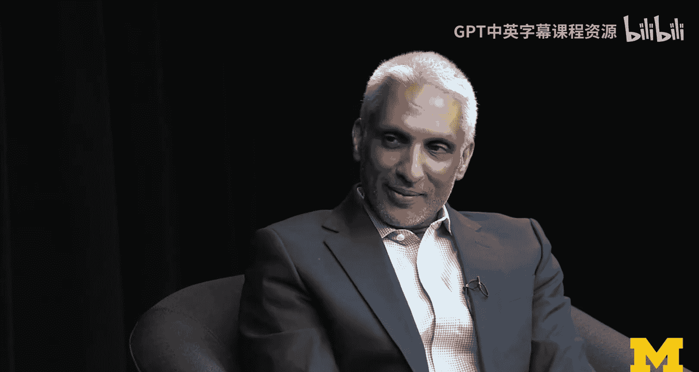
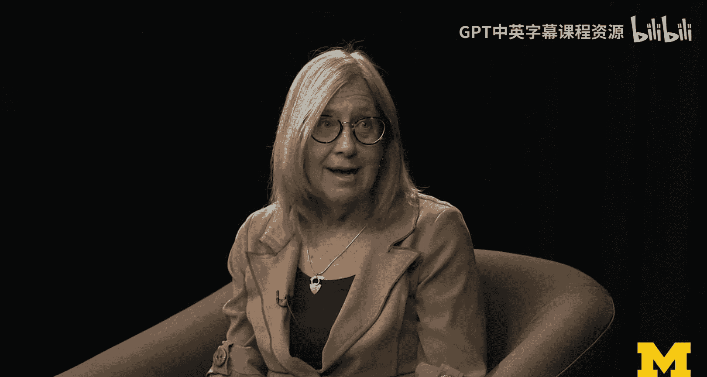
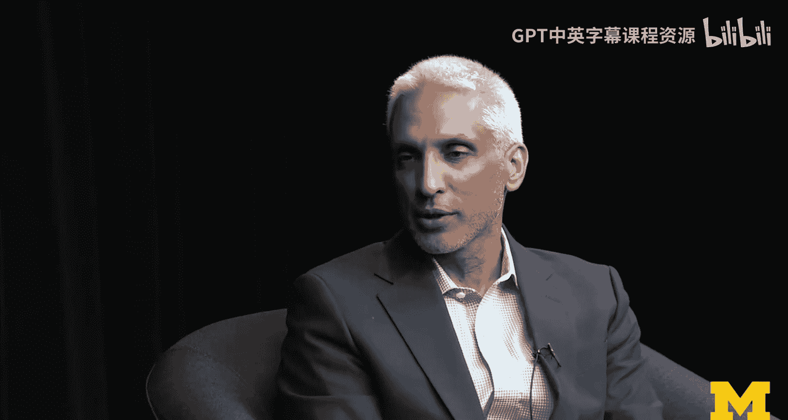
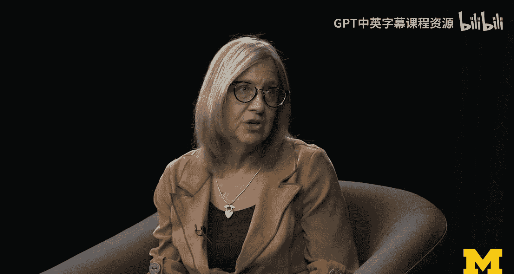
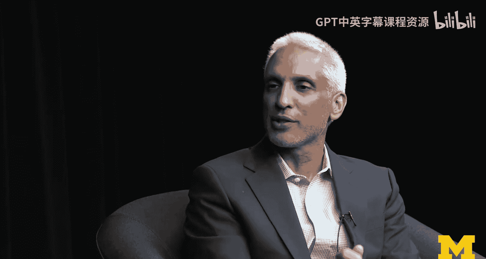
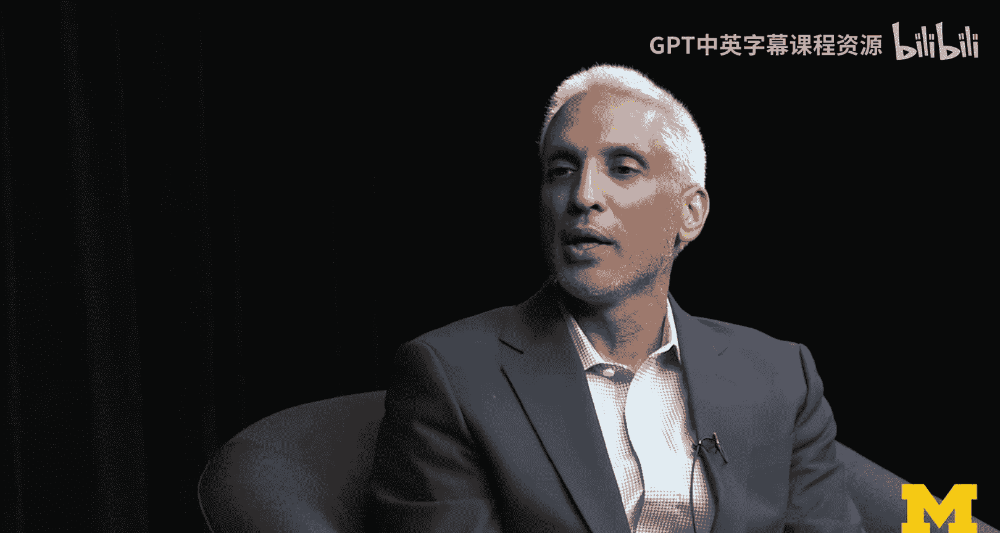
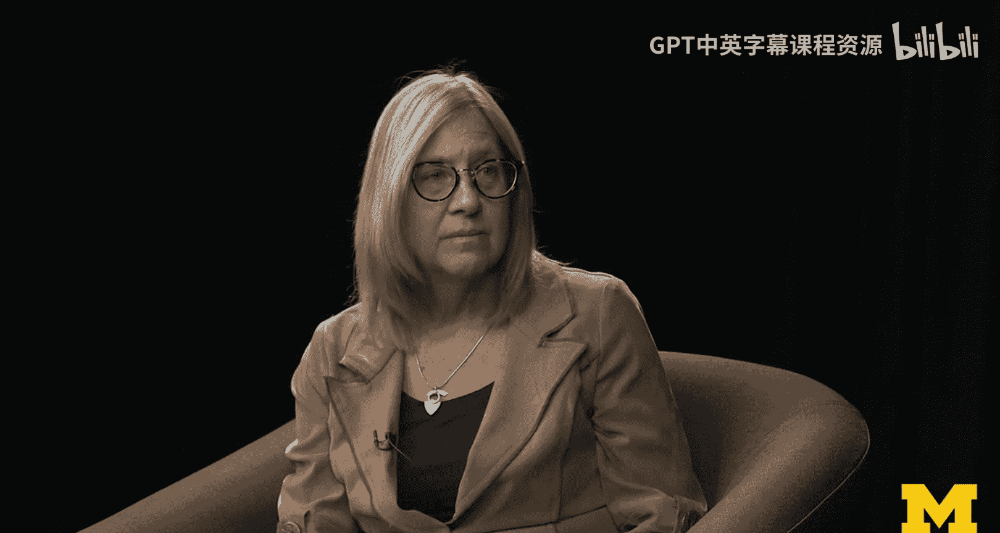
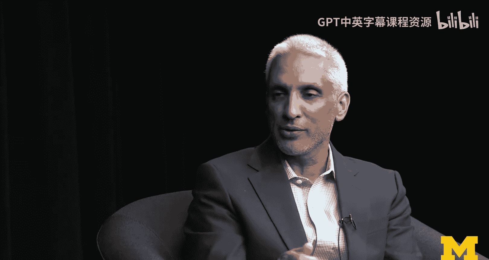
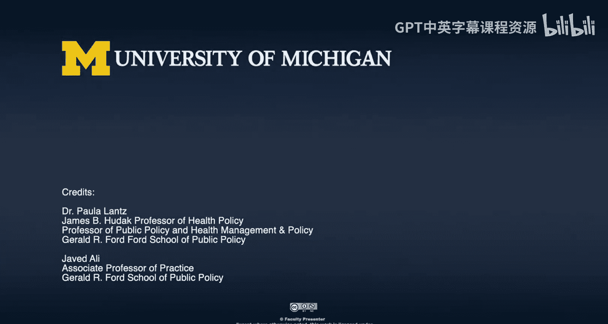

# 公共部门的R数据分析（基础、数据探索、决策支持）：41：贾维德·阿里访谈（第一部分）：国家安全与政府官僚体系 🏛️🔒

在本节课中，我们将通过贾维德·阿里教授的访谈，探讨国家安全这一公共产品的复杂性，以及政府官僚体系在应对国家安全挑战时的运作与协作。

欢迎。今天我很高兴能与我的同事兼朋友贾维德·阿里教授在此交谈。阿里教授是密歇根大学福特公共政策学院的实践副教授，他教授网络安全、国家安全和反恐方面的课程。阿里教授曾担任过一系列非常有趣的工作和领导职务。他稍后会详细介绍，但这确实包括了在美国国防情报局、国土安全部以及联邦调查局担任的非常高级别的职位。他拥有底特律大学的法学博士学位，并且再次拥有丰富的经验和知识。贾维德，我非常感谢你今天抽出宝贵时间与我讨论你在公共部门这一重要领域的工作经验，特别是谈谈数据及数据分析在这项工作中的角色。保罗，很高兴和你在一起，我也很高兴来到这里，并期待我们的对话。

那么，首先，请花点时间告诉我们你在职业生涯中做过的所有很酷的事情。我会尽量简洁地概括。正如你所提到的，我在华盛顿特区期间担任过许多不同的角色。我在华盛顿待了26年，那是一段很长的时间。在这26年中，有16年在政府任职。你已经描述过其中的一些部门和机构。但在所有这些不同的职位中，甚至包括在特朗普政府时期在白宫工作的一年，我绝大部分时间都专注于反恐。但由于这些职位的多样性，我得以审视几乎所有方面：分析、行动、战略、政策、资源。因此，与大多数通常在同一组织内度过大部分政府服务生涯的同事不同，我恰恰相反。在16年的服务中，我担任过六个不同的工作，级别、责任和管理职责不断提高。这真是一段独特的职业生涯。但现在，我非常激动、荣幸且光荣地能与你一起在我的母校密歇根大学工作。正如我开玩笑地对我的学生说的那样，我可能是最不可能成为教授的人。所以，我需要一些时间来适应被这样称呼。但我真的很高兴来到这里。

很好，谢谢。到目前为止，在我们的课程中，学习者和我们一直在讨论公共产品。国家安全无疑是一个非常重要的公共产品，但它也非常庞大。你能花点时间解释一下“国家安全”这个大概念吗？是的，国家安全是一个极其广阔和复杂的领域。在这个广泛的国家安全主题下，有不同的议题和学科，它们可以是区域性的，也可以是功能性的。我的整个职业生涯，至少在政府方面，都专注于一个功能性问题：反恐。但反恐并不是美国唯一的国家安全优先事项。尽管我认为，在9/11事件之后，反恐成为了主导性的优先事项。回顾历史，也许这是一个错误。我的意思是，我们过于专注于应对国内外的恐怖主义威胁，以至于可能失去了理解其他一系列国家安全优先事项的能力。快进到我们现在所处的2022年，我认为是的，反恐作为一个国家安全优先事项仍然重要，但也许还有其他同等重要或更重要的优先事项。这涉及到大国竞争，而俄乌冲突只是其表现之一。网络安全，正如你提到的，我在密歇根大学教一门关于网络安全的课程，它也跨越了所有这些不同的学科。气候变化已成为国家安全的巨大问题，拜登政府可能比过去20年任何一届政府都更认识到这一点。显然还有公共卫生，我们仍处于这场新冠疫情之中。我尽量保持乐观，我知道你有不同的看法，但这同样是一个非常重大的国家安全问题。看看经济发生了什么，以及它对人们日常生活的影响，这也对我们开展国家安全事务的能力产生了影响。所以我想说的是，在这个广泛的国家安全旗帜下有很多不同的问题。而我的职业生涯中反恐占主导地位的辉煌日子已经过去了。我认为反恐现在正与一系列其他议题竞争。

很好。正如你所知，我们正在与之交谈的许多学习者来自许多不同的国家。那么根据你的经验，在思考国家安全问题并围绕这些重要的国家安全问题组织政府方面，不同国家和民族之间有哪些相似之处，又有哪些不同之处？没有单一的国家安全模式，没有放之四海而皆准的方法。至少在我的政府生涯中，我很幸运能够周游世界，与我们的外国伙伴会面，了解他们是如何处理即使是反恐这一个问题的，反恐是更广泛国家安全框架内的一个议题，或者了解他们从国家安全角度是如何设置的，与我们相比如何。通过所有这些旅行，我发现没有哪个国家能与美国的体系相提并论，因为我们如此庞大，如此……我们有许多不同的部门和机构参与国家安全的不同方面。这本身就是美国与其他国家在组织方式上的一个主要区别。但同时，一些共同的主题包括国防和情报方面的强力手段，以及这些不同国家如何看待这两个领域的任务优先事项。我认为必须分别看待每个国家。我认为那些在关注点上与我们最接近的国家，可能不是规模上，而是关注点上，是英国、澳大利亚、加拿大和新西兰。美国在这些共同优先事项的国家安全领域运作的一种方式，是通过一个叫做“五眼联盟”的关系。这种关系可以追溯到几十年前。因此，包括美国在内的这五个国家，由于这个“五眼”架构，我们在国家安全上几乎有着相同的哲学方法。但一旦脱离这个“五眼”方法，情况就变得更加个性化和定制化。因此，即使是像德国和法国这样美国的强大伙伴，我们也不是在同样的“五眼”方法下进行国家安全合作的。我们在这门课程中一直在讨论政府官僚体系，我认为这是各国共有的问题。政府是一个庞大的官僚机构，公共行政和公共政策面临着挑战，因为大多数大型政府官僚机构都难以驾驭。你能谈谈你的经验吗？在国家安全领域，为了防止筒仓效应，并积极促进所有表面上处理相同问题的官僚体系不同部分之间的协作与沟通，采取了哪些措施？是的，这确实是我们美国国家安全机构的一个持久特征，即这些根深蒂固的官僚优先事项和文化。同样，无论好坏，我都亲眼目睹了，因为我在许多不同的部门和机构任职。我服务过的这六个机构，每一个都有其自身的组织文化、自身的语言、自身的官僚流程。我需要自己去弄清楚如何在这些之间穿行。因此，即使在我自己的职业生涯中，我也看到了这些挑战，并有很多有趣的经历。但美国一直努力尝试做的一件事，至少在反恐领域——这是我比大多数人了解得一样多或更多的领域——就是打破这些筒仓，突破那些阻碍信息共享、协作与整合的官僚障碍。因为我们从9/11之前学到的是，如果你不做这些事情，像9/11这样的事件就会发生。我教一门关于这个的课，梳理导致9/11事件的失误、错失的机会和组织失败。在那次可怕的袭击之后，必须做出一些戏剧性的改变。我们不能只是维持现状。因此，美国反恐必须做的一件事是提出一套新的范式、新的结构和新的体系。由此产生的一件事是2004年成立了国家情报总监办公室，这是9/11委员会的建议。因此，该组织一旦启动运行，其任务就是至少在情报界推动反恐方面的整合、协作和信息共享，以防止类似9/11的事件再次发生。我的职业生涯也顺应了这一浪潮，包括在这个新组织中担任两个不同的职务。我愿意认为，至少从美国方面来看，这使我们在反恐方面做得更好，因为我们试图改变9/11之后的所有事情。这并不意味着我们是完美的，也不意味着我们不会再受到攻击。我们在国内和海外都曾受到攻击。但至少你不必与文化作斗争，也不必与官僚体系作斗争来达到这些最终状态。对手和敌人总是有发言权。当官僚机构缓慢地移动到某个新位置时，他们可以移动得更快，这就是我们在反恐领域看到的情况。

本节课中，我们一起学习了国家安全概念的广泛性与多维度，了解了不同国家在组织国家安全体系上的异同，并探讨了美国政府为打破官僚壁垒、促进跨部门协作以应对国家安全挑战（特别是反恐）所采取的措施，例如成立国家情报总监办公室。这为我们理解公共部门中复杂政策领域的运作提供了重要背景。