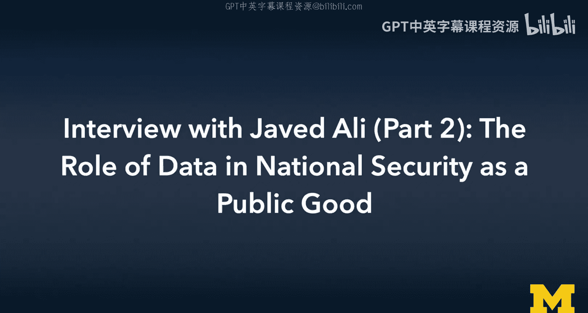
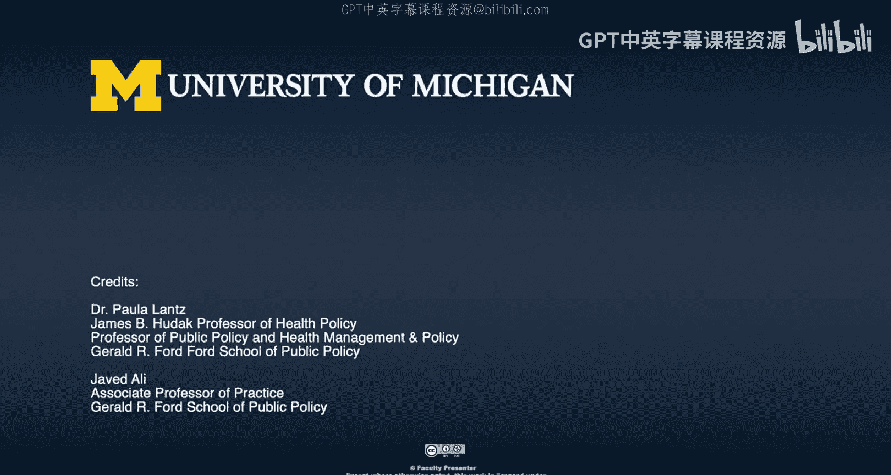

# 42：数据在国家安全中的战略作用（第二部分）

在本节课中，我们将继续探讨数据与信息在国家安全领域，特别是反恐、国防和网络安全中的核心作用。我们将了解不同类型数据的优先级、整合公开与机密信息的挑战，以及该领域对数据分析人才的迫切需求。

上一节我们介绍了数据在国家安全中的重要性，本节中我们来看看具体面临的数据挑战与机遇。

## 数据优先级与挑战

国家安全领域的数据问题至关重要，但必须针对每个具体功能或区域问题来理解哪些数据最相关，因为并非所有数据都具有同等价值。如果针对某个主题或问题从错误的数据集入手，可能无法发现真正寻找的威胁。这一点在9/11事件后，反恐领域不得不进行调整。9/11之后，数据获取的范围极大地扩展了。

社交媒体数据的增长，无论在机密还是公开层面，都加剧了这一挑战。仅就反恐而言，这已是持续存在的难题，更不用说其他国家安全优先事项了。在一些政府职位上工作时，我目睹了这股数据浪潮开始冲击我们。我当时认为，如果我们情报界不开始尝试领先应对这些数据挑战——无论是在机密侧还是公开可获取信息侧——那么更多的威胁将会发生，我们将失去阻止它们的能力。

机密数据问题是一个传统挑战。情报界过去存在一种文化倾向，即仅通过所掌握的机密信息来理解世界，无论是来自卫星的技术信息、图像，还是来自人力来源的信息。这些都是需要筛选的不同类型的机密数据。

但现在，我们拥有了一个庞大得多的公开可用信息池，其中大量信息存在于社交媒体世界。如何将这两个世界结合起来？如何将这两种完全不同的数据类型融合到一个共同的方法中，让像我职业生涯初期那样的分析师能够在袭击发生前识别威胁？这是保护国内外美国公众、预防袭击的最终目标。

## 整合数据与应对挑战

我认为挑战在于：现在数据更多，但理解数据含义、以及如何及时、可操作且合理地摄取数据的能力却更弱。这些都是我们目前仍在持续面临的挑战。

以下是一个关于社交媒体挑战的例子，至少对美国和其他国家的国家安全领域是如此：

情报界的传统重点是收集机密情报，但社交媒体世界中存在大量与国家安全相关的信息。挑战之一在于：其中有多少是相关的？在法律上可以获取多少？在美国，我们有宪法保护，执法和情报界可以收集哪些公开可用的信息？即使你拥有了这些信息，又该如何处理？

一个外国对手如何利用社交媒体领域对抗美国的很好例子，是2016年俄罗斯的虚假信息宣传活动。他们基本上利用其政府的不同部门以及像互联网研究机构这样的掩护组织，在2016年特朗普总统和当时总统候选人希拉里·克林顿的选举前夕，领导了一场非常强大的虚假和错误信息宣传活动。

当这些社交媒体驱动的活动发生时，美国政府并不知道哪些账户与俄罗斯代理人或互联网研究机构有关联。我们至今仍未完全解答的一个问题是：这些社交媒体活动在多大程度上影响了人们对特朗普或希拉里·克林顿的看法，并最终影响了投票？但事实是，这种活动是实时发生的，当时没有人知道其俄罗斯背景部分正在实时发生，并且可能对选举产生了重大影响。这是一个关于外国对手如何在众目睽睽之下利用社交媒体，而我们却无法理解真实情况的惊人案例研究。这种情况很可能在未来的选举中继续发生。

## 职业建议与人才需求

我们在这里的谈话非常发人深省。不幸的是，我带来的并非全是好消息，但这是公共部门工作中如此重要的一个方面。正如我们一直讨论的，这是一项非常重要的公共利益。只有政府才会承担起理解国家安全威胁和挑战的这一角色。

对于那些考虑并感兴趣在政府及其国家内部（以及国家内部的 subdivisions）从事数据分析和政策分析职业的人，特别是在国家安全、国防和反恐领域，我的建议是：是的，如果存在这些机会，请积极投身于这些职位。你可以通过学术或专业途径积累技能。

至少在美国，我们需要更多这类人才，无论是年轻人还是处于职业生涯中期的人。鉴于我们在信息和数据分析方面讨论的这些挑战，这部分人才在我们的国家安全劳动力中仍然严重不足。我认为可以安全地说，这种情况普遍存在，但在国家安全界尤其如此。当我2018年离开政府开始在这里教学时，我的一些前部门和机构正试图招聘一系列此类职位，但即使只是招聘少数人也变得非常困难。

困难的原因要么是我们找不到具备合适技能和经验的人，要么是我们找到了这样的人，但他们从私营公司获得了好得多的 offer，薪水可能是政府的三四倍，而且不需要获得政府安全许可、接受测谎仪测试和药物测试。如果你打算进入这个世界，至少在美国这边，你也必须做出一些生活方式上的选择。因此，我认为存在许多准入门槛，使得这变得困难。这是政府方面必须做出的权衡之一：人们可能不得不承担更多风险；你可能无法找到一个能通过所有安全审查的候选人，但他们拥有硬技能。什么更重要？是确保某人首先拥有硬技能，还是优先考虑一些较低级别的安全问题？因为如果我们一直默认某人必须先通过所有这些安全检查，我们将永远无法用真正重要的人才填补这些职位。技能绝对重要。

我知道我们可以花更多时间讨论所有这些重要问题，但非常感谢你今天抽出时间与我们分享，更多地谈谈数据和信息在极其重要的国家安全领域的重要作用。非常感谢。