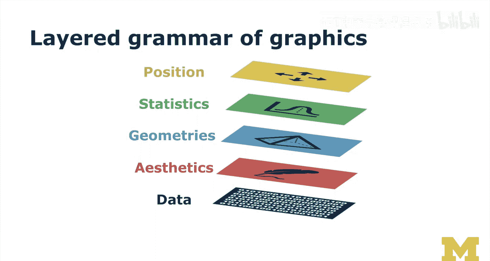
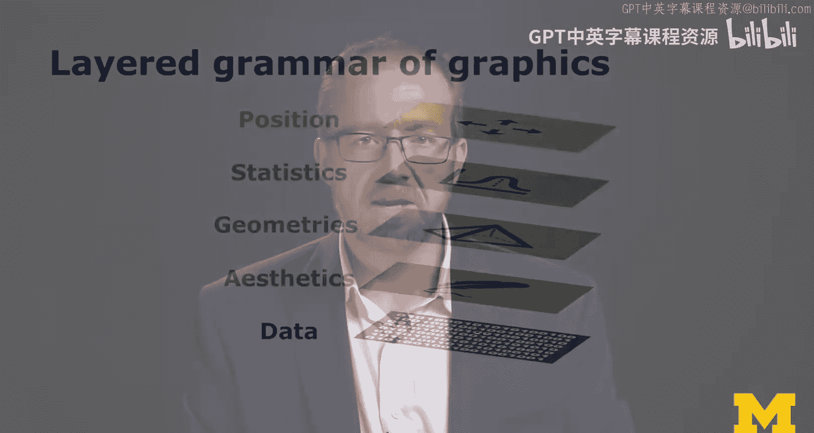
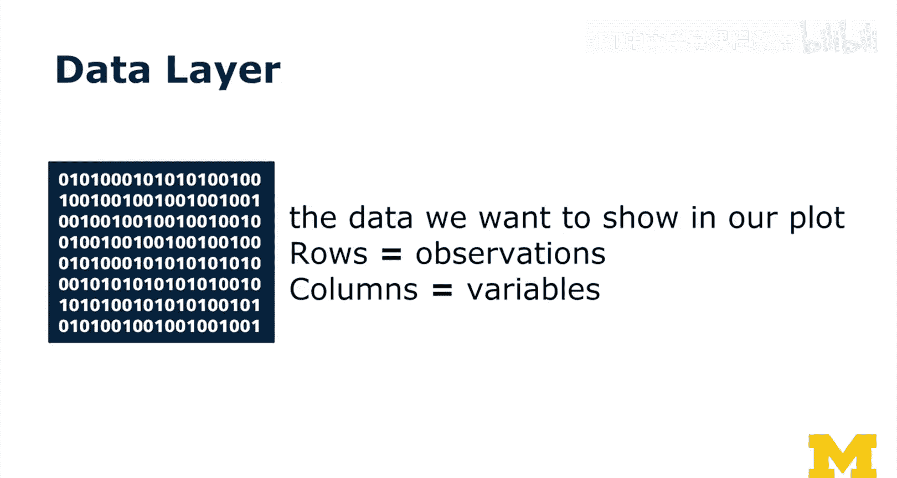
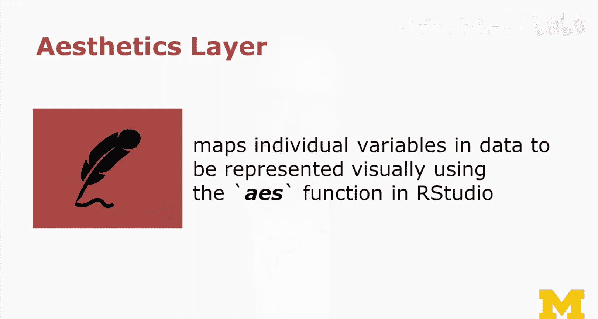
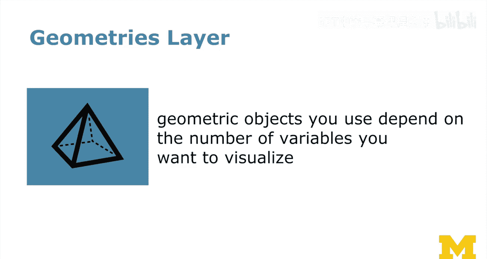
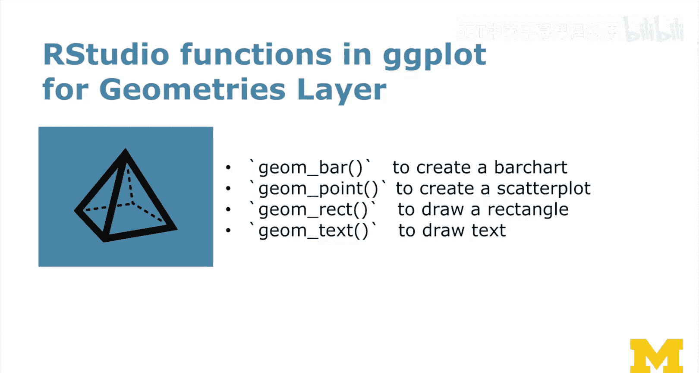
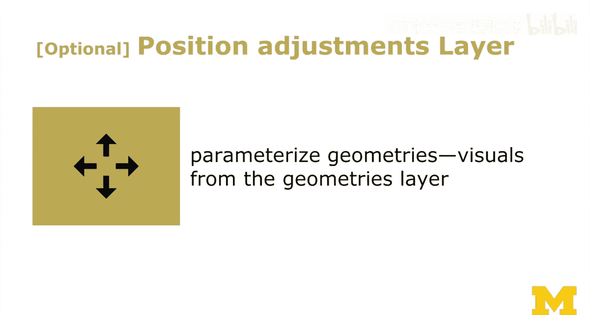

# 公共部门的R数据分析：1：分层图形语法体系 📊

在本节课中，我们将要学习R语言中用于数据可视化的核心框架——分层图形语法体系。我们将了解其构成部分、工作原理以及如何利用它来创建结构化的、可重复的图表。

## 概述

在R生态系统中，有多种制作图表的方法。其中，来自Tidyverse的`ggplot2`包是目前最流行的方法，由Hadley Wickham创建。它基于一种称为“图形语法”的理论，这是一种通过定义明确且可重复的规则来结构化定义可视化的方式。

Hadley Wickham并非独自构建了这个系统，而是建立在其他人的工作之上，包括首次将其定义为“语法”的Wilkinson等人，以及制图师Jacques Bertin。Bertin在80年代初提出的“图形符号学”理论，至今仍是我们本课程将要讨论主题的绝佳灵感来源。

实际上，关于信息可视化的理论思考之深远令我感到惊讶。其根源很大程度上可以追溯到现代计算机时代之前，当时可视化图表必须手工精心制作，而图表的印刷和再版是一个极其昂贵的过程。因此，有许多优秀的著作从人类视觉感知系统以及眼睛和大脑能够快速、直观地解码信息的方式等角度来探讨这个问题。我们将在本课程的最后一周触及其中一些内容。

但我想首先聚焦于在`ggplot2`中创建图表的具体机制。让我们从Wickham描述的分层图形语法开始。

## 分层图形语法

分层的思想有点像老式的透明胶片。你可以绘制一个图表，比如说一个带有X轴、Y轴和一堆数据点的散点图。然后你可以在上面添加另一个图层，比如一个显示数据趋势的线图，甚至可能添加第三个图层来突出显示图表中需要关注的特定区域。

在`ggplot2`中，一个图层负责渲染每个视觉元素。图层由五个部分组成，这些部分构成了一套语法或规则，R将根据这些规则创建可视化图形。

### 图层的组成部分

以下是构成`ggplot2`图层的五个核心部分。

1.  **数据**
    图层的第一要素是我们已经相当熟悉的数据，即我们想要在图表中展示的数据。这通常是一个数据框或Tidyverse中的`tibble`。这些数据不必是我们所有的数据，可以使用我们之前见过的一些工具进行过滤和转换。遵循Tidyverse的“固执己见”理念，数据应该是整洁的，这意味着每一行应代表一个观测值，每一列应代表一个变量。

2.  **美学映射**
    图层的下一个组成部分是美学映射，它们通过`aes()`函数定义。这会将数据中的各个变量映射到将在视觉上表示的元素。可视化数据的方式有很多种。我们通常从数据的X和Y维度开始。这里需要指出，`ggplot2`的目标是擅长二维可视化，而这是目前最常见的。因此，`aes()`函数的这两个方面总是作为前两个参数传入。在此之后，则取决于你想要制作的图表类型以及可用的不同美学映射。例如，你可以将颜色绑定到数据中的另一列。

3.  **几何对象**
    图层的第三个组成部分是几何对象。你使用的几何对象类型取决于你想要可视化的变量数量以及这些变量是离散的还是连续的。连续变量通常是数值型的，可以有一个范围，比如某人的年龄、体重或考试百分比分数。离散变量是分类变量，可能有顺序也可能没有顺序。例如，国籍可能是无序分类变量的例子，而马拉松比赛的名次则是有序分类变量的例子。有时这些离散变量被称为因子，我们将在下一讲深入探讨。几何对象的函数名都以`geom_`开头。例如，我们有`geom_bar()`来创建条形图，或者`geom_point()`来创建散点图。我们还有一些几何对象，它们与变量没有直接关系，但被认为是图形基元，例如用`geom_rect()`绘制矩形或用`geom_text()`添加文本。这些在`ggplot2`中都是简写形式，使用它们会产生一些重要的副作用，这些副作用可能会模糊我们对分层图形语法工作原理的初步理解。因此我们将在本课程的第二周深入探讨这些内容。

4.  **统计变换**
    数据、美学映射和几何对象构成了每个图层语法的核心元素。然而，我们还有两个可选的图层构造：统计变换，它对数据进行统计转换。

5.  **位置调整**
    位置调整，它对我们的几何对象进行参数化。

了解这些很有用，但很多时候它们有自己的函数，我们只需将参数传递给几何对象，甚至使用已硬编码到几何对象中的统计变换。本周，我们将主要关注图形语法的前三个方面，但下周我们会加入最后两个。

## 语法的连接与组织

以上构成了基于图层的语法的核心。现在，就像英语等语言有句子的语法规则一样，我们也有覆盖句子之间连接的规则（如标点符号），以及覆盖多个句子组合在一起的规则（如段落和章节）。在我们的图形语法中也有这些元素，用于连接、框定和跨越不同的图层。

## 总结

本节课中，我们一起学习了`ggplot2`包所依赖的分层图形语法体系。我们了解到一个完整的图表由多个图层叠加构成，而每个图层又包含**数据**、**美学映射**、**几何对象**、**统计变换**和**位置调整**这五个核心部分。我们重点探讨了前三者：数据是可视化的基础，美学映射（通过`aes(x=, y=, color=)`等）定义了数据如何转换为视觉属性，而几何对象（如`geom_point()`， `geom_bar()`）则决定了图表的最终呈现形式。理解这个语法框架是使用`ggplot2`进行高效、灵活数据可视化的关键第一步。在接下来的课程中，我们将通过实际编码来应用这些概念。