# 2：R语言因子变量处理 🐕


在本节课中，我们将学习R语言中一个重要的数据类型——**因子**。因子是处理分类数据的关键，尤其在数据可视化中扮演着核心角色。我们将通过分析美国西雅图市的宠物许可证数据，来理解因子的概念、创建方法以及在`ggplot2`绘图中的应用。

## 课程概述


首先，我们引入一个有趣的数据集——西雅图市的宠物许可证数据。这类市政数据的公开化是全球趋势，为数据分析师提供了丰富的研究材料。我们的目标是探索这些数据，并利用因子变量来更好地理解和展示它。


## 数据导入与初步观察

我们首先加载`tidyverse`包并读入数据。

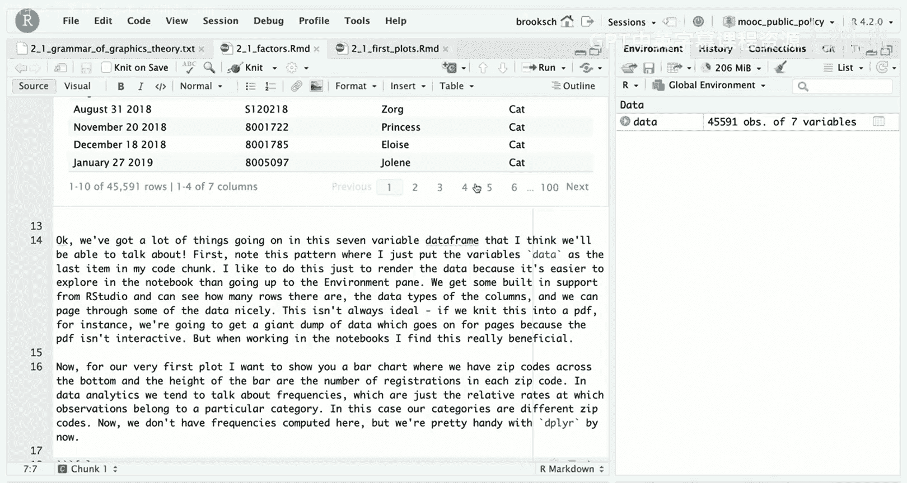

```r
library(tidyverse)
data <- read_csv("pet_licenses.csv")
data
```


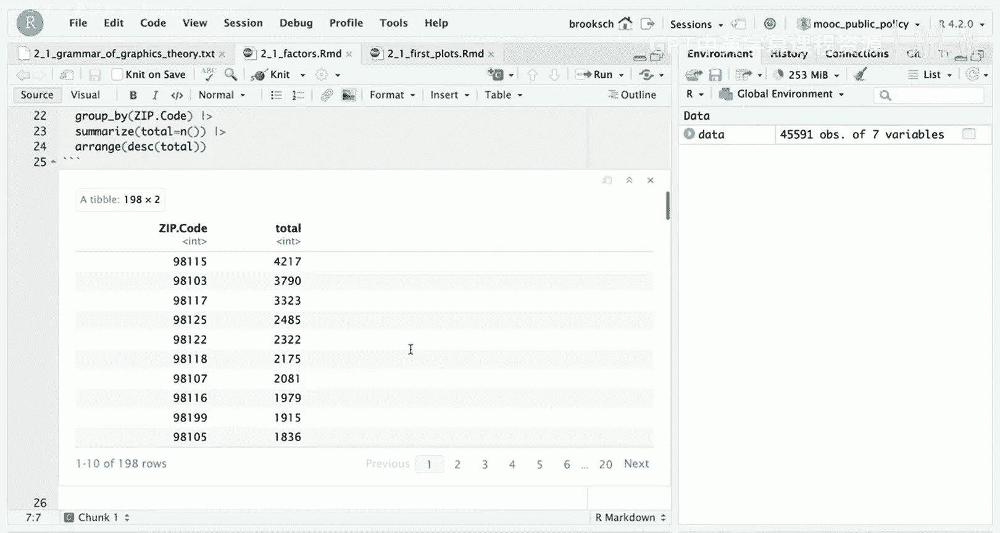

执行上述代码后，我们得到一个包含7个变量的数据框。在RStudio的笔记本环境中，直接输出数据框可以方便地交互式浏览数据，包括行数、列数据类型和前几行数据。

## 理解频率与分类数据

在数据分析中，**频率**是指观测值属于某个特定类别的相对比率。我们的第一个目标是创建一个条形图，以邮政编码为X轴，以每个邮政编码的宠物注册数量为Y轴。

我们当前的数据没有直接计算频率，但可以使用`dplyr`轻松完成。

```r
freq_data <- data %>%
  group_by(zip_code) %>%
  summarise(total = n()) %>%
  arrange(desc(total))
freq_data
```

结果显示有198个邮政编码，有些邮政编码有数千个宠物注册。数据中还存在用`NA`表示的缺失值，在本次分析中，我们将其保留为一个单独的类别。


## 引入因子数据类型

现在我们需要面对一个核心问题：邮政编码本质上是**分类数据**，但在数据中被读成了整数。在R中，处理分类数据的专门类型叫做**因子**。

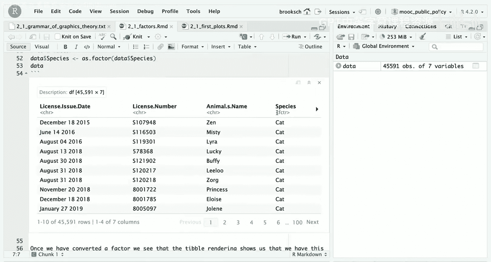

在统计学中，变量通常分为**离散型**和**连续型**。我们将离散型变量更直观地称为**分类变量**。分类变量就像贴有标签的桶，桶内的所有项目在标签意义上是相同的。

有些分类变量存在自然的顺序或等级，例如动物对主人的平均忠诚度排名（狗 > 马 > 猫）。这类变量称为**有序分类变量**。在R中，因子可以是有序的，也可以是无序的，这对于`ggplot2`和`tidyverse`至关重要。


让我们查看原始数据中的`species`（物种）列，它是一个完美的因子候选，但目前是字符向量。

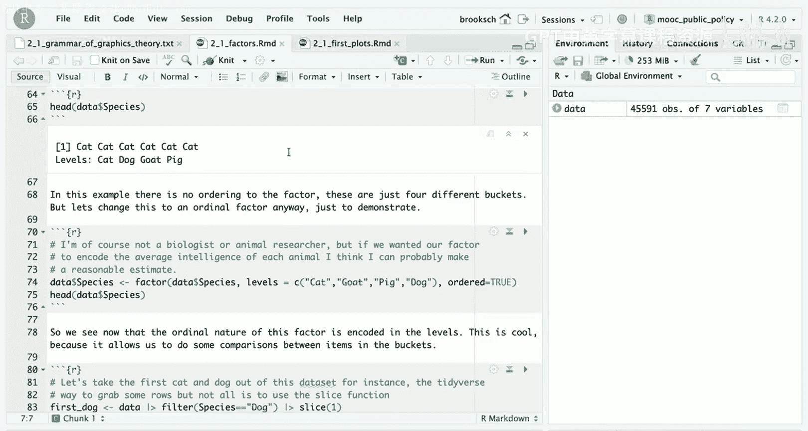


```r
unique(data$species)
# 输出可能是: "Cat", "Dog", "Goat", "Pig"
```

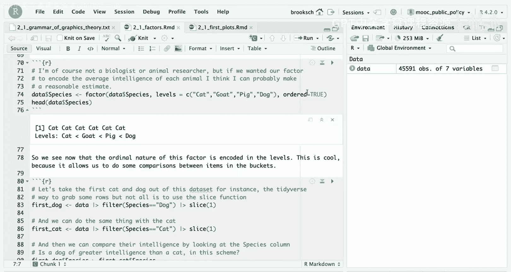

我们可以使用`as.factor()`函数将其转换为因子。

```r
data$species <- as.factor(data$species)
data
```


转换后，数据框会显示该列的类型已变为`factor`。

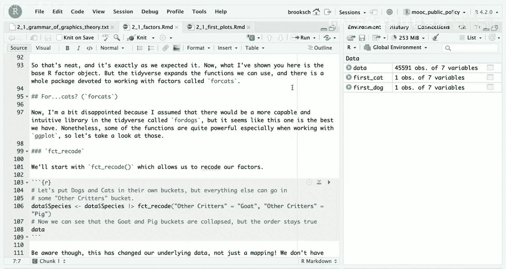


## 因子的内部机制与操作

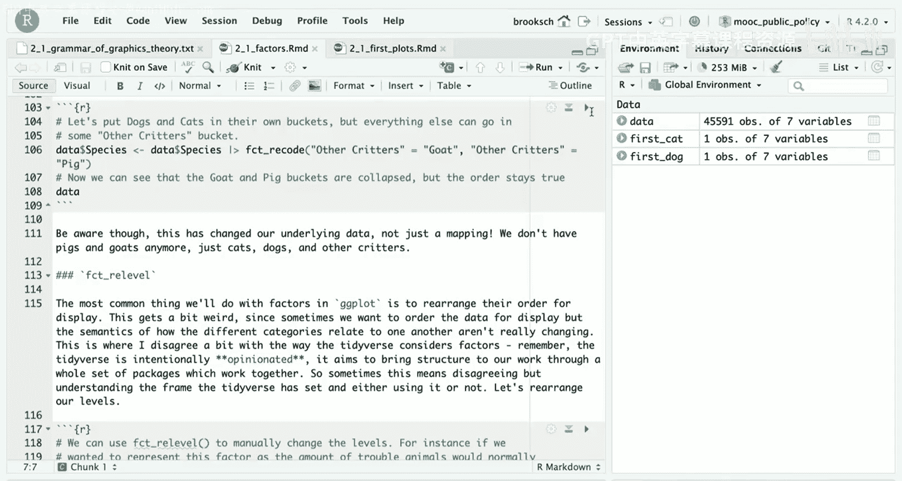

将字符向量转换为因子时，R在幕后将其转换为整数向量，并创建数字与不同类别（在R中称为**水平**）之间的映射关系。我们可以使用`attributes()`函数查看。

```r
attributes(data$species)
```


`tidyverse`为因子操作提供了更强大的工具集，主要集中在`forcats`包中。

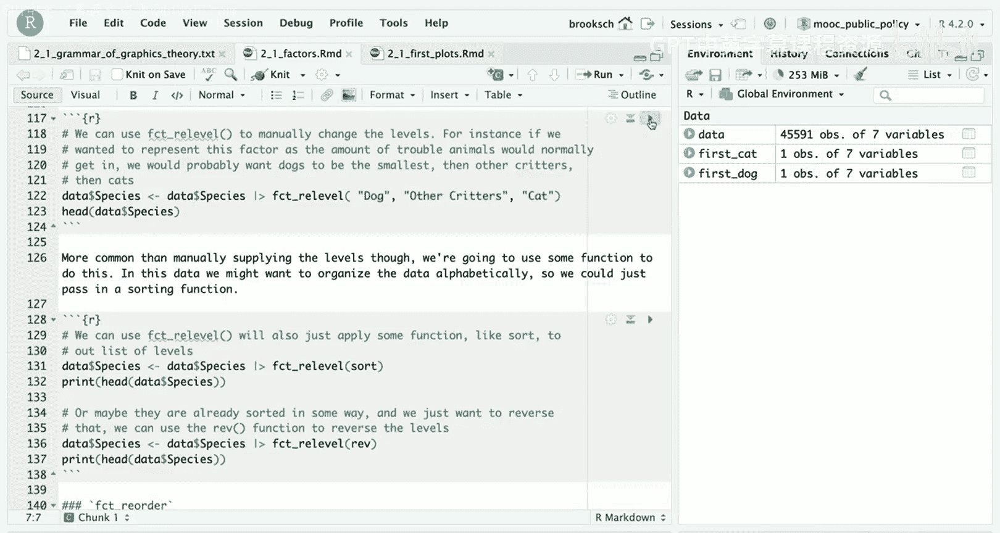

以下是`forcats`包的一些常用函数：
*   `fct_recode()`: 重新编码因子水平（例如，合并类别）。
*   `fct_relevel()`: 手动改变因子水平的顺序。
*   `fct_reorder()`: 根据另一个变量的值（如频率）来重新排序因子水平。
*   `fct_infreq()`: 按频率从高到低排序因子水平。


例如，我们可以按物种出现的频率来排序：

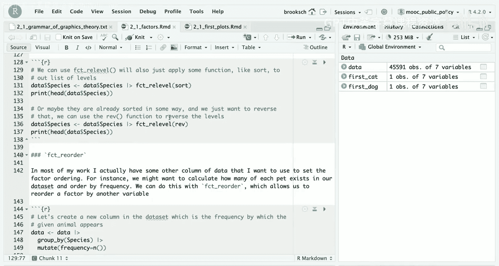


```r
# 方法1：使用dplyr计算频率后，用fct_reorder排序
data <- data %>%
  group_by(species) %>%
  mutate(frequency = n()) %>%
  ungroup()

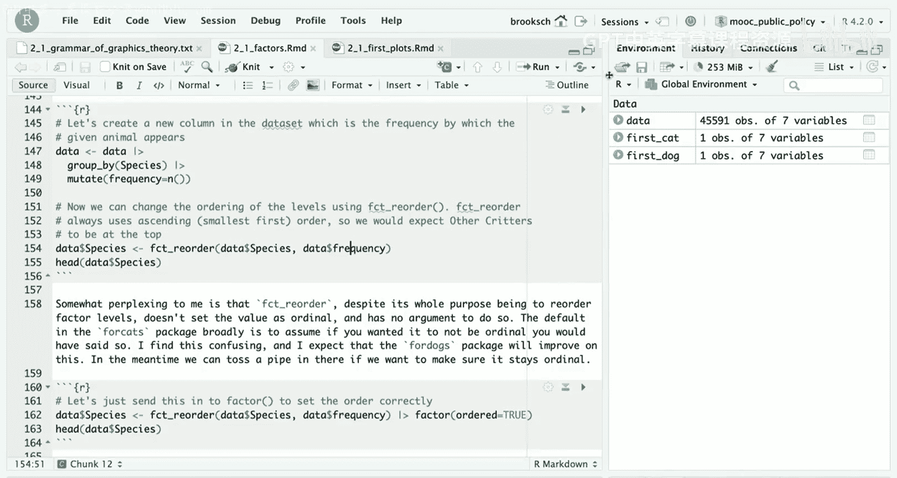

data$species <- fct_reorder(data$species, data$frequency)
# 注意：fct_reorder默认是升序（从小到大）

# 方法2：直接使用fct_infreq按频率从高到低排序
data$species <- fct_infreq(data$species)
```


## 因子在数据可视化中的重要性

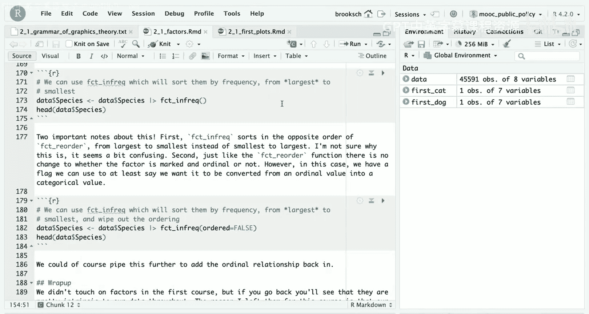

`ggplot2`绘图库严重依赖因子来显示数据。它通过查看因子的`levels`属性来决定绘图时类别的显示顺序。因此，在绘图前正确设置因子的顺序至关重要。


`ggplot2`主要假定因子水平的顺序就是你希望显示的顺序，而不会过多考虑你是否将其标记为有序因子。这是一个需要注意的设计特点。

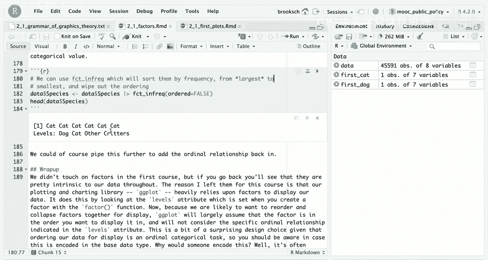

## 课程总结

本节课我们一起学习了R语言中的因子变量处理。我们了解到：
1.  **因子的本质**：因子是用于处理分类数据（有序或无序）的R数据类型。
2.  **因子的创建与转换**：可以使用`as.factor()`或`factor()`函数创建因子。
3.  **因子的操作**：借助`forcats`包，我们可以轻松地重新编码、重新排序因子水平，特别是按频率排序，这对于数据准备和可视化至关重要。
4.  **因子的应用**：在`ggplot2`中，因子的水平顺序直接决定了图表中类别的显示顺序。


现在，我们已经掌握了图形语法的五层结构以及R中因子的处理方法，接下来就可以开始进行丰富的数据可视化了。