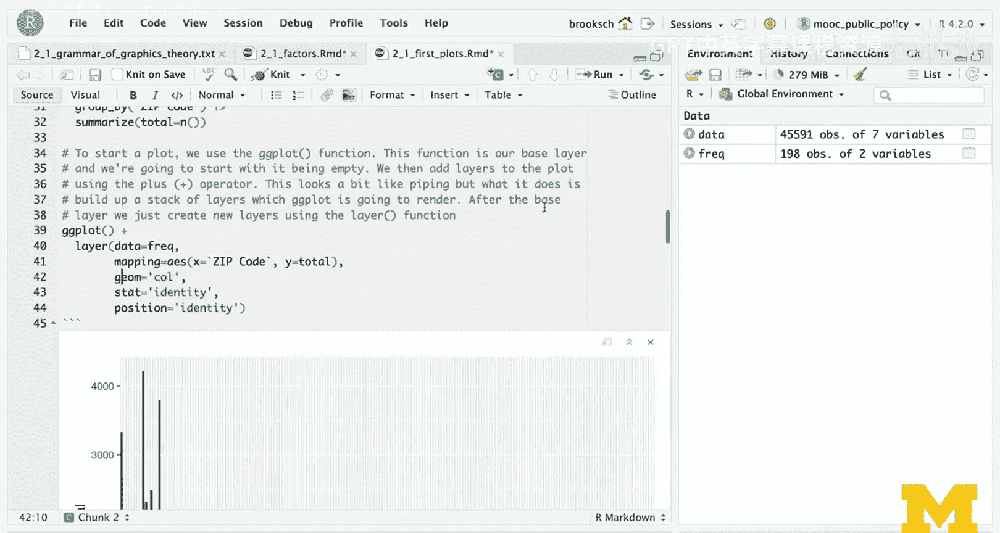
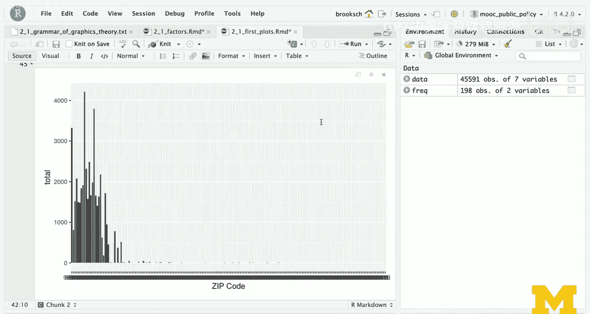
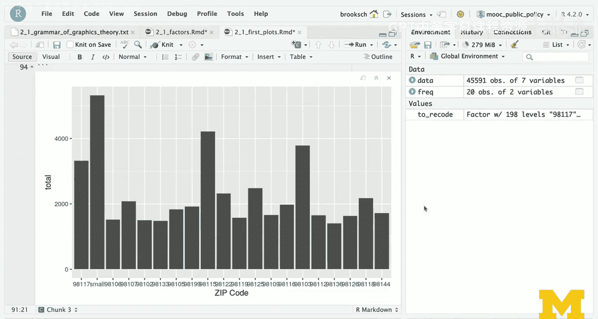

# 3：ggplot基础绘图入门 🎨


在本节课中，我们将学习如何使用 `ggplot2` 包创建基础可视化图表。我们将从加载和准备数据开始，逐步构建一个条形图，并在此过程中探索数据转换和可视化的核心概念。

---

上一节我们介绍了图形语法的分层理论，并进行了初步实践。本节中，我们来看看如何创建美观的可视化图表。

首先加载西雅图宠物许可证数据并查看。请注意，这里我们将从一开始就运用关于因子的新知识。

首先，导入 `tidyverse` 包。

```r
library(tidyverse)
```

现在，我们将读取数据并在一行代码中适当地设置列类型。在之前的讲座中，我使用了基础R的 `read.csv` 函数，但本次讲座将使用 `tidyverse` 的 `read_csv` 函数。这是一个细微但重要的区别，因为它会更改一些列名并自动创建一个 `tibble`。

```r
pet_data <- read_csv("path/to/your/data.csv", col_types = "cccFFF")
```

我在 `col_types` 参数上做了一些“魔法”。之前我展示了如何指示特定列应具有特定类型，但 `read_csv` 实际上有一个方便的功能，可以让你按列出现的顺序列出所有想要的列类型。因此，字符串 `"cccFFF"` 告诉 `read_csv` 我希望前三列是字符向量，后四列是因子。你可以查阅文档以获取有关此处可输入值的更多信息。

你可能还会注意到列名被清理了，它们包含空格但没有句点。这将改变我们后续的一些代码，现在你应该知道如何查阅文档以获取更多细节。

---

几节课前，我们设定了本周的目标：展示一个条形图，底部是邮政编码，条形的高度是每个邮政编码的注册数量。我们开始尝试使用 `dplyr` 清理和汇总数据，我们知道有198个不同的邮政编码，其中一些有数千个注册。

因此，让我们创建第一个单层可视化。回顾分层图形语法，我们的数据是这个包含198个观测值的 `tibble`，我们的美学映射是X轴上的邮政编码变量和Y轴上的值，即图表上每个条形的高度。


我们语法中的下一个元素——几何对象——起初有点反直觉。实际上，我们制作的不是条形图，而是柱状图。我们稍后会讨论这两者之间的区别。最后，我们的统计和位置元素在这里并没有真正使用，我们将使用数据中的任何统计信息，并且不应用任何转换。

现在，R将通过使用单词 `identity` 来完成此操作，这意味着这两个项目不会以任何方式改变图层的渲染。

---

我们要做的第一件事是计算每个邮政编码因子的频率并将其添加到数据中。稍后我会展示我们实际上不需要这一步，但我认为现在有它会更清晰。

以下是计算频率的步骤：

```r
freq <- pet_data %>%
  group_by(`Zip Code`) %>%
  summarise(total = n())
```

我们将在这里使用反引号包裹列名，因为它们包含空格。这是从 `read.csv` 切换到 `read_csv` 的副作用之一，我希望你了解如何处理名称中包含空格的变量。这个变量名中确实有一个空格，因此我们必须用反引号将其包围。请注意，这些不是单引号，而是反引号，在大多数键盘上是波浪号键。然后，我们将其通过管道传递到 `summarise` 函数，并创建一个名为 `total` 的新列，即计数 `n()`。

---



要开始绘图，我们将使用 `ggplot` 函数。这个函数是我们的基础图层，我们将从空图层开始。然后，我们将使用加号运算符向图表添加图层。这看起来有点像管道操作，但它实际上是构建一个 `ggplot` 将要渲染的图层堆栈。

在基础图层之后，我们只需使用这个 `layer` 函数创建新图层。我们将传入数据、映射、几何对象等。让我们运行一下。

```r
ggplot() +
  layer(
    data = freq,
    mapping = aes(x = `Zip Code`, y = total),
    geom = "col",
    stat = "identity",
    position = "identity"
  )
```


很好，我们的第一个可视化图表。邮政编码被映射到X轴，而条形的高度是总数。回顾那个 `layer` 函数，我们可以稍微分解一下。我们知道每个图层有五个元素：数据（在我们的例子中是 `freq`）、美学映射（我们映射X和Y轴）、几何对象（本例中是 `"col"` 表示柱状图），以及统计和位置参数。

---

我们一眼就能看出，有许多邮政编码条目只有很少的宠物注册，而少数几个邮政编码有很多注册。

我认为我们可以处理一下邮政编码因子并进行一些合并，以使这个图表更具信息性。例如，我们为什么不将注册数少于1000的邮政编码合并为一个因子，然后看看我们得到了什么。



有很多不同的方法可以做到这一点，我将在这里展示一种可能不是最高效但易于阅读的方法，它使用了我们的 `dplyr` 技能，当然也会向你介绍一些新东西。

以下是合并低频邮政编码的步骤：

```r
# 1. 识别需要重编码的邮政编码
to_recode <- freq %>%
  filter(total < 1000) %>%
  select(`Zip Code`) %>%
  unlist()

# 2. 使用 mutate 和 case_when 进行重编码
freq <- freq %>%
  mutate(
    `Zip Code` = case_when(
      `Zip Code` %in% to_recode ~ "small",
      TRUE ~ as.character(`Zip Code`)
    )
  ) %>%
  mutate(`Zip Code` = factor(`Zip Code`))

# 3. 按新的邮政编码分组并重新计算总数
freq_summary <- freq %>%
  group_by(`Zip Code`) %>%
  summarise(total = sum(total))
```

请注意末尾的 `unlist`，这实际上会将 `select` 返回的表格转换为向量，这很重要，因为下一步我要进行比较。所以这里的 `to_recode` 数据结构将包含我们想要合并的所有邮政编码，只是作为一个巨大的字符向量列出。

现在我想做一个 `mutate` 和一个 `case_when` 并用字符串覆盖。这里我将获取我们的 `freq`，通过管道传入 `mutate`，获取我们的邮政编码，使用这个 `case_when`，然后我会说如果邮政编码在 `to_recode` 中，我想要字符串 `"small"`。然后有这个捕获所有情况的 `TRUE`，对于不匹配第一条规则的所有其他情况，我希望邮政编码作为字符返回。这里使用的 `%in%` 运算符看起来有点吓人，但其实不然，它所做的就是检查左侧的项目是否存在于右侧的向量中，这称为集合成员检查，实际上你会经常使用它。在这种情况下，我想在向量中搜索邮政编码列的值，这就是为什么我使用 `unlist` 函数。


你会注意到，在捕获所有情况的语句中，我将邮政编码的值作为字符返回。请记住，`case_when` 的所有情况必须返回相同的数据类型，所以这里我将所有内容都转换为字符向量，因为我想要这个名为 `"small"` 的新字符串值。

好的，现在如果我们愿意，可以将此列转换回因子。这里我说 `freq$Zip Code`，然后实际上只是将其转换为因子。

然后我们只想合并所有具有这个新值 `"small"` 的因子，以计算它们的合并频率。所以我将在这里使用 `dplyr` 来完成这项工作，尽管我们可以使用 `forcats` 包完成其中的一部分。请记住，当我们在分组内时，如果想访问该组，可以使用 `cur_data()` 函数，这允许我获取该组的数据框或表格，然后我将创建一个总和，通过管道传入 `summarise` 并创建这个新的 `total`。

---

然后我们只需绘图，这里的绘图实际上非常简单。我们只需说我们的数据是 `freq_summary`，我们的映射是这个邮政编码和总数，我们想使用柱状几何对象。让我们看一下。

```r
ggplot(freq_summary, aes(x = `Zip Code`, y = total)) +
  geom_col()
```

---




本节课中我们一起学习了如何使用 `ggplot2` 创建基础柱状图。我们从加载数据、计算汇总统计数据开始，然后应用数据转换（如合并低频类别）以使可视化更具可读性。我们介绍了 `ggplot()` 函数、`layer()` 函数以及美学映射 `aes()` 的基本用法。我们还实践了使用 `dplyr` 进行数据操作，为绘图准备数据。这是使用 R 进行数据可视化的第一步，后续课程将在此基础上构建更复杂的图表。