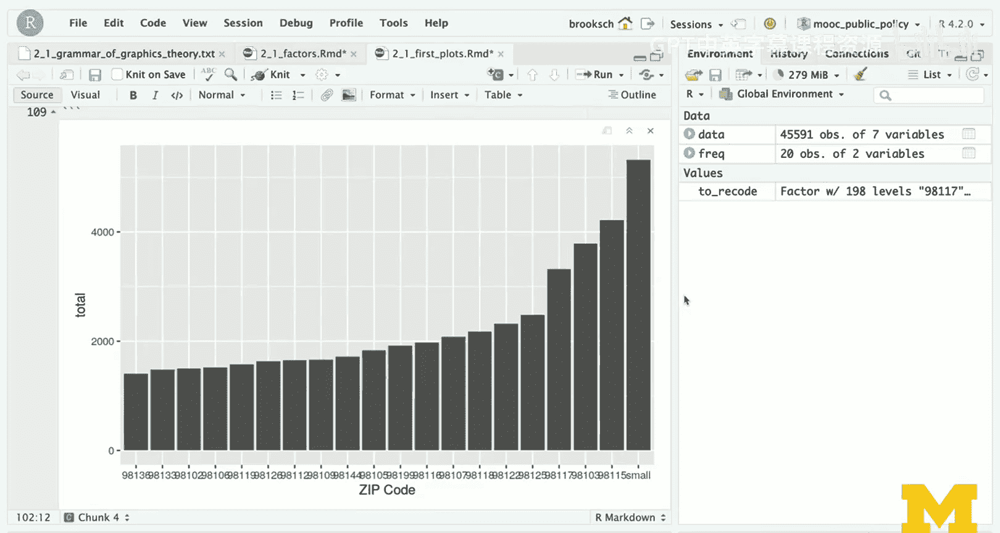
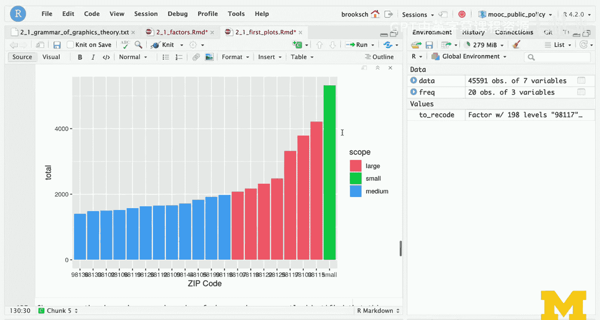
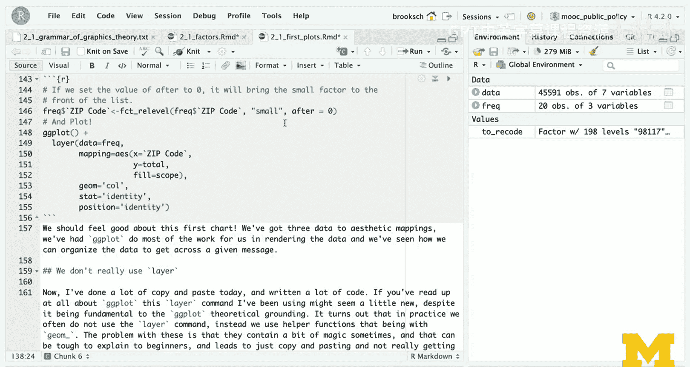
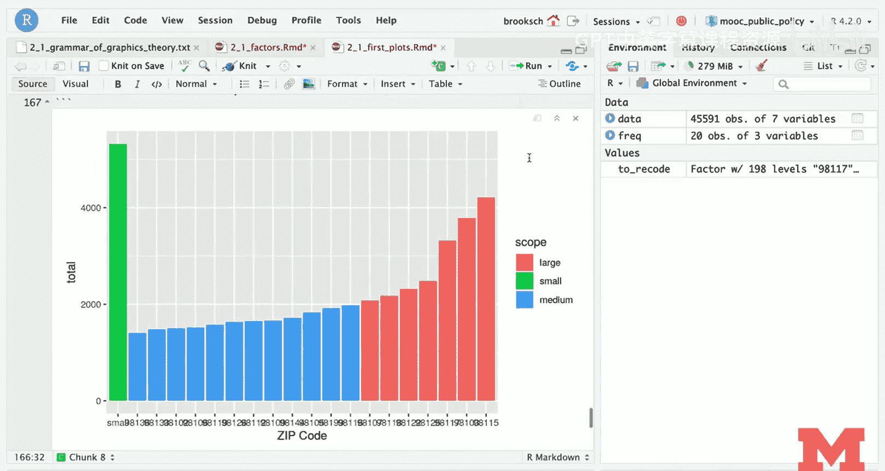

# 公共部门的R数据分析：4：ggplot美学增强实践

在本节课中，我们将学习如何使用ggplot2包来增强数据可视化的美学效果。我们将通过一个具体的例子，探索如何重新排序因子、添加新的数据维度（如分类着色），并理解ggplot2的图层语法。课程将涵盖数据整理、美学映射以及如何通过简单的代码调整来优化图表可读性。

## 数据初步探索与排序

上一节我们介绍了ggplot的基础知识，本节中我们来看看如何通过调整因子顺序来优化柱状图的展示。

图像的可读性有所提升，但仍不理想。我们可以从按因子各水平的总动物数量排序开始。

这里我希望按总数重新排序。我将对邮政编码和频率数据进行操作，并按该列重新排序。

我经常需要执行此类操作：选取某一列（本例中是“总数”），并希望根据该列来改变因子的顺序，然后重新绘图。

现在我们可以看到，数据已按从小到大的顺序进行了良好的排序。

## 添加数据分类与颜色映射

在优化了排序之后，我们可以进一步为数据添加分类信息，例如创建一个“小型”汇总类别。

我们可能希望标识出这个汇总性的“小型”特殊类别，它并非另一个邮政编码。为了避免读者混淆，我们可能还想将其他邮政编码分成两个不同的类别：动物数量大于2000的和小于2000的。我们可以通过数据框的几次`mutate`操作来创建一个新列，然后通过分配填充颜色美学来呈现它。

我将创建一个新列，其值为“小型”、“中型”或“大型”。由于我们已经将小型数据归为一组，我将先检查现有的邮政编码值，然后检查总数以确定中型组，最后将其他所有数据设为大型。

以下是使用`mutate`配合`case_when`的示例。我认为多展示一些`case_when`的例子很有用，因此我尝试以不同方式演示它们，因为其中涉及很多操作。我将这个新列命名为“范围”，对频率数据使用`mutate`，并将“范围”设置为邮政编码的字符值。当它等于“小型”时，实际上类似于保持原样。如果其中有名为“小型”的项，则仍将其输出为“小型”。

然后，我想查看“总数”列。如果没有匹配到“小型”，则检查总数是否小于2000。如果总数小于2000，则将其设为“中型”。最后一条规则总是为真，因此所有其他情况都将归入“大型”组。接着，我将通过管道将其传递给`select`，以便只获取“范围”列。然后，我实际上会使用`unlist`将其转换为向量，以便随后将其转换为因子。最终，我们将得到一个“范围”列，它是一个基于`mutate`和`case_when`操作转换而来的因子。

现在我们来绘图。绘图代码的唯一变化是在映射美学中：不仅指定了x和y，还使用了`fill`值，并将其设置为“范围”列内的值。重要的是，所有这些都必须是因子。`fill`不仅仅是一个字符向量，它实际上指向一个因子列。你可以在`geom_col`的文档中了解更多关于`fill`的信息。让我们运行这段代码。

现在这个图表看起来非常有趣了。我们可以看到数据的三个不同维度：底部是所有邮政编码的分类列表（包括作为小型邮政编码集合的“小型”组），条形的高度表示每个组中注册的动物数量，而颜色则向图表读者直观地展示了哪些是大型组、小型组和中型组。

## 调整因子顺序以优化布局

尽管我们的条形已按大小排序，并且正确标识了“小型”这个汇总类别，但看到它位于图表的最右侧可能会让人感到不适。我知道这让我感到困扰。我们只需要改变因子的顺序，即邮政编码因子的水平。ggplot使用这些水平来沿X轴排序数据。让我们先检查当前的排序顺序。

如果我们想查看因子的顺序，可以执行几个操作：打印该列，这会在底部显示信息；或者直接使用`levels`函数。这里我将使用`levels`函数来查看该数据列。

它返回的是一系列字符串，都是邮政编码，最后是我们命名为“小型”的邮政编码。

我们已经知道有多种方法可以使用`factor`来改变水平，但还有另一种便捷的方法：`relevel`函数。`relevel`允许你获取特定的水平并将其放置在水平列表中的指定位置，本质上允许你将其移动到任意位置。

为此，我们将`after`参数的值设置为0，这会将“小型”因子移到列表的前面。这里我将对这个邮政编码因子使用`relevel`，然后指定我感兴趣的因子“小型”，并设置`after = 0`，这意味着将其放在列表的第一个位置。然后我们用同样的方式绘图。

我们应该对这个第一个图表感到满意。我们映射了三种不同的数据美学，让ggplot几乎为我们完成了所有的数据渲染工作，并且看到了如何组织数据以传达简单的信息。

## 理解ggplot的图层语法与便捷函数

今天我进行了很多复制粘贴，编写了很多代码。如果你阅读过关于ggplot的资料，可能见过关于`layer`命令的内容，这可能看起来有点陌生。如果你阅读一些博客或Medium文章，可能不会立即理解，但它实际上是ggplot及其理论基础的核心。

在实践中，我们通常不直接使用`layer`命令，而是使用以`geom_`开头的辅助函数。这些函数的问题在于它们有时包含一些“魔法”，这可能对初学者来说难以解释，至少仅靠复制粘贴无法真正理解这种分层图形语法的工作原理。

你的每个图层都有五个要素，即我们讨论过的五个：数据、美学、几何对象、统计变换和位置调整。但我们不必总是使用`layer`函数来指定所有这些进行渲染。例如，在这种情况下，我们可以使用`geom_col`来简化为柱状图的创建。

默认情况下，`geom_col`会为我们设置几何对象、统计变换和位置调整。它使用恒等变换作为统计和位置。因此，我们可以像这样编写整个图层部分：`ggplot() + geom_col()`，然后设置数据和美学映射。就这样，我们得到了完全相同的图表。

尽管这样写起来简单得多，但它向你隐藏了底层发生的一些事情。了解`layer`函数的工作原理很重要，因为有些你想使用的几何对象并没有对应的辅助函数。

## 课程总结

本节课中我们一起学习了如何创建我们的第一个图表——柱状图。我展示了如何排序因子、如何改变ggplot渲染柱状列表的方式，以及如何将三种不同的美学值映射到图表中有意义的转换上：本例中的X轴、Y轴和条形的颜色。

我们没有过多讨论坐标轴或图例的标签。ggplot自动从我们的因子水平中推断出了这些信息。

我们还进一步了解了R的内部工作原理：首先，`read_csv`允许我们在加载数据时以相当直接的方式设置列数据类型。在实践中，你可能会发现不会一开始就加载因子，这没关系。还有其他数据类型，如日期和时间，我们将在未来的课程中探讨这些。

此外，我们讨论了当需要处理数据时，将tibble转换为向量的重要性。起初这可能看起来不直观，但你会逐渐掌握它。只需密切关注右上角的环境面板，以了解你正在使用的数据结构。

最后，我特意向你展示了使用反引号处理包含特殊字符（如空格）的列名的繁琐语法。我从不使用这种格式处理数据，加载数据后会立即清理列名。但我希望你能意识到这一点。我将在未来的课程中向你介绍一个有助于数据清理这一环节的包。

😊

