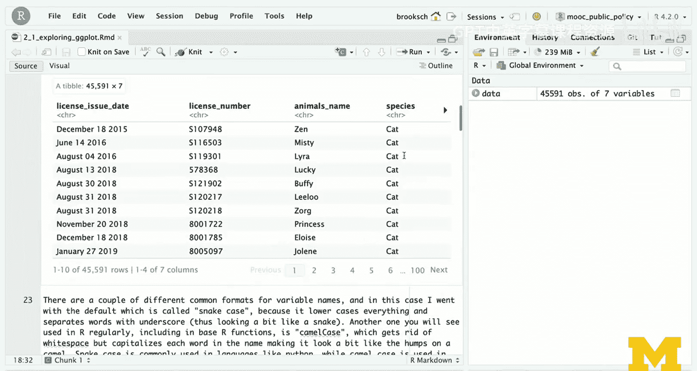
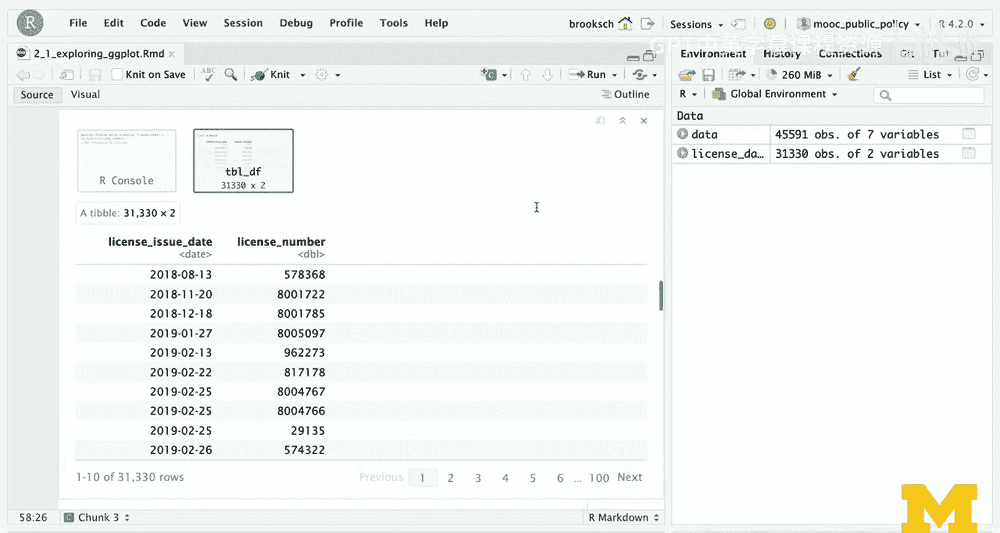
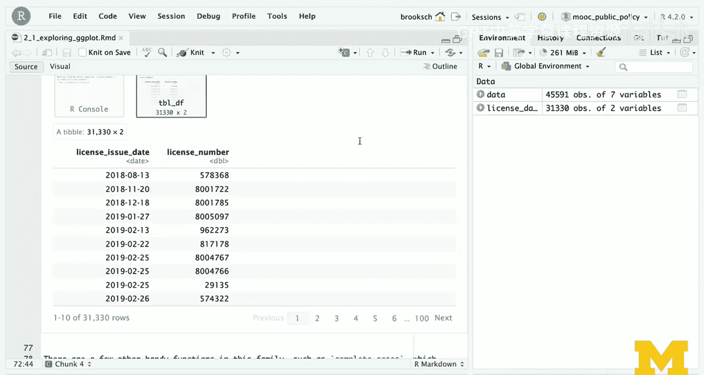
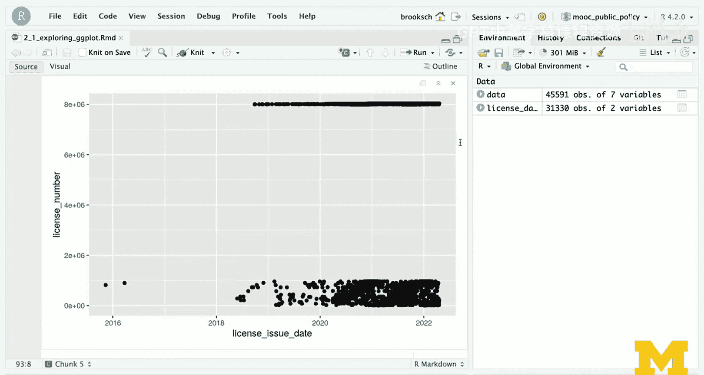

# 密歇根大学《公共部门的R数据分析》：5：ggplot功能深度探索 🎨


在本节课中，我们将深入学习 `ggplot2` 包的一些核心功能，特别是图层系统的运作方式。我们将通过一个宠物许可数据集，探索如何创建散点图，并理解数据清理与可视化之间的衔接。

## 数据准备与清理



上一节我们介绍了 `ggplot2` 的基础语法，本节中我们来看看如何为绘图准备数据。

首先，我们需要加载必要的包并导入数据。

```r
library(tidyverse)
library(janitor)
library(lubridate)

pets_data <- read_csv("pets_data.csv", col_types = cols(`License Issue Date` = col_date())) %>%
  clean_names()
```

`janitor` 包的 `clean_names()` 函数将列名转换为“蛇形命名法”（snake_case），即所有字母小写并用下划线分隔单词。另一种常见的命名法是“驼峰命名法”（camelCase），即每个单词首字母大写且无空格。


接下来，我们处理日期列。日期数据在编程中处理起来可能很复杂，因为格式多样。`lubridate` 包提供了便捷的解析函数。

```r
pets_data$license_issue_date <- mdy(pets_data$license_issue_date)
```


这里，`mdy()` 函数根据“月-日-年”的顺序解析日期。数据清理，尤其是处理日期和缺失值，是数据分析的关键步骤。

## 创建散点图

一个常见的探索性数据分析技术是使用散点图比较两个变量。这需要连续型或有序数据，因为X轴和Y轴的值是顺序排列的视觉元素。


我们的数据集只有一个连续变量（日期）。为了演示，我们将使用许可证号（`license_number`）作为另一个连续变量，并过滤掉无法转换为数字的行。

以下是准备绘图数据的步骤：

1.  **选择相关列**：提取日期和许可证号。
2.  **转换数据类型**：将许可证号从字符串转换为数字，无法转换的将变为 `NA`。
3.  **移除缺失值**：过滤掉任何一列中存在 `NA` 的行。



```r
license_data <- pets_data %>%
  select(license_issue_date, license_number) %>%
  mutate(license_number = as.numeric(license_number)) %>%
  na.omit()
```

`na.omit()` 是一个基础R函数，它会移除数据框中任何包含 `NA` 值的整行。这比手动检查每一列更高效。但请注意，删除数据会影响分析结果，必须向利益相关者说明。


## 理解ggplot的图层系统

现在，让我们用清理好的数据绘制散点图。在 `ggplot2` 中，散点图使用 `geom_point()` 几何对象创建。



`ggplot2` 的图表是分层构建的：
*   **基础层**：由 `ggplot()` 函数创建，通常用于指定数据和全局的美学映射（aesthetic mappings）。
*   **几何对象层**：由 `geom_*()` 函数（如 `geom_point()`）添加，用于指定具体的图形类型。

基础层中的参数（如数据和美学映射）对其上方的图层是可见的，除非在更高层被显式覆盖。


```r
ggplot(data = license_data, aes(x = license_issue_date, y = license_number)) +
  geom_point()
```

在这段代码中，我们将数据和X、Y轴的美学映射放在了 `ggplot()` 基础层中。`geom_point()` 层会自动继承这些设置，因此我们无需重复指定。

从生成的散点图可以看出，许可证号与颁发日期之间没有明显的顺序关系，小号和大号许可证在整个时间范围内都有颁发。



## 知识巩固与实践


更重要的是，这是我们第一次深入讨论 `ggplot2` 中图层的交互。通常的做法是在基础层提供数据和美学映射，然后在上面叠加具体的图形图层。

以下是几个供你实践的问题，建议暂停课程，在RStudio中尝试：
*   如果将美学映射放在 `ggplot()` 调用中，而 `geom_point()` 调用为空，会发生什么？
*   如果完全省略 `geom_point()` 函数，会发生什么？
*   你能用之前提到的 `layer()` 函数重现我们刚刚制作的图表吗？

## 总结


本节课中我们一起学习了 `ggplot2` 的更多功能。我们实践了使用 `janitor` 和 `lubridate` 包进行数据清理，理解了 `na.omit()` 等函数在处理缺失值时的作用。最关键的是，我们深入探讨了 `ggplot2` 的图层系统，明白了如何通过 `ggplot()` 基础层设置全局参数，并由上层的几何对象继承，这使得代码更加简洁和模块化。掌握这些概念将帮助你构建更复杂、更精美的数据可视化图形。