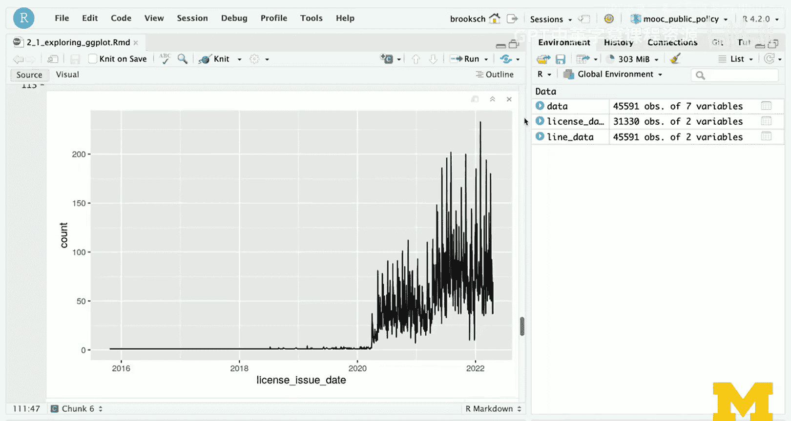
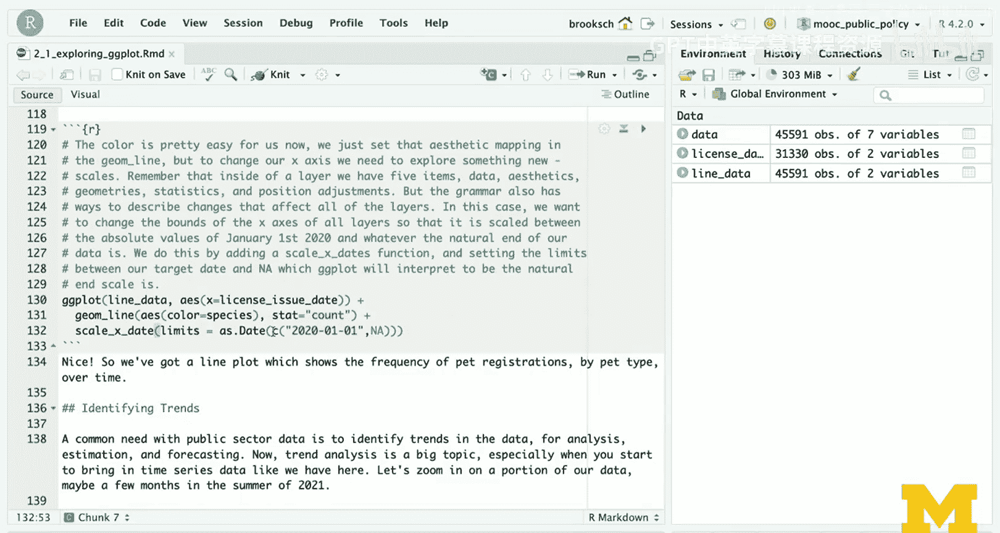
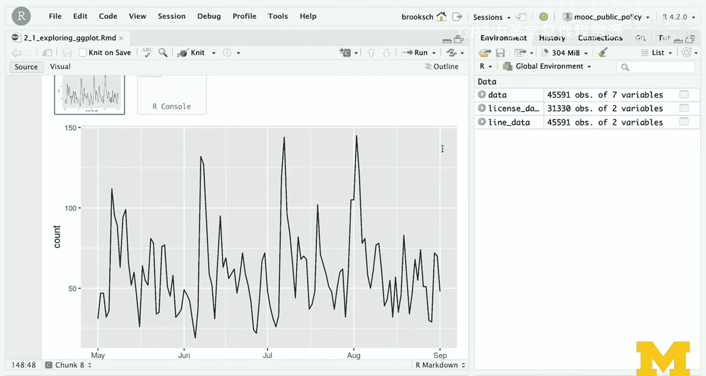

# 6：折线图绘制方法 📈


在本节课中，我们将要学习如何使用R语言中的`ggplot2`包来创建折线图。折线图是连接散点图中各个点的线段，它能帮助我们直观地观察数据随时间或其他连续变量变化的趋势。我们将使用宠物注册数据作为示例，并学习如何在图表中动态计算频率、调整坐标轴范围以及按类别区分数据。


## 概述

折线图是一种基础但强大的数据可视化工具，特别适用于展示时间序列数据或连续变量上的趋势变化。在公共部门数据分析中，识别数据趋势对于分析、评估和预测至关重要。本节我们将从基础折线图开始，逐步学习如何通过`ggplot2`的图层语法来定制和增强图表。

## 绘制基础折线图



上一节我们介绍了散点图，本节中我们来看看如何创建折线图。我们将使用清理后的宠物注册数据，其中X轴为日期，Y轴为每日的注册数量。

以下是创建基础折线图的步骤：


1.  首先，我们使用`ggplot()`函数建立基础图层，并指定数据和X轴的美学映射（`aes`）。
2.  然后，我们添加`geom_line()`几何对象层来绘制线条。为了直接计算每日注册频率，我们可以在`geom_line()`中使用`stat = "count"`参数，这样`ggplot2`会自动统计每个日期的数据点数量。

对应的R代码如下：
```r
ggplot(data = clean_data, aes(x = license_date)) +
  geom_line(stat = "count")
```
这段代码会生成一个显示宠物注册数量随时间变化的折线图。从图中可以观察到，2020年之前的注册数量很少，而之后则出现了有趣的峰值。

## 按类别区分并调整坐标轴

为了更深入地分析，我们可能需要比较不同宠物类别（如猫、狗）的注册趋势。同时，为了更清晰地观察近期趋势，我们可以将X轴的范围限制在2020年之后。

以下是实现这两个目标的步骤：



1.  在`geom_line()`的美学映射中，通过`color = species`参数，用不同颜色线条区分不同物种。
2.  使用`scale_x_date()`函数来调整X轴的比例尺，通过`limits`参数设置起始日期为“2020-01-01”，结束日期为`NA`（表示使用数据的自然终点）。


对应的R代码如下：
```r
ggplot(data = clean_data, aes(x = license_date)) +
  geom_line(aes(color = species), stat = "count") +
  scale_x_date(limits = as.Date(c("2020-01-01", NA)))
```
现在，我们得到了一张按宠物类型区分颜色的折线图，并且X轴从2020年开始，清晰地展示了不同物种注册频率随时间的变化趋势。

## 聚焦特定数据段进行分析



在公共部门数据分析中，经常需要放大数据的特定部分以进行更细致的趋势分析。例如，我们可能想观察2021年夏季几个月中狗的注册情况。

以下是实现数据筛选和视图聚焦的方法：

1.  使用`dplyr`包的`filter()`函数，从数据中筛选出物种为“狗”的记录。
2.  通过管道操作符`%>%`将筛选后的数据直接传递给`ggplot()`。
3.  在`scale_x_date()`中同时设置起始和结束日期，以“放大”观察特定时间段。

对应的R代码如下：
```r
clean_data %>%
  filter(species == "dog") %>%
  ggplot(aes(x = license_date)) +
  geom_line(stat = "count") +
  scale_x_date(limits = as.Date(c("2021-06-01", "2021-09-01")))
```
通过这张放大的图表，我们可以更清楚地看到狗类注册在2021年夏季呈现出一种有规律的、月初出现峰值的趋势。这可能与人们的支付周期、机构处理表格的时间等因素有关。

## 总结

本节课中我们一起学习了折线图的绘制方法。我们从创建基础折线图开始，逐步掌握了如何利用`ggplot2`的统计变换功能动态计算频率、如何通过颜色美学映射来区分不同类别的数据，以及如何使用比例尺函数来调整坐标轴范围以聚焦于特定的数据区间。


通过这一周的学习，我们已经掌握了使用`ggplot2`创建柱状图、散点图和折线图的能力，并理解了图层语法图形的核心思想。这为我们探索更复杂的数据可视化技术奠定了坚实的基础。虽然内容密集，但图形语法为我们提供了一种结构化、非魔法的描述信息可视化方式，这将帮助我们在后续课程和实践中不断巩固和深化这些技能。