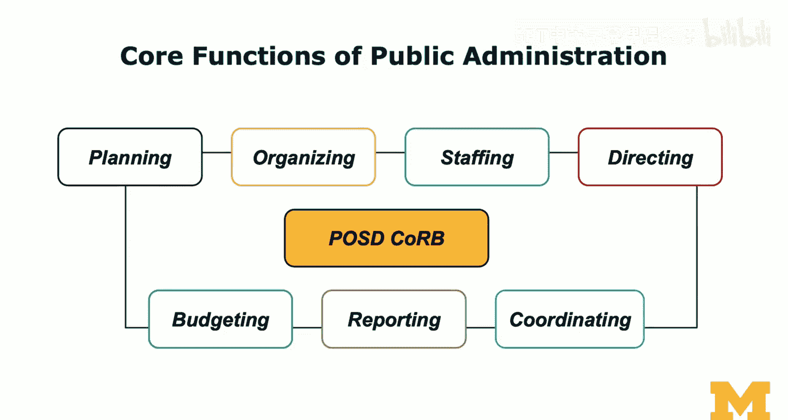
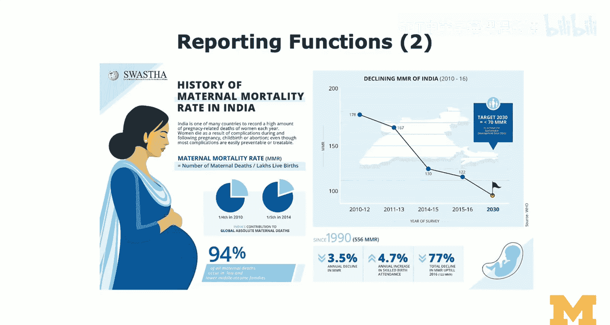
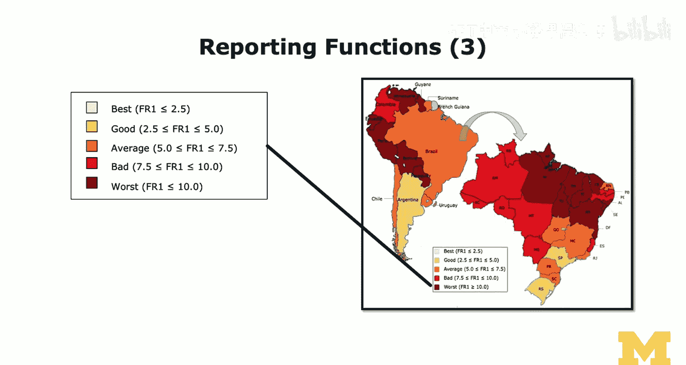
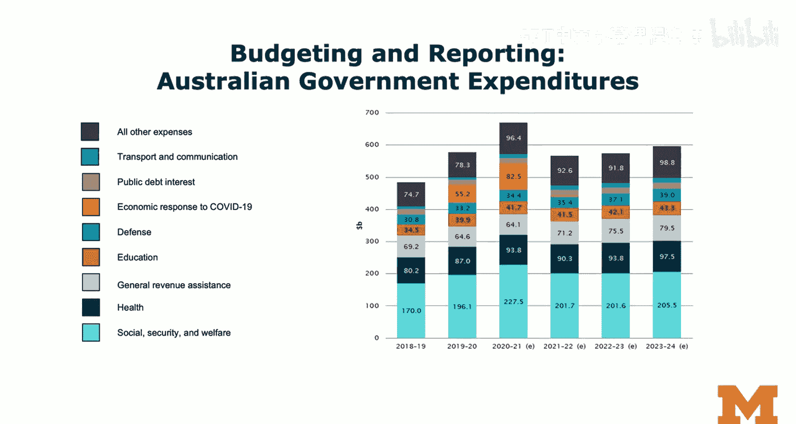
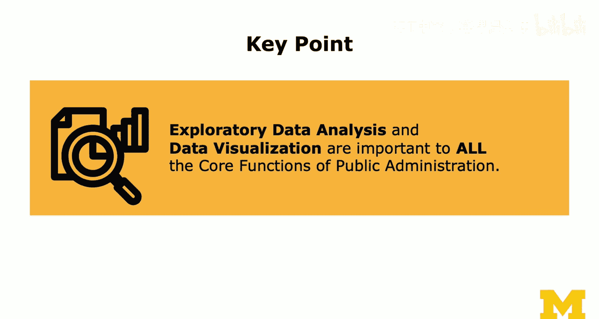

# 公共部门的R数据分析：7：数据可视化在公共管理中的战略价值 📊

我是Paula Lance教授，很高兴能参与你在这门课程中的学习。

众所周知，R语言在探索性数据分析和创建数据可视化方面非常强大。然而，让我们暂时从编程中退一步，首先提醒自己为什么这项工作如此重要。数据和信息对公共行政的所有核心职能都至关重要。正如我希望你记得的，我们之前讨论过政府行政或执行部门需要履行的关键职能，包括规划、组织、人员配备、指挥、协调、报告以及预算编制。这些职能既独立执行，也以重要的组合形式进行。数据和信息对所有职能都至关重要，在政府内部和向公众沟通数据时也同样关键。

让我们快速浏览几个简单的例子，以便更清楚地理解这一点。

## 报告职能 📈

公共行政的报告职能涵盖范围很广，包括政府被要求分享或报告信息的各种方式，无论是内部还是向公众。

报告职能对于理解趋势、进展、公共产品或重要社会问题的持续状况也至关重要。

以下是报告职能的两个例子：

*   **教育成就趋势图**：这张图表显示了从1968年到2018年，美国全国以及黑人人口的高中辍学率和大学入学率的长期趋势。图表涵盖了很长一段时间内的许多信息，包括与种族教育平等趋势相关的数据。
*   **印度孕产妇死亡率信息图**：这张信息图分享了许多有趣的信息，包括易于阅读的饼图，并显示了孕产妇死亡率的下降趋势。然而，这个比率仍未达到203年的既定目标，这也是信息的一部分。

因此，设计精美的信息图可以非常高效有效地传达或报告大量信息。

## 指挥与规划职能 🗺️

上一节我们看到了数据可视化如何服务于报告职能。本节中，我们来看看它在指挥和规划职能中的应用。

这张地图通过一个五点量表，显示了整个南美大陆各国的道路安全水平。然而，图表还特别突出了巴西，显示虽然巴西作为一个整体道路安全水平处于平均，但国内不同地区实际上存在巨大差异。理解这些差异，以及那些道路状况被评为“差”或“最差”的大片地理区域，应有助于巴西行政管理人员将资源引导到最需要的地方。

来自选民和公民的调查数据，包括公众舆论数据，对政府的行政规划职能非常重要。这张图包含了许多信息，它展示了28个国家的条形图信息。但这实际上是一种视觉上比较调查数据（在本例中是公众舆论数据）在不同人群（在本例中是不同国家）中响应分布的好方法。通过这种视觉呈现，我们的眼睛可以比仅有一堆数字或百分比的表格更容易地理解不同国家间调查响应的范围和分布。

## 人员配备与预算职能 📊

在规划职能之外，数据可视化同样对人员配备和预算编制至关重要。

这张图显示了加利福尼亚州需要更新驾驶执照的客户在上一个财政年度如何获得该服务：他们要么亲自到现场办公室办理，要么通过互联网或邮寄办理。这种对不同驾照更新方法相对使用情况的可视化，有助于管理人员确定如何最好地分配资源以优化用户服务及其体验。

最后一张条形图是预算和报告职能的一个例子，其中澳大利亚政府正在沟通五个财政年度不同类别的公共支出水平。这种格式使我们能够看到哪些是较大的支出类别，以及它们如何随时间波动。我们还可以从图中看到，当新冠疫情经济响应支出冲击预算时发生了什么。同时请注意，该图显示了每年的绝对支出金额，而不仅仅是像饼图那样显示百分比。虽然饼图是政府报告支出的常用方式，但它们只显示相对百分比或每个类别中“饼块”的大小，而不是整个“饼”的大小可能增加或减少的方式。

## 总结

我可以展示更多例子，但这里只给出几个非常简单的。主要观点是，探索性数据分析和数据可视化对公共行政的所有核心职能都很重要。

在本节课中，我们一起学习了数据可视化在公共管理中的战略价值。我们回顾了公共行政的核心职能，并通过具体案例看到，清晰有效的数据可视化如何服务于**报告**、**指挥**、**规划**、**人员配备**和**预算编制**等关键环节。无论是追踪长期社会趋势、分配有限资源、理解公众意见，还是透明化财政支出，良好的数据呈现都是支持公共决策和沟通不可或缺的工具。