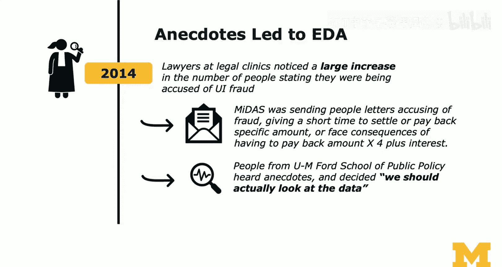
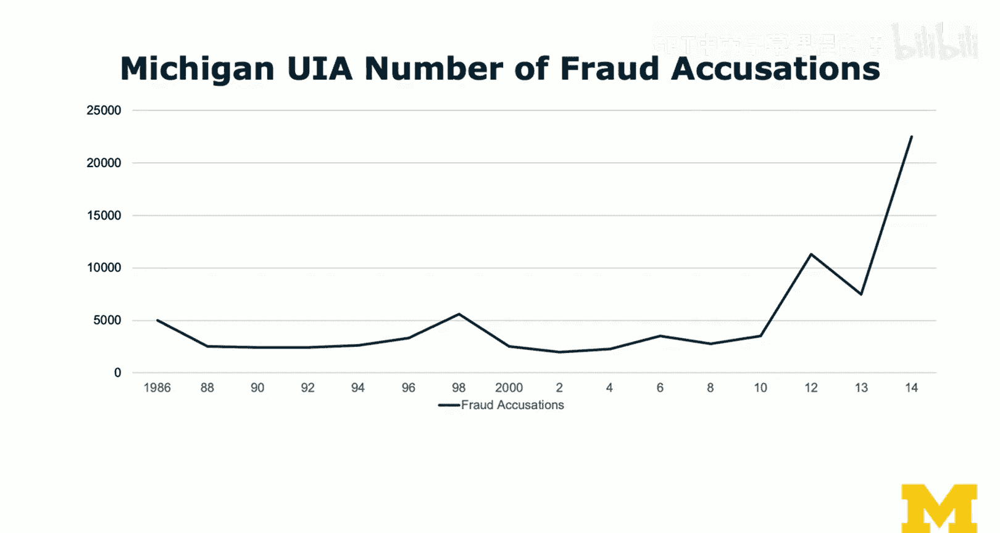
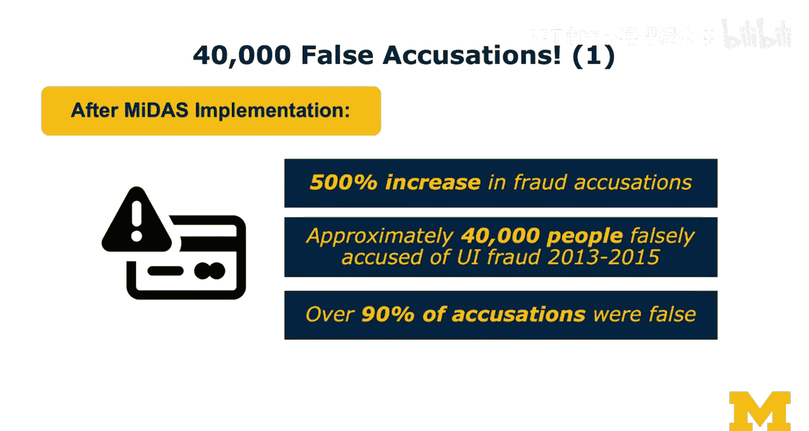
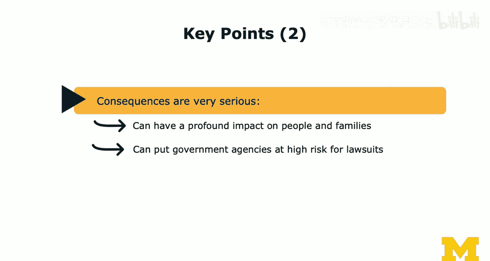

# 公共部门的R数据分析（基础、数据探索、决策支持）：8：本周补充：异常趋势EDA案例研究 📈


在本节课中，我们将通过一个来自美国密歇根州的真实案例，学习探索性数据分析在公共部门中的重要性。这个案例展示了即使是最简单的数据分析，也能揭示出行政系统中的重大问题，并对成千上万人的生活产生深远影响。

## 案例背景：密歇根州失业救济金系统

上一节我们介绍了探索性数据分析的基本概念，本节中我们来看看一个具体的应用案例。故事发生在密歇根州的失业救济保险机构。该机构的主要职责是为非因自身过错（如裁员或规模缩减）而失业的个人提供临时经济援助。公共管理的核心原则，特别是**经济性**和**效率性**，对该机构至关重要。因为失业救济金来源于向雇主征收的税款，并且管理该计划也需要公共资源，所以机构致力于尽可能避免**欺诈、浪费和滥用**。

## 新系统上线与问题初现


2013年，密歇根州像许多其他政府一样，实施了一套新的、升级的自动化政府信息和行政系统，名为**MiDAS**。MiDAS系统整合了失业救济保险机构的各项工作，包括向雇主征税、评估申请人的资格以及向受益人支付索赔。MiDAS使用多种不同的程序和算法来处理诸多事务，其中就包括标记潜在的欺诈案件。

2014年，就在新的MiDAS系统上线后不久，全州各公共援助法律诊所的律师们开始注意到，声称被州政府指控或判定犯有失业救济保险欺诈的人数有所增加。MiDAS系统向正在领取失业救济金的人们发出了大量信件，指控他们存在欺诈行为。这些信件还给出了非常短的期限，要求他们要么对指控提出上诉，要么偿还所谓的“欺诈”款项，否则将被处以**四倍于被指控金额的罚款**。当时出现了许多传闻和担忧。

## 数据探索揭示惊人趋势

直到密歇根大学的一些同事听说了此事，并决定查看数据以了解实际情况。他们与州政府的工作人员合作，获取了一些数据，并进行了非常简单的探索性数据分析。

以下是分析的核心结果，通过一个极其简单的图表展示：

```r
# 伪代码：绘制年度欺诈指控数量趋势图
plot(fraud_accusations ~ year, data = michigan_data, type = "l", main = "失业救济保险欺诈指控数量年度趋势")
```

图表清晰地显示，从2013年到2015年，欺诈指控的数量急剧上升，而这恰好与切换到新的MiDAS行政信息系统的时间点完全吻合。

## 深入分析：排除其他可能性






我们首先需要考虑导致这种趋势的可能原因。例如，是否同时期失业案件数量本身也在激增？然而，另一张简单的图表显示，自2010年以来，包括2013年至2015年在内，全州的失业率一直在稳步下降。因此，失业救济金申请数量的增加并不是驱动欺诈指控激增的原因。

更广泛的探索性数据分析揭示，在新的MiDAS系统投入使用后，欺诈指控数量增加了**500%**。在2013年至2015年间，这导致该州有**40，000人**被错误地指控犯有失业救济保险欺诈，这个数字占到了指控总数的**90%**。

## 问题根源：算法缺陷


显然，用于识别欺诈的算法存在问题。由于该算法未公开，我们无法确切知道其中具体出了什么问题。但一种普遍的看法是，过去仅作为需要进一步调查的“警示信号”（例如某人是否是主动辞职而非被裁员），在新算法中被直接当作了欺诈的证据。



目前，州政府无人对此事发表评论，因为一场由众多受害者提起的集体诉讼正在进行中，尚未解决。

## 案例启示与经验教训

尽管如此，这个事件已经为我们提供了一些关键的经验教训：

首先，这是对政府自动化行政数据系统的一个深刻警示。算法及其协议需要经过非常谨慎的设计和测试。


其次，数据分析应用于寻找新系统测试和实施时发生的任何变化或异常。这种探索性数据分析应该是持续进行的，例如每周、每两周或每月一次，以便在新系统上线时及时发现问题，而不是等待年度数据来发现系统故障。

第三，正如本案例所表明的，数据系统的问题会对个人及其家庭产生深远影响。在本案中，许多人因害怕复合罚款，向州政府偿还了他们本不欠的数千美元；同时，应得福利的人却没有收到。这些问题不仅影响了真实的人和家庭，造成了严重的困难，也使政府面临极高的诉讼风险。

最后，持续性的探索性数据分析及其可视化对于所有行政职能都至关重要。而草率的设计和误用可能会对这些职能产生严重的负面影响。

## 总结




本节课中，我们一起学习了探索性数据分析在公共部门中的一个关键应用案例。通过分析密歇根州失业救济系统在引入新自动化系统后的数据，我们看到了一个简单的趋势图如何揭示出严重的系统缺陷和算法问题，这些问题导致了大规模的错误指控，并对民众生活造成了实质伤害。这个案例强有力地证明了，持续、简单的数据探索是保障公共行政系统公平、高效运行不可或缺的工具。